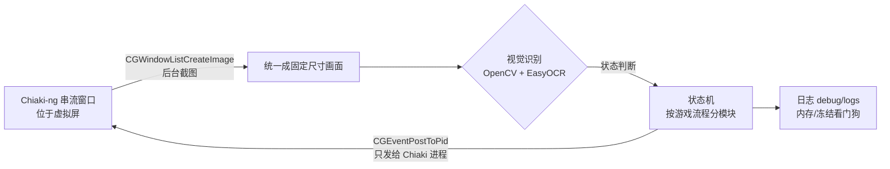

> 一句话概括：PS5 用 Chiaki-ng 串流到 Mac，Python 只"看"串流窗口的画面（OpenCV + EasyOCR），再把按键直接发给 Chiaki 进程。本文把**所有游戏项目共用的部分**一次讲清楚：Chiaki-ng 安装与注册、按键映射、多账号、PS5 设置、BetterDisplay 虚拟屏、Python 环境与权限、后台截图发键的底层，以及一套通用的视觉判断方法。
>
> 各游戏的具体实战只写游戏本身的内容，环境部分直接引用本文：
> - [龙信2：异界石自动送礼](/2026/11/05/ps5-dd2-rift-bot.html)
> - [影之刃零：饰品属性无限叠加](/2026/11/06/ps5-pbz-accessory-bot.html)

**本文结构**

1. 整体架构
2. 软件与 Python 环境
3. Chiaki-ng：安装、注册与 Base64 Account ID
4. Chiaki-ng：按键映射与串流菜单
5. 多账号：一号一节点
6. PS5 端设置（含"只断外网、保留局域网"）
7. BetterDisplay 虚拟屏：挂机和办公互不打扰
8. 后台截图 + 后台发键：底层实现与三个大坑
9. 通用视觉判断方法
10. 运行、停止与日志
11. 新项目检查清单

> ⚠️ 声明：本文只用于单机内容的学习与研究。用自动化操作远程游玩可能不符合平台或游戏的使用条款，请自行评估账号风险；长时间挂机注意主机和电脑散热。

---

## 1. 整体架构



关键点只有两个：

- **截图只截 Chiaki 窗口**（被遮挡也能截）；
- **按键只发给 Chiaki 进程**（不经过前台窗口）。

所以脚本跑起来以后，Mac 仍然可以正常办公，键盘鼠标完全不受影响。

---

## 2. 软件与 Python 环境

### 2.1 软件清单

| 软件 | 用途 | 官网 / 下载 |
|---|---|---|
| macOS（推荐 Apple Silicon） | 运行一切；EasyOCR 可用 MPS(GPU) 加速 | — |
| PS5 | 被控端，开启"远程游玩" | 设置 → 系统 → 远程游玩 |
| **Chiaki-ng** | 开源 PS 远程游玩客户端，键盘可映射手柄 | https://github.com/streetpea/chiaki-ng/releases |
| **BetterDisplay** | 创建虚拟显示器，Chiaki 放上去挂机 | https://github.com/waydabber/BetterDisplay |
| Python 3.10~3.12 | 运行脚本 | https://www.python.org/downloads/macos/ |
| PyCharm（可选） | 编辑调试 | https://www.jetbrains.com/pycharm/ |

### 2.2 Python 库

| 库 | 用途 |
|---|---|
| opencv-python | 模板匹配、HSV 颜色分割、连通域 |
| numpy | 图像数组运算 |
| easyocr | 中英文 OCR（菜单、名字、数字） |
| torch | EasyOCR 的推理后端（Mac 上走 MPS） |
| pyobjc-framework-Quartz / Cocoa | 后台截图 + 给指定进程发按键 |

建议用虚拟环境：

```bash
python3 -m venv ~/venv
~/venv/bin/pip install opencv-python numpy easyocr torch pyobjc-framework-Quartz pyobjc-framework-Cocoa
```

**EasyOCR 模型**：第一次运行会自动下载到 `~/.EasyOCR`。网络不好可以手动下载 `craft_mlt_25k.pth`（文字检测）和 `zh_sim_g2.pth`（简体中文识别），放到项目的 `assets/easyocr/` 里，脚本优先从这里读并关闭联网下载。模型下载页：https://www.jaided.ai/easyocr/modelhub/

### 2.3 macOS 权限（必做，否则截图全黑或按键无效）

系统设置 → 隐私与安全性：

- **屏幕录制**：勾选运行脚本的程序（"终端"或 PyCharm）。没有这个权限，截到的是黑图或只有桌面背景。
- **辅助功能**：同样勾选。给其他进程发按键需要它。

改完权限要**重启终端 / PyCharm** 才生效。

---

## 3. Chiaki-ng：安装、注册与 Base64 Account ID

### 3.1 Chiaki-ng 是什么

Chiaki-ng（前身 chiaki4deck）是免费开源的 PS4/PS5 远程游玩第三方客户端，脱胎于原项目 Chiaki（作者 thestr4ng3）。原项目停更后，由 StreetPeanut 及社区重构扩展，最初为 Steam Deck 优化，后来更名为 Chiaki-ng（Next Generation）。

相比官方 Remote Play，它支持 HDR、DualSense 触觉反馈与自适应扳机、**自定义键盘映射**和更细的码率控制。对自动化来说，最关键的是**键盘映射**：脚本只要发键盘事件，就等于在按手柄。

下载：https://github.com/streetpea/chiaki-ng/releases

### 3.2 两个概念：NPSSO 与 b64_id

1. **NPSSO**（Network PlayStation Single Sign-On）：索尼的单点登录令牌，相当于你在网页登录 PSN 后拿到的"临时通行证"，通常是 64 位字母数字，有效期约 2 个月。**它等同于你的登录凭证，绝对不要发给别人或贴到网上。**
2. **b64_id**（Base64 Account ID）：每个 PSN 账号有一个全球唯一的 64 位（8 字节）数字 Account ID。Chiaki-ng 注册主机时要求填它的 **Base64 编码**。

官方客户端通过 OAuth 在后台自动完成鉴权和 ID 交换，所以从不向用户展示这串 ID；第三方客户端只能让用户自己拿到并填进去。

> 新版 Chiaki-ng 的注册界面如果提供了 PSN 登录自动获取 Account ID 的选项，优先用它；下面是手动方法，不依赖任何第三方转换网站。

### 3.3 手动获取 b64_id

**步骤 1：拿到 NPSSO**

1. 打开浏览器的**无痕/隐私窗口**（避免大小号 Cookie 串号）。
2. 访问 https://www.playstation.com ，登录要绑定的 PSN 账号。
3. 在同一个无痕窗口访问：`https://ca.account.sony.com/api/v1/ssocookie`
4. 页面只有一行 `{"npsso":"……"}`，复制引号里的那串字符。

**步骤 2：安装 PSNAWP**

PSNAWP（PlayStation Network API Wrapper for Python）是封装 PSN 非公开 API 的第三方库，提供 NPSSO 后可以查询账号信息。

```bash
pip3 install psnawp
```

**步骤 3：计算小端序 Base64 ID**

技术陷阱：Chiaki-ng 要求 8 字节 **小端序（little-endian）**。用错字节序，注册时会报 `0x80108b02`（Invalid PSN ID）。

把下面代码里的两处占位符换成你自己的，保存成 `get_b64_id.py` 后运行 `python3 get_b64_id.py`：

```python
import base64
from psnawp_api import PSNAWP

npsso = "在这里填你的NPSSO"          # ← 步骤 1 复制的值，不要分享给任何人
online_id = "在这里填你的PSN在线ID"   # ← 你的 PSN ID

try:
    psnawp = PSNAWP(npsso)
    user = psnawp.user(online_id=online_id)
    account_id_int = int(user.account_id)
    b64_id = base64.b64encode(account_id_int.to_bytes(8, 'little')).decode('utf-8')
    print("小端序 Base64 Account ID：", b64_id)
except Exception as e:
    print("获取失败：", e)
```

> 为什么建议存成文件运行，而不是粘进 `python3` 交互环境？交互环境里，缩进块中间如果有一个完全空白的行，解释器会认为 `try:` 已经结束，下一行就报 `unexpected indent`，`except` 也会因找不到配对的 `try` 报语法错误。

这一行做了三件事：

- `.to_bytes(8, 'little')`：把整数 ID 转成 8 字节小端序二进制；
- `base64.b64encode(...)`：把二进制转成可输入的 Base64 文本（含 `+`、`/`、`=`）；
- `.decode('utf-8')`：把 bytes 转成普通字符串，方便复制。

### 3.4 PS5 端生成 PIN

1. PS5 上**登录要绑定的那个账号**；
2. 设置 → 系统 → 远程游玩 → **关联设备**；
3. 屏幕显示 8 位 PIN，约 5 分钟有效，过期重新获取。

### 3.5 Chiaki-ng 注册

1. 右上角 **Add Manual Host**，填 PS5 的 IP；
2. **PSN Account-ID**：填算出的 Base64（包括末尾的 `=`）；
3. **Remote Play PIN**：填 PS5 上的 8 位 PIN；
4. **Console Pin [Optional]**：PS5 的 4 位开机锁屏密码，没设就留空；
5. 选择 PS5，点 **Register**。

| 错误现象 | 原因 | 解决 |
|---|---|---|
| `0x80108b02`（Invalid PSN ID） | 账号不匹配，或字节序错误 | 确认算 ID 的账号就是 PS5 当前登录的账号；确认用的是 `little` |
| 注册成功但列表没出现新图标 | 同 IP 的多个账号节点可能被折叠显示 | 删除旧记录后重试，或直接双击现有图标测试连接 |

---

## 4. Chiaki-ng：按键映射与串流菜单

### 4.1 键盘映射

Chiaki-ng → Settings → Keys。我的所有项目都用同一套映射，脚本按这张表发键；你的映射不同，就改脚本顶部的按键常量。

| 手柄 | 键盘 |
|---|---|
| ✕ | `/` |
| ○ | `'` |
| □ | `;` |
| △ | `[` |
| 十字键 上/下/左/右 | `I` / `K` / `J` / `L` |
| L1 / R1 | `Q` / `E` |
| L2 / R2 | `Tab` / `R` |
| 触摸板 | `T` |
| OPTIONS | `O` |
| 左摇杆 | `W A S D` |
| 右摇杆 | `↑ ↓ ← →` |

> 键盘是"数字量"：摇杆要么推到底、要么不推，没有半推。需要控制镜头转多少的游戏，就得靠"按多久"来控制，并做一次转向标定（见龙信2篇）。

### 4.2 小心 Chiaki-ng 自己的串流菜单

按 **⌘O**（Windows/Linux 是 Ctrl+O）或手柄 **L1+R1+L3+R3** 会在画面底部弹出串流菜单：音量、Mic、Zoom、Stretch、画质预设、Display，右下角是码率、连接地址和丢帧数。菜单开着时，**键盘输入全部被菜单接走，游戏收不到任何按键**；再按一次 ⌘O 关闭。

脚本是怎么"不小心"按出它的，见第 8.3 节。

### 4.3 窗口不能最小化

macOS 对被最小化、被**完全**盖住、在别的桌面（Space）或显示器睡眠时的窗口**停止重绘**，截图会拿到一张"冻结"的旧画面。解决方法见第 7 节虚拟屏。

---

## 5. 多账号：一号一节点

### 5.1 一个很迷惑的故障

用账号 A（比如小号）连接 Chiaki，进系统后手动切换到账号 B（比如大号）启动游戏。结果：

- 主菜单里一切正常；
- **一进游戏，方向键、动作键全部失效**；
- 但 PS 键和 OPTIONS 键还能呼出菜单；
- 全程**没有任何报错**。

很容易误以为是网络延迟、Chiaki Bug、脚本冲突或手柄坏了。

### 5.2 原因：账号与控制器绑定

1. 用账号 A 的 Account ID 连接时，PS5 生成的是**属于账号 A 的虚拟控制器**；
2. 切到账号 B 开游戏，游戏进程属于账号 B，而控制器属于账号 A；
3. 系统保留 A 控制器在**系统层**的导航权限（所以 PS 键、OPTIONS 能用，方便你切回去），但不允许它操作**属于 B 的游戏**。

### 5.3 解决与原则

- 用大号的 Account ID 和 PIN，**在 Chiaki 里再注册一个节点**。之后想用哪个号玩，就双击哪个号的节点连接。
- **不要**在串流中途跨账号控制游戏。要换号：先断开 Chiaki → 选目标账号的节点 → 重新连接。
- 跑脚本前，确认当前 Chiaki 节点和游戏运行的账号一致，否则脚本进游戏后会因按键失灵而卡死。

---

## 6. PS5 端设置

### 6.1 通用

- 设置 → 系统 → 远程游玩：**启用**；
- 设置 → 系统 → 节能 → 待机模式中可用的功能：打开"保持连接网络""从网络启用 PS5"；
- 设置 → 系统 → 远程游玩：打开**"隐藏远程游玩连接状态弹出通知"**。串流刚连上时顶部会弹通知，正好盖住画面顶部的 UI 文字，脚本会误判状态。

### 6.2 可选：只断外网、保留局域网

**适用场景**：利用游戏 BUG 的项目，希望 PS5 停在当前版本（游戏一检测到新版本就必须先更新才能启动）。

**思路**：PS5 还连着路由器（局域网通，Chiaki 能直连），但查不到任何网址（外网不通）。

> ⚠️ 不要直接在 PS5 上"断开网络"，那样局域网也断了，Chiaki 连不上。

联网状态下先做好：

1. 设置 → 保存数据和游戏/应用程序 → 自动更新：关闭自动下载、自动安装；
2. 设置 → 用户和账户 → 其他 → **主机共享和离线游玩：启用**（数字版离线验证授权要靠它）；
3. **先用 Chiaki 完成注册并成功连一次**。

然后：PS5 设置 → 网络 → 设置 → 设置互联网连接 → 选中当前连接 → 高级设定（下面是示例值，按你家的网段改）：

| 项目 | 示例值 | 说明 |
|---|---|---|
| IP 地址设定 | 手动 | |
| IPv4 地址 | 192.168.1.200 | 同网段里没人用的地址 |
| 子网掩码 | 255.255.255.0 | 照抄 Mac 的 |
| 默认网关 | 192.168.1.1 | 真实路由器地址 |
| 首选 DNS / 备用 DNS | **0.0.0.0** / 0.0.0.0 | 关键：查不到任何网址 |

测试网络连接："能获取 IP 地址、互联网连接失败"就对了。

**临时恢复联网**：把首选 DNS 改成路由器地址或公共 DNS（如 `223.5.5.5`），改回 `0.0.0.0` 就又断了。联网期间不要启动游戏，下载队列里出现游戏更新直接删掉。

---

## 7. BetterDisplay 虚拟屏：挂机和办公互不打扰

### 7.1 为什么需要

Chiaki 放在主屏，办公时窗口总会被盖住 → 画面冻结 → 脚本以为卡住，或者把 Chiaki 调到前台抢走你的焦点。

虚拟屏是一块"看不见的显示器"，Chiaki 单独待在上面。系统认为它"可见"，会一直绘制；你在真实屏幕上怎么盖窗口、切桌面都不影响。

### 7.2 创建

BetterDisplay 菜单栏图标 → **Create New Virtual Screen**：

| 设置 | 取值 | 原因 |
|---|---|---|
| 宽高比 | **16:9** | 和 PS5 输出一致，没有黑边 |
| 分辨率 | 2880×1620 或 2560×1440（HiDPI） | 脚本会统一缩放成固定尺寸再识别；太小（视频宽 < 1600）文字识别会变差，太大截图慢、吃内存 |
| HDR | **关** | HDR 改变颜色和亮度，阈值会失效 |

### 7.3 把 Chiaki 放上去

1. 系统设置 → 桌面与程序坞 → 打开 **"显示器具有单独的空间"**；
2. 在 BetterDisplay 里临时把虚拟屏设为**镜像**，把 Chiaki 拖过去再取消镜像；或开虚拟屏的**画中画**预览确认位置；
3. 在虚拟屏上让 Chiaki **全屏**；
4. 系统设置 → 显示器 → 排列：把虚拟屏拖到主屏的**斜对角**，只碰一个角，避免鼠标不小心滑到虚拟屏上；
5. 脚本启动时打印 Chiaki 所在屏幕的名字、是否虚拟屏、分辨率，确认即可。

### 7.4 防止睡眠

启动脚本用 `caffeinate -dims` 包住 Python：挂机期间显示器、磁盘、系统都不睡眠（睡眠/锁屏也会让画面冻结）。

---

## 8. 后台截图 + 后台发键：底层实现与三个大坑

### 8.1 原理

- **截图**：用 `Quartz.CGWindowListCreateImage` 按**窗口 ID** 截 Chiaki 窗口，不管它在哪块屏、是否被遮挡（只要没最小化）。
- **发键**：用 `Quartz.CGEventCreateKeyboardEvent` 创建按键事件，`Quartz.CGEventPostToPid` **只发给 Chiaki 进程**，不经过前台，不影响你正在用的程序。
- **画面统一**：截到的窗口可能带标题栏、黑边，先找出 16:9 视频区域，再缩放到固定尺寸（我用 2880×1620，上下补黑边到 2880×1800）。所有识别区域都用**比例坐标**写，窗口大小、虚拟屏分辨率怎么变都不用重标定。

### 8.2 大坑一：内存涨到 92GB

pyobjc 调 Quartz 得到的 Objective-C 对象靠**自动释放池**回收，普通 Python `while` 循环里没有释放池，每张截图都不归还内存。一张截图十几 MB，一秒几张，几十分钟就能吃掉几十 GB，最后系统弹出"强制退出"。

```python
import objc
_pool = objc.autorelease_pool

def capture_raw(self):
    with _pool():   # 截图对象在这里用完立即释放
        img = Quartz.CGWindowListCreateImage(...)
        data = Quartz.CGDataProviderCopyData(Quartz.CGImageGetDataProvider(img))
        buf = np.frombuffer(data, np.uint8)            # 不要 bytes() 整块复制
        arr = buf.reshape((h, bpr // 4, 4))[:, :w, :3]
        out = np.ascontiguousarray(arr)                # 只复制一次需要的部分
        del arr, buf, data, img
        return out
```

- **凡是调 Quartz/AppKit 的地方都包在 `objc.autorelease_pool()` 里**；
- 每轮循环 `gc.collect()` + `torch.mps.empty_cache()`；
- 日志打印内存占用，超 6GB 警告、超 12GB 安全停止——给长时间运行的程序装一根"保险丝"。

### 8.3 大坑二：发出去的 `o` 变成了 ⌘O

用 `kCGEventSourceStateHIDSystemState` 创建的按键事件，会带上**你当时在 Mac 上实际按着的修饰键**。挂机时你正好在别处按着 ⌘（⌘C、⌘Tab），脚本发的 `o` 就变成 **⌘O**（打开串流菜单，之后所有按键进不了游戏），`q` 会变成 **⌘Q**（直接退出 Chiaki）。

```python
src = Quartz.CGEventSourceCreate(Quartz.kCGEventSourceStateHIDSystemState)
ev = Quartz.CGEventCreateKeyboardEvent(src, code, bool(down))
Quartz.CGEventSetFlags(ev, 0)          # 清掉 ⌘/⌥/⌃/⇧，永远发"裸键"
Quartz.CGEventPostToPid(pid, ev)
```

另外再加一道保险：用 OCR 识别画面底部是否出现了串流菜单，出现就自己发 ⌘O 关掉。

### 8.4 大坑三：某个键间歇性"失灵"

现象：其他键都正常，只有某一个键（我遇到过 □、○）按了没反应，补发松开事件、松开所有键都没用，重启脚本过几分钟又好了。目前原因还没定论（可能在 PS5/游戏侧）。通用做法：

- 每次按下前先补发一次松开，脚本退出时在 `finally` 里松开所有键；
- 按完**检查画面有没有变化**，没变化重试几次；
- 仍不行就退回安全状态，按 60/120/240/480 秒逐步等待再试，长时间不恢复才停止，并在日志里记录等了多久。

### 8.5 冻结看门狗

发出按键后画面长时间纹丝不动（比如 8 秒）→ 判定冻结，原地等待恢复（设上限），恢复后本轮作废、从头再来。

---

## 9. 通用视觉判断方法

### 9.1 四条原则

1. **看到结果再走下一步**，不用固定 sleep。每个动作后都有"完成判据"，轮询 + 超时。
2. **判断状态用固定位置的 UI 文字/图标**，而不是 3D 场景；并且用"**只有这个状态才有**"的特征来区分相似界面。
3. **看不清就不按 ✕**。识别函数要能返回"不确定"，宁可多等一轮。
4. **每种界面都有回家的路**：认不出的界面先退回游戏画面；连续多轮没有进展就停止，不让它空转一晚上。

### 9.2 常用工具

| 方法 | 用在哪 | 要点 |
|---|---|---|
| Canny 模板匹配 | 固定样式的提示框、按钮 | 半分辨率粗搜 + 全分辨率精修；用边缘不用灰度，抗半透明背景 |
| 稳定性校验 | 一闪而过的提示 | 连续 3 次、间隔 0.15s 都在、位置漂移很小才算出现 |
| EasyOCR + 模糊匹配 | 菜单项、名字、数字 | 关键词拆成多个片段，`difflib` 相似度；建立"常见误读表"统一归一 |
| 菜单高亮判断 | 光标在哪一行 | 依次用亮度 → 饱和度 → 按键前后变化量；背后有发光物时亮度会失效，饱和度更稳 |
| 右对齐数字读取 | 金额、资源数 | 数字变长会往左长，不要用固定读数框；按列找字符块从右往左合并，读多次取多数 |

### 9.3 OCR 常见误读（中文界面）

| 原文 | 常被读成 |
|---|---|
| ✕ 图标 | 囚、& |
| ✦ 图标 | 4、#、+ |
| · | '、. |
| 已 | 己 |

---

## 10. 运行、停止与日志

### 10.1 项目目录约定

```text
GameName/
├── xxx_bot_vN.py           # 主脚本（最新版）
├── run_vN.command          # 双击：正式挂机
├── run_vN_menu.command     # 双击：菜单选模式（单模块测试）
├── run_vN_diagnose.command # 双击：截一帧打印全部检测结果
├── stop_bot.command        # 双击：安全停止
├── reference/              # 按流程编号的参考截图 + README
├── assets/easyocr/         # OCR 模型
└── debug/logs/             # 每次运行的完整日志
```

### 10.2 启动与停止脚本

```bash
#!/bin/bash
# run_vN.command：双击启动
cd "$(dirname "$0")" || exit 1
PY="$HOME/venv/bin/python"          # ← 改成你的 Python
"$PY" -c "import Quartz, AppKit" 2>/dev/null || "$PY" -m pip install -q pyobjc-framework-Quartz pyobjc-framework-Cocoa
caffeinate -dims "$PY" -u xxx_bot_vN.py --mode 0
```

```bash
#!/bin/bash
# stop_bot.command：新建 STOP 文件，脚本下一步检测到就松开所有键并退出
cd "$(dirname "$0")" && touch STOP && echo "已发出停止信号" && sleep 2
```

新建的 `.command` 要先 `chmod +x *.command` 才能双击运行。后台模式下鼠标不动，pyautogui 的"甩鼠标到角落"急停不适用，所以用 STOP 文件。

### 10.3 日志

- 终端输出同时写入 `debug/logs/`，保留最近 30 份；
- 每轮打印内存占用；
- 看不清的画面存截图到 `debug/`，方便事后对照。

出问题时，完整日志里的得分、坐标、OCR 结果比截图更有用。

### 10.4 散热

Chiaki 持续解码 + 脚本持续截图跑 OCR，长时间挂机 Mac 会明显发热。可以把串流帧率降到 30fps、分辨率 1080p、确认用硬件解码；电脑放在硬质平面上通风。**闻到焦味或塑料味，先停掉挂机。**

---

## 11. 新项目检查清单

- [ ] Chiaki-ng 节点对应的账号 = 游戏运行的账号
- [ ] 按键映射与脚本常量一致
- [ ] PS5 隐藏了远程游玩连接通知
- [ ] Chiaki 在虚拟屏上全屏，HDR 关
- [ ] 终端/PyCharm 有屏幕录制 + 辅助功能权限
- [ ] 先跑 diagnose 模式，确认截图、OCR 正常
- [ ] 按流程截好参考图（`reference/00_…`），每个界面写清：看到什么 → 怎么确认是它 → 按什么 → 按完怎么确认成功
- [ ] 每种界面都有退出方法，连续无进展会自动停止
