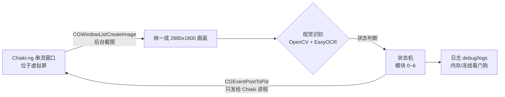

> 一句话概括：PS5 用 Chiaki-ng 串流到 Mac，Python 只"看"串流窗口的画面（OpenCV + EasyOCR），再把按键直接发给 Chiaki 进程，让《龙之信条2》在异界石里**自动召唤自己的随从 → 雇佣 → 解雇送礼 → 跑出边界重置**，循环 50 轮（同一个随从一次最多收 50 件礼物，这是我实测出来的上限，见第 8 节）。全程后台运行，Chiaki 放在一块 BetterDisplay 虚拟屏上，真实屏幕照常办公。

> 🎮 测试环境：PS5 Pro，《龙之信条2》游戏版本 4.200.000。其他版本的界面、文字位置可能不同，模板和区域需要重新确认。

**本文结构**

1. 效果与整体架构
2. 软件与库的准备（附官网下载地址）
3. Chiaki-ng 配置与按键映射
4. BetterDisplay 虚拟屏：挂机和办公互不打扰
5. 游戏内设置：视角左右灵敏度与转向标定
6. 自动化整体思路与注意事项
7. 视觉控制难题是怎么解决的（找人、寻路、找异界石、利用符文"抽象画"数漩涡臂、菜单光标、认人）
8. 踩坑全记录（含 92GB 内存那次，以及 v16~v18"多加判断条件"）
9. 完整代码 v28（代码单独成文件；先看"需要自己修改的地方"）
10. 人机协作的思考：怎么高效地告诉 AI 写代码，以及未来展望
11. 经验总结：可以复用到下一个项目的东西

> ⚠️ 声明：本文只用于单机内容（自己账号的随从互送礼物）的学习与研究。串流和自动化操作请自行评估风险，长时间挂机注意主机散热。

---

## 1. 效果与整体架构

**一轮完整闭环**（日志里记作"第 N 次送礼闭环达成"）：

1. 在野外找到异界石，长按【调查】进石；
2. 打开异界石菜单 → 查找追随者 → 特别关注的追随者 → 召唤目标随从（自动识别大号/小号随从，例如我的 Polay / PYL）；
3. 在石内找到这个随从，走过去打招呼 → 雇佣；
4. 再找到它 → 解雇 → 送礼（按预设优先级挑礼物）；
5. 跑出异界石边界，弹窗选"是"离开，回到第 1 步。



关键点只有两个：**截图只截 Chiaki 窗口**（被遮挡也能截）、**按键只发给 Chiaki 进程**（不经过前台），所以脚本跑起来以后 Mac 仍然可以正常用，键盘鼠标完全不受影响。

---

## 2. 软件与库的准备

### 2.1 软件清单

| 软件 | 用途 | 官网 / 下载 |
|---|---|---|
| macOS（Apple Silicon 推荐） | 运行一切；EasyOCR 可用 MPS(GPU) 加速 | — |
| PS5 + 《龙之信条2》 | 被控端，开启"远程游玩" | PS5：设置 → 系统 → 远程游玩 |
| **Chiaki-ng** | 开源 PS 远程游玩客户端，键盘可映射手柄 | GitHub：https://github.com/streetpea/chiaki-ng ，文档：https://streetpea.github.io/chiaki-ng/ |
| **BetterDisplay** | 创建虚拟显示器，Chiaki 放上去挂机 | https://github.com/waydabber/BetterDisplay |
| Python 3.10~3.12 | 运行脚本 | https://www.python.org/downloads/macos/ |
| PyCharm（可选） | 编辑调试 | https://www.jetbrains.com/pycharm/ |
| Homebrew（可选） | 装命令行工具 | https://brew.sh |

### 2.2 Python 库

| 库 | 用途 | 官网 |
|---|---|---|
| opencv-python | 模板匹配、HSV 颜色分割、连通域、极坐标变换 | https://pypi.org/project/opencv-python/ |
| numpy | 图像数组运算 | https://numpy.org |
| easyocr | 中英文 OCR（菜单、名牌、礼物名） | https://github.com/JaidedAI/EasyOCR |
| torch | EasyOCR 的推理后端（Mac 上走 MPS） | https://pytorch.org/get-started/locally/ |
| pyobjc-framework-Quartz / Cocoa | 后台截图 + 给指定进程发按键 | https://pyobjc.readthedocs.io/ |

建议用虚拟环境（我的是 `~/venv`）：

```bash
python3 -m venv ~/venv
~/venv/bin/pip install opencv-python numpy easyocr torch pyobjc-framework-Quartz pyobjc-framework-Cocoa
```

**EasyOCR 模型**：第一次运行会自动下载到 `~/.EasyOCR`。网络不好可以手动下载 `craft_mlt_25k.pth`（文字检测）和 `zh_sim_g2.pth`（简体中文识别）放到项目的 `assets/easyocr/` 里，脚本会优先从这里读，并且关闭联网下载。模型下载页：https://www.jaided.ai/easyocr/modelhub/

> 早期我用过 YOLO 训练数据集来识别随从，后来发现**纯规则视觉（颜色 + 几何 + OCR）就够了**，而且不用标注数据、调参可解释，YOLO 那套最后全部删除。

### 2.3 macOS 权限（必做，否则截图全黑或按键无效）

系统设置 → 隐私与安全性：

- **屏幕录制**：勾选运行脚本的程序（"终端"或 PyCharm）。没有这个权限，`CGWindowListCreateImage` 截到的是黑图或只有桌面背景。
- **辅助功能**：同样勾选"终端"/PyCharm。`CGEventPostToPid` 给其他进程发按键需要它。

改完权限要**重启终端 / PyCharm** 才生效。

### 2.4 项目目录

```text
DragonsDogma2/
├── dd2_rift_bot_v28.py          # 主脚本（最新版，v28）
├── run_v28.command              # 双击：50 轮自动挂机
├── run_v28_menu.command         # 双击：菜单选模式（单模块测试/标定）
├── run_v28_diagnose.command     # 双击：截一帧打印所有检测结果
├── stop_bot.command             # 双击：安全停止
├── reference/                   # 按流程顺序编号的界面截图（00~11），给 AI 看的"说明书"，见第 10 节
├── assets/
│   ├── templates/               # UI_O_pawn.jpg / UI_O_riftstone.jpg / UI_Exit_the_Rift.jpg（自己裁）
│   ├── calibration/             # UI_map_ref_patch.png + map_calib.json（模式 8 生成）
│   └── easyocr/                 # craft_mlt_25k.pth / zh_sim_g2.pth
├── debug/logs/                  # 每次运行的完整日志（自动保留最近 30 份）
├── tools/                       # 遮挡/冻结排查小工具
└── history/                     # 只保留最近 3 个历史版本
```

---

## 3. Chiaki-ng 配置与按键映射

Chiaki-ng 的安装、PS5 注册（PSN 登录、主机注册 PIN）、串流画质等基础配置，我在上一篇里写过，这里不重复：

👉 **上一篇：** [基础篇：Chiaki-ng 串流、虚拟屏与视觉识别通用配置](/2026/11/04/ps5-chiaki-mac-automation-basics.html)

本项目额外要求的只有两点：

**① 键盘映射**（Chiaki-ng → Settings → Keys）。脚本里所有按键都按这张表发，你的映射不一样就改脚本里对应的按键名：

| 手柄 | 键盘 | 脚本里的用途 |
|---|---|---|
| ✕ | `/` | 确认、对话快进 |
| ○ | `'` | 交互/长按【调查】【打招呼】、取消 |
| 十字键 上/下/左/右 | `I` / `K` / `J` / `L` | 菜单移动、礼物翻页 |
| L1 / R1 | `Q` / `E` | 地图里光标跳转到"返回的基石" |
| L2 | `Tab` | 拔刀 |
| 触摸板 | `T` | 打开地图 |
| 左摇杆 | `W A S D` | 移动 |
| 右摇杆 左/右 | `←` / `→` | **转镜头**（键盘是"数字量"，只有按/不按，所以灵敏度很关键，见第 5 节） |
| 右摇杆 上/下 | `↑` / `↓` | v21 起用于**上下调镜头**：名牌太靠上/下时拉回画面中部 |
| OPTIONS（三横线） | `O` | v24 起用于打开**暂停菜单**，读左下角队伍卡片，确认目标随从是否还在队伍里 |
| △ | `[` | 和 L1 组合放突进技能（按你自己职业的技能改） |

> 注意：串流里"按键时长"就是"摇杆推到底的时长"，没有半推。镜头转多少完全靠按多久，这就是后面要做"转向标定"的原因。

**② 窗口模式 / 全屏都可以，但不能最小化。** macOS 对被最小化、被**完全**盖住、在别的桌面（Space）或显示器睡眠时的窗口**停止重绘**，截图会拿到一张"冻结"的旧画面。解决方法就是下一节的虚拟屏。

---

## 4. BetterDisplay 虚拟屏：挂机和办公互不打扰

### 4.1 为什么需要虚拟屏

最开始我让 Chiaki 窗口留在主屏、只要求"别被完全挡住"。实际办公时窗口总会被盖住 → 画面冻结 → 脚本检测到冻结后把 Chiaki 调到前台 → **正在打字的我被抢走焦点**。

虚拟屏的思路：建一块"看不见的显示器"，Chiaki 单独待在上面。那块屏上永远只有 Chiaki，系统认为它"可见"，会一直绘制；你在真实屏幕上怎么盖窗口、切桌面都不影响。

### 4.2 创建虚拟屏（我的配置）

BetterDisplay 菜单栏图标 → **Create New Virtual Screen**：

| 设置 | 取值 | 原因 |
|---|---|---|
| 宽高比 | **16:9** | 和 PS5 输出一致，没有黑边 |
| 分辨率 | **2880 × 1620** | 我的模板全是在 2880 宽的全屏画面上裁的，像素 1:1，不缩放最准 |
| HDR | **关** | HDR 会改变颜色，HSV 阈值失效 |
| 8K 选项 | **关** | 分辨率越高截图越大、越慢、越吃内存，且模板对不上 |

> 有人会问"不是可以选更高分辨率吗？"——可以，但**模板匹配和颜色阈值都是按 2880 宽标定的**，分辨率变了要重新裁模板、重标定，收益只有"更清晰"，代价是每张截图更大、更慢。保持和模板一致最省事。

### 4.3 把 Chiaki 放到虚拟屏上

1. 系统设置 → 桌面与程序坞 → 打开 **"显示器具有单独的空间"**（Displays have separate spaces）。
2. 虚拟屏是"看不见"的，所以要先把窗口挪过去。两种方法任选：
   - BetterDisplay 里临时把虚拟屏设为**镜像**到真实屏（能看到它），把 Chiaki 拖过去，再取消镜像；
   - 或在 BetterDisplay 里对虚拟屏开启 **画中画（Picture in Picture）** 预览窗口，在预览里确认 Chiaki 已在虚拟屏上。
3. 在虚拟屏上让 Chiaki **全屏**。全屏在虚拟屏上没问题：它占的是虚拟屏的那个桌面，不会抢你真实屏的桌面。
4. 脚本启动时会在日志里打印 `Chiaki 窗口所在屏幕：名字 / 是否虚拟屏 / 分辨率`，确认一下即可。

### 4.4 防止睡眠

启动脚本用 `caffeinate -dims` 包住 Python：挂机期间显示器、磁盘、系统都不睡眠（睡眠/锁屏也会让画面冻结）。

---

## 5. 游戏内设置：视角左右灵敏度与转向标定

### 5.1 把"视角转动速度（左/右）"调到最低

游戏 → 选项 → 镜头：**视角转动速度（左/右）= 最低**。

原因：键盘控制右摇杆只有"推到底"一种力度，灵敏度高时，最短的一次按键也会转过头——对准目标时就会在目标左右来回摆（日志里看到名牌 x 坐标在 1142 ↔ 1449 之间反复跳）。调到最低后，最短一下只转约 0.015 屏宽，可以精细修正。

另外 DD2 的镜头**长按会加速**，所以"按 2 秒 = 按 1 秒 × 2"并不成立，单次转向最长只按 0.5~1.5 秒，剩下的偏差下一帧再修。

### 5.2 用"模式 10"标定转向

运行 `run_v28_menu.command`，选 **10**。脚本会分别按住 ←/→ 0.03 / 0.10 / 0.25 / 0.5 / 1.0 秒，用 ORB 特征点匹配前后两帧，算出画面水平位移，然后线性拟合给出建议值。我的实测（灵敏度最低）：

```text
0.03s→43px  0.06s→72  0.10s→84  0.15s→106  0.25s→143（2880 宽）
拟合：位移 ≈ 429px/s × 时长 + 39px → 约 6.7 秒转一屏宽，最小步长 ≈ 0.015 屏宽
```

把建议值填回脚本 `DD2RiftBot.__init__` 的"运动参数"：

```python
self.turn_sec_per_width = 6.7   # 按住方向键转过一屏宽约需秒数
self.turn_min_hold = 0.03       # 最短按键
self.turn_min_step = 0.015      # 最短按键转过的屏宽
self.turn_zone_frac = 0.08      # 偏差 > 0.08 屏宽才转镜头，以内用 W + A/D 平移修正
self.full_circle_turn_sec = 12.0  # 扫描时转一整圈约 12 秒（看日志实测）
```

**以后只要改了游戏里的转动速度，就要重跑模式 10。**

---

## 6. 自动化整体思路与注意事项

### 6.1 模块化状态机

| 模块 | 做什么 | "完成"的判据 |
|---|---|---|
| 0 | 处理"是否离开异界石"弹窗，选 是/否 | 比较"是"和"否"两行的亮度，高亮的那行就是光标所在 |
| 1 | 野外找异界石并贴脸 | 【调查】提示**稳定出现**（连续约 0.45s、位置不漂移）+ OCR 读到"调查" |
| 1B | 找不到石头 → 地图飞石传送到固定基石 | 底部提示含"返回的基石" + 光标处几何/参考图双校验 + 地图确实关闭 |
| 2 | 长按【调查】进石，菜单状态机进"特别关注的追随者"，召唤 | 顶部出现【基础信息】才算进石；列表里 OCR 找到目标所在行 |
| 3 | 石内找随从、走过去、打招呼 | 【打招呼】模板稳定 |
| 4 | 雇佣 | 说话前先认名牌；雇佣面板加载完成且 OCR 含目标关键词 → **确认光标高亮在【雇佣】** 再按 ✕ → 回到石内确认循环 |
| 5 | 解雇 + 送礼 | 菜单里有【解雇】才算已雇佣菜单 → 高亮移到【解雇】→ 礼物名 OCR 命中预设 → 确认框高亮在【是】→ 回到石内确认循环 |
| 6 | 跑出边界重置 | 边界弹窗出现并选"是"，【基础信息】消失 |

### 6.2 三条核心原则

1. **每一步都要"看到结果"再走下一步，不要"按完固定等 N 秒"。** 加载快慢、对话句数、网络延迟都不固定。我前期大部分 bug 都来自固定等待。
2. **判断状态用"固定位置的 UI 文字/图标"，而不是 3D 场景。** 比如：顶部【基础信息】= 在石内；右下角"对话快进" = 正在对话；底部按键提示带 = 地图状态。这些位置固定、背景稳定，OCR 又快又准。
3. **所有异常都要有退路**：寻人超时 → 出界重置；连续 3 次没进石 → 传送重置；传送连续失败 2 次 / 礼物用完 / 列表里没有目标 → 安全停止并写明原因。任何退出都在 `finally` 里松开全部按键。v16 以后又加了两条：**认不出的界面先退回游戏画面**；**连续 12 轮没有任何进展就停止**，不让它在菜单里空转几个小时。

### 6.3 使用注意事项

- **停止**：双击 `stop_bot.command`（新建 STOP 文件），脚本下一帧检测到就松键退出。后台模式下鼠标不动，pyautogui 的"甩鼠标到角落"急停已经不适用。
- **日志**：每次运行完整日志保存到 `debug/logs/`，出问题直接看日志里的得分、坐标、OCR 结果——比截图有用得多。
- **内存**：日志每轮打印 `🧠 [内存] 脚本当前占用 X GB`，正常应稳定在 1~3GB；超过 6GB 警告，超过 12GB 自动安全停止。
- **礼物**：礼物界面翻 10 次都没有预设礼物，并且 OCR 确认确实在礼物界面 → 停止程序（不乱送东西）。
- **画面冻结**：发出按键后画面 8 秒纹丝不动 → 判定冻结，原地等待（最多 10 分钟），恢复后本轮作废、从头再来。
- **关掉 PS5 的"已连接远程游玩"提示**：串流刚连上时，画面最顶端会弹出这条通知，正好盖住【基础信息】，脚本会以为"没进石"。在 PS5 上关掉：设置 → 系统 → 远程游玩 → 打开"隐藏远程游玩连接状态弹出通知"。v17 起日志里读到"远程/游玩"会直接提醒你。
- **礼物上限 50 件**：同一个随从一次最多收 50 件礼物（我自己实测，游戏版本以你当时为准），所以默认 `--loops 50`。
- **散热**：Chiaki 持续解码视频 + 脚本持续截图、跑 OCR，长时间挂机 Mac 会明显发热。活动监视器里的 CPU% 是按单核算的（100% = 1 个核）。想降负载可以把串流帧率降到 30fps、分辨率保持 1080p、确认用的是硬件解码；电脑放在硬质平面上通风。**如果闻到焦味或塑料味，先停掉挂机，让电脑冷却，再去检查。**

---

## 7. 视觉控制难题是怎么解决的

### 7.1 先统一坐标：任何窗口大小都还原成 2880×1800

截图拿到的是窗口（可能有 28pt 标题栏、可能有黑边）。脚本做三件事：

1. 判断顶部那条是不是标题栏——要求**又亮又均匀**（平均亮度 > 150 且标准差 < 12），否则不裁（全屏时游戏顶部是亮天空，曾被误裁）；画面本身正好 16:9 时直接判定没有标题栏；
2. 按 16:9 找出视频区域；
3. 缩放成 2880×1620，上下各补 90px 黑边 → 2880×1800，和我做模板时的 MacBook 全屏截图像素级一致。

所以**模板、ROI、地图标定都只需要做一次**，窗口大小怎么变都能用。所有 ROI 都用"屏幕比例"写，比如名牌横带 `(0.03, 0.16, 0.97, 0.62)`。

### 7.2 UI 提示识别：Canny 模板匹配，粗搜 + 精修

【调查】【打招呼】【离开异界石】这几个提示用模板匹配：

- 先在 ROI 内**半分辨率 Canny 边缘**粗搜，再在候选点附近全分辨率精修。单次从 145~223ms 降到约 20ms，得分不变。
- 用边缘而不是灰度：提示框背景是半透明的，随场景变化很大，边缘几乎不变。
- **稳定性校验**：突进途中【调查】会一闪而过，被当成"已到位"。现在要求连续 3 次、间隔 0.15s 都在、位置漂移 < 2% 屏宽才算。
- **防误捡**：同一位置还会出现"捡起"提示，OCR 读到"捡/起"就拦截。

### 7.3 找异界石：利用它的"抽象画"——符文密度 + 数漩涡臂

这是整个项目最有意思的部分。

#### 符文先是"噪声"

异界石表面布满发光的青蓝色符文。第一版做 OCR 时，**EasyOCR 的文字检测器把每一笔符文都当成文字框**，一帧画面检出上百个框，单次 OCR 要 12~17 秒。

**规避方法**：OCR 之前先把"高饱和、高亮的青蓝像素"涂黑（`suppress_rift_blue`：H 85~122、S ≥ 110、V ≥ 120）。名牌文字是米黄色，不受影响。固定位置的 UI 文字更进一步，直接用 `reader.recognize()` 跳过检测阶段，并在第一次识别成功后缓存成小模板，之后毫秒级判断。

#### 再把"噪声"变成"信号"

野外的异界石离得远、角度多，模板匹配不可靠。但它有一个**别的东西都没有的特征**：一大团密集的、短小的、发光青蓝笔画。`RiftstoneDetector.detect` 是这么做的：

1. 画面缩到 960 宽，HSV 阈值 `(85,115,175)~(115,255,255)` 取出发光青蓝像素；
2. 连通域分析，**只留面积 2~250 像素的小块**——这就是一笔一笔的符文（大块的天空、水面被过滤）；
3. 用一个大圆核膨胀，把相邻笔画连成团，选包含笔画数最多的那一团；
4. 笔画数 ≥ 25 才算"看到异界石"，团的重心就是石头方位，团的面积占比代表远近。

这样即使石头只占画面一小块、被树挡住一半，也能稳定给出方位。日志长这样：

```text
🔵 [外部寻石#7] 符文笔画=386 中心=(2245,531) 占比=0.18 偏差=+805px | 漩涡臂数=6 稳定度=0.41 ✅正面
```


#### 数漩涡臂：确认"正面"

靠近以后还要知道是不是正对着石头正面（交互点在正面）。异界石正面中心有一团白色发光核心，周围是旋转的漩涡臂。

**核心思路**：以漩涡中心为圆心画一个圆，数这个圆穿过了几条亮带。漩涡有 6 条臂，任意半径的圆都会被 6 条亮带切过，这一圈上就会"亮—暗"交替 6 次。代码 `count_swirl_arms` 做的就是这件事，下面分 6 步对照代码讲。

##### 第 0 步：只在石头框里算

```python
def count_swirl_arms(self, bgr, det, v_th=200, s_max=200, core_v=230, core_s=170):
    if not det or not det.get('found'):
        return None
    bx, by, bw, bh = det['bbox']
    roi = bgr[by:by + bh, bx:bx + bw]          # 只看异界石所在的框
    hsv = cv2.cvtColor(roi, cv2.COLOR_BGR2HSV)
```

`det` 是前面"符文笔画密度"找到的那团石头。之后所有计算都只在这个框里做，天空、地面都不参与。

##### 第 1 步：找漩涡中心

```python
core = ((hsv[:, :, 2] >= core_v) & (hsv[:, :, 1] <= core_s)).astype(np.uint8) * 255   # V≥230、S≤170
core = cv2.morphologyEx(core, cv2.MORPH_OPEN, 圆形核)      # 去掉零星小亮点
n, lab, st, _ = cv2.connectedComponentsWithStats(core)
i = 面积最大的连通域
cx, cy = 该连通域像素坐标的平均值                          # 重心 = 漩涡中心
```

中心那团光几乎是纯白的：亮度极高、饱和度低。周围的符文是青蓝色，饱和度高，会被 `S ≤ 170` 排除。取面积最大的亮白区域，它的重心就当作圆心。如果这块不到 50 个像素，说明看到的不是正面（比如是石头背面），直接返回 None。

##### 第 2 步：挑出"够亮"的像素

```python
bright = ((hsv[:, :, 2] >= 200) & (hsv[:, :, 1] <= 200)).astype(np.float32)
```

这一行是典型的 **NumPy 向量化多条件布尔掩码 + 类型转换**，可以拆成四层来看：

**① 通道提取：`hsv[:, :, 2]` 和 `hsv[:, :, 1]`**

`hsv` 是一个三维数组，形状是 `(高, 宽, 通道)`，3 个通道依次是 H（色相）、S（饱和度）、V（亮度）。`:` 表示"这一维全部都要"。所以 `hsv[:, :, 2]` 取的是所有像素的 V，得到一张 `(高, 宽)` 的二维亮度图；`hsv[:, :, 1]` 同理，取的是饱和度。

**② 逐元素比较**

`hsv[:, :, 2] >= 200` 不会只返回一个 True/False。NumPy 会把标量 200 **广播**到每个像素，逐个比较，返回一张和原图一样大的布尔图：亮度 ≥ 200 的位置是 True，其余是 False。

**③ 用 `&` 合并两个条件，括号不能省**

- 必须用 `&`，不能用 `and`。Python 的 `and` 会把整个数组当成"一个真假值"来判断，NumPy 无法决定，就会报错 `ValueError: The truth value of an array with more than one element is ambiguous`。NumPy 重载了 `&`，含义是**逐元素逻辑与**：两张布尔图在同一位置都是 True，结果才是 True。
- 括号必须加，因为 `&` 的优先级**高于** `>=` 和 `<=`。如果写成 `hsv[:,:,2] >= 200 & hsv[:,:,1] <= 200`，Python 会先算 `200 & hsv[:,:,1]`，整句被解析成链式比较 `a >= (200 & b) <= 200`。这不是语法错误，但运行时同样会触发上面那个 ValueError，而且逻辑也已经错了。

到这一步，得到的是一张布尔图：**又亮又不太艳**的像素是 True。V ≥ 200 是主要条件，因为漩涡臂是发光的；S ≤ 200 用来排掉饱和度极高的纯青蓝符文。

**④ `.astype(np.float32)`：转成浮点**

`.astype` 会新建一个数组，把每个元素转成目标类型：True → 1.0，False → 0.0。转成浮点是因为下一步 `cv2.warpPolar` 要做**双线性插值**，插值结果是 0～1 之间的小数，布尔型装不下。用 `float32` 而不是 `float64`，是因为 OpenCV 的几何变换函数对 `CV_32F`（也就是 `np.float32`）支持最好，内存也只占一半。

> 为什么比第 1 步宽松（200/200 对比 230/170）？找中心要的是最白、最亮的那一小团，这样圆心才准；漩涡臂比核心暗一些、也更偏蓝，用同样严的阈值会把臂筛掉一大半。

##### 第 3 步：极坐标展开，把"圆"拉成"长方形"

```python
rmax = int(W * 0.15)    # W 是整个画面宽 2880 → rmax = 432 像素：从中心往外最远看 432 像素
A = 720                 # 一圈采 720 个点，每 0.5° 一个
polar = cv2.warpPolar(bright, (rmax, A), (cx, cy), rmax, cv2.WARP_POLAR_LINEAR) > 0.5
```

| 参数 | 值 | 含义 |
|---|---|---|
| `bright` | 上一步的 0/1 图 | 要展开的图 |
| `(rmax, A)` | (432, 720) | 输出图大小：**宽 432、高 720**（OpenCV 写尺寸的顺序是"宽, 高"） |
| `(cx, cy)` | 漩涡中心 | 圆心 |
| `rmax` | 432 | 展开到多远为止 |
| `WARP_POLAR_LINEAR` | | 半径均匀采样（另一种对数采样会把外圈压缩，这里用不到） |

**"展开"到底是什么意思？** 公式本身就是普通的极坐标转笛卡尔坐标：

$$r = x \cdot \frac{\text{maxRadius}}{\text{dsize.width}},\qquad \theta = y \cdot \frac{2\pi}{\text{dsize.height}}$$

$$X = c_x + r\cos\theta,\qquad Y = c_y + r\sin\theta$$

但 `warpPolar` 不是把原图里的点挪个位置，而是**新建一张长方形图**，对新图的每个格子 `dst[y, x]` 回答一个问题："这个格子应该填原图哪个点的值？" 答案就是上面的公式：第 x 列对应半径 r，第 y 行对应角度 θ，去原图的 (X, Y) 取值。原图里的位置一般不是整数，所以用周围 4 个像素做双线性插值，结果可能是 0.3、0.7 这样的小数；`> 0.5` 再把它变回"亮 / 不亮"。

因为输出宽度 432 正好等于 `maxRadius` 432，**第 x 列就是离圆心 x 像素的那一整圈**，第 y 行就是角度 y × 0.5°（第 0 行是正右方，图像 y 轴朝下，所以在屏幕上看是顺时针）。

举个例子：圆心在 (100, 100)，原图上有一个半径 50 的亮圆环。

| 新图格子 | 对应 (r, θ) | 去原图取哪个点 | 取到的值 |
|---|---|---|---|
| dst[0, 50] | 50, 0° | (150, 100) | 亮 |
| dst[180, 50] | 50, 90° | (100, 150) | 亮 |
| dst[360, 50] | 50, 180° | (50, 100) | 亮 |
| dst[0, 20] | 20, 0° | (120, 100) | 暗 |

整个圆环在新图里全部落在**第 50 列**，变成了一条竖线：一个圆变成了一条直线，所以叫"展开"。信息基本没丢，只是换了一种排列方式，用 `WARP_INVERSE_MAP` 还能卷回去。这和地球仪与世界地图是一个道理：经纬度一样，只是把球面摊平了。在展开图里，漩涡臂会变成一条条**斜带**，因为臂是旋转的，半径越大，臂所在的角度越偏。

##### 第 4 步：对每个半径，数这一圈有几段亮

```python
k = max(1, int(3 * A / 360))                       # 约 3° 宽的去噪核
counts = []
for c in range(rmax):                              # 每一列 = 每一个半径的一整圈
    col = polar[:, c].astype(np.uint8)
    col3 = np.tile(col, 3).reshape(-1, 1)          # 复制 3 份首尾相接
    col = cv2.morphologyEx(col3, cv2.MORPH_OPEN, np.ones((k, 1), np.uint8)).ravel()[A:2 * A]
    counts.append(self._circular_runs(col))

def _circular_runs(col):
    if col.all():     return 1                     # 整圈全亮 → 1 段
    if not col.any(): return 0                     # 整圈全暗 → 0 段
    return int(np.sum((col == 1) & (np.roll(col, 1) == 0)))
```

- **开运算**：去掉宽度不到 3° 的零星亮点，避免噪点被数成一条臂。
- **为什么复制 3 份**：圆是首尾相连的，359.5° 的下一个点就是 0°。直接对这 720 个点做开运算，两端会被当成边界处理错。拼成 [一圈][一圈][一圈] 以后只取中间那份，它两头都有真实的邻居，效果就等于按环形处理。
- **数段数**：`np.roll(col, 1)` 把这一圈整体错开一位，得到每个点"前一个点"的值。"我是亮、前一个是暗"就是一段亮的**起点**，数一共有几个起点就有几段。`roll` 本身就是环形的，所以 0° 和 359.5° 也能正确衔接。

```
col:  0 0 1 1 0 0 1 1 0 0 1 1 0 0 1 1 0 0 1 1 0 0 1 1
起点:     ↑       ↑       ↑       ↑       ↑       ↑     → 6 段 = 6 条臂
```

##### 第 5 步：从内到外，找"最稳定的读数"

`counts` 是每个半径数出来的段数，例如：

```
半径:   0  1  2  3  4  5  6  7  8  9 10 11 12 13 14 ...
counts: 1  1  0  2  6  6  6  6  6  6  6  5  9  3  0 ...
                    └────── 连续 7 个都是 6 ──────┘
```

太靠里是白色核心，整圈都亮，读数是 1；太靠外会碰到符文和边缘噪声，读数乱跳。只有中间那段是真正的漩涡臂，**从里到外一长串半径都数出同一个数**。

```python
best_len, best_val, cur, prev = 0, 0, 0, None
for c in counts:
    if 3 <= c <= 10 and c == prev:      # 在合理范围内，且和上一个半径相同 → 连续段 +1
        cur += 1
    else:
        cur = 1 if 3 <= c <= 10 else 0  # 断了，从头算
    if cur > best_len:
        best_len, best_val = cur, c     # 记下最长的连续段和它的取值
    prev = c
stability = best_len / float(rmax)      # 最长连续段占全部半径的比例
```

- 只认 3～10：1、2 太少，可能只是一两条亮线；超过 10 多半是符文噪声。
- 要求"连续相同"：单个半径可能恰好碰到噪点，多数一段或少数一段；真正的臂是从里到外延续的，连续很多个半径给出同一个数，才说明这个数可信。

##### 第 6 步：判定

```python
ok = (best_val in self.expected_arms) and stability >= 0.15    # expected_arms = (6,)
return {'arms': best_val, 'stability': stability, 'ok': ok, ...}
```

臂数为 6，且至少 15% 的半径都稳定地数出 6，就判定为正对正面。日志里的 `漩涡臂数=6 稳定度=0.41 ✅正面`，意思是 41% 的半径都连续数出了 6。

在 `approach_riftstone` 里，只有石头占画面 ≥ 12% 时才会数臂，太远时漩涡糊成一团，数不准。目前它主要作为辅助信号写进日志；真正决定"到位"的，还是【调查】提示出现并且保持稳定。

> **一句话总结**：先找到白色中心；把"够亮、不太艳"的像素挑出来；以中心为原点，把圆拉直成"列 = 半径、行 = 角度"的长方形；对每一列数亮段；最后取从里到外保持一致最久的那个数，作为臂数。

#### 一个意外收获：用臂数发现"画面冻结"

有一次日志里镜头转了 12 秒，24 次检测的"符文笔画=386、中心=(2245,531)、漩涡臂数=4"**一模一样**。真实画面压缩噪点，不可能连续完全一致——说明截图拿到的一直是同一张旧画面。这直接引出了后面的**画面冻结看门狗**（160×90 缩略图逐帧比较，平均差 < 0.05 且已发出 ≥2 次按键、持续 8 秒 → 判冻结）。

### 7.4 寻路：没有导航网格，就用"视觉伺服"

游戏里拿不到坐标，只能"看着目标走"，本质是一个简单的闭环控制：

- **误差** = 目标在画面中的 x − 画面中心（越肩视角要补偿 −110px）；
- **大偏差**（> 0.08 屏宽）：按方向键转镜头，时长按标定的线性关系算；
- **小偏差**（0.035~0.08 屏宽）：**不碰镜头**，按 W + A/D 斜走修正；
- **几乎对准**：笔直按 W；
- **防震荡**：如果这次要转的方向和上次相反，说明转过头了 → 把转向区放大 1.3 倍、转向时长减半；
- **扫描**：看不见目标时始终向同一方向转，每步约 0.18 屏宽，累计转满一圈（约 12 秒）还没找到 → 放弃，走地图传送；
- **刚跟丢**：12 秒内看到过目标，先往它最后出现的一侧小步回找 5 次，而不是转一整圈；
- **卡墙**：连续 9~12 步直走还没到 → 随机向左/右侧滑一下。

**野外找不到石头的兜底：飞石传送。** 打开地图后按 L1 让光标吸附"返回的基石"，必须同时满足：① 底部提示带 OCR 含"返回的基石"；② 光标处是那块基石（中心有蓝色基石图标 + 固定相对位置有蓝色异界石图标；再用参考图做**掩膜相关**——黄色任务方块、白色人物三角、白线、白字都不参与比较，正确位置 0.87、错误位置 ≤ 0.40，阈值 0.55）；③ 底部出现"使用飞石移动"。三条都对才按确认，错了就按 L1 切下一个。

### 7.5 找人：从"整带 OCR"到"名牌锚点"

随从头顶有名牌：金色职业徽章 + 名字 + 黄绿色血条（完整加载时还有 Lv 等）。

**v8 之前**：在名牌所在横带整条 OCR。问题是我的小号随从叫 **PYL**，只有 3 个字母，米黄字压在亮蓝背景上，**文字检测器经常根本没把它框出来**，90 秒只认出 1 次；同一画面里 5 个字母的 Polay 却每次都能认出。

**v9 的名牌锚点**（不靠 OCR 先找位置）：

1. 用颜色找名牌的**固定部件**：金色徽章 HSV `(8,110,60)~(30,255,255)`，要求尺寸、填充率、长宽比都像徽章；黄绿色血条 HSV `(30,40,130)~(60,200,255)`，要求又细又长（宽高比 ≥ 10）；
2. 按名牌的**固定几何关系**推出名字所在的小框（实测：徽章 44×53，名字从徽章右边 +16px 开始，字高约 28px；血条在名字下方约 18px），右边界用"米黄/白字"的列投影找；
3. **用红色通道识别**：名字是米黄色（红分量高），背景是青蓝色（红分量低），红色通道里就是"亮字暗底"，比灰度图干净得多；
4. `recognize` + 字母白名单（只允许 A~Z、a~z），可疑结果放大 2 倍复识别；
5. **短名宽松匹配**：PYL 常被读成 PII / PYI / PVL / PX，用正则 `^[pb][yvxij1l|'`]?[li1|tj]?$` 统一判定，但**要求字宽像 3 个字母**，避免把 Polay 的误读 Pol / Poly 也算进来；长名用 difflib 模糊匹配（相似度 ≥ 0.75）。

识别到以后把名牌裁成小模板做**跟踪**，每 8 帧用复识别校验一次，不再每帧整带 OCR。

### 7.6 绕石：目标在异界石背后怎么办

石内的异界石本体会挡住随从。`RiftRockDetector` 识别石头本体：**颜色**（高亮、高饱和蓝）+ **纹理**（局部亮度标准差，石头粗糙 13~21，地面蓝雾平滑 1~3）。踩过的两个坑：

- 只看颜色 → 地面蓝雾也算石头 → 加纹理条件；
- 纹理做大范围平滑 → 旁边人物的纹理"扩散"到雾上 → 纹理只在"颜色像石头"的像素里统计，饱和度下限 150（石头 160+，随从身体约 127，自己角色发光约 99）。

判断是否被挡：随从站在**整块名牌的正下方**（不是名字文字正下方），所以把名牌下方 `[文字−0.01W, 文字+0.065W]` 逐列检查岩体覆盖率，**只要有一列看得到就不算挡住**；所有列覆盖率 ≥ 0.6 才绕行。绕行时朝离目标更近的石头边缘侧移，同时保持镜头对着目标（效果就是绕着石头走），一侧绕 14 步不过就换另一侧。

### 7.7 菜单与对话：OCR 状态机

- 异界石菜单：每次截图 OCR 左侧菜单区，分成 主菜单 / 查找菜单 / 特别关注列表 / 加载中 / 误入其他列表 / 无菜单 几种状态，每种状态对应一个动作，而不是一串固定按键。
- 特别关注列表：OCR 名字列 + Lv 列，算出目标在第几行，先按 ↓ 移到那一行再召唤。
- **回到石内确认循环**（雇佣后、送礼后）：每 0.4s 看一次——右下角有"对话快进"就按 ✕ 快进；停在别的确认框超过 1.2s 就按 ✕（最多 6 次）；顶部重新出现【基础信息】且没有对话 → 才算完成。**在石内绝不多按 ✕**，否则会变成跳跃。

#### 右侧对话菜单：先看光标在哪一行，再按 ✕（v16~v17）

和随从说话后，右侧会弹出一列选项。v15 及之前都是"盲按"：比如解雇就按 `↓` 再按 `✕`。这在 60 轮里都没出问题，第 61 轮雇佣其实没生效，弹出的是**雇佣面板**而不是已雇佣菜单，`↓ ✕` 落到了【查看追随者详情】，进了一个脚本不认识的状态界面，然后在菜单里盲按了 4 个多小时。

v16 起，所有菜单都"先确认光标在哪一行"：

| 菜单 | 行（从上到下） |
|---|---|
| 雇佣面板（还没雇） | 雇佣 / 查看追随者详情 / 查看主人详情 / 取消特别关注 / 放弃 |
| 已雇佣菜单 | 对话 / 解雇 / 取消特别关注 / 没什么事 |
| 别人的随从 | 对话 / 没什么事 |

几种菜单都是**底部对齐、行距相同**，所以只要知道有几行，就能算出每一行的纵坐标（`MENU_BOTTOM_Y = 0.749`、`MENU_PITCH = 0.0666`，按 reference 截图实测）。

**怎么判断哪行被选中？** v16 用亮度：选中行比其他行亮 1.5~2.5 倍。结果遇到 PYL 背后的盾牌发光，几行都被照亮（69/66/51/58），分不出来，脚本就一直不敢按。v17 改用**饱和度**：选中行是中性灰底（饱和度 20~63），没选中的行偏蓝（81~147）。发光只会让一行变亮，不会让它变灰，所以饱和度更稳：

```python
@staticmethod
def row_least_saturated(bgr, xs, ys, half_h=0.015, margin=30.0):
    H, W = bgr.shape[:2]
    ...
    for y in ys:                                    # 每一行取一条横带
        band = hsv[a:b, :, 1]                       # 只看 S（饱和度）通道
        vals.append(float(np.median(band)))         # 中位数，不怕个别亮点
    order = np.argsort(vals)
    if vals[order[1]] - vals[order[0]] >= margin:   # 最灰的一行要比第二灰的低 30 以上
        return int(order[0]), vals                  # 才算"看清了"
    return None, vals                               # 看不清 → 不按 ✕
```

最关键的是最后一行：**看不清就返回 None，调用方拒绝按 ✕**。宁可这一轮重来，也不在不确定的时候按确认。

另外两个游戏机制也要写进代码：

- 按 ○ **不会直接关掉**雇佣面板，只会把光标移到最下面的【放弃】，还要再按 ✕ 才退出；
- "是/否"确认框背景暗、没有遮挡，继续用亮度判断（选中 46~52，未选中 24）。

#### 界面分类：`screen_kind`

每次不确定时，先回答"我现在在哪个界面"，再决定按什么：

| 类型 | 怎么认 |
|---|---|
| HIRE_PANEL | 左侧有个性/特技等信息，右侧有【雇佣】 |
| PARTY_MENU | 右侧菜单含【解雇】（已雇佣菜单） |
| TALK_MENU | 右侧菜单只有【对话 / 没什么事】（别人的随从） |
| CONFIRM | 中间弹窗含"继续 / 认真 / 赠送" |
| RATING / GIFT / DIALOGUE | 评价界面 / 礼物界面 / 右下角"对话快进" |
| RIFT / WORLD / MAP / MENU | 石内 / 野外 / 地图 / 其他带"取消"提示的菜单 |

`escape_to_world` 就是按这张表退出：每种界面用自己的退出方式，直到回到石内或野外。认不出的界面按 ○，最多 12 步。

### 7.8 认人：别人的随从也会跟你打招呼（v18）

v17 连续跑了 24 轮，然后在石内又出了问题：目标 PYL 还在远处，旁边路过一个**别人的随从**，它的【打招呼】提示先弹了出来。脚本以为是目标，上去说了话，弹出的是只有两行的"对话 / 没什么事"。当时代码只要看到"没什么事"就当成已雇佣菜单，结果雇佣阶段以为已经雇上了，解雇阶段又找不到【解雇】。

v18 加了前后两层判断：

1. **说话前先认人**。仔细看【打招呼】提示，它左上角有个小 ▼，那其实是这个随从名牌血条的末端，所以**提示正上方就是它的名牌**。在提示上方一小块区域里找名牌锚点（金色徽章 / 血条），再用红色通道 + 字母白名单读名字：
   - 是目标 → 打招呼；
   - 读出来是别的名字 → 不说话，后退 0.5s + 随机侧移 0.6s 绕开，2.5 秒内忽略这个提示；
   - 读不出 → 照常说话，交给第 2 层兜底。
2. **说话后再认菜单**。只有菜单里有【解雇】才是已雇佣菜单；两行菜单就是别人的随从 → 选【没什么事】退出，绕开继续找，不中断这一轮。

```python
def prompt_owner(self, fr, ploc):
    x0, y0 = ploc                               # 【打招呼】模板左上角
    roi = (x0/W - 0.12, y0/H - 0.07, x0/W + 0.07, y0/H + 0.01)   # 正上方一小块
    anchors = find_nameplate_anchors(fr.bgr, roi=roi)
    ...
    if self.name_matches(t, ...):  return 'target', t
    if len(norm_text(best)) >= 3:  return 'other', best
    return 'unknown', ...
```

这一节的教训：**"看到某个字"不等于"在某个界面"**。"没什么事"在两种菜单里都有，真正能区分的是"有没有【解雇】"。判断条件要选**只有这个状态才有**的特征。

---

## 8. 踩坑全记录

| 版本 | 现象 | 根因 | 解决 |
|---|---|---|---|
| v3 | 单次 OCR 12~17 秒 | 符文被当成上百个文字框 | 涂黑青蓝像素；固定位置文字跳过检测 + 缓存模板 |
| v3 | 找到随从却原地转 | 最短一次转向约 300px，而死区只有 ±10° → 来回摆 | 大偏差转镜头，小偏差 W + A/D；防震荡 |
| v3 | 【调查】一闪而过被当成到位 | 突进途中经过 | 稳定性校验 + 先等画面静止 |
| v4 | 绕石误判 | 地面蓝雾、人物轮廓被算成石头 | 纹理条件 + 饱和度下限 |
| v4 | 镜头太灵 | 键盘只有"推到底" | 视角左右灵敏度调到最低，重新标定 |
| v5 | 第 20 轮传送后卡在地图 | 地图上有两个"返回的基石"，光标跳错 | 三重校验才确认；连续 2 次失败停止 |
| v5 | 落地后固定转 4.28 秒对不准 | 镜头长按会加速 | 去掉固定宏，改为视觉扫描 |
| v6 | 挂机时鼠标键盘被占用 | pyautogui 走前台 | Quartz 窗口截图 + CGEventPostToPid 发给进程 |
| v7 | PYL 被读成 "PX"；目标不在第一行 | 3 字母短名；列表顺序会变 | 误读表 + 放大复识别；按 Lv 列算行号 |
| v8 | 识别结果每帧一模一样，按键全失效 | Chiaki 被完全挡住，macOS 停止重绘 → **画面冻结** | 冻结看门狗；caffeinate 防睡眠 |
| v9 | 90 秒只认出 1 次 PYL | 文字检测器框不出 3 个字母 | 名牌锚点 + 红色通道 + 白名单 |
| v10 | 雇佣后卡在随从台词里 | 固定等 2.5s 就当成功 | 回到石内确认循环 |
| v11 | 送礼后固定连按 4 次 ✕，没结束干净 | 对话句数不固定 | 同上，统一用确认循环 |
| v12 | 没进石也照样去开菜单 | 长按【调查】后没验证 | 12s 内必须出现【基础信息】；连续 3 次失败 → 传送 |
| v13 | 冻结时脚本把 Chiaki 拉到前台，打断办公 | 冻结处理的"激活窗口" | **BetterDisplay 虚拟屏**；默认不再激活窗口 |
| v14 | 虚拟屏全屏时顶部被误裁 | 亮天空被当成标题栏 | 标题栏必须又亮又均匀；16:9 直接不裁 |
| v15 | **跑 1 小时 Python 占 92GB，系统把 Chiaki 和 PyCharm 都暂停了** | 见 8.1 | 见 8.1 |
| v16 | 连续 60 轮成功后，第 61 轮在菜单里盲按了 4 个多小时 | 雇佣没生效，解雇时的盲按落到了别的选项 | 先确认高亮行再按 ✕；界面分类 + 退回游戏画面；连续 12 轮无进展就停止 |
| v16 | 默认 100 轮，比实际需要的多 | 同一个随从一次最多收 50 件礼物（实测） | 默认循环 100 → 50 |
| v17 | 光标明明在【解雇】，脚本却一直不敢按 | 背后盾牌发光，几行亮度都被抬高 | 高亮判断从亮度改成饱和度 |
| v17 | 明明在石内，却判断"没进石"，接着去传送 | PS5 的"已连接远程游玩"通知盖住了【基础信息】 | PS5 设置里隐藏这条通知；日志提醒 |
| v18 | 和路过的别人的随从说上了话，雇佣误判、解雇找不到选项 | 只看"没什么事"判断菜单；说话前没认人 | 说话前读提示上方的名牌；菜单有【解雇】才算已雇佣 |
| v19 | 背景偏暗时高亮判断失败；解雇失败后特别关注列表一直空，空转约 18 分钟 | 光照暗，差距只有 22；随从仍在石内 | 弱判据（最灰一行 ≤70 且连续两次同一行）；列表连续为空 → 退出菜单找人续接 |
| v20 | 送礼只看到第一个物品，档位经常不是最优 | 只有"找到就送" | 5 档优先级；在礼物界面翻完一圈再选最高档，复核一致才送 |
| v21 | 随从贴脸时名牌在画面最上沿，认不出来，右转扫了 90 秒 | 名牌搜索范围只到 0.14 屏高 | 搜索扩到顶部，顶部固定 UI 涂黑；新增上下调镜头；去掉外部寻石的突进；误碰别人的随从后继续朝目标直走 |
| v22 | 召唤时 [/][k][/] 盲按，停在特别关注页面却去石外找石头；列表里的名字被当成名牌；出界重置时把菜单当成野外；"全能灵药"的说明文字被当成"恢复生命喷雾" | 盲按；菜单识别不全；OCR 把说明文字也读进来了 | 召唤每一步确认（小菜单 → 高亮 → 菜单关闭）；菜单统一识别；送礼只读物品名那一行 |
| v23 | 饲狼香囊、白雪石这类非贵重物品只送了 1 个 | 选中后弹出【请选择个数】框，脚本不认识 | 认出个数框，按 [j] 选最大再按 [/]；解雇按了没生效时再选一次 |
| v24 | 解雇前长按 ['] 说话没打开，本轮作废；随从其实还在队伍里，特别关注列表里没有她，脚本判定"没有目标"并停止 | 没考虑"随从在队伍里但不在列表里"；说话没打开被当成失败 | 说话没打开时重新找她说话；列表没有目标时按 [o] 查暂停菜单的队伍卡片，在队伍里就直接去石内解雇 |
| v25 | 解雇时第 1、2 行饱和度都是 70~80，看不出高亮 → 没解雇成功；下一轮按 [o] 打开了暂停菜单，但只靠标题 "Pause Menu" 没认出来，判定"不在队伍"并停止 | 菜单高亮只有强弱两个判据；暂停菜单只认一个标题 | 暂停菜单看整个左上区域（Item/Quest/Status… 命中 ≥2 个即可）；认不出算"不确定"，先去石内找她；高亮新增"变化量判据"：比较按键前后各行饱和度 |
| v26 | 诺根的中央异界石弹出【通信出现错误，无法连接到网络。是否重试？】，默认光标在【否】 | 脚本不认识网络错误对话框 | 认出这个对话框，确认高亮在【是】再按 [/]，等【成功连接网络】；最多重试 3 次；每轮开头、寻人、开菜单前等多个检查点都会先查它 |
| v27 | 解雇按 [k] 后两行饱和度都在 75~85；暂停菜单里队伍卡片一个名字都没读到 → 当成"不在队伍" → 停止 | 随从发光的身体让下一行本来就偏灰；卡片文字小 | 变化量判据放宽：原高亮行升高 ≥15、连续两次即可；卡片放大重读 3 次，读不到算"不确定"；看不清高亮时存截图 |
| v28 | 【打招呼】提示其实是主随从 Polay 的，弹出她的【重要的事 / 闲聊 / 放弃】菜单；脚本不认识，连按 ○ 卡了 7 分钟，外部寻石还把她发光的盔甲当成了异界石 | 菜单类型漏了一种；半透明菜单背后是白色发光盔甲时，每一行都发灰 | 认出这个菜单（读到"闲聊 / 重要的事"）：○ 移到【放弃】再 ✕；变化量判据两条满足任一条；新增"按推断"：看不清 4 次时按光标推算的行按 [/]，后面有检查兜底 |

### 8.1 重点说说 92GB 内存那次

逻辑本身不复杂，为什么能吃掉 92GB？

- 截图用的是 pyobjc 调 macOS 的 `CGWindowListCreateImage`。**Objective-C 对象靠"自动释放池"回收**，而普通的 Python `while` 循环里没有释放池——每张截图对象用完以后，系统并不会归还它的内存。
- 一张 2880×1620 截图约 18MB，另外我还用 `bytes()` 把整块数据又复制了一份；脚本一秒截好几张 → 几十分钟累积到几十 GB。
- macOS 内存压力过大时弹出"强制退出"窗口，并暂停了 Chiaki 和 PyCharm。

修复（v15）：

```python
import objc
_pool = objc.autorelease_pool

def capture_raw(self):
    with _pool():   # 截图对象在这里用完立即释放
        img = Quartz.CGWindowListCreateImage(...)
        data = Quartz.CGDataProviderCopyData(Quartz.CGImageGetDataProvider(img))
        buf = np.frombuffer(data, np.uint8)            # 不再 bytes() 整块复制
        arr = buf.reshape((h, bpr // 4, 4))[:, :w, :3]
        out = np.ascontiguousarray(arr)                # 只复制一次需要的 BGR 部分
        del arr, buf, data, img
        return out
```

- 截图、发按键、查询窗口信息，**凡是调 Quartz/AppKit 的地方都包在 `objc.autorelease_pool()` 里**；
- 每轮循环开头 `gc.collect()` + `torch.mps.empty_cache()`（EasyOCR 在 GPU 上的缓存）；
- 日志打印当前内存（`ps -o rss=`），超 6GB 警告、超 12GB 安全停止——**给长时间运行的程序装一根"保险丝"**，最坏情况也不会拖垮整台机器。

**教训：用 pyobjc 在 Python 循环里反复调 Cocoa/Quartz API 时，一定要手动加自动释放池。** 这在 Objective-C 里是常识，但从 Python 这边很容易忽略。修好以后跑 60 轮，内存一直稳定在 1GB 左右。

### 8.2 v16~v18：说到底就是"多加判断条件"

v15 解决内存以后，主流程已经能连续跑几十轮。后面三个版本没有加什么新算法，做的事都一样：**找到一个"以为是 A、其实是 B"的地方，加一个能把 A 和 B 区分开的条件**。

| 以为是 | 其实是 | 区分它们的条件 |
|---|---|---|
| 光标在第 2 行 | 菜单根本不是我以为的那个 | 先认菜单类型（数行数、找【解雇】） |
| 按 ○ 已经退出 | 光标只是移到了【放弃】 | 按完再看高亮是不是在最后一行 |
| 亮的那行是选中行 | 背后有发光物 | 改看饱和度（选中行是灰的） |
| 没进石 | 上面盖了一条系统通知 | 读到"远程/游玩"单独处理 |
| 这是我的目标随从 | 路过的别人的随从 | 读提示正上方的名牌；看菜单有没有【解雇】 |

几条写判断条件的经验：

1. **每个按 ✕ 的地方都要先问"我确定吗"。** 不确定就返回 None，宁可这一轮重来。按错一次确认的代价，比多等一轮大得多。
2. **用"只有这个状态才有"的特征。** 两种菜单都有"没什么事"，不能用它来区分；只有已雇佣菜单才有【解雇】。
3. **每种界面都要有退出方法。** 状态机里只要有一个"不认识的界面"，就可能在里面困几个小时。`screen_kind` + `escape_to_world` 就是给每种界面一条回家的路。
4. **给"没有进展"设上限。** 连续 2 轮没送出礼物就先退回游戏画面，连续 12 轮就停止。出问题时最坏的结果是停下来，而不是空转一晚上。
5. **最难的 bug 都发生在第几十轮。** 第 1 轮跑通不代表什么；真正的考验是长时间运行时那些偶发情况：路人、发光、通知、加载慢。

### 8.3 后记：发键会带上你按着的修饰键（在下一个项目里发现）

后来做《影之刃零》自动化时踩到一个坑，本文的代码也有：用 `kCGEventSourceStateHIDSystemState` 创建的按键事件，会带上**你当时在 Mac 上实际按着的修饰键**。挂机时你正好在别的程序里按着 ⌘（比如 ⌘C、⌘Tab），脚本发的 `o` 就变成了 **⌘O**（Chiaki-ng 串流菜单的快捷键，菜单弹出后所有按键都进不了游戏），`q` 会变成 **⌘Q**（直接退出 Chiaki）。

修法是在发出前把修饰键清零（本文附的 v28 代码是挂机时的原样，没有这一行，需要的话自己加上）：

```python
src = Quartz.CGEventSourceCreate(Quartz.kCGEventSourceStateHIDSystemState)
ev = Quartz.CGEventCreateKeyboardEvent(src, code, bool(down))
Quartz.CGEventSetFlags(ev, 0)          # ← 新增：清掉 ⌘/⌥/⌃/⇧，脚本发的永远是"裸键"
Quartz.CGEventPostToPid(self.pid, ev)
```

---

## 9. 完整代码

### 9.1 使用前必须自己修改的地方

代码是我自己环境下的原样，**直接跑大概率跑不通**，以下内容请按自己的情况改：

| 位置 | 改什么 |
|---|---|
| `TARGETS` / `TARGET_PRIORITY` | **你自己的大号/小号随从名字**（我的是 `Polay`、`PYL`）。`keywords` 是在雇佣面板/特别关注列表里 OCR 时用的关键词，一般填随从名 + 主人名（玩家名）；`aliases` 是 OCR 常见误读 |
| `SHORT_NAME_LOOSE` | 只有 3 个字母左右的短名才需要，按你的名字改正则；名字长就删掉 |
| `run_v28.command` 里的 `PY=` | 改成你自己的 Python 路径，例如 `/Users/你的用户名/venv/bin/python` |
| `assets/templates/` 三张模板 | **必须自己裁**：在 2880 宽的全屏画面上截【调查】提示、【打招呼】提示、"是否离开异界石"弹窗。分辨率/语言不同都要重裁 |
| `CANON_W, CANON_H` | 我的统一画面是 2880×1800（MacBook 全屏截图，视频 2880×1620 + 上下黑边 90）。你的模板截图尺寸不同就改这里，并按比例检查 ROI |
| 虚拟屏分辨率 | 推荐和模板一致（我的是 2880×1620） |
| 按键映射 `MAC_KEYCODES` / 各处按键名 | 和你 Chiaki 的 Keys 设置一致（含 OPTIONS=`O`、右摇杆上下=`↑`/`↓`）；组合技能键 `[` 按你的职业改 |
| 运动参数 | 跑模式 10 标定后填 `turn_sec_per_width` 等；`pawn_anchor_x_offset` 是越肩视角补偿 |
| 地图传送 | 我传送到固定的"诺根的基石"，要先站在正确位置运行**模式 8** 生成地图参考图；你用别的基石要重新标定 |
| 礼物优先级 | 文件顶部的 `GIFT_TIERS`（5 档，0 最高）。每个道具写显示名和 OCR 片段，改成你想送的东西 |
| `gift_scan_limit` | 礼物界面最多翻几次 |
| 中文界面 | OCR 关键词（基础信息、调查、对话快进、返回的基石、礼物……）都是**简体中文界面**的文字，其他语言要全部替换 |

### 9.2 运行方式

- 首次：先 `run_v28_diagnose.command`（截一帧打印所有检测结果，保存 `debug/debug_snapshot.jpg`），确认截图、模板、OCR 都正常；
- 标定：`run_v28_menu.command` → 模式 10（转向）、模式 8（地图参考图）；
- 单模块测试：菜单模式 1~7 逐个验证；
- 挂机：双击 `run_v28.command`；停止：双击 `stop_bot.command`。
- 查看日志：`debug/logs/` 里每次运行一份，出问题把对应时间段的日志发给我分析。

启动脚本 `run_v28.command`：

```bash
#!/bin/bash
# 双击：v28 自动挂机 50 轮（自动识别目标随从，不需要输入任何东西）
cd "$(dirname "$0")" || exit 1
PY=/Users/你的用户名/venv/bin/python          # ← 改成你的 Python
"$PY" -c "import Quartz, AppKit" 2>/dev/null || "$PY" -m pip install -q pyobjc-framework-Quartz pyobjc-framework-Cocoa
caffeinate -dims "$PY" -u dd2_rift_bot_v28.py --mode 0 --loops 50   # caffeinate：挂机期间显示器不睡眠（睡眠/锁屏会让画面冻结）
```

停止脚本 `stop_bot.command`：

```bash
#!/bin/bash
cd "$(dirname "$0")" && touch STOP && echo "已发出停止信号，脚本会在几秒内安全退出。" && sleep 2
```

新建的 `.command` 文件要先 `chmod +x run_v28.command stop_bot.command` 才能双击运行。

### 9.3 主脚本 dd2_rift_bot_v28.py

完整代码约 4200 行，为了让博客加载和构建更快，单独放成了文件：

- 👉 [在 GitHub 上查看 dd2_rift_bot_v28.py（带语法高亮、行号）](https://github.com/Geoffry-Librom/Geoffry-Librom.github.io/blob/main/code/dd2_rift_bot_v28.py)
- 👉 [下载原始文件](/code/dd2_rift_bot_v28.py)

---

## 10. 人机协作的思考：怎么高效地告诉 AI 写代码，以及未来展望

这个项目的代码基本都是 AI 写的，我做的事情主要是：**跑、看、截图、标注、把现象说清楚**。回头看，效率高低几乎完全取决于"我给的信息够不够让它判断"。

### 10.1 这次真正好用的几种输入

1. **截图 + 标注。** 在截图上画框、写字："这是光标所在行""这个提示属于路过的别人的随从"。AI 能直接从截图里量坐标、取颜色、算阈值，比如菜单行距、高亮行的饱和度，都是从我标注过的截图里实测出来的。
2. **按流程编号的参考图文件夹。** 我把 `reference/` 里的截图按流程顺序重命名成 `00_按键映射`、`04_雇佣前_对话面板_光标在雇佣`……`11_送礼后_评价界面`，再配一份 README。这其实就是一份**界面说明书**：AI 一看文件名就知道每个界面在流程里的位置。后来遇到的特殊情况，就补成 `06b`、`07c` 这样的"反例图"。
3. **完整日志 + 出错的时间点。** "10:24:54 那一轮出错"比"它又卡住了"有用得多。日志里有得分、坐标、OCR 原文，AI 可以直接定位到是哪个判断走错了分支。如果我手动干预过，也要说清楚"最后那段是我手动操作的，别管它"。
4. **只有玩家知道的游戏机制。** 比如"按 ○ 只会把光标移到【放弃】，还要按 ✕ 才退出"、"同一个随从最多收 50 件礼物"。这些 AI 查不到，也猜不对，但一句话就能说清楚。

### 10.2 怎么描述"判断条件"

我后来发现，最有效的描述方式是把每个界面写成四件事：

> **看到什么**（截图）→ **怎么确认就是它**（只有它才有的特征）→ **该按什么** → **按完怎么确认成功了**

再加上两类例子：

- **正例**：正常情况下的截图；
- **反例 / 边界情况**：长得很像但不是的截图（两行菜单 vs 四行菜单）、干扰情况的截图（背后有发光物、顶部有系统通知）。

AI 写判断条件最容易犯的错，就是只拿到正例，写出一个"看到 X 就是 A"的条件，然后在 B 也有 X 的时候出错。反例截图能直接告诉它"X 不够，还要再加一个条件"。

一个我觉得好用的报 bug 模板：

```text
版本：v17，日志：run_20261020_093911_mode0.log
现象：10:24:54 那一轮，和随从说完话后没有雇佣，直接去解雇了
截图：（附图，已标注：这个提示属于路过的别人的随从，不是我的）
我知道的机制：别人的随从只有"对话 / 没什么事"两行
日志最后 2 分钟是我手动操作的，可以忽略
```

### 10.3 截图的局限

截图是静止的，有些问题在截图里看不出来：

- **时序问题**：面板淡入的那 0.3 秒里按键会被吞掉；【调查】提示在突进途中一闪而过；
- **"之前发生了什么"**：卡住的截图只能看到结果，看不到它是怎么走到这一步的；
- **偶发情况**：路过的人、突然的通知，等我截图时往往已经过去了。

这些现在只能靠日志补。

### 10.4 展望：视频，以及更"底层"的信号

**① 用视频代替截图。** 最直接的一步是让脚本自己当"行车记录仪"：内存里一直保留最近 20~30 秒的低分辨率画面，出错（无进展、冻结、认不出界面）时把这段存成视频，和同一时间段的日志一起交给 AI。多模态模型能看视频以后，"它是怎么走到这一步的"就一目了然了，比我事后描述准确得多。这个用现有的东西就能做，可能是下一个版本最值得加的功能。

**② 录下"人是怎么玩的"。** 现在每个动作都是我用语言描述、AI 翻译成按键时长。如果我自己手动玩一轮，同时录下**画面 + 我的每一次按键（时间、时长）**，AI 拿到的就是一份"示范"：在这个画面下，人按了什么、按了多久。转向标定、菜单操作这类问题，就可以从示范数据里直接学参数，而不是一次次试。在 Mac 上，用手柄连 Chiaki 时记录手柄输入，或者用键盘时记录按键事件，都是可行的方向。

**③ 换设备直接取信号。** 再往下一层，是用硬件采集卡拿 HDMI 画面、用微控制器模拟手柄发信号，完全绕开串流。这条路在别的主机上有人做过，但 PS5 对第三方手柄有认证限制，自己做硬件模拟手柄门槛很高。对个人项目来说，Remote Play 串流目前仍然是最现实的输入/输出通道。

**④ 游戏本身给不了的东西。** PS5 上拿不到游戏内存、坐标、导航网格，只能"看"。这其实也是这个项目最有意思的地方：所有判断都要从画面里找证据。以后模型的视觉理解越强，规则代码就可以越少，但"**只有这个状态才有的特征**"和"**不确定就别按**"这两条原则不会变。

---

## 11. 经验总结：可以复用到下一个项目的东西

这次"基于 Mac + Chiaki-ng 视觉识别——龙信2自动挂机实战"从 v3 迭代到 v28，下面这些经验和具体游戏无关，换任何"串流画面 + 键盘控制"的自动化项目都能直接用：

1. **"看结果"驱动，而不是"按时间"驱动。** 每个动作后都定义一个可观测的"完成判据"，用轮询 + 超时代替固定 sleep。固定等待在前 10 轮看起来没问题，跑到第 20 轮一定出事。
2. **优先找"固定位置、固定背景"的判据。** 顶部标签、右下角按键提示、底部提示带——这些比 3D 场景里的任何东西都稳定，OCR 也快。把它们当作状态机的"传感器"。
3. **识别要分层：颜色/几何先定位，OCR 最后确认。** OCR 慢且对小字不稳，先用颜色、形状、相对位置把范围缩到很小，再识别；选对颜色通道（这次是红色通道）往往比换模型更有效。
4. **干扰物也可能是特征。** 异界石符文对 OCR 是噪声，但对"找石头"恰恰是最独特的信号；同一个东西，在一个任务里要"抑制"，在另一个任务里要"利用"。
5. **控制问题先标定再写逻辑。** 键盘控制摇杆是"数字量"，先把游戏灵敏度调低，再实测"按多久转多少"，拟合出参数；控制上用"大偏差转向 + 小偏差平移 + 防震荡"，别指望一次对准。
6. **把运行环境本身当作可能出错的部分。** 窗口被挡住会冻结、显示器睡眠会冻结、Python 循环里 Cocoa 对象不释放会吃光内存。要给程序装"看门狗"：画面冻结检测、内存保险丝、STOP 文件急停、finally 松开所有按键。
7. **后台化是体验的分水岭。** 窗口截图 + 发给进程的按键 + 虚拟屏，让脚本从"占用整台电脑"变成"真正的后台挂机"。下次做类似项目，第一天就按后台方案设计。
8. **日志就是最好的调试工具。** 每一步打印得分、坐标、OCR 原文，日志自动存档；很多问题（比如画面冻结、PYL 认不出）都是从日志里"数值完全一样"或"连候选都没有"看出来的，比反复截图高效。
9. **每版只改有日志证据的问题，并保留历史版本。** 每个版本的文件头写清楚"对应哪次日志的什么现象、根因是什么、改了什么"，回退和复盘都很方便。
10. **少即是多。** YOLO 训练、数据集标注最后都没用上；规则视觉 + 少量 OCR 已经足够稳定，而且每个阈值都能解释、能调。先用最简单的方法跑通闭环，再针对日志里的失败点加复杂度。
11. **不确定就别按确认。** 识别函数要能返回"看不清"，调用方看到"看不清"就不按 ✕。所有界面都要有退出方法，所有循环都要有"无进展上限"。
12. **判断条件用"只有这个状态才有"的特征，并且用反例截图来检验。** 这是 v16~v18 三个版本反复在做的事。

如果你也在做 PS5 / 其他串流游戏的自动化，欢迎在评论区交流 🙌