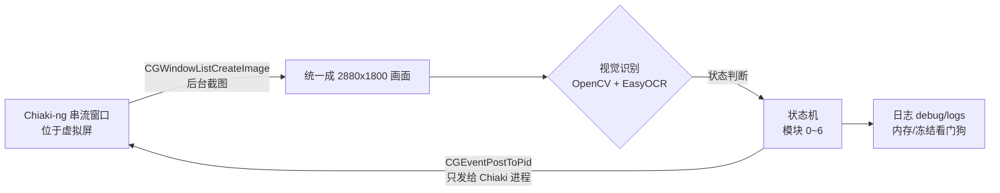

> 一句话概括：PS5 用 Chiaki-ng 串流到 Mac，Python 只"看"串流窗口的画面（OpenCV + EasyOCR），再把按键直接发给 Chiaki 进程，让《龙之信条2》在异界石里**自动召唤自己的随从 → 雇佣 → 解雇送礼 → 跑出边界重置**，循环 50 轮（同一个随从一次最多收 50 件礼物，这是我实测出来的上限，见第 8 节）。全程后台运行，Chiaki 放在一块 BetterDisplay 虚拟屏上，真实屏幕照常办公。

**本文结构**

1. 效果与整体架构
2. 软件与库的准备（附官网下载地址）
3. Chiaki-ng 配置与按键映射
4. BetterDisplay 虚拟屏：挂机和办公互不打扰
5. 游戏内设置：视角左右灵敏度与转向标定
6. 自动化整体思路与注意事项
7. 视觉控制难题是怎么解决的（找人、寻路、找异界石、利用符文"抽象画"数漩涡臂、菜单光标、认人）
8. 踩坑全记录（含 92GB 内存那次，以及 v16~v18"多加判断条件"）
9. 完整代码 v28（先看"需要自己修改的地方"）
10. 人机协作的思考：怎么高效地告诉 AI 写代码，以及未来展望
11. 经验总结：可以复用到下一个项目的东西

> ⚠️ 声明：本文只用于单机内容（自己账号的随从互送礼物）的学习与研究。串流和自动化操作请自行评估风险，长时间挂机注意主机散热。

---

## 1. 效果与整体架构

**一轮完整闭环**（日志里记作"第 N 次送礼闭环达成"）：

1. 在野外找到异界石，长按【调查】进石；
2. 打开异界石菜单 → 查找追随者 → 特别关注的追随者 → 召唤目标随从（自动识别大号/小号随从，例如我的 Polay / PYL）；
3. 在石内找到这个随从，走过去打招呼 → 雇佣；
4. 再找到它 → 解雇 → 送礼（按预设优先级挑礼物）；
5. 跑出异界石边界，弹窗选"是"离开，回到第 1 步。



关键点只有两个：**截图只截 Chiaki 窗口**（被遮挡也能截）、**按键只发给 Chiaki 进程**（不经过前台），所以脚本跑起来以后 Mac 仍然可以正常用，键盘鼠标完全不受影响。

---

## 2. 软件与库的准备

### 2.1 软件清单

| 软件 | 用途 | 官网 / 下载 |
|---|---|---|
| macOS（Apple Silicon 推荐） | 运行一切；EasyOCR 可用 MPS(GPU) 加速 | — |
| PS5 + 《龙之信条2》 | 被控端，开启"远程游玩" | PS5：设置 → 系统 → 远程游玩 |
| **Chiaki-ng** | 开源 PS 远程游玩客户端，键盘可映射手柄 | GitHub：https://github.com/streetpea/chiaki-ng ，文档：https://streetpea.github.io/chiaki-ng/ |
| **BetterDisplay** | 创建虚拟显示器，Chiaki 放上去挂机 | https://github.com/waydabber/BetterDisplay |
| Python 3.10~3.12 | 运行脚本 | https://www.python.org/downloads/macos/ |
| PyCharm（可选） | 编辑调试 | https://www.jetbrains.com/pycharm/ |
| Homebrew（可选） | 装命令行工具 | https://brew.sh |

### 2.2 Python 库

| 库 | 用途 | 官网 |
|---|---|---|
| opencv-python | 模板匹配、HSV 颜色分割、连通域、极坐标变换 | https://pypi.org/project/opencv-python/ |
| numpy | 图像数组运算 | https://numpy.org |
| easyocr | 中英文 OCR（菜单、名牌、礼物名） | https://github.com/JaidedAI/EasyOCR |
| torch | EasyOCR 的推理后端（Mac 上走 MPS） | https://pytorch.org/get-started/locally/ |
| pyobjc-framework-Quartz / Cocoa | 后台截图 + 给指定进程发按键 | https://pyobjc.readthedocs.io/ |

建议用虚拟环境（我的是 `~/venv`）：

```bash
python3 -m venv ~/venv
~/venv/bin/pip install opencv-python numpy easyocr torch pyobjc-framework-Quartz pyobjc-framework-Cocoa
```

**EasyOCR 模型**：第一次运行会自动下载到 `~/.EasyOCR`。网络不好可以手动下载 `craft_mlt_25k.pth`（文字检测）和 `zh_sim_g2.pth`（简体中文识别）放到项目的 `assets/easyocr/` 里，脚本会优先从这里读，并且关闭联网下载。模型下载页：https://www.jaided.ai/easyocr/modelhub/

> 早期我用过 YOLO 训练数据集来识别随从，后来发现**纯规则视觉（颜色 + 几何 + OCR）就够了**，而且不用标注数据、调参可解释，YOLO 那套最后全部删除。

### 2.3 macOS 权限（必做，否则截图全黑或按键无效）

系统设置 → 隐私与安全性：

- **屏幕录制**：勾选运行脚本的程序（"终端"或 PyCharm）。没有这个权限，`CGWindowListCreateImage` 截到的是黑图或只有桌面背景。
- **辅助功能**：同样勾选"终端"/PyCharm。`CGEventPostToPid` 给其他进程发按键需要它。

改完权限要**重启终端 / PyCharm** 才生效。

### 2.4 项目目录

```text
DragonsDogma2/
├── dd2_rift_bot_v28.py          # 主脚本（最新版，v28）
├── run_v28.command              # 双击：50 轮自动挂机
├── run_v28_menu.command         # 双击：菜单选模式（单模块测试/标定）
├── run_v28_diagnose.command     # 双击：截一帧打印所有检测结果
├── stop_bot.command             # 双击：安全停止
├── reference/                   # 按流程顺序编号的界面截图（00~11），给 AI 看的"说明书"，见第 10 节
├── assets/
│   ├── templates/               # UI_O_pawn.jpg / UI_O_riftstone.jpg / UI_Exit_the_Rift.jpg（自己裁）
│   ├── calibration/             # UI_map_ref_patch.png + map_calib.json（模式 8 生成）
│   └── easyocr/                 # craft_mlt_25k.pth / zh_sim_g2.pth
├── debug/logs/                  # 每次运行的完整日志（自动保留最近 30 份）
├── tools/                       # 遮挡/冻结排查小工具
└── history/                     # 只保留最近 3 个历史版本
```

---

## 3. Chiaki-ng 配置与按键映射

Chiaki-ng 的安装、PS5 注册（PSN 登录、主机注册 PIN）、串流画质等基础配置，我在上一篇里写过，这里不重复：

👉 **上一篇：** https://blog.csdn.net/weixin_42884201/article/details/168298655

本项目额外要求的只有两点：

**① 键盘映射**（Chiaki-ng → Settings → Keys）。脚本里所有按键都按这张表发，你的映射不一样就改脚本里对应的按键名：

| 手柄 | 键盘 | 脚本里的用途 |
|---|---|---|
| ✕ | `/` | 确认、对话快进 |
| ○ | `'` | 交互/长按【调查】【打招呼】、取消 |
| 十字键 上/下/左/右 | `I` / `K` / `J` / `L` | 菜单移动、礼物翻页 |
| L1 / R1 | `Q` / `E` | 地图里光标跳转到"返回的基石" |
| L2 | `Tab` | 拔刀 |
| 触摸板 | `T` | 打开地图 |
| 左摇杆 | `W A S D` | 移动 |
| 右摇杆 左/右 | `←` / `→` | **转镜头**（键盘是"数字量"，只有按/不按，所以灵敏度很关键，见第 5 节） |
| 右摇杆 上/下 | `↑` / `↓` | v21 起用于**上下调镜头**：名牌太靠上/下时拉回画面中部 |
| OPTIONS（三横线） | `O` | v24 起用于打开**暂停菜单**，读左下角队伍卡片，确认目标随从是否还在队伍里 |
| △ | `[` | 和 L1 组合放突进技能（按你自己职业的技能改） |

> 注意：串流里"按键时长"就是"摇杆推到底的时长"，没有半推。镜头转多少完全靠按多久，这就是后面要做"转向标定"的原因。

**② 窗口模式 / 全屏都可以，但不能最小化。** macOS 对被最小化、被**完全**盖住、在别的桌面（Space）或显示器睡眠时的窗口**停止重绘**，截图会拿到一张"冻结"的旧画面。解决方法就是下一节的虚拟屏。

---

## 4. BetterDisplay 虚拟屏：挂机和办公互不打扰

### 4.1 为什么需要虚拟屏

最开始我让 Chiaki 窗口留在主屏、只要求"别被完全挡住"。实际办公时窗口总会被盖住 → 画面冻结 → 脚本检测到冻结后把 Chiaki 调到前台 → **正在打字的我被抢走焦点**。

虚拟屏的思路：建一块"看不见的显示器"，Chiaki 单独待在上面。那块屏上永远只有 Chiaki，系统认为它"可见"，会一直绘制；你在真实屏幕上怎么盖窗口、切桌面都不影响。

### 4.2 创建虚拟屏（我的配置）

BetterDisplay 菜单栏图标 → **Create New Virtual Screen**：

| 设置 | 取值 | 原因 |
|---|---|---|
| 宽高比 | **16:9** | 和 PS5 输出一致，没有黑边 |
| 分辨率 | **2880 × 1620** | 我的模板全是在 2880 宽的全屏画面上裁的，像素 1:1，不缩放最准 |
| HDR | **关** | HDR 会改变颜色，HSV 阈值失效 |
| 8K 选项 | **关** | 分辨率越高截图越大、越慢、越吃内存，且模板对不上 |

> 有人会问"不是可以选更高分辨率吗？"——可以，但**模板匹配和颜色阈值都是按 2880 宽标定的**，分辨率变了要重新裁模板、重标定，收益只有"更清晰"，代价是每张截图更大、更慢。保持和模板一致最省事。

### 4.3 把 Chiaki 放到虚拟屏上

1. 系统设置 → 桌面与程序坞 → 打开 **"显示器具有单独的空间"**（Displays have separate spaces）。
2. 虚拟屏是"看不见"的，所以要先把窗口挪过去。两种方法任选：
   - BetterDisplay 里临时把虚拟屏设为**镜像**到真实屏（能看到它），把 Chiaki 拖过去，再取消镜像；
   - 或在 BetterDisplay 里对虚拟屏开启 **画中画（Picture in Picture）** 预览窗口，在预览里确认 Chiaki 已在虚拟屏上。
3. 在虚拟屏上让 Chiaki **全屏**。全屏在虚拟屏上没问题：它占的是虚拟屏的那个桌面，不会抢你真实屏的桌面。
4. 脚本启动时会在日志里打印 `Chiaki 窗口所在屏幕：名字 / 是否虚拟屏 / 分辨率`，确认一下即可。

### 4.4 防止睡眠

启动脚本用 `caffeinate -dims` 包住 Python：挂机期间显示器、磁盘、系统都不睡眠（睡眠/锁屏也会让画面冻结）。

---

## 5. 游戏内设置：视角左右灵敏度与转向标定

### 5.1 把"视角转动速度（左/右）"调到最低

游戏 → 选项 → 镜头：**视角转动速度（左/右）= 最低**。

原因：键盘控制右摇杆只有"推到底"一种力度，灵敏度高时，最短的一次按键也会转过头——对准目标时就会在目标左右来回摆（日志里看到名牌 x 坐标在 1142 ↔ 1449 之间反复跳）。调到最低后，最短一下只转约 0.015 屏宽，可以精细修正。

另外 DD2 的镜头**长按会加速**，所以"按 2 秒 = 按 1 秒 × 2"并不成立，单次转向最长只按 0.5~1.5 秒，剩下的偏差下一帧再修。

### 5.2 用"模式 10"标定转向

运行 `run_v28_menu.command`，选 **10**。脚本会分别按住 ←/→ 0.03 / 0.10 / 0.25 / 0.5 / 1.0 秒，用 ORB 特征点匹配前后两帧，算出画面水平位移，然后线性拟合给出建议值。我的实测（灵敏度最低）：

```text
0.03s→43px  0.06s→72  0.10s→84  0.15s→106  0.25s→143（2880 宽）
拟合：位移 ≈ 429px/s × 时长 + 39px → 约 6.7 秒转一屏宽，最小步长 ≈ 0.015 屏宽
```

把建议值填回脚本 `DD2RiftBot.__init__` 的"运动参数"：

```python
self.turn_sec_per_width = 6.7   # 按住方向键转过一屏宽约需秒数
self.turn_min_hold = 0.03       # 最短按键
self.turn_min_step = 0.015      # 最短按键转过的屏宽
self.turn_zone_frac = 0.08      # 偏差 > 0.08 屏宽才转镜头，以内用 W + A/D 平移修正
self.full_circle_turn_sec = 12.0  # 扫描时转一整圈约 12 秒（看日志实测）
```

**以后只要改了游戏里的转动速度，就要重跑模式 10。**

---

## 6. 自动化整体思路与注意事项

### 6.1 模块化状态机

| 模块 | 做什么 | "完成"的判据 |
|---|---|---|
| 0 | 处理"是否离开异界石"弹窗，选 是/否 | 比较"是"和"否"两行的亮度，高亮的那行就是光标所在 |
| 1 | 野外找异界石并贴脸 | 【调查】提示**稳定出现**（连续约 0.45s、位置不漂移）+ OCR 读到"调查" |
| 1B | 找不到石头 → 地图飞石传送到固定基石 | 底部提示含"返回的基石" + 光标处几何/参考图双校验 + 地图确实关闭 |
| 2 | 长按【调查】进石，菜单状态机进"特别关注的追随者"，召唤 | 顶部出现【基础信息】才算进石；列表里 OCR 找到目标所在行 |
| 3 | 石内找随从、走过去、打招呼 | 【打招呼】模板稳定 |
| 4 | 雇佣 | 说话前先认名牌；雇佣面板加载完成且 OCR 含目标关键词 → **确认光标高亮在【雇佣】** 再按 ✕ → 回到石内确认循环 |
| 5 | 解雇 + 送礼 | 菜单里有【解雇】才算已雇佣菜单 → 高亮移到【解雇】→ 礼物名 OCR 命中预设 → 确认框高亮在【是】→ 回到石内确认循环 |
| 6 | 跑出边界重置 | 边界弹窗出现并选"是"，【基础信息】消失 |

### 6.2 三条核心原则

1. **每一步都要"看到结果"再走下一步，不要"按完固定等 N 秒"。** 加载快慢、对话句数、网络延迟都不固定。我前期大部分 bug 都来自固定等待。
2. **判断状态用"固定位置的 UI 文字/图标"，而不是 3D 场景。** 比如：顶部【基础信息】= 在石内；右下角"对话快进" = 正在对话；底部按键提示带 = 地图状态。这些位置固定、背景稳定，OCR 又快又准。
3. **所有异常都要有退路**：寻人超时 → 出界重置；连续 3 次没进石 → 传送重置；传送连续失败 2 次 / 礼物用完 / 列表里没有目标 → 安全停止并写明原因。任何退出都在 `finally` 里松开全部按键。v16 以后又加了两条：**认不出的界面先退回游戏画面**；**连续 12 轮没有任何进展就停止**，不让它在菜单里空转几个小时。

### 6.3 使用注意事项

- **停止**：双击 `stop_bot.command`（新建 STOP 文件），脚本下一帧检测到就松键退出。后台模式下鼠标不动，pyautogui 的"甩鼠标到角落"急停已经不适用。
- **日志**：每次运行完整日志保存到 `debug/logs/`，出问题直接看日志里的得分、坐标、OCR 结果——比截图有用得多。
- **内存**：日志每轮打印 `🧠 [内存] 脚本当前占用 X GB`，正常应稳定在 1~3GB；超过 6GB 警告，超过 12GB 自动安全停止。
- **礼物**：礼物界面翻 10 次都没有预设礼物，并且 OCR 确认确实在礼物界面 → 停止程序（不乱送东西）。
- **画面冻结**：发出按键后画面 8 秒纹丝不动 → 判定冻结，原地等待（最多 10 分钟），恢复后本轮作废、从头再来。
- **关掉 PS5 的"已连接远程游玩"提示**：串流刚连上时，画面最顶端会弹出这条通知，正好盖住【基础信息】，脚本会以为"没进石"。在 PS5 上关掉：设置 → 系统 → 远程游玩 → 打开"隐藏远程游玩连接状态弹出通知"。v17 起日志里读到"远程/游玩"会直接提醒你。
- **礼物上限 50 件**：同一个随从一次最多收 50 件礼物（我自己实测，游戏版本以你当时为准），所以默认 `--loops 50`。
- **散热**：Chiaki 持续解码视频 + 脚本持续截图、跑 OCR，长时间挂机 Mac 会明显发热。活动监视器里的 CPU% 是按单核算的（100% = 1 个核）。想降负载可以把串流帧率降到 30fps、分辨率保持 1080p、确认用的是硬件解码；电脑放在硬质平面上通风。**如果闻到焦味或塑料味，先停掉挂机，让电脑冷却，再去检查。**

---

## 7. 视觉控制难题是怎么解决的

### 7.1 先统一坐标：任何窗口大小都还原成 2880×1800

截图拿到的是窗口（可能有 28pt 标题栏、可能有黑边）。脚本做三件事：

1. 判断顶部那条是不是标题栏——要求**又亮又均匀**（平均亮度 > 150 且标准差 < 12），否则不裁（全屏时游戏顶部是亮天空，曾被误裁）；画面本身正好 16:9 时直接判定没有标题栏；
2. 按 16:9 找出视频区域；
3. 缩放成 2880×1620，上下各补 90px 黑边 → 2880×1800，和我做模板时的 MacBook 全屏截图像素级一致。

所以**模板、ROI、地图标定都只需要做一次**，窗口大小怎么变都能用。所有 ROI 都用"屏幕比例"写，比如名牌横带 `(0.03, 0.16, 0.97, 0.62)`。

### 7.2 UI 提示识别：Canny 模板匹配，粗搜 + 精修

【调查】【打招呼】【离开异界石】这几个提示用模板匹配：

- 先在 ROI 内**半分辨率 Canny 边缘**粗搜，再在候选点附近全分辨率精修。单次从 145~223ms 降到约 20ms，得分不变。
- 用边缘而不是灰度：提示框背景是半透明的，随场景变化很大，边缘几乎不变。
- **稳定性校验**：突进途中【调查】会一闪而过，被当成"已到位"。现在要求连续 3 次、间隔 0.15s 都在、位置漂移 < 2% 屏宽才算。
- **防误捡**：同一位置还会出现"捡起"提示，OCR 读到"捡/起"就拦截。

### 7.3 找异界石：利用它的"抽象画"——符文密度 + 数漩涡臂

这是整个项目最有意思的部分。

#### 符文先是"噪声"

异界石表面布满发光的青蓝色符文。第一版做 OCR 时，**EasyOCR 的文字检测器把每一笔符文都当成文字框**，一帧画面检出上百个框，单次 OCR 要 12~17 秒。

**规避方法**：OCR 之前先把"高饱和、高亮的青蓝像素"涂黑（`suppress_rift_blue`：H 85~122、S ≥ 110、V ≥ 120）。名牌文字是米黄色，不受影响。固定位置的 UI 文字更进一步，直接用 `reader.recognize()` 跳过检测阶段，并在第一次识别成功后缓存成小模板，之后毫秒级判断。

#### 再把"噪声"变成"信号"

野外的异界石离得远、角度多，模板匹配不可靠。但它有一个**别的东西都没有的特征**：一大团密集的、短小的、发光青蓝笔画。`RiftstoneDetector.detect` 是这么做的：

1. 画面缩到 960 宽，HSV 阈值 `(85,115,175)~(115,255,255)` 取出发光青蓝像素；
2. 连通域分析，**只留面积 2~250 像素的小块**——这就是一笔一笔的符文（大块的天空、水面被过滤）；
3. 用一个大圆核膨胀，把相邻笔画连成团，选包含笔画数最多的那一团；
4. 笔画数 ≥ 25 才算"看到异界石"，团的重心就是石头方位，团的面积占比代表远近。

这样即使石头只占画面一小块、被树挡住一半，也能稳定给出方位。日志长这样：

```text
🔵 [外部寻石#7] 符文笔画=386 中心=(2245,531) 占比=0.18 偏差=+805px | 漩涡臂数=6 稳定度=0.41 ✅正面
```


#### 数漩涡臂：确认"正面"

靠近以后还要知道是不是正对着石头正面（交互点在正面）。异界石正面中心有一团白色发光核心，周围是旋转的漩涡臂。

**核心思路**：以漩涡中心为圆心画一个圆，数这个圆穿过了几条亮带。漩涡有 6 条臂，任意半径的圆都会被 6 条亮带切过，这一圈上就会"亮—暗"交替 6 次。代码 `count_swirl_arms` 做的就是这件事，下面分 6 步对照代码讲。

##### 第 0 步：只在石头框里算

```python
def count_swirl_arms(self, bgr, det, v_th=200, s_max=200, core_v=230, core_s=170):
    if not det or not det.get('found'):
        return None
    bx, by, bw, bh = det['bbox']
    roi = bgr[by:by + bh, bx:bx + bw]          # 只看异界石所在的框
    hsv = cv2.cvtColor(roi, cv2.COLOR_BGR2HSV)
```

`det` 是前面"符文笔画密度"找到的那团石头。之后所有计算都只在这个框里做，天空、地面都不参与。

##### 第 1 步：找漩涡中心

```python
core = ((hsv[:, :, 2] >= core_v) & (hsv[:, :, 1] <= core_s)).astype(np.uint8) * 255   # V≥230、S≤170
core = cv2.morphologyEx(core, cv2.MORPH_OPEN, 圆形核)      # 去掉零星小亮点
n, lab, st, _ = cv2.connectedComponentsWithStats(core)
i = 面积最大的连通域
cx, cy = 该连通域像素坐标的平均值                          # 重心 = 漩涡中心
```

中心那团光几乎是纯白的：亮度极高、饱和度低。周围的符文是青蓝色，饱和度高，会被 `S ≤ 170` 排除。取面积最大的亮白区域，它的重心就当作圆心。如果这块不到 50 个像素，说明看到的不是正面（比如是石头背面），直接返回 None。

##### 第 2 步：挑出"够亮"的像素

```python
bright = ((hsv[:, :, 2] >= 200) & (hsv[:, :, 1] <= 200)).astype(np.float32)
```

这一行是典型的 **NumPy 向量化多条件布尔掩码 + 类型转换**，可以拆成四层来看：

**① 通道提取：`hsv[:, :, 2]` 和 `hsv[:, :, 1]`**

`hsv` 是一个三维数组，形状是 `(高, 宽, 通道)`，3 个通道依次是 H（色相）、S（饱和度）、V（亮度）。`:` 表示"这一维全部都要"。所以 `hsv[:, :, 2]` 取的是所有像素的 V，得到一张 `(高, 宽)` 的二维亮度图；`hsv[:, :, 1]` 同理，取的是饱和度。

**② 逐元素比较**

`hsv[:, :, 2] >= 200` 不会只返回一个 True/False。NumPy 会把标量 200 **广播**到每个像素，逐个比较，返回一张和原图一样大的布尔图：亮度 ≥ 200 的位置是 True，其余是 False。

**③ 用 `&` 合并两个条件，括号不能省**

- 必须用 `&`，不能用 `and`。Python 的 `and` 会把整个数组当成"一个真假值"来判断，NumPy 无法决定，就会报错 `ValueError: The truth value of an array with more than one element is ambiguous`。NumPy 重载了 `&`，含义是**逐元素逻辑与**：两张布尔图在同一位置都是 True，结果才是 True。
- 括号必须加，因为 `&` 的优先级**高于** `>=` 和 `<=`。如果写成 `hsv[:,:,2] >= 200 & hsv[:,:,1] <= 200`，Python 会先算 `200 & hsv[:,:,1]`，整句被解析成链式比较 `a >= (200 & b) <= 200`。这不是语法错误，但运行时同样会触发上面那个 ValueError，而且逻辑也已经错了。

到这一步，得到的是一张布尔图：**又亮又不太艳**的像素是 True。V ≥ 200 是主要条件，因为漩涡臂是发光的；S ≤ 200 用来排掉饱和度极高的纯青蓝符文。

**④ `.astype(np.float32)`：转成浮点**

`.astype` 会新建一个数组，把每个元素转成目标类型：True → 1.0，False → 0.0。转成浮点是因为下一步 `cv2.warpPolar` 要做**双线性插值**，插值结果是 0～1 之间的小数，布尔型装不下。用 `float32` 而不是 `float64`，是因为 OpenCV 的几何变换函数对 `CV_32F`（也就是 `np.float32`）支持最好，内存也只占一半。

> 为什么比第 1 步宽松（200/200 对比 230/170）？找中心要的是最白、最亮的那一小团，这样圆心才准；漩涡臂比核心暗一些、也更偏蓝，用同样严的阈值会把臂筛掉一大半。

##### 第 3 步：极坐标展开，把"圆"拉成"长方形"

```python
rmax = int(W * 0.15)    # W 是整个画面宽 2880 → rmax = 432 像素：从中心往外最远看 432 像素
A = 720                 # 一圈采 720 个点，每 0.5° 一个
polar = cv2.warpPolar(bright, (rmax, A), (cx, cy), rmax, cv2.WARP_POLAR_LINEAR) > 0.5
```

| 参数 | 值 | 含义 |
|---|---|---|
| `bright` | 上一步的 0/1 图 | 要展开的图 |
| `(rmax, A)` | (432, 720) | 输出图大小：**宽 432、高 720**（OpenCV 写尺寸的顺序是"宽, 高"） |
| `(cx, cy)` | 漩涡中心 | 圆心 |
| `rmax` | 432 | 展开到多远为止 |
| `WARP_POLAR_LINEAR` | | 半径均匀采样（另一种对数采样会把外圈压缩，这里用不到） |

**"展开"到底是什么意思？** 公式本身就是普通的极坐标转笛卡尔坐标：

$$r = x \cdot \frac{\text{maxRadius}}{\text{dsize.width}},\qquad \theta = y \cdot \frac{2\pi}{\text{dsize.height}}$$

$$X = c_x + r\cos\theta,\qquad Y = c_y + r\sin\theta$$

但 `warpPolar` 不是把原图里的点挪个位置，而是**新建一张长方形图**，对新图的每个格子 `dst[y, x]` 回答一个问题："这个格子应该填原图哪个点的值？" 答案就是上面的公式：第 x 列对应半径 r，第 y 行对应角度 θ，去原图的 (X, Y) 取值。原图里的位置一般不是整数，所以用周围 4 个像素做双线性插值，结果可能是 0.3、0.7 这样的小数；`> 0.5` 再把它变回"亮 / 不亮"。

因为输出宽度 432 正好等于 `maxRadius` 432，**第 x 列就是离圆心 x 像素的那一整圈**，第 y 行就是角度 y × 0.5°（第 0 行是正右方，图像 y 轴朝下，所以在屏幕上看是顺时针）。

举个例子：圆心在 (100, 100)，原图上有一个半径 50 的亮圆环。

| 新图格子 | 对应 (r, θ) | 去原图取哪个点 | 取到的值 |
|---|---|---|---|
| dst[0, 50] | 50, 0° | (150, 100) | 亮 |
| dst[180, 50] | 50, 90° | (100, 150) | 亮 |
| dst[360, 50] | 50, 180° | (50, 100) | 亮 |
| dst[0, 20] | 20, 0° | (120, 100) | 暗 |

整个圆环在新图里全部落在**第 50 列**，变成了一条竖线：一个圆变成了一条直线，所以叫"展开"。信息基本没丢，只是换了一种排列方式，用 `WARP_INVERSE_MAP` 还能卷回去。这和地球仪与世界地图是一个道理：经纬度一样，只是把球面摊平了。在展开图里，漩涡臂会变成一条条**斜带**，因为臂是旋转的，半径越大，臂所在的角度越偏。

##### 第 4 步：对每个半径，数这一圈有几段亮

```python
k = max(1, int(3 * A / 360))                       # 约 3° 宽的去噪核
counts = []
for c in range(rmax):                              # 每一列 = 每一个半径的一整圈
    col = polar[:, c].astype(np.uint8)
    col3 = np.tile(col, 3).reshape(-1, 1)          # 复制 3 份首尾相接
    col = cv2.morphologyEx(col3, cv2.MORPH_OPEN, np.ones((k, 1), np.uint8)).ravel()[A:2 * A]
    counts.append(self._circular_runs(col))

def _circular_runs(col):
    if col.all():     return 1                     # 整圈全亮 → 1 段
    if not col.any(): return 0                     # 整圈全暗 → 0 段
    return int(np.sum((col == 1) & (np.roll(col, 1) == 0)))
```

- **开运算**：去掉宽度不到 3° 的零星亮点，避免噪点被数成一条臂。
- **为什么复制 3 份**：圆是首尾相连的，359.5° 的下一个点就是 0°。直接对这 720 个点做开运算，两端会被当成边界处理错。拼成 [一圈][一圈][一圈] 以后只取中间那份，它两头都有真实的邻居，效果就等于按环形处理。
- **数段数**：`np.roll(col, 1)` 把这一圈整体错开一位，得到每个点"前一个点"的值。"我是亮、前一个是暗"就是一段亮的**起点**，数一共有几个起点就有几段。`roll` 本身就是环形的，所以 0° 和 359.5° 也能正确衔接。

```
col:  0 0 1 1 0 0 1 1 0 0 1 1 0 0 1 1 0 0 1 1 0 0 1 1
起点:     ↑       ↑       ↑       ↑       ↑       ↑     → 6 段 = 6 条臂
```

##### 第 5 步：从内到外，找"最稳定的读数"

`counts` 是每个半径数出来的段数，例如：

```
半径:   0  1  2  3  4  5  6  7  8  9 10 11 12 13 14 ...
counts: 1  1  0  2  6  6  6  6  6  6  6  5  9  3  0 ...
                    └────── 连续 7 个都是 6 ──────┘
```

太靠里是白色核心，整圈都亮，读数是 1；太靠外会碰到符文和边缘噪声，读数乱跳。只有中间那段是真正的漩涡臂，**从里到外一长串半径都数出同一个数**。

```python
best_len, best_val, cur, prev = 0, 0, 0, None
for c in counts:
    if 3 <= c <= 10 and c == prev:      # 在合理范围内，且和上一个半径相同 → 连续段 +1
        cur += 1
    else:
        cur = 1 if 3 <= c <= 10 else 0  # 断了，从头算
    if cur > best_len:
        best_len, best_val = cur, c     # 记下最长的连续段和它的取值
    prev = c
stability = best_len / float(rmax)      # 最长连续段占全部半径的比例
```

- 只认 3～10：1、2 太少，可能只是一两条亮线；超过 10 多半是符文噪声。
- 要求"连续相同"：单个半径可能恰好碰到噪点，多数一段或少数一段；真正的臂是从里到外延续的，连续很多个半径给出同一个数，才说明这个数可信。

##### 第 6 步：判定

```python
ok = (best_val in self.expected_arms) and stability >= 0.15    # expected_arms = (6,)
return {'arms': best_val, 'stability': stability, 'ok': ok, ...}
```

臂数为 6，且至少 15% 的半径都稳定地数出 6，就判定为正对正面。日志里的 `漩涡臂数=6 稳定度=0.41 ✅正面`，意思是 41% 的半径都连续数出了 6。

在 `approach_riftstone` 里，只有石头占画面 ≥ 12% 时才会数臂，太远时漩涡糊成一团，数不准。目前它主要作为辅助信号写进日志；真正决定"到位"的，还是【调查】提示出现并且保持稳定。

> **一句话总结**：先找到白色中心；把"够亮、不太艳"的像素挑出来；以中心为原点，把圆拉直成"列 = 半径、行 = 角度"的长方形；对每一列数亮段；最后取从里到外保持一致最久的那个数，作为臂数。

#### 一个意外收获：用臂数发现"画面冻结"

有一次日志里镜头转了 12 秒，24 次检测的"符文笔画=386、中心=(2245,531)、漩涡臂数=4"**一模一样**。真实画面压缩噪点，不可能连续完全一致——说明截图拿到的一直是同一张旧画面。这直接引出了后面的**画面冻结看门狗**（160×90 缩略图逐帧比较，平均差 < 0.05 且已发出 ≥2 次按键、持续 8 秒 → 判冻结）。

### 7.4 寻路：没有导航网格，就用"视觉伺服"

游戏里拿不到坐标，只能"看着目标走"，本质是一个简单的闭环控制：

- **误差** = 目标在画面中的 x − 画面中心（越肩视角要补偿 −110px）；
- **大偏差**（> 0.08 屏宽）：按方向键转镜头，时长按标定的线性关系算；
- **小偏差**（0.035~0.08 屏宽）：**不碰镜头**，按 W + A/D 斜走修正；
- **几乎对准**：笔直按 W；
- **防震荡**：如果这次要转的方向和上次相反，说明转过头了 → 把转向区放大 1.3 倍、转向时长减半；
- **扫描**：看不见目标时始终向同一方向转，每步约 0.18 屏宽，累计转满一圈（约 12 秒）还没找到 → 放弃，走地图传送；
- **刚跟丢**：12 秒内看到过目标，先往它最后出现的一侧小步回找 5 次，而不是转一整圈；
- **卡墙**：连续 9~12 步直走还没到 → 随机向左/右侧滑一下。

**野外找不到石头的兜底：飞石传送。** 打开地图后按 L1 让光标吸附"返回的基石"，必须同时满足：① 底部提示带 OCR 含"返回的基石"；② 光标处是那块基石（中心有蓝色基石图标 + 固定相对位置有蓝色异界石图标；再用参考图做**掩膜相关**——黄色任务方块、白色人物三角、白线、白字都不参与比较，正确位置 0.87、错误位置 ≤ 0.40，阈值 0.55）；③ 底部出现"使用飞石移动"。三条都对才按确认，错了就按 L1 切下一个。

### 7.5 找人：从"整带 OCR"到"名牌锚点"

随从头顶有名牌：金色职业徽章 + 名字 + 黄绿色血条（完整加载时还有 Lv 等）。

**v8 之前**：在名牌所在横带整条 OCR。问题是我的小号随从叫 **PYL**，只有 3 个字母，米黄字压在亮蓝背景上，**文字检测器经常根本没把它框出来**，90 秒只认出 1 次；同一画面里 5 个字母的 Polay 却每次都能认出。

**v9 的名牌锚点**（不靠 OCR 先找位置）：

1. 用颜色找名牌的**固定部件**：金色徽章 HSV `(8,110,60)~(30,255,255)`，要求尺寸、填充率、长宽比都像徽章；黄绿色血条 HSV `(30,40,130)~(60,200,255)`，要求又细又长（宽高比 ≥ 10）；
2. 按名牌的**固定几何关系**推出名字所在的小框（实测：徽章 44×53，名字从徽章右边 +16px 开始，字高约 28px；血条在名字下方约 18px），右边界用"米黄/白字"的列投影找；
3. **用红色通道识别**：名字是米黄色（红分量高），背景是青蓝色（红分量低），红色通道里就是"亮字暗底"，比灰度图干净得多；
4. `recognize` + 字母白名单（只允许 A~Z、a~z），可疑结果放大 2 倍复识别；
5. **短名宽松匹配**：PYL 常被读成 PII / PYI / PVL / PX，用正则 `^[pb][yvxij1l|'`]?[li1|tj]?$` 统一判定，但**要求字宽像 3 个字母**，避免把 Polay 的误读 Pol / Poly 也算进来；长名用 difflib 模糊匹配（相似度 ≥ 0.75）。

识别到以后把名牌裁成小模板做**跟踪**，每 8 帧用复识别校验一次，不再每帧整带 OCR。

### 7.6 绕石：目标在异界石背后怎么办

石内的异界石本体会挡住随从。`RiftRockDetector` 识别石头本体：**颜色**（高亮、高饱和蓝）+ **纹理**（局部亮度标准差，石头粗糙 13~21，地面蓝雾平滑 1~3）。踩过的两个坑：

- 只看颜色 → 地面蓝雾也算石头 → 加纹理条件；
- 纹理做大范围平滑 → 旁边人物的纹理"扩散"到雾上 → 纹理只在"颜色像石头"的像素里统计，饱和度下限 150（石头 160+，随从身体约 127，自己角色发光约 99）。

判断是否被挡：随从站在**整块名牌的正下方**（不是名字文字正下方），所以把名牌下方 `[文字−0.01W, 文字+0.065W]` 逐列检查岩体覆盖率，**只要有一列看得到就不算挡住**；所有列覆盖率 ≥ 0.6 才绕行。绕行时朝离目标更近的石头边缘侧移，同时保持镜头对着目标（效果就是绕着石头走），一侧绕 14 步不过就换另一侧。

### 7.7 菜单与对话：OCR 状态机

- 异界石菜单：每次截图 OCR 左侧菜单区，分成 主菜单 / 查找菜单 / 特别关注列表 / 加载中 / 误入其他列表 / 无菜单 几种状态，每种状态对应一个动作，而不是一串固定按键。
- 特别关注列表：OCR 名字列 + Lv 列，算出目标在第几行，先按 ↓ 移到那一行再召唤。
- **回到石内确认循环**（雇佣后、送礼后）：每 0.4s 看一次——右下角有"对话快进"就按 ✕ 快进；停在别的确认框超过 1.2s 就按 ✕（最多 6 次）；顶部重新出现【基础信息】且没有对话 → 才算完成。**在石内绝不多按 ✕**，否则会变成跳跃。

#### 右侧对话菜单：先看光标在哪一行，再按 ✕（v16~v17）

和随从说话后，右侧会弹出一列选项。v15 及之前都是"盲按"：比如解雇就按 `↓` 再按 `✕`。这在 60 轮里都没出问题，第 61 轮雇佣其实没生效，弹出的是**雇佣面板**而不是已雇佣菜单，`↓ ✕` 落到了【查看追随者详情】，进了一个脚本不认识的状态界面，然后在菜单里盲按了 4 个多小时。

v16 起，所有菜单都"先确认光标在哪一行"：

| 菜单 | 行（从上到下） |
|---|---|
| 雇佣面板（还没雇） | 雇佣 / 查看追随者详情 / 查看主人详情 / 取消特别关注 / 放弃 |
| 已雇佣菜单 | 对话 / 解雇 / 取消特别关注 / 没什么事 |
| 别人的随从 | 对话 / 没什么事 |

几种菜单都是**底部对齐、行距相同**，所以只要知道有几行，就能算出每一行的纵坐标（`MENU_BOTTOM_Y = 0.749`、`MENU_PITCH = 0.0666`，按 reference 截图实测）。

**怎么判断哪行被选中？** v16 用亮度：选中行比其他行亮 1.5~2.5 倍。结果遇到 PYL 背后的盾牌发光，几行都被照亮（69/66/51/58），分不出来，脚本就一直不敢按。v17 改用**饱和度**：选中行是中性灰底（饱和度 20~63），没选中的行偏蓝（81~147）。发光只会让一行变亮，不会让它变灰，所以饱和度更稳：

```python
@staticmethod
def row_least_saturated(bgr, xs, ys, half_h=0.015, margin=30.0):
    H, W = bgr.shape[:2]
    ...
    for y in ys:                                    # 每一行取一条横带
        band = hsv[a:b, :, 1]                       # 只看 S（饱和度）通道
        vals.append(float(np.median(band)))         # 中位数，不怕个别亮点
    order = np.argsort(vals)
    if vals[order[1]] - vals[order[0]] >= margin:   # 最灰的一行要比第二灰的低 30 以上
        return int(order[0]), vals                  # 才算"看清了"
    return None, vals                               # 看不清 → 不按 ✕
```

最关键的是最后一行：**看不清就返回 None，调用方拒绝按 ✕**。宁可这一轮重来，也不在不确定的时候按确认。

另外两个游戏机制也要写进代码：

- 按 ○ **不会直接关掉**雇佣面板，只会把光标移到最下面的【放弃】，还要再按 ✕ 才退出；
- "是/否"确认框背景暗、没有遮挡，继续用亮度判断（选中 46~52，未选中 24）。

#### 界面分类：`screen_kind`

每次不确定时，先回答"我现在在哪个界面"，再决定按什么：

| 类型 | 怎么认 |
|---|---|
| HIRE_PANEL | 左侧有个性/特技等信息，右侧有【雇佣】 |
| PARTY_MENU | 右侧菜单含【解雇】（已雇佣菜单） |
| TALK_MENU | 右侧菜单只有【对话 / 没什么事】（别人的随从） |
| CONFIRM | 中间弹窗含"继续 / 认真 / 赠送" |
| RATING / GIFT / DIALOGUE | 评价界面 / 礼物界面 / 右下角"对话快进" |
| RIFT / WORLD / MAP / MENU | 石内 / 野外 / 地图 / 其他带"取消"提示的菜单 |

`escape_to_world` 就是按这张表退出：每种界面用自己的退出方式，直到回到石内或野外。认不出的界面按 ○，最多 12 步。

### 7.8 认人：别人的随从也会跟你打招呼（v18）

v17 连续跑了 24 轮，然后在石内又出了问题：目标 PYL 还在远处，旁边路过一个**别人的随从**，它的【打招呼】提示先弹了出来。脚本以为是目标，上去说了话，弹出的是只有两行的"对话 / 没什么事"。当时代码只要看到"没什么事"就当成已雇佣菜单，结果雇佣阶段以为已经雇上了，解雇阶段又找不到【解雇】。

v18 加了前后两层判断：

1. **说话前先认人**。仔细看【打招呼】提示，它左上角有个小 ▼，那其实是这个随从名牌血条的末端，所以**提示正上方就是它的名牌**。在提示上方一小块区域里找名牌锚点（金色徽章 / 血条），再用红色通道 + 字母白名单读名字：
   - 是目标 → 打招呼；
   - 读出来是别的名字 → 不说话，后退 0.5s + 随机侧移 0.6s 绕开，2.5 秒内忽略这个提示；
   - 读不出 → 照常说话，交给第 2 层兜底。
2. **说话后再认菜单**。只有菜单里有【解雇】才是已雇佣菜单；两行菜单就是别人的随从 → 选【没什么事】退出，绕开继续找，不中断这一轮。

```python
def prompt_owner(self, fr, ploc):
    x0, y0 = ploc                               # 【打招呼】模板左上角
    roi = (x0/W - 0.12, y0/H - 0.07, x0/W + 0.07, y0/H + 0.01)   # 正上方一小块
    anchors = find_nameplate_anchors(fr.bgr, roi=roi)
    ...
    if self.name_matches(t, ...):  return 'target', t
    if len(norm_text(best)) >= 3:  return 'other', best
    return 'unknown', ...
```

这一节的教训：**"看到某个字"不等于"在某个界面"**。"没什么事"在两种菜单里都有，真正能区分的是"有没有【解雇】"。判断条件要选**只有这个状态才有**的特征。

---

## 8. 踩坑全记录

| 版本 | 现象 | 根因 | 解决 |
|---|---|---|---|
| v3 | 单次 OCR 12~17 秒 | 符文被当成上百个文字框 | 涂黑青蓝像素；固定位置文字跳过检测 + 缓存模板 |
| v3 | 找到随从却原地转 | 最短一次转向约 300px，而死区只有 ±10° → 来回摆 | 大偏差转镜头，小偏差 W + A/D；防震荡 |
| v3 | 【调查】一闪而过被当成到位 | 突进途中经过 | 稳定性校验 + 先等画面静止 |
| v4 | 绕石误判 | 地面蓝雾、人物轮廓被算成石头 | 纹理条件 + 饱和度下限 |
| v4 | 镜头太灵 | 键盘只有"推到底" | 视角左右灵敏度调到最低，重新标定 |
| v5 | 第 20 轮传送后卡在地图 | 地图上有两个"返回的基石"，光标跳错 | 三重校验才确认；连续 2 次失败停止 |
| v5 | 落地后固定转 4.28 秒对不准 | 镜头长按会加速 | 去掉固定宏，改为视觉扫描 |
| v6 | 挂机时鼠标键盘被占用 | pyautogui 走前台 | Quartz 窗口截图 + CGEventPostToPid 发给进程 |
| v7 | PYL 被读成 "PX"；目标不在第一行 | 3 字母短名；列表顺序会变 | 误读表 + 放大复识别；按 Lv 列算行号 |
| v8 | 识别结果每帧一模一样，按键全失效 | Chiaki 被完全挡住，macOS 停止重绘 → **画面冻结** | 冻结看门狗；caffeinate 防睡眠 |
| v9 | 90 秒只认出 1 次 PYL | 文字检测器框不出 3 个字母 | 名牌锚点 + 红色通道 + 白名单 |
| v10 | 雇佣后卡在随从台词里 | 固定等 2.5s 就当成功 | 回到石内确认循环 |
| v11 | 送礼后固定连按 4 次 ✕，没结束干净 | 对话句数不固定 | 同上，统一用确认循环 |
| v12 | 没进石也照样去开菜单 | 长按【调查】后没验证 | 12s 内必须出现【基础信息】；连续 3 次失败 → 传送 |
| v13 | 冻结时脚本把 Chiaki 拉到前台，打断办公 | 冻结处理的"激活窗口" | **BetterDisplay 虚拟屏**；默认不再激活窗口 |
| v14 | 虚拟屏全屏时顶部被误裁 | 亮天空被当成标题栏 | 标题栏必须又亮又均匀；16:9 直接不裁 |
| v15 | **跑 1 小时 Python 占 92GB，系统把 Chiaki 和 PyCharm 都暂停了** | 见 8.1 | 见 8.1 |
| v16 | 连续 60 轮成功后，第 61 轮在菜单里盲按了 4 个多小时 | 雇佣没生效，解雇时的盲按落到了别的选项 | 先确认高亮行再按 ✕；界面分类 + 退回游戏画面；连续 12 轮无进展就停止 |
| v16 | 默认 100 轮，比实际需要的多 | 同一个随从一次最多收 50 件礼物（实测） | 默认循环 100 → 50 |
| v17 | 光标明明在【解雇】，脚本却一直不敢按 | 背后盾牌发光，几行亮度都被抬高 | 高亮判断从亮度改成饱和度 |
| v17 | 明明在石内，却判断"没进石"，接着去传送 | PS5 的"已连接远程游玩"通知盖住了【基础信息】 | PS5 设置里隐藏这条通知；日志提醒 |
| v18 | 和路过的别人的随从说上了话，雇佣误判、解雇找不到选项 | 只看"没什么事"判断菜单；说话前没认人 | 说话前读提示上方的名牌；菜单有【解雇】才算已雇佣 |
| v19 | 背景偏暗时高亮判断失败；解雇失败后特别关注列表一直空，空转约 18 分钟 | 光照暗，差距只有 22；随从仍在石内 | 弱判据（最灰一行 ≤70 且连续两次同一行）；列表连续为空 → 退出菜单找人续接 |
| v20 | 送礼只看到第一个物品，档位经常不是最优 | 只有"找到就送" | 5 档优先级；在礼物界面翻完一圈再选最高档，复核一致才送 |
| v21 | 随从贴脸时名牌在画面最上沿，认不出来，右转扫了 90 秒 | 名牌搜索范围只到 0.14 屏高 | 搜索扩到顶部，顶部固定 UI 涂黑；新增上下调镜头；去掉外部寻石的突进；误碰别人的随从后继续朝目标直走 |
| v22 | 召唤时 [/][k][/] 盲按，停在特别关注页面却去石外找石头；列表里的名字被当成名牌；出界重置时把菜单当成野外；"全能灵药"的说明文字被当成"恢复生命喷雾" | 盲按；菜单识别不全；OCR 把说明文字也读进来了 | 召唤每一步确认（小菜单 → 高亮 → 菜单关闭）；菜单统一识别；送礼只读物品名那一行 |
| v23 | 饲狼香囊、白雪石这类非贵重物品只送了 1 个 | 选中后弹出【请选择个数】框，脚本不认识 | 认出个数框，按 [j] 选最大再按 [/]；解雇按了没生效时再选一次 |
| v24 | 解雇前长按 ['] 说话没打开，本轮作废；随从其实还在队伍里，特别关注列表里没有她，脚本判定"没有目标"并停止 | 没考虑"随从在队伍里但不在列表里"；说话没打开被当成失败 | 说话没打开时重新找她说话；列表没有目标时按 [o] 查暂停菜单的队伍卡片，在队伍里就直接去石内解雇 |
| v25 | 解雇时第 1、2 行饱和度都是 70~80，看不出高亮 → 没解雇成功；下一轮按 [o] 打开了暂停菜单，但只靠标题 "Pause Menu" 没认出来，判定"不在队伍"并停止 | 菜单高亮只有强弱两个判据；暂停菜单只认一个标题 | 暂停菜单看整个左上区域（Item/Quest/Status… 命中 ≥2 个即可）；认不出算"不确定"，先去石内找她；高亮新增"变化量判据"：比较按键前后各行饱和度 |
| v26 | 诺根的中央异界石弹出【通信出现错误，无法连接到网络。是否重试？】，默认光标在【否】 | 脚本不认识网络错误对话框 | 认出这个对话框，确认高亮在【是】再按 [/]，等【成功连接网络】；最多重试 3 次；每轮开头、寻人、开菜单前等多个检查点都会先查它 |
| v27 | 解雇按 [k] 后两行饱和度都在 75~85；暂停菜单里队伍卡片一个名字都没读到 → 当成"不在队伍" → 停止 | 随从发光的身体让下一行本来就偏灰；卡片文字小 | 变化量判据放宽：原高亮行升高 ≥15、连续两次即可；卡片放大重读 3 次，读不到算"不确定"；看不清高亮时存截图 |
| v28 | 【打招呼】提示其实是主随从 Polay 的，弹出她的【重要的事 / 闲聊 / 放弃】菜单；脚本不认识，连按 ○ 卡了 7 分钟，外部寻石还把她发光的盔甲当成了异界石 | 菜单类型漏了一种；半透明菜单背后是白色发光盔甲时，每一行都发灰 | 认出这个菜单（读到"闲聊 / 重要的事"）：○ 移到【放弃】再 ✕；变化量判据两条满足任一条；新增"按推断"：看不清 4 次时按光标推算的行按 [/]，后面有检查兜底 |

### 8.1 重点说说 92GB 内存那次

逻辑本身不复杂，为什么能吃掉 92GB？

- 截图用的是 pyobjc 调 macOS 的 `CGWindowListCreateImage`。**Objective-C 对象靠"自动释放池"回收**，而普通的 Python `while` 循环里没有释放池——每张截图对象用完以后，系统并不会归还它的内存。
- 一张 2880×1620 截图约 18MB，另外我还用 `bytes()` 把整块数据又复制了一份；脚本一秒截好几张 → 几十分钟累积到几十 GB。
- macOS 内存压力过大时弹出"强制退出"窗口，并暂停了 Chiaki 和 PyCharm。

修复（v15）：

```python
import objc
_pool = objc.autorelease_pool

def capture_raw(self):
    with _pool():   # 截图对象在这里用完立即释放
        img = Quartz.CGWindowListCreateImage(...)
        data = Quartz.CGDataProviderCopyData(Quartz.CGImageGetDataProvider(img))
        buf = np.frombuffer(data, np.uint8)            # 不再 bytes() 整块复制
        arr = buf.reshape((h, bpr // 4, 4))[:, :w, :3]
        out = np.ascontiguousarray(arr)                # 只复制一次需要的 BGR 部分
        del arr, buf, data, img
        return out
```

- 截图、发按键、查询窗口信息，**凡是调 Quartz/AppKit 的地方都包在 `objc.autorelease_pool()` 里**；
- 每轮循环开头 `gc.collect()` + `torch.mps.empty_cache()`（EasyOCR 在 GPU 上的缓存）；
- 日志打印当前内存（`ps -o rss=`），超 6GB 警告、超 12GB 安全停止——**给长时间运行的程序装一根"保险丝"**，最坏情况也不会拖垮整台机器。

**教训：用 pyobjc 在 Python 循环里反复调 Cocoa/Quartz API 时，一定要手动加自动释放池。** 这在 Objective-C 里是常识，但从 Python 这边很容易忽略。修好以后跑 60 轮，内存一直稳定在 1GB 左右。

### 8.2 v16~v18：说到底就是"多加判断条件"

v15 解决内存以后，主流程已经能连续跑几十轮。后面三个版本没有加什么新算法，做的事都一样：**找到一个"以为是 A、其实是 B"的地方，加一个能把 A 和 B 区分开的条件**。

| 以为是 | 其实是 | 区分它们的条件 |
|---|---|---|
| 光标在第 2 行 | 菜单根本不是我以为的那个 | 先认菜单类型（数行数、找【解雇】） |
| 按 ○ 已经退出 | 光标只是移到了【放弃】 | 按完再看高亮是不是在最后一行 |
| 亮的那行是选中行 | 背后有发光物 | 改看饱和度（选中行是灰的） |
| 没进石 | 上面盖了一条系统通知 | 读到"远程/游玩"单独处理 |
| 这是我的目标随从 | 路过的别人的随从 | 读提示正上方的名牌；看菜单有没有【解雇】 |

几条写判断条件的经验：

1. **每个按 ✕ 的地方都要先问"我确定吗"。** 不确定就返回 None，宁可这一轮重来。按错一次确认的代价，比多等一轮大得多。
2. **用"只有这个状态才有"的特征。** 两种菜单都有"没什么事"，不能用它来区分；只有已雇佣菜单才有【解雇】。
3. **每种界面都要有退出方法。** 状态机里只要有一个"不认识的界面"，就可能在里面困几个小时。`screen_kind` + `escape_to_world` 就是给每种界面一条回家的路。
4. **给"没有进展"设上限。** 连续 2 轮没送出礼物就先退回游戏画面，连续 12 轮就停止。出问题时最坏的结果是停下来，而不是空转一晚上。
5. **最难的 bug 都发生在第几十轮。** 第 1 轮跑通不代表什么；真正的考验是长时间运行时那些偶发情况：路人、发光、通知、加载慢。

### 8.3 后记：发键会带上你按着的修饰键（在下一个项目里发现）

后来做《影之刃零》自动化时踩到一个坑，本文的代码也有：用 `kCGEventSourceStateHIDSystemState` 创建的按键事件，会带上**你当时在 Mac 上实际按着的修饰键**。挂机时你正好在别的程序里按着 ⌘（比如 ⌘C、⌘Tab），脚本发的 `o` 就变成了 **⌘O**（Chiaki-ng 串流菜单的快捷键，菜单弹出后所有按键都进不了游戏），`q` 会变成 **⌘Q**（直接退出 Chiaki）。

修法是在发出前把修饰键清零（本文附的 v28 代码是挂机时的原样，没有这一行，需要的话自己加上）：

```python
src = Quartz.CGEventSourceCreate(Quartz.kCGEventSourceStateHIDSystemState)
ev = Quartz.CGEventCreateKeyboardEvent(src, code, bool(down))
Quartz.CGEventSetFlags(ev, 0)          # ← 新增：清掉 ⌘/⌥/⌃/⇧，脚本发的永远是"裸键"
Quartz.CGEventPostToPid(self.pid, ev)
```

---

## 9. 完整代码

### 9.1 使用前必须自己修改的地方

代码是我自己环境下的原样，**直接跑大概率跑不通**，以下内容请按自己的情况改：

| 位置 | 改什么 |
|---|---|
| `TARGETS` / `TARGET_PRIORITY` | **你自己的大号/小号随从名字**（我的是 `Polay`、`PYL`）。`keywords` 是在雇佣面板/特别关注列表里 OCR 时用的关键词，一般填随从名 + 主人名（玩家名）；`aliases` 是 OCR 常见误读 |
| `SHORT_NAME_LOOSE` | 只有 3 个字母左右的短名才需要，按你的名字改正则；名字长就删掉 |
| `run_v28.command` 里的 `PY=` | 改成你自己的 Python 路径，例如 `/Users/你的用户名/venv/bin/python` |
| `assets/templates/` 三张模板 | **必须自己裁**：在 2880 宽的全屏画面上截【调查】提示、【打招呼】提示、"是否离开异界石"弹窗。分辨率/语言不同都要重裁 |
| `CANON_W, CANON_H` | 我的统一画面是 2880×1800（MacBook 全屏截图，视频 2880×1620 + 上下黑边 90）。你的模板截图尺寸不同就改这里，并按比例检查 ROI |
| 虚拟屏分辨率 | 推荐和模板一致（我的是 2880×1620） |
| 按键映射 `MAC_KEYCODES` / 各处按键名 | 和你 Chiaki 的 Keys 设置一致（含 OPTIONS=`O`、右摇杆上下=`↑`/`↓`）；组合技能键 `[` 按你的职业改 |
| 运动参数 | 跑模式 10 标定后填 `turn_sec_per_width` 等；`pawn_anchor_x_offset` 是越肩视角补偿 |
| 地图传送 | 我传送到固定的"诺根的基石"，要先站在正确位置运行**模式 8** 生成地图参考图；你用别的基石要重新标定 |
| 礼物优先级 | 文件顶部的 `GIFT_TIERS`（5 档，0 最高）。每个道具写显示名和 OCR 片段，改成你想送的东西 |
| `gift_scan_limit` | 礼物界面最多翻几次 |
| 中文界面 | OCR 关键词（基础信息、调查、对话快进、返回的基石、礼物……）都是**简体中文界面**的文字，其他语言要全部替换 |

### 9.2 运行方式

- 首次：先 `run_v28_diagnose.command`（截一帧打印所有检测结果，保存 `debug/debug_snapshot.jpg`），确认截图、模板、OCR 都正常；
- 标定：`run_v28_menu.command` → 模式 10（转向）、模式 8（地图参考图）；
- 单模块测试：菜单模式 1~7 逐个验证；
- 挂机：双击 `run_v28.command`；停止：双击 `stop_bot.command`。
- 查看日志：`debug/logs/` 里每次运行一份，出问题把对应时间段的日志发给我分析。

启动脚本 `run_v28.command`：

```bash
#!/bin/bash
# 双击：v28 自动挂机 50 轮（自动识别目标随从，不需要输入任何东西）
cd "$(dirname "$0")" || exit 1
PY=/Users/你的用户名/venv/bin/python          # ← 改成你的 Python
"$PY" -c "import Quartz, AppKit" 2>/dev/null || "$PY" -m pip install -q pyobjc-framework-Quartz pyobjc-framework-Cocoa
caffeinate -dims "$PY" -u dd2_rift_bot_v28.py --mode 0 --loops 50   # caffeinate：挂机期间显示器不睡眠（睡眠/锁屏会让画面冻结）
```

停止脚本 `stop_bot.command`：

```bash
#!/bin/bash
cd "$(dirname "$0")" && touch STOP && echo "已发出停止信号，脚本会在几秒内安全退出。" && sleep 2
```

新建的 `.command` 文件要先 `chmod +x run_v28.command stop_bot.command` 才能双击运行。

### 9.3 主脚本 dd2_rift_bot_v28.py

```python
# -*- coding: utf-8 -*-
"""
龙之信条2 (DD2) 异界石自动招人送礼脚本 —— v28（后台模式 + 虚拟屏）
VERSION = v28（2026-10-25）。历史版本放在 history/ 文件夹（只保留最近 3 份）。

v28 相对 v27 的改动（10/25 17:18 日志：雇佣寻人时【打招呼】提示其实是主随从 Polay 的（名牌读不出 → 照常说话），
弹出主随从的【重要的事 / 闲聊 / 放弃】菜单。脚本不认识它，当成普通菜单连按 ○ —— ○ 只会把光标移到【放弃】、不会关菜单，
之后 7 分钟一直卡在这里，外部寻石还把她发光的盔甲当成了异界石）：
  · 认出这个菜单（右侧或右下角读到"闲聊 / 重要的事"）：按 ○ 移到【放弃】再按 ✕ 退出。
  · 雇佣、续接、解雇前遇到它 = 说错人了 → 退出后继续朝目标随从走（和误碰别人的随从同样处理）。
  · 对话菜单高亮（今天 5 次雇佣、3 次解雇看不清）：存下的截图显示，菜单条是半透明的，背后是自己发光的白色盔甲时
    每一行都发灰，饱和度根本分不出。
      - 变化量判据：原高亮行升高 ≥15 或 下一行降低 ≥15，满足任一个（连续两次）即可。
      - 新增"按推断"：菜单刚打开时光标在第 1 行（按 ○ 后在最后一行），看清一次后每按一下键就推一行；
        看不清 4 次、推断光标就在目标行、目标行是最灰的两行之一、文字亮度不矛盾 → 按 [/]。
        按错了有后续检查兜底（雇佣后要回到石内、解雇后要进礼物界面；误进确认框选【否】）。

v27 相对 v26 的改动（10/25 15:02 日志：解雇时按 [k] 后第 1、2 行饱和度都在 75~85，看不出高亮 → 没解雇；
下一轮列表里没有 PYL → 暂停菜单打开了，但队伍卡片一个名字都没读到 → 当成"不在队伍" → 程序停止）：
  · 变化量判据放宽：按了一下 [k]/[i] 后，原来高亮的那一行饱和度升高 ≥15（变蓝 = 光标已经离开），
    连续两次 → 光标在按键方向的下一行（不再要求下一行也降低 ≥15，她发光的身体会让那一行本来就偏灰）。
  · 查队伍：卡片区域放大，读不到名字等 0.8s 再读（共 3 次）；还是一个名字都没有 → 当成"不确定"
    （先去石内找她解雇），不再当成"不在队伍"。读不到时把截图存到 debug/。
  · 看不清高亮第 3 次时存一张截图到 debug/（menu_unsure_*.jpg），方便以后校准。

v26 相对 v25 的改动（10/25 在诺根的中央异界石弹出【通信出现错误，无法连接到网络。是否重试？】，默认光标在【否】）：
  · 认出这个对话框（和送礼确认框同一种：是/否 两行位置相同）：确认高亮在【是】再按 [/] →
    等最多 30s：弹出【成功连接网络】→ 按 [/] 继续；又报通信错误 → 再试，共 3 次；3 次都不行 → 停止程序。
  · 检查点：每轮开头、寻人开始、打开异界石菜单前、找特别关注时看不到菜单、等对话菜单、回石内确认、退回游戏画面。
    这个对话框弹出时顶部【基础信息】还在，所以"回到石内"之前也会先确认没有它；也不会再对它按 ○（那等于选【否】）。

v25 相对 v24 的改动（10/25 00:39 日志：第 11 轮解雇时按 [k] 后第 1、2 行饱和度都在 70~80，看不出高亮 → 没解雇成功；
下一轮列表里没有 PYL → 按 [o] 打开了暂停菜单，但只靠标题 "Pause Menu" 的 OCR 没认出来，又按了一次 [o]，
判定"打不开" → 当成"不在队伍" → 程序停止，暂停菜单还开着）：
  · 暂停菜单改看整个左上区域：Item/Quest/Status… 命中 ≥2 个，或读到"使用或交换道具"就算打开；
    已经开着就不再按 [o]；认不出时保存截图到 debug/，并把它当成"不确定"而不是"不在队伍"：
    先当作她还在队伍里去石内找她，连续 2 次都查不到队伍才停止。退回游戏画面时也会关掉暂停菜单。
  · 对话菜单高亮新增"变化量判据"：按 [k]/[i] 之后强弱判据都分不出时，比较按键前后各行饱和度：
    原高亮行升高 ≥15、下一行降低 ≥15，连续两次 → 认为光标已经移过去。

v24 相对 v23 的改动（10/22 11:42 日志：解雇前长按 ['] 说话没打开对话，脚本直接作废本轮、出界重置；
PYL 其实还在队伍里，队伍里的随从不会出现在特别关注列表 → 列表只剩梅琳娜 → 判定'没有目标'，程序停止）：
  · 解雇前 / 续接时说话没打开（画面还是石内）→ 重新找她说话（共 4 次），不作废本轮。
  · 特别关注列表加载出来却没有目标 → 不再直接停止：先关掉异界石菜单，按 [o] 打开暂停菜单，
    读左下角队伍卡片的名字。目标还在队伍里 → 按 ['] 退出暂停菜单，跳过召唤，去石内找她解雇送礼；
    队伍里也没有 → 才停止程序。

v23 相对 v22 的改动（10/22 09:56 那次跑了 27 轮；饲狼香囊、白雪石这类非贵重物品选中后先弹【请选择个数 ◀ 1 ▶】，
v22 不认识这个框，靠"回到石内循环"盲按 [/] 只送了 1 个）：
  · 送礼按 [/] 后认【请选择个数】框：按 [j] 翻到最大，读数字确认（还是 1 就再按一次 [j]），再按 [/]；
    之后照常【将赠送此道具，是否继续？】选是 →（贵重物品可能追加确认）→ 评价界面 [/] → 台词 [/]。
  · 选了【解雇】6s 没进礼物界面、已雇佣菜单还在（[/] 没生效）→ 再选一次【解雇】，不直接作废本轮。
  · 修了礼物列表里误敲的 '狼香'aa囊'（会导致脚本启动时报语法错误）。

v22 相对 v21 的改动（10/22 09:31 日志：第 7 轮召唤时 [/][k][/] 三下盲按有两下没生效，停在特别关注列表、
小菜单光标还在【档案】上，脚本却以为召唤完了；寻人时名牌锚点把列表里的 "PYL" 当成了名牌，
画面不动、转了 90s；出界重置时顶部没有【基础信息】→ 以为已经在石外，在菜单里转圈找石头、按 T 开地图）：
  · 召唤改成每一步都确认：按 [/] 后要看到小菜单（档案/召唤追随者/解除特别关注/放弃），
    比较各行亮度确认高亮在【召唤追随者】才按 [/]，之后要等到菜单全部关闭。任何一步不对 →
    按 ○ 关掉异界石菜单，本轮作废、出界重置。
  · 寻人开始前先确认没有异界石菜单；寻人途中转了镜头名牌却纹丝不动连续 3 次 → 检查是不是菜单还开着。
  · 退回游戏画面（出界重置、连续无进展时）会识别异界石菜单（特别关注/查找追随者/档案…）并按 ○ 关掉，
    不再把菜单当成野外。
  · 送礼只用【物品名那一行】判断档位，不再把下面的说明文字算进去
    （全能灵药的说明里有"彻底恢复生命"，被当成了 0 档的恢复生命喷雾，6 轮里 5 轮送的都是它）。

v21 相对 v20 的改动（10/22 08:52 日志：PYL 召唤出来就站在身边，名牌在画面最上沿（y≈0.03~0.07），
而名牌锚点只搜 y≥0.14、横带 OCR 只扫 y≥0.16、【打招呼】模板只搜 y≥0.20 → 右转扫了 90s 一次都没看到她）：
  · 名牌搜索范围扩到画面顶部：锚点（金色徽章/血条）从 y=0 开始找；横带 OCR 也从 y=0 开始，但先把顶部固定 UI
    （【L1 基础信息 R1】标签栏、右上角 R 数）涂黑，避免误读。【打招呼】模板的搜索范围同样扩到顶部。
  · 新增上下调镜头（右摇杆上下 = 方向键 ↑/↓）：目标名牌中心高于 0.13 屏高（太近/镜头太低）或低于 0.60 屏高 →
    点一下 ↑/↓ 把名牌拉回画面中部，连续最多 4 次。第一次按完会看名牌往哪边动，方向反了自动换键。
  · 外部找异界石：去掉【Tab 拔刀 + 组合突进】，视野里没有符文就直接原地转圈找漩涡（实测更稳）。
  · 误碰别人的随从：不再后退 + 侧移，而是继续朝目标随从直走；5s 内忽略【打招呼】提示，
    除非提示正上方就是目标名牌。之前"走一步后立刻检查提示"的即时拦截会绕过这个忽略，导致刚离开又和她说上话 → 已修。
    和别人的随从说上话之后（两行菜单 / 非目标雇佣面板），退出菜单后保留对目标名牌的跟踪，下一次寻人先朝她最后出现的方向找。

v20 相对 v19 的改动（送礼优先级改成 5 档）：
  · 0 档 暴击/之箭 > 1 档 诺根/古币 > 2 档 白雪石/饲狼香囊/钩索 > 3 档 强心/药/全能/灵药 > 4 档 统治者护甲（保底）。
  · 礼物界面先往后翻一圈（最多 gift_scan_limit 个，翻回第 1 个物品就算一圈），记下档位最高、最先遇到的那个；
    遇到 0 档立刻停。然后按 [l]/[j] 回到它，OCR 复核档位一致才送；不一致重扫一次，还不一致就不送、出界重置。
  · 物品名匹配：长名字拆成几个片段（饲狼香囊 → 饲狼 / 狼香囊），去掉标点空格后找子串；4 字以上再做模糊匹配，
    OCR 错一个字也能认出来。
  · 去掉了旧规则里"二档要翻满 5 个才送"“统治者护甲要见到两次才送”，由"看完一圈再挑最高档"代替。

v19 相对 v18 的改动（10/20 13:20 日志：第 15 轮解雇时菜单背景偏暗，高亮行饱和度 55、其他行 77，差 22 < 30 →
8 次都“看不清”不敢按【解雇】→ 出界重置；但随从还在队伍里，之后每轮特别关注列表都是空的（0 行），
菜单状态机 30 次进不去 → 一直空转到 13:35）：
  · 高亮弱判据：最灰的一行 ≤70 且比第二灰的低 ≥15，并且连续两次都是同一行 → 也算看清（强判据 ≥30 照旧）。
  · 特别关注列表连续 8 次一行都没有 → 判定随从已经在石内：间隔短按 ○ 三次退出菜单，确认回到石内，
    跳过召唤，直接去找她说话：已雇佣菜单（有【解雇】）→ 直接解雇送礼；目标的雇佣面板 → 先雇佣再解雇；
    别人的随从 → 绕开重找。完成后照常算一轮、出界重置。

v18 相对 v17 的改动（10/20 10:24、10:26 日志：v17 连续 24 轮成功；石内路过别人的随从 Polay 时它的【打招呼】先弹出，
和它说上了话，弹出的是只有两行的【对话 / 没什么事】菜单，被当成了已雇佣菜单 → 雇佣时误判已雇上、解雇时找不到【解雇】）：
  · 说话前先认人：【打招呼】模板左上角的 ▼ 就是这个随从名牌血条的末端，提示正上方就是它的名牌。
    用名牌锚点（金色徽章/血条）+ 字母白名单读出名字：不是目标 → 不说话，后退 + 侧移绕开，2.5s 内忽略这个提示；
    读不出名字 → 照常说话（交给下面的菜单判断兜底）。
  · 说话后再认菜单：新增 TALK_MENU（两行【对话 / 没什么事】= 别人的随从）。只有菜单里有【解雇】才算已雇佣菜单。
    雇佣、解雇两个阶段遇到别人的随从（两行菜单或非目标的雇佣面板）→ 选【没什么事】/【放弃】退出，继续找，不中断本轮。

v17 相对 v16 的改动（10/20 09:10 日志：PYL 身后的盾牌发光把右侧菜单几行都照亮，各行亮度 69/66/51/58 分不出高亮，
一直不敢按确定）：
  · 右侧对话菜单改用【饱和度】判断高亮：选中行是中性灰（饱和度 20~63），没选中的行偏蓝（81~147），
    发光背景只会让行变亮、不会让它变灰。5 张实测截图（含盾牌发光那张）最低差 56。
    是/否确认框背景暗、没有遮挡，继续用亮度（选中 46~52，未选中 24）。
  · 顶部判断【基础信息】时如果读到 PS5 的『已连接远程游玩』提示 → 日志里明确提示去 PS5 设置隐藏它
    （设置 → 系统 → 远程游玩 → 隐藏远程游玩连接状态弹出通知），避免误以为是没进石。

v16 相对 v15 的改动（10/20 日志：v15 内存稳定 ~1GB，连续 60 轮成功；02:55 第 61 轮雇佣没真正生效，
解雇时按 [k][/] 落到雇佣面板的【查看追随者详情】进了状态界面，脚本不认识这个界面，之后 4 个多小时在菜单里盲按）：
  · 对话菜单【先确认光标高亮在哪一行，再按 ✕】：右侧菜单每行比较亮度（选中行约为其他行 1.5~2.5 倍），
    雇佣面板 5 行（雇佣/查看追随者详情/查看主人详情/取消特别关注/放弃）、已雇佣菜单 4 行（对话/解雇/取消特别关注/没什么事）
    共用同一套行坐标（底部对齐、行距相同，按 reference/04、05、07 实测）。
  · 雇佣：面板左侧信息 + 右侧【雇佣】都读到才算加载完成；高亮在【雇佣】才按 ✕。
    退出面板：按 ○ 只会把光标移到【放弃】，所以是 ○ → 确认高亮在【放弃】→ ✕（不再用 i + / 盲退）。
    和随从说话弹出的是已雇佣菜单 → 说明上一次其实雇上了，选【没什么事】退出，直接算雇佣成功。
  · 解雇前先认菜单：已雇佣菜单 → 高亮移到【解雇】再按 ✕，并确认进入礼物界面；
    如果弹出的是雇佣面板 → 她没被雇上 → 退出面板、重新雇佣，再来解雇。
  · 送礼确认框（将赠送此道具 / 贵重物品的追加确认【你是认真的吗】）：确认高亮在【是】再按 ✕；评价界面按 ✕。
  · 新增【退回游戏画面】：认得出的界面按各自的方法退出，其他带【取消】按键提示的菜单按 ○，直到回到石内/野外。
    出界重置前、地图没打开时、连续无进展时都会先做这一步。
  · 防空转：连续 2 轮没有完成送礼就先退回游戏画面；连续 12 轮没有任何进展 → 停止程序（不再空转几个小时）。
  · 默认循环次数 100 → 50：同一个随从一次最多收 50 件礼物（10/20 实测确认）。

v15 相对 v14 的改动（10/19 22:07：跑了约 1 小时，Python 占用 92GB，系统内存耗尽把 Chiaki/PyCharm 暂停）：
  · 根因：截图用的 pyobjc（CGWindowListCreateImage）在普通 Python 循环里没有"自动释放池"，
    每张 2880x1620 截图（约 18MB）用完后系统内存不会被归还，一秒截好几张 → 几十分钟涨到几十 GB。
  · 修复：每次截图 / 发按键 / 查窗口都包在 objc.autorelease_pool() 里，用完立刻释放；
    截图数据少复制一次（不再 bytes() 整块拷贝）。
  · 每轮循环结束：gc + 清理 EasyOCR 在 MPS(GPU) 上的缓存；日志里打印当前内存占用。
  · 内存保险丝：脚本自身内存超过 6GB 先警告，超过 12GB 安全停止（松开按键、写日志），不会再拖垮整台 Mac。
  · 调试输出（冻结截图 debug/frozen_*.jpg）已注释掉保留，需要时去掉 # 即可；日志照常写。
  · EasyOCR 模型改为优先从 assets/easyocr/ 读取（原来散在 DragonsDogma2 根目录的两个 .pth 移到这里）。

v14 相对 v13 的改动：支持 Chiaki 在 BetterDisplay 虚拟屏上【全屏】
  · 推荐：虚拟屏 16:9、分辨率 2880×1620，Chiaki 在虚拟屏上全屏 → 截图正好 2880×1620，
    和当初做模板的全屏画面像素级一致，不再有 2741→2880 的放大。
  · 标题栏判断更严：原来"顶部 28pt 平均亮度 >150 就当标题栏裁掉"，全屏时如果游戏画面顶部是亮天空会被误裁；
    现在要求这条带子又亮又均匀（标准差 <12），并且截图本身正好 16:9 时直接判定没有标题栏。

v13 相对 v12 的改动（10/19 20:03~20:07：Chiaki 被 Cherry Studio 整个盖住 → 画面冻结 → 脚本把 Chiaki 调到前台，打断办公）：
  · 推荐用法改为：BetterDisplay 建一块虚拟屏，Chiaki 窗口放在虚拟屏上。虚拟屏上没有别的窗口，
    Chiaki 永远"可见"，macOS/Qt 不会停止绘制，你在真实屏幕上怎么盖、怎么切桌面都不影响。
  · 冻结时【默认不再把 Chiaki 调到前台】（会抢走你的键盘焦点）：改为原地暂停等待，每 30s 提醒一次，
    最多等 10 分钟，画面恢复后从本轮开头继续；仍想要旧行为 → 加参数 --activate-on-freeze。
  · 启动时在日志里写出 Chiaki 窗口在哪块屏幕上（名字、是否虚拟屏、分辨率），方便确认摆放正确。

v12 相对 v11 的改动（10/19 20:07 日志：画面冻结恢复后，在石外长按【调查】没进石，却仍等了 25s 再去开菜单）：
  · 长按【调查】后先确认【进石】：12s 内顶部出现【基础信息】才继续；没出现 → 判定这次交互没成功，
    直接回到模块 1（石外原地检查【调查】/ 视觉寻石）重新触发交互，不再盲开菜单。
  · 连续 3 次长按都没进石 → 走【诺根的基石】传送重置，避免原地死循环。

v11 相对 v10 的改动（10/19 19:49 日志：送完诺根古币后固定连按 4 次 [/] 结束对话，没结束干净）：
  · 送礼确认后不再固定连按 [/]，改用和雇佣后同一个【回到石内确认循环】（最多 20s）：
      右下角"对话快进" → 按 [/] 快进；画面停在别的确认框/过场上超过 1.2s → 按 [/]（最多 6 次）；
      顶部重新出现【基础信息】且没有对话 → 才算送礼完成。20s 还没回来 → 出界重置。
    在石内（看得到【基础信息】）时绝不再按 [/]，避免多按变成跳跃。

v10 相对 v9 的改动（10/19 19:27 日志：v9 锚点成功认出 PYL；但雇佣后卡在随从对话里，模块 5 找不到名牌）：
  · 雇佣按完 [/][/] 后随从会说一句台词（右下角"○/✕ 对话快进"），原来固定等 2.5s 就当作成功。
  · 改为【状态确认循环】（最多 15s）：每 0.4s 看一次画面——
      右下角有"对话快进" → 按 [/]（✕ 快进）；雇佣面板还在 → 再按一次 [/]（上一下可能没生效）；
      顶部重新出现【基础信息】且没有对话 → 才算回到石内、雇佣完成。15s 还没回到石内 → 出界重置。
    不用"固定多按一次"：对话句数、加载快慢都不固定，多按的一下在面板上可能点到别的选项。

v9 相对 v8 的改动（10/19 17:38~17:59 日志：石内寻 PYL 时 90 秒只认出 1 次，同一画面里的 Polay 却每次都认得出）：
  · 根因：原来找名牌完全靠 EasyOCR 在整条横带里"先找字、再认字"。3 个字母的 PYL 字小、米黄字压在亮蓝背景上，
    文字检测器经常根本没把它框出来（日志里就是"未见名牌"，连候选都没有）；Polay 5 个字母，框得出来。
    后台截图的画面是从 2741 宽放大到 2880（约 5%），字边缘稍软，会让这个问题更明显，但不是主因。
  · 新增【名牌锚点】：先用颜色找名牌的固定部件——金色职业徽章、黄绿色血条（这两样不靠 OCR，亮蓝背景下也很稳），
    再按固定几何关系裁出名字那一小块，用红色通道（米黄字亮、蓝背景暗）+ 字母白名单直接识别。
    整条横带 OCR 留作兜底。名牌只有"徽章+名字+血条"（你说的没完整加载）或完整面板两种样式都能处理。
  · PYL 的常见误读（PII / PYI / PVL / PX…）统一判定，并要求字宽像 3 个字母（排除 Pol / Poly 这类 Polay 的误读）。
  · 刚看到目标又跟丢时，先往目标最后出现的那一侧小步回找，而不是一直向右转一整圈。

v8 相对 v7 的改动（10/19 17:22、17:24 两次运行失败的根因：截到的 Chiaki 画面"冻结"了）：
  · 17:24 日志：镜头转了 12 秒，24 次检测的 符文笔画=386、中心=(2245,531)、漩涡臂数=4 一模一样；
    17:22 日志：【调查】模板分 3 次都是 0.799、OCR 完全相同，长按 ' 三次菜单都没出现。
    → 截图拿到的一直是同一张旧画面（不是识别阈值的问题，漩涡臂数=4 只是那张旧画面里石头的侧面）。
    macOS 在 Chiaki 窗口被【完全】挡住 / 挪到别的桌面 / 显示器睡眠或锁屏时，不再刷新窗口内容。
  · 新增【画面冻结看门狗】：发出按键后画面 8 秒纹丝不动 → 判定冻结：保存冻结画面到 debug/、
    写出窗口诊断；先等 20 秒看能否自己恢复，不行就把 Chiaki 窗口调到前台（只在冻结时才这样做），
    恢复后从本轮开头重新来（冻结期间的操作都是"盲操作"，不能接着用）；60 秒还没恢复 → 停止程序。
  · 启动时先检查画面是否在刷新，冻结的话直接按上面的流程处理，不再盲跑。
  · 启动脚本加 caffeinate：挂机期间 Mac 不会因显示器睡眠而让画面冻结。

v7 相对 v6 的改动（v6 实测：后台挂机成功，但一直没找到目标）：
  · 自动选目标：完整主循环不再询问 Polay/PYL，每轮在【特别关注的追随者】列表里 OCR，
    找到谁就召唤谁（都在时 Polay 优先）；列表里一个都没有 → 停止程序并说明原因。
    单模块测试（模式 1~10）仍然先选目标。
  · 修复 PYL 认不出：列表里 "PYL" 被 OCR 读成 "PX"，3 个字母的名字原来只认精确匹配 →
    增加常见误读表，P 开头的短词再放大 + 字母白名单复识别一次。
  · 修复"默认目标在第一行"：按列表的 Lv 列算出目标在第几行，先按 k 下移到那一行再召唤
    （10/19 列表里有 PYL 和 梅琳娜 两行）。
  · 启动顺序改为先选模式；双击 run_v7.command 直接开始 100 轮自动挂机，不用输入任何东西。

======== 以下为 v6 说明 ========

v6 相对 v5 的改动：后台挂机，不再占用你的键盘鼠标
  · 截图：只截 Chiaki 窗口（Quartz 窗口截图，被别的窗口挡住也能截），去掉 28pt 标题栏，
    按 16:9 找出视频区域，再还原成全屏时的 2880x1800 画面（视频 2880x1620 + 上下 90px 黑边），
    所以模板、地图标定、OCR 区域全部沿用，窗口大小可以变。
  · 按键：pyautogui → CGEventPostToPid，按键直接发给 Chiaki 进程，不经过前台。
    已实测（10/19 16:42）：Chiaki 在后台、被遮挡时，镜头照样转。
  · 使用规则：Chiaki 窗口模式、留在当前桌面；可以被挡住，不能最小化、不能全屏到单独桌面（画面会冻结）。
  · 停止方式：FAILSAFE 不再适用（不动鼠标）→ 在 DragonsDogma2 文件夹新建名为 STOP 的文件即可安全停止。
  · 新增命令行参数 --target / --mode / --loops，可以双击 .command 文件直接运行。
  · 新依赖：pip install pyobjc-framework-Quartz pyobjc-framework-Cocoa（不再需要 mss / pyautogui）

======== 以下为 v5 说明 ========

v5 相对 v4 的改动（v4 实测连续 19 次闭环成功，第 20 轮外部寻石失败 → 传送卡死在地图）：
  · 传送修复：打开地图后先按 q (L1) 让光标吸附到"返回的基石"，必须同时满足
      ① 底部有"返回的基石"  ② 光标处是诺根的基石（几何 + 参考图）  ③ 底部出现"✕ 使用飞石移动"
    才按确认；图上有两个返回的基石，不对就再按 q 切换。
    按确认后检查地图确实关闭；没关闭就关地图、不再在地图里乱按。连续 2 次传送失败 → 停止程序。
  · 去掉落地固定宏（left 4.28s）：镜头长按会加速，按时长换算不准，改为落地后直接转一圈找石头。
  · 外部寻石：镜头累计最多转一整圈（≈12s，按 10/19 日志实测），转完没到就传送；
    扫描始终同一方向；对准时单次最多转 0.5s，避免转过头丢失目标。

======== 以下为 v4 说明 ========

v4 相对 v3 的改动：
  · 绕石误判修复：岩体识别加"晶体纹理"条件 + 饱和度下限 150，不再把地面蓝雾和人物轮廓算成石头；
    挡住判断改为检查名牌下方整段范围（目标站在整块名牌正下方，不在名字文字正下方），
    只要有一列看得到目标就不绕行。用 5 张石内截图验证（含 10/19 两张误判截图）。
  · 送礼：礼物界面翻 10 次都没有预设礼物，且 OCR 确认在礼物界面 → 停止程序。
  · 主循环次数 1000 → 100。
  · 每次运行的日志自动保存到 debug/logs/。
  · 镜头参数按"视角转动速度(左/右)=最低"重新标定。

======== 以下为 v3 说明 ========
v3（提速 / 防误判 / 绕石 / 地图双指标）

相对上一版（状态校验版）的改动，逐条对应 6 次测试反馈：

  [反馈1] 突进途中【调查】提示一闪而过，被当成"已到位"
      → 突进后先等画面静止；【调查】必须"连续约 0.45s 存在且位置不漂移"才算到位。
        一闪而过记为 transient（说明石头就在附近），切换为近距离小步逼近。

  [反馈2] 地图光标校验（变动图标 + 两个指标）
      → 指标2：OCR 底部按键提示，必须含"返回的基石"。
        指标1：4 根白线光标在 R1 跳转后总是在屏幕正中（你两张截图实测都在 (1440,900) 附近），
               所以直接看屏幕中心：必须"中心有蓝色基石图标 + 左下固定位置有蓝色异界石图标"。
               若光标跳到了异界石图标上，另一个蓝图标会出现在右上，判定为错。
               （直接检测白线已在截图上测试过：会被上方"诺根的基石"白字笔画骗到，所以不用它做判据。）
        参考图（模式 8 标定）改为掩膜相关：黄色任务方块、白色人物三角、白线、白字一律不参与比对。
        用你两张截图实测：正确位置得分 0.87（两张图的任务/人物图标不同，还有你画的标注），错误位置 ≤ 0.40，阈值 0.55。

  [反馈3] 进石后固定等 6 秒
      → 改为每 0.25s 轮询：【调查】提示 + 顶部【基础信息】同时出现（连续 2 次）就立即继续。

  [反馈4] 寻人：OCR 识别率低 / 找到了不动 / 异界石挡在中间
      → ① 提速：每帧 3 次"整屏 2880x1800 全分辨率 Canny 匹配"改为"ROI 内半分辨率粗搜 + 全分辨率局部精修"。
           用你截图实测：单次匹配 145~223ms → 约 20ms，得分与全分辨率完全一致（0.939 → 0.939），原阈值不用改。
           名牌改为跟踪 + 定期小图复识别，不再每 6 帧整带重 OCR。
        ② 名牌 OCR：只扫名牌所在横带；先把符文/岩体的高饱和青蓝像素涂黑（符文会被当成上百个文字框）；
           可疑候选再 2 倍放大 + 字母白名单复识别；跟踪期间定期用复识别校验，不再整屏重 OCR。
        ③ "找到不动"的根因：一次转向最小步长约 300px，而转向死区只有 ±10°，于是在 1142↔1449 之间来回摆，
           同时"偏角>25° 只转不走"，所以一直原地转。现在偏航用水平像素误差：
           大偏差才转镜头（带震荡保护），小偏差用 W + A/D 斜走修正，不碰镜头。
        ④ 绕石：识别异界石高亮蓝色岩体（正面背面都行，不依赖符文）。
           名牌正下方被岩体覆盖 = 目标在石头后面 → 朝离目标更近的石头边缘侧移（同时保持镜头对着目标，
           效果是绕着走），视线一通就恢复直线逼近；一侧绕不过去自动换另一侧。

  [反馈5/6] 无遮挡寻人、地图传送：逻辑保持不变，只是更快。

  另外：
    · 固定位置的 UI 文字（基础信息）改用 reader.recognize() 跳过文本检测，并在第一次 OCR 成功后
      缓存为小模板，之后毫秒级判断。上一版单次 OCR 12~17 秒，就是符文/花纹被当成大量文字框。
    · 地图是否打开改为读底部按键提示带（深色底、纯文字，快且准），不再 OCR 左上角花纹标题。
    · 新增模式 10：测量镜头转向步长，给出 turn_sec_per_width / turn_zone_frac 的建议值。
    · 任何异常/急停都会在 finally 里松开所有按键（包括 FAILSAFE 触发时）。

目录结构（路径一律相对脚本所在文件夹，和 PyCharm 的工作目录无关）：
  assets/templates/     UI_O_pawn.jpg / UI_O_riftstone.jpg / UI_Exit_the_Rift.jpg（手工裁剪的模板，均为 2880x1800 物理像素截图）
  assets/calibration/   UI_map_ref_patch.png + map_calib.json（模式 8 自动生成）
  debug/                debug_snapshot.jpg / debug_map_fullscreen.png（模式 8/9 输出，可随时删）
  debug/logs/           每次运行的完整日志 run_<时间>_mode<N>.log（自动保留最近 30 份）
  旧位置（脚本同目录、dd2_vision.screenshot/）里的文件也能找到，迁移前后都能跑。
"""
import os
import re
import sys
import ssl
import atexit
import json
import math
import time
import random
import difflib
from datetime import datetime

import cv2
import numpy as np
import gc
import contextlib
try:
    import Quartz
    import objc
    from AppKit import NSWorkspace
    _pool = objc.autorelease_pool          # 用完立刻释放 Cocoa/Quartz 对象（防内存泄漏）
except ImportError:   # 离线测试环境没有 pyobjc；在 Mac 上运行时必须有
    Quartz = None
    NSWorkspace = None
    _pool = contextlib.nullcontext
import easyocr

ssl._create_default_https_context = ssl._create_unverified_context

# =============================================================================
# 可调参数（新增项集中放这里）
# =============================================================================
MATCH_SCALE = 0.5           # UI 模板粗搜的分辨率；得分始终在全分辨率精修，和上一版阈值可比。改成 1.0 = 纯全分辨率
MAP_CATEGORY_KEY = None     # 底部提示不是"返回的基石"时用来切换 L1/R1 跳转类别的按键；None = 只校验不切换
# 按键（与你 Chiaki 的 Keys 设置一致）：/ = ✕确定，' = ○取消/交互，I/K/J/L = 十字键 上/下/左/右，
# Q/E = L1/R1，Tab/R = L2/R2，T = 触摸板（地图），方向键 = 右摇杆（转镜头），WASD = 左摇杆
KEY_CANCEL = "'"
LETTERS = "ABCDEFGHIJKLMNOPQRSTUVWXYZabcdefghijklmnopqrstuvwxyz"
# ---------- 路径 ----------
try:
    BASE_DIR = os.path.dirname(os.path.abspath(__file__))
except NameError:  # 交互式环境里没有 __file__
    BASE_DIR = os.getcwd()
TEMPLATE_DIR = os.path.join(BASE_DIR, "assets", "templates")
CALIB_DIR = os.path.join(BASE_DIR, "assets", "calibration")
DEBUG_DIR = os.path.join(BASE_DIR, "debug")
OCR_MODEL_DIR = os.path.join(BASE_DIR, "assets", "easyocr")   # craft_mlt_25k.pth / zh_sim_g2.pth
MEM_WARN_GB, MEM_STOP_GB = 6.0, 12.0   # 脚本自身内存：超过 6GB 警告，超过 12GB 安全停止


def current_rss_gb():
    """当前进程实际占用内存（GB）"""
    try:
        import subprocess
        kb = float(subprocess.check_output(["ps", "-o", "rss=", "-p", str(os.getpid())], text=True).strip())
        return kb / 1024 / 1024
    except Exception:
        return -1.0
LEGACY_DIRS = [BASE_DIR, os.path.join(BASE_DIR, "dd2_vision.screenshot")]   # 迁移前的旧位置，作兜底


def asset_path(name, primary_dir):
    """优先返回新目录里的文件；新目录没有、旧位置有时返回旧位置（并提示）；都没有则返回新目录路径（用于写入）"""
    p = os.path.join(primary_dir, name)
    if os.path.exists(p):
        return p
    for d in LEGACY_DIRS:
        q = os.path.join(d, name)
        if os.path.exists(q):
            print(f"[路径] '{name}' 仍在旧位置 {d}，建议移到 {primary_dir}", flush=True)
            return q
    return p


def out_path(name, folder):
    os.makedirs(folder, exist_ok=True)
    return os.path.join(folder, name)


ALL_KEYS = ['w', 'a', 's', 'd', 'left', 'right', "'", '/', 'k', 'i', 'j', 'l', 'e', 't', 'tab', 'q', '[']


# =============================================================================
# v6 后台模式：只截 Chiaki 窗口 + 按键直接发给 Chiaki 进程（不占用你的键盘鼠标）
# =============================================================================
MAC_KEYCODES = {
    'a': 0, 's': 1, 'd': 2, 'q': 12, 'w': 13, 'e': 14, 't': 17, 'o': 31, '[': 33, 'i': 34,
    'l': 37, 'j': 38, "'": 39, 'k': 40, '/': 44, 'tab': 48, 'left': 123, 'right': 124,
    'down': 125, 'up': 126,
}
CANON_W, CANON_H = 2880, 1800          # 和全屏时完全一样的画面：视频 2880x1620，上下各 90 像素黑边
CANON_VID_H, CANON_VID_Y = 1620, 90
STOP_FILE = os.path.join(BASE_DIR, "STOP")   # 在 DragonsDogma2 文件夹里新建一个名为 STOP 的文件 → 脚本安全停止


class StopRequested(Exception):
    pass


class ChiakiNotReady(Exception):
    pass


class MemoryGuardException(Exception):
    """脚本自身内存超过上限 → 安全停止，避免拖垮整台 Mac"""
    pass


class NoProgressException(Exception):
    """v16：连续很多轮没有完成任何送礼 → 停止，不再空转"""


class StreamResumed(Exception):
    """画面冻结后又恢复了：冻结期间的操作都是盲操作 → 从本轮开头重新来"""
    pass


class ChiakiBackend:
    """找到 Chiaki 窗口；截图时去掉标题栏、按 16:9 找出视频区域，再还原成全屏时的 2880x1800 画面"""
    TITLEBAR_PT = 28

    def __init__(self):
        if Quartz is None:
            raise ChiakiNotReady("缺少 pyobjc：pip install pyobjc-framework-Quartz pyobjc-framework-Cocoa")
        self.pid, self.wid, self.bounds, self.app = None, None, None, None
        # ---- 画面冻结看门狗 ----
        self.freeze_sec = 8.0          # 发了按键后画面 8 秒完全不变 → 冻结
        self.freeze_min_keys = 2
        self.last_thumb = None
        self.last_change_t = time.time()
        self.keys_since_change = 0
        self.in_freeze_handler = False
        self.activate_on_freeze = False   # True = 冻结 20s 后把 Chiaki 调到前台（旧行为，会抢焦点）
        self.freeze_wait_max = 600.0      # 不调前台时最多原地等 10 分钟
        self.refresh()

    def refresh(self):
        with _pool():
            self._refresh()

    def _refresh(self):
        self.pid = None
        for app in NSWorkspace.sharedWorkspace().runningApplications():
            if "chiaki" in (app.localizedName() or "").lower():
                self.pid = app.processIdentifier()
                self.app = app
                break
        if self.pid is None:
            raise ChiakiNotReady("没找到运行中的 Chiaki")
        wins = Quartz.CGWindowListCopyWindowInfo(Quartz.kCGWindowListOptionAll, Quartz.kCGNullWindowID) or []
        best, area = None, 0
        for w in wins:
            if w.get(Quartz.kCGWindowOwnerPID) != self.pid or w.get(Quartz.kCGWindowLayer, 0) != 0:
                continue
            b = w.get(Quartz.kCGWindowBounds) or {}
            ar = float(b.get("Width", 0)) * float(b.get("Height", 0))
            if ar > area:
                best, area = w, ar
        if best is None or area < 200 * 120:
            raise ChiakiNotReady("找到 Chiaki 进程，但没有串流窗口（还没开始串流，或窗口被最小化了）")
        self.wid = best[Quartz.kCGWindowNumber]
        self.bounds = dict(best[Quartz.kCGWindowBounds])

    def capture_raw(self):
        with _pool():   # v15：截图对象在这里用完立即释放（之前没有释放池 → 每张 18MB 一直不归还）
            img = Quartz.CGWindowListCreateImage(
                Quartz.CGRectNull, Quartz.kCGWindowListOptionIncludingWindow, self.wid,
                Quartz.kCGWindowImageBoundsIgnoreFraming | Quartz.kCGWindowImageBestResolution)
            if img is None:
                return None
            w, h = Quartz.CGImageGetWidth(img), Quartz.CGImageGetHeight(img)
            if w < 50 or h < 50:
                return None
            bpr = Quartz.CGImageGetBytesPerRow(img)
            data = Quartz.CGDataProviderCopyData(Quartz.CGImageGetDataProvider(img))
            try:
                buf = np.frombuffer(data, np.uint8)
            except TypeError:   # 个别 pyobjc 版本 NSData 不支持缓冲区协议 → 退回复制一次
                buf = np.frombuffer(bytes(data), np.uint8)
            arr = buf.reshape((h, bpr // 4, 4))[:, :w, :3]
            out = np.ascontiguousarray(arr)   # 只复制需要的 BGR 部分，之后 data / img 随释放池一起释放
            del arr, buf, data, img
            return out

    def video_rect(self, raw):
        """返回 (x, y, w, h)：窗口截图里视频所在的矩形"""
        H, W = raw.shape[:2]
        scale = W / max(1.0, float(self.bounds.get("Width", W)))
        tb = int(round(self.TITLEBAR_PT * scale))
        strip = raw[:tb] if tb > 0 else None
        if (tb >= H // 3 or strip is None or float(strip.mean()) < 150 or float(strip.std()) > 12
                or abs(W / H - 16 / 9) < 0.001):   # 不是"又亮又均匀"的标题栏，或画面本身就是 16:9（全屏）→ 不裁
            tb = 0
        ch = H - tb
        if W / ch > 16 / 9:   # 窗口比视频宽 → 左右黑边
            vh, vw = ch, int(round(ch * 16 / 9))
            return (W - vw) // 2, tb, vw, vh
        vw, vh = W, int(round(W * 9 / 16))
        return 0, tb + (ch - vh) // 2, vw, vh

    def grab_canonical(self):
        raw = self.capture_raw()
        if raw is None:
            self.refresh()
            raw = self.capture_raw()
            if raw is None:
                raise ChiakiNotReady("截不到 Chiaki 窗口（屏幕录制权限？窗口被最小化？）")
        x, y, w, h = self.video_rect(raw)
        vid = raw[y:y + h, x:x + w]
        if not self.in_freeze_handler:
            self.watch_freeze(vid)
        out = np.zeros((CANON_H, CANON_W, 3), np.uint8)
        out[CANON_VID_Y:CANON_VID_Y + CANON_VID_H] = cv2.resize(
            vid, (CANON_W, CANON_VID_H), interpolation=cv2.INTER_AREA if w > CANON_W else cv2.INTER_LINEAR)
        return out, (raw.shape[1], raw.shape[0], x, y, w, h)

    # ------------------------------------------------------------------
    # 画面冻结看门狗
    # ------------------------------------------------------------------
    @staticmethod
    def _thumb(vid):
        return cv2.resize(cv2.cvtColor(vid, cv2.COLOR_BGR2GRAY), (160, 90),
                          interpolation=cv2.INTER_AREA).astype(np.float32)

    def frame_changed(self, vid):
        """和上一帧比较：真实串流（风、雾、人物呼吸、视频压缩噪点）几乎不可能连续 8 秒像素级不变"""
        th = self._thumb(vid)
        prev, self.last_thumb = self.last_thumb, th
        if prev is None or prev.shape != th.shape:
            return True
        return float(np.mean(np.abs(th - prev))) > 0.05

    def watch_freeze(self, vid):
        now = time.time()
        if self.frame_changed(vid):
            self.last_change_t, self.keys_since_change = now, 0
            return
        if now - self.last_change_t >= self.freeze_sec and self.keys_since_change >= self.freeze_min_keys:
            self.handle_freeze(vid, reason=f"发出 {self.keys_since_change} 次按键后画面 "
                                           f"{now - self.last_change_t:.0f}s 完全没变")

    def window_diagnosis(self):
        with _pool():
            return self._window_diagnosis()

    def _window_diagnosis(self):
        parts = []
        try:
            info = Quartz.CGWindowListCopyWindowInfo(Quartz.kCGWindowListOptionIncludingWindow, self.wid) or []
            if not info:
                parts.append("窗口已不存在（Chiaki 断开串流了？）")
            else:
                w = info[0]
                onscreen = bool(w.get(Quartz.kCGWindowIsOnscreen, False))
                parts.append("窗口在当前桌面上" if onscreen else "❗窗口不在当前桌面（被最小化 / 全屏到单独桌面 / 在别的桌面）")
            if self.app is not None and self.app.isHidden():
                parts.append("❗Chiaki 被隐藏了（⌘H）")
            front = NSWorkspace.sharedWorkspace().frontmostApplication()
            parts.append(f"当前前台程序={front.localizedName() if front else '?'}")
            # 看 Chiaki 窗口有没有被别的窗口整个盖住
            above = Quartz.CGWindowListCopyWindowInfo(
                Quartz.kCGWindowListOptionOnScreenAboveWindow, self.wid) or []
            b = self.bounds or {}
            bx, by = float(b.get("X", 0)), float(b.get("Y", 0))
            bw, bh = float(b.get("Width", 0)), float(b.get("Height", 0))
            for o in above:
                if o.get(Quartz.kCGWindowLayer, 0) != 0:
                    continue
                ob = o.get(Quartz.kCGWindowBounds) or {}
                ox, oy = float(ob.get("X", 0)), float(ob.get("Y", 0))
                ow, oh = float(ob.get("Width", 0)), float(ob.get("Height", 0))
                if ox <= bx + 2 and oy <= by + 2 and ox + ow >= bx + bw - 2 and oy + oh >= by + bh - 2:
                    parts.append(f"❗Chiaki 窗口被【{o.get(Quartz.kCGWindowOwnerName, '?')}】整个盖住了")
                    break
        except Exception as e:
            parts.append(f"诊断出错: {e}")
        return "；".join(parts)

    def _wait_unfreeze(self, seconds):
        """等画面重新动起来；期间检查 STOP 文件"""
        t0 = time.time()
        while time.time() - t0 < seconds:
            if os.path.exists(STOP_FILE):
                raise StopRequested("检测到 STOP 文件")
            time.sleep(1.0)
            raw = self.capture_raw()
            if raw is None:
                try:
                    self.refresh()
                except ChiakiNotReady:
                    continue
                continue
            x, y, w, h = self.video_rect(raw)
            if self.frame_changed(raw[y:y + h, x:x + w]):
                return True
        return False

    def handle_freeze(self, vid, reason=""):
        self.in_freeze_handler = True
        try:
            release_everything()
            debug_log(f"🧊 [画面冻结] {reason}")
            debug_log(f"🧊 [画面冻结] 窗口诊断：{self.window_diagnosis()}")
            # [调试用，已停用] 保存冻结画面到 debug/frozen_*.jpg —— 需要排查时去掉下面几行的 #
            # try:
            #     path = out_path(f"frozen_{datetime.now().strftime('%H%M%S')}.jpg", DEBUG_DIR)
            #     cv2.imwrite(path, cv2.resize(vid, None, fx=0.5, fy=0.5))
            #     debug_log(f"🧊 [画面冻结] 冻结画面已保存: {path}")
            # except Exception:
            #     pass
            debug_log("🧊 [画面冻结] 常见原因：Chiaki 窗口被其它窗口【完全】挡住 / 被最小化或隐藏 / 全屏到单独桌面 / "
                      "显示器睡眠或锁屏 / 串流断开。根治：把 Chiaki 放到 BetterDisplay 虚拟屏上。")
            if not self.activate_on_freeze:
                debug_log(f"🧊 [画面冻结] 原地暂停等待画面恢复（不会把 Chiaki 调到前台；最多 {self.freeze_wait_max / 60:.0f} 分钟）...")
                t0, ok = time.time(), False
                while time.time() - t0 < self.freeze_wait_max:
                    if self._wait_unfreeze(30):
                        ok = True
                        break
                    debug_log(f"🧊 [画面冻结] 已等 {time.time() - t0:.0f}s 仍冻结 | {self.window_diagnosis()}")
                if not ok:
                    raise ChiakiNotReady(f"Chiaki 画面冻结超过 {self.freeze_wait_max / 60:.0f} 分钟，停止运行")
                debug_log("✅ [画面冻结] 画面已恢复刷新 → 冻结期间的操作作废，从本轮开头重新开始")
                self.last_change_t, self.keys_since_change = time.time(), 0
                raise StreamResumed("画面冻结后恢复")
            debug_log("🧊 [画面冻结] 等 20 秒看能否自己恢复...")
            ok = self._wait_unfreeze(20)
            if not ok:
                debug_log("🧊 [画面冻结] 仍未恢复 → 把 Chiaki 窗口调到前台（只在冻结时这样做）")
                try:
                    self.refresh()
                    if self.app is not None:
                        if self.app.isHidden():
                            self.app.unhide()
                        self.app.activateWithOptions_(2)   # NSApplicationActivateIgnoringOtherApps
                except Exception as e:
                    debug_log(f"🧊 [画面冻结] 调到前台失败: {e}")
                ok = self._wait_unfreeze(40)
            if not ok:
                raise ChiakiNotReady("Chiaki 画面持续冻结超过 60 秒（串流断开 / 窗口最小化 / 锁屏？），停止运行，"
                                     "冻结期间不能盲操作")
            debug_log("✅ [画面冻结] 画面已恢复刷新 → 冻结期间的操作作废，从本轮开头重新开始")
            self.last_change_t, self.keys_since_change = time.time(), 0
            raise StreamResumed("画面冻结后恢复")
        finally:
            self.in_freeze_handler = False

    def display_info(self):
        """Chiaki 窗口所在的屏幕：名字、是否内建、像素分辨率"""
        try:
            b = self.bounds
            rect = Quartz.CGRectMake(float(b["X"]), float(b["Y"]), float(b["Width"]), float(b["Height"]))
            err, ids, cnt = Quartz.CGGetDisplaysWithRect(rect, 4, None, None)
            if not cnt:
                return "未知屏幕"
            did = ids[0]
            name = ""
            try:
                from AppKit import NSScreen
                for sc in NSScreen.screens():
                    if int(sc.deviceDescription()["NSScreenNumber"]) == int(did):
                        name = str(sc.localizedName())
            except Exception:
                pass
            mode = Quartz.CGDisplayCopyDisplayMode(did)
            px = f"{Quartz.CGDisplayModeGetPixelWidth(mode)}x{Quartz.CGDisplayModeGetPixelHeight(mode)}px" if mode else "?"
            pt = f"{int(Quartz.CGDisplayPixelsWide(did))}x{int(Quartz.CGDisplayPixelsHigh(did))}pt"
            kind = "内建屏" if Quartz.CGDisplayIsBuiltin(did) else "外接/虚拟屏"
            main = "（主屏）" if Quartz.CGDisplayIsMain(did) else ""
            return f"{name or '屏幕'} #{did} {kind}{main} {pt} / {px}" + (f" | 窗口跨 {cnt} 块屏" if cnt > 1 else "")
        except Exception as e:
            return f"无法获取屏幕信息: {e}"

    def startup_freeze_check(self):
        """启动时先确认画面在刷新（不发任何按键，看 3 秒）；冻结则走冻结处理流程"""
        for _ in range(12):
            raw = self.capture_raw()
            if raw is not None:
                x, y, w, h = self.video_rect(raw)
                if self.frame_changed(raw[y:y + h, x:x + w]) and self.last_thumb is not None and _ > 0:
                    debug_log("✅ [启动检查] Chiaki 画面正在刷新")
                    self.last_change_t, self.keys_since_change = time.time(), 0
                    return
            time.sleep(0.25)
        try:
            self.handle_freeze(raw[y:y + h, x:x + w] if raw is not None else np.zeros((90, 160, 3), np.uint8),
                               reason="启动时 3 秒内画面完全没变")
        except StreamResumed:
            pass

    def key(self, name, down):
        if down:
            self.keys_since_change += 1
        code = MAC_KEYCODES[name]
        with _pool():
            src = Quartz.CGEventSourceCreate(Quartz.kCGEventSourceStateHIDSystemState)
            Quartz.CGEventPostToPid(self.pid, Quartz.CGEventCreateKeyboardEvent(src, code, bool(down)))


class _KB:
    """替代 pyautogui 的 keyDown/keyUp：按键只发给 Chiaki；每次按键前检查 STOP 文件"""
    backend = None

    @classmethod
    def keyDown(cls, k):
        if os.path.exists(STOP_FILE):
            raise StopRequested("检测到 STOP 文件")
        cls.backend.key(k, True)

    @classmethod
    def keyUp(cls, k):
        cls.backend.key(k, False)


KB = _KB


# =============================================================================
# 通用工具
# =============================================================================
def debug_log(msg):
    """带毫秒级时间戳的全局 Debug 打印函数"""
    now_str = datetime.now().strftime("%H:%M:%S.%f")[:-3]
    print(f"[{now_str}] {msg}", flush=True)


def sep(ch="-", n=70):
    print("\n" + ch * n, flush=True)


# 目标随从：名字 → 关键词（特别关注列表 / 雇佣面板 OCR 用）+ 名字 OCR 常见误读
TARGETS = {
    'Polay': {'keywords': ['polay', 'librom'], 'aliases': []},
    'PYL':   {'keywords': ['pyl', 'ash'], 'aliases': ['px', 'pv', 'pxl', 'pvl', 'pyl']},   # 10/19 列表里被读成 "PX"
}
TARGET_PRIORITY = ['Polay', 'PYL']
# 名牌上 3 个字母的短名，OCR 常把 Y 读成 V/X/I、把 L 读成 I/1/T（10/19 日志：PII、PYI、PX）。
# 只在字宽像 3 个字母时才用这条宽松规则（Polay 的误读 Pol / Poly 带 o，也不会命中）
SHORT_NAME_LOOSE = {
    'PYL': re.compile(r'^[pb][yvxij1l|\'`]?[li1|tj]?$'),
}   # 自动模式下两个都在列表里时，优先选前面的


class NoTargetInFavoritesException(Exception):
    """自动模式：特别关注列表加载出来了，但里面没有任何可用目标 → 停止程序"""
    pass


class TeleportFailedException(Exception):
    """连续多次飞石传送失败 → 停止程序，避免卡在地图里乱按"""
    pass


class NetworkLostException(Exception):
    """v26：【通信出现错误，无法连接到网络。是否重试？】重试几次都连不上 → 停止整个程序"""
    pass


class GiftsExhaustedException(Exception):
    """礼物界面里翻了一整圈都没有可送的预设礼物 → 停止整个程序"""
    pass


class StuckInRiftException(Exception):
    """异界石内部任何环节重复满上限或状态异常时抛出，触发全局出界重置"""
    pass


# OCR 常见混淆字符归一（关键词和识别结果用同一套映射，所以不会误伤）
_OCR_FIX = str.maketrans({'0': 'o', '1': 'l', '|': 'l', 'i': 'l', '!': 'l', '5': 's', '$': 's'})


def norm_text(s):
    return "".join(str(s).lower().split()).translate(_OCR_FIX)


def fuzzy_hit(text, keyword, min_ratio=0.75):
    """模糊匹配：Polay 被识别成 P0lay / Polav / Pola 也能命中；≤3 字符的短名(PYL)只认精确子串。
    返回 (是否命中, 最高相似度)"""
    t, k = norm_text(text), norm_text(keyword)
    if not t or not k:
        return False, 0.0
    if k in t:
        return True, 1.0
    if len(k) <= 3:
        return False, difflib.SequenceMatcher(None, t, k).ratio()
    best = difflib.SequenceMatcher(None, t, k).ratio()
    L = len(k)
    for win in (L - 1, L, L + 1):
        for i in range(0, max(0, len(t) - win) + 1):
            best = max(best, difflib.SequenceMatcher(None, t[i:i + win], k).ratio())
    return best >= min_ratio, best


# v20：送礼优先级，5 档（0 最高，4 最低）。每档 (显示名, [OCR 可接受的片段…])：
# 长名字拆成几个有区分度的片段，OCR 错一个字时另一个片段还能命中；同档之间先遇到谁就送谁。
# 0~3 档可以为空列表；第 4 档（统治者护甲）不能为空，它是保底。
GIFT_TIERS = [
    [('吸引奇鸟的狼烟', ['吸引奇鸟的狼烟', '奇鸟的狼烟', '吸引奇鸟', '狼烟']),
     ('猛攻精华', ['猛攻精华'])],
    [('龙之脉动', ['龙之脉动', '之脉动', '龙之脉'])],
    [('暴击之箭', ['暴击之箭', '暴击'])],
    [('恢复生命喷雾', ['恢复生命喷雾', '生命喷雾', '恢复生命', '命喷雾']),
      ('耀眼的宝钥', ['耀眼的宝钥', '耀眼', '宝钥']),
     ('降龙', ['降龙']),
     ('强心', ['强心', '强心药']), ('全能', ['全能']), ('灵药', ['灵药', '药'])],
    [('统治者', ['统治者', '统治']), ('护甲', ['护甲']), ('诺根', ['诺根']), ('古币', ['古币'])],
]
_GIFT_PUNCT = str.maketrans('', '', ' ·・.,，。:：;；\'"“”‘’()（）[]【】<>《》-_~|')


def gift_norm(text):
    return str(text).translate(_GIFT_PUNCT)


def gift_tier_of(text):
    """物品名 → (档位, 命中的名字)；不送 → (None, '')。
    先找片段的精确子串；4 个字以上的名字再做一次模糊匹配（错 1 个字也认）"""
    t = gift_norm(text)
    if not t:
        return None, ''
    for tier, items in enumerate(GIFT_TIERS):
        for name, frags in items:
            if any(f and f in t for f in frags):
                return tier, name
    for tier, items in enumerate(GIFT_TIERS):
        for name, _ in items:
            if len(name) >= 4 and _window_ratio(t, name) >= 0.74:
                return tier, name
    return None, ''


def _window_ratio(t, k):
    L, best = len(k), 0.0
    for win in (L - 1, L, L + 1):
        for i in range(0, max(0, len(t) - win) + 1):
            best = max(best, difflib.SequenceMatcher(None, t[i:i + win], k).ratio())
    return best


def frac_to_px(shape, roi):
    H, W = shape[:2]
    x1, y1 = int(W * roi[0]), int(H * roi[1])
    x2, y2 = int(W * roi[2]), int(H * roi[3])
    return max(0, x1), max(0, y1), min(W, x2), min(H, y2)


def crop_frac(img, roi):
    """按屏幕比例裁剪，返回 (子图, (x偏移, y偏移))，Retina/非Retina 通用"""
    x1, y1, x2, y2 = frac_to_px(img.shape, roi)
    return img[y1:y2, x1:x2], (x1, y1)


def clamp_box(x1, y1, x2, y2, W, H):
    return max(0, int(x1)), max(0, int(y1)), min(W, int(x2)), min(H, int(y2))


def name_text_channel(bgr):
    """名牌名字是米黄色（红色分量高），异界石/雾是青蓝色（红色分量低）→ 红色通道里字亮、背景暗，最适合 OCR"""
    return bgr[:, :, 2].copy()


def find_nameplate_anchors(bgr, roi=(0.0, 0.0, 1.0, 0.68)):
    """不靠 OCR 找名牌：金色职业徽章、黄绿色血条。返回 [(kind, x, y, w, h)]（2880 宽画面坐标）
    v21：上沿从 0.14 改成 0 —— 随从贴身时名牌在画面最上面（10/22 08:52 PYL 名牌 y≈0.03~0.07）"""
    H, W = bgr.shape[:2]
    s = W / 2880.0
    x0, y0, x1, y1 = int(roi[0] * W), int(roi[1] * H), int(roi[2] * W), int(roi[3] * H)
    hsv = cv2.cvtColor(bgr[y0:y1, x0:x1], cv2.COLOR_BGR2HSV)
    out = []
    m = cv2.inRange(hsv, (8, 110, 60), (30, 255, 255))
    m = cv2.morphologyEx(m, cv2.MORPH_CLOSE, np.ones((5, 5), np.uint8))
    n, _, st, _ = cv2.connectedComponentsWithStats(m)
    for i in range(1, n):
        x, y, w, h, a = st[i]
        if 30 * s <= w <= 85 * s and 35 * s <= h <= 95 * s and a >= 0.45 * w * h and 0.6 <= h / w <= 1.7:
            out.append(('badge', x + x0, y + y0, w, h))
    m2 = cv2.inRange(hsv, (30, 40, 130), (60, 200, 255))
    m2 = cv2.morphologyEx(m2, cv2.MORPH_CLOSE, np.ones((3, 9), np.uint8))
    n, _, st, _ = cv2.connectedComponentsWithStats(m2)
    for i in range(1, n):
        x, y, w, h, a = st[i]
        if w >= 90 * s and h <= 16 * s and w / max(h, 1) >= 10 and a >= 0.5 * w * h:
            out.append(('bar', x + x0, y + y0, w, h))
    return out


def nameplate_name_box(bgr, anchor):
    """按名牌固定几何从锚点推出名字所在的框；右边界按"米黄/白色字"的列投影找（字间空隙 >30px 视为结束）。
    10/19 实测（2880 宽）：徽章 44x53，名字从徽章右边 +16px 开始，字高约 28px，与徽章顶部齐平；血条在名字下方约 18px。"""
    H, W = bgr.shape[:2]
    s = W / 2880.0
    kind, x, y, w, h = anchor
    if kind == 'badge':
        rx1, ry1, ry2 = x + w + int(4 * s), y - int(10 * s), y + int(42 * s)
    else:
        rx1, ry1, ry2 = x - int(8 * s), y - int(50 * s), y - int(8 * s)
    rx2 = rx1 + int(420 * s)
    rx1, ry1, rx2, ry2 = clamp_box(rx1, ry1, rx2, ry2, W, H)
    if rx2 - rx1 < 20 or ry2 - ry1 < 15:
        return None
    hsv = cv2.cvtColor(bgr[ry1:ry2, rx1:rx2], cv2.COLOR_BGR2HSV)
    tm = (hsv[..., 1] < 110) & (hsv[..., 2] > 115)
    cols = np.where(tm.sum(0) >= max(2, int(3 * s)))[0]
    if len(cols) == 0 or cols[0] > 60 * s:
        return None
    start = end = cols[0]
    for c in cols[1:]:
        if c - end > 30 * s:
            break
        end = c
    if end - start < 18 * s:
        return None
    return rx1 + start, ry1, rx1 + end + 1, ry2


def suppress_rift_blue(bgr):
    """把高饱和、高亮的青蓝像素（异界石符文/岩体）涂黑。
    符文笔画会被 OCR 检测器当成上百个文字框，导致单次 OCR 2~17 秒；名牌文字是米黄色，不受影响。"""
    hsv = cv2.cvtColor(bgr, cv2.COLOR_BGR2HSV)
    m = (hsv[..., 0] >= 85) & (hsv[..., 0] <= 122) & (hsv[..., 1] >= 110) & (hsv[..., 2] >= 120)
    out = bgr.copy()
    out[m] = 0
    return out


def variable_icon_mask(bgr):
    """地图上会变的东西：黄色任务方块、白色人物三角 / 白线光标 / 白字 → True 表示该像素不参与比对"""
    hsv = cv2.cvtColor(bgr, cv2.COLOR_BGR2HSV)
    h, s, v = hsv[..., 0], hsv[..., 1], hsv[..., 2]
    yellow = (h >= 12) & (h <= 38) & (s >= 130) & (v >= 120)
    white = (v >= 210) & (s <= 45)
    m = (yellow | white).astype(np.uint8) * 255
    m = cv2.dilate(m, np.ones((5, 5), np.uint8))
    return m > 0


def masked_ncc(a, b, valid):
    """只在 valid 像素上计算零均值归一化相关"""
    if int(valid.sum()) < 50:
        return 0.0
    a = a[valid].astype(np.float32)
    b = b[valid].astype(np.float32)
    a -= a.mean()
    b -= b.mean()
    den = math.sqrt(float((a * a).sum()) * float((b * b).sum())) + 1e-6
    return float((a * b).sum() / den)


# =============================================================================
# 地图光标相关（纯函数，便于单独测试）
# =============================================================================
def blue_icon_mask(bgr):
    """地图上的蓝色图标（基石 / 异界石）。在你截图上实测：图标饱和度中位数只有 75~82，
    羊皮纸背景完全没有这个色相；饱和度上限 200 用来排除纯蓝的人工标注/UI 线条。"""
    hsv = cv2.cvtColor(bgr, cv2.COLOR_BGR2HSV)
    h, s, v = hsv[..., 0], hsv[..., 1], hsv[..., 2]
    return (h >= 90) & (h <= 130) & (s >= 70) & (s <= 200) & (v >= 60)


def find_blue_icons(bgr, cx, cy, half=(0.09, 0.13), scale=0.5, min_area_small=35):
    """光标附近的蓝色图标，返回 [(x, y, 面积), ...]（全分辨率绝对坐标；面积为降采样像素）"""
    H, W = bgr.shape[:2]
    x1, y1, x2, y2 = clamp_box(cx - W * half[0], cy - H * half[1], cx + W * half[0], cy + H * half[1], W, H)
    roi = bgr[y1:y2, x1:x2]
    if roi.size == 0:
        return []
    sm = cv2.resize(roi, None, fx=scale, fy=scale, interpolation=cv2.INTER_AREA)
    m = blue_icon_mask(sm).astype(np.uint8) * 255
    m = cv2.morphologyEx(m, cv2.MORPH_CLOSE, np.ones((3, 3), np.uint8))
    n, _, st, ce = cv2.connectedComponentsWithStats(m, connectivity=8)
    out = []
    for i in range(1, n):
        if st[i][4] >= min_area_small:
            out.append((x1 + ce[i][0] / scale, y1 + ce[i][1] / scale, int(st[i][4])))
    return out


# =============================================================================
# 帧 / 模板封装
# =============================================================================
class Frame:
    """一帧截图：全分辨率 BGR/灰度 + 按需生成并缓存的降采样灰度（同一帧多个模板共用）"""

    def __init__(self, bgr):
        self.bgr = bgr
        self.gray = cv2.cvtColor(bgr, cv2.COLOR_BGR2GRAY)
        self.H, self.W = self.gray.shape
        self.t = time.time()
        self._scaled = {}

    def gray_at(self, scale):
        if scale == 1.0:
            return self.gray
        g = self._scaled.get(scale)
        if g is None:
            g = cv2.resize(self.gray, None, fx=scale, fy=scale, interpolation=cv2.INTER_AREA)
            self._scaled[scale] = g
        return g


class UITemplate:
    """Canny 边缘模板，两段式匹配，返回的坐标/得分都是【全分辨率】口径（和上一版阈值可比）：
      ① 粗搜：半分辨率 + ROI，找出最多 3 个候选位置（很快）
      ② 精修：在每个候选附近的小窗口里用全分辨率重新算得分
    为什么要两段：用你截图里的【O 调查】实测，小字模板直接在半分辨率匹配，正确位置得分会从 0.939 掉到 0.479，
    贴着 0.45 阈值；而大模板（离开异界石弹窗大小）半分辨率几乎不掉分。两段式兼顾速度和你原来调好的阈值。"""

    def __init__(self, path, desc, roi=(0.0, 0.0, 1.0, 1.0), threshold=0.45, scale=MATCH_SCALE,
                 coarse_threshold=0.28, max_candidates=3):
        self.path, self.desc, self.roi, self.threshold, self.scale = path, desc, roi, threshold, scale
        self.coarse_threshold, self.max_candidates = coarse_threshold, max_candidates
        img = cv2.imread(path, 0)
        self.ok = img is not None
        if not self.ok:
            debug_log(f"❌ 模板未加载: {desc} -> '{path}'")
            return
        self.h, self.w = img.shape
        self.edges_full = cv2.Canny(img, 100, 200)
        small = img if scale == 1.0 else cv2.resize(img, None, fx=scale, fy=scale, interpolation=cv2.INTER_AREA)
        self.edges = cv2.Canny(small, 100, 200)
        debug_log(f"📄 模板加载成功: {desc} | 尺寸={self.w}x{self.h} | 匹配ROI={roi}")

    @property
    def shape(self):
        return self.h, self.w

    def _full_res_at(self, fr, x, y, pad):
        """在全分辨率 (x,y) 附近 ±pad 的窗口内精修，返回 (得分, 左上角坐标)"""
        x1, y1, x2, y2 = clamp_box(x - pad, y - pad, x + self.w + pad, y + self.h + pad, fr.W, fr.H)
        win = fr.gray[y1:y2, x1:x2]
        if win.shape[0] < self.h or win.shape[1] < self.w:
            return 0.0, (x, y)
        res = cv2.matchTemplate(cv2.Canny(win, 100, 200), self.edges_full, cv2.TM_CCOEFF_NORMED)
        _, mv, _, ml = cv2.minMaxLoc(res)
        return (float(mv) if np.isfinite(mv) else 0.0), (x1 + ml[0], y1 + ml[1])

    def match(self, fr, threshold=None, roi=None):
        if not self.ok:
            return False, None, 0.0
        thr = self.threshold if threshold is None else threshold
        if self.scale == 1.0:
            x1, y1, x2, y2 = frac_to_px(fr.gray.shape, roi or self.roi)
            region = fr.gray[y1:y2, x1:x2]
            if region.shape[0] < self.h or region.shape[1] < self.w:
                return False, None, 0.0
            res = cv2.matchTemplate(cv2.Canny(region, 100, 200), self.edges_full, cv2.TM_CCOEFF_NORMED)
            _, mv, _, ml = cv2.minMaxLoc(res)
            mv = float(mv) if np.isfinite(mv) else 0.0
            return mv >= thr, (x1 + ml[0], y1 + ml[1]), mv

        # ① 粗搜
        g = fr.gray_at(self.scale)
        x1, y1, x2, y2 = frac_to_px(g.shape, roi or self.roi)
        region = g[y1:y2, x1:x2]
        th, tw = self.edges.shape
        if region.shape[0] < th or region.shape[1] < tw:
            return False, None, 0.0
        res = cv2.matchTemplate(cv2.Canny(region, 100, 200), self.edges, cv2.TM_CCOEFF_NORMED)
        res = np.nan_to_num(res, nan=0.0, posinf=0.0, neginf=0.0)
        coarse_best = float(res.max()) if res.size else 0.0

        # ② 精修：取最多 N 个粗搜峰值（相互抑制），在全分辨率重新打分
        best_val, best_loc = 0.0, None
        pad = max(8, int(4 / self.scale))
        for _ in range(self.max_candidates):
            _, mv, _, ml = cv2.minMaxLoc(res)
            if mv < self.coarse_threshold:
                break
            fx, fy = int((x1 + ml[0]) / self.scale), int((y1 + ml[1]) / self.scale)
            val, loc = self._full_res_at(fr, fx, fy, pad)
            if val > best_val:
                best_val, best_loc = val, loc
            sx1, sy1 = max(0, ml[0] - tw // 2), max(0, ml[1] - th // 2)
            res[sy1:ml[1] + th // 2 + 1, sx1:ml[0] + tw // 2 + 1] = -1.0
        if best_loc is None:
            return False, None, coarse_best   # 粗搜都没过，分数本来就远低于任何阈值
        return best_val >= thr, best_loc, best_val


class TextAnchor:
    """固定位置的 UI 文字（如顶部【基础信息】）。
    第一次用 OCR 确认后，把那块画面中间 80% 存成小模板；之后先用模板毫秒级判断，失配才回退 OCR。"""

    def __init__(self, name, roi, keywords, tpl_threshold=0.78):
        self.name, self.roi, self.keywords, self.thr = name, roi, keywords, tpl_threshold
        self.tpl = None

    def check(self, bot, fr, verbose=True):
        crop, _ = crop_frac(fr.gray, self.roi)
        if crop.size == 0:
            return False
        if self.tpl is not None and crop.shape[0] >= self.tpl.shape[0] and crop.shape[1] >= self.tpl.shape[1]:
            res = cv2.matchTemplate(crop, self.tpl, cv2.TM_CCOEFF_NORMED)
            _, mv, _, _ = cv2.minMaxLoc(res)
            if mv >= self.thr:
                if verbose:
                    debug_log(f"    🏷️ [{self.name}] 模板快检 {mv:.2f} -> ✅")
                return True
        text = bot.ocr_line(crop)
        hit = any(k in text for k in self.keywords)
        if not hit:  # recognize 读不出来时，再用带检测的 readtext 兜底一次（小区域，很快）
            text2 = "".join(bot.ocr_texts(crop)).replace(" ", "")
            hit = any(k in text2 for k in self.keywords)
            text = f"{text} | {text2}"
        if verbose:
            debug_log(f"    🏷️ [{self.name}] OCR='{text}' -> {'✅' if hit else '❌'}")
        if not hit and ('远程' in text or '游玩' in text) and time.time() - getattr(self, '_banner_warn_t', 0) > 60:
            self._banner_warn_t = time.time()
            debug_log("    📢 顶部被 PS5『已连接远程游玩』提示挡住，【基础信息】看不到！请在 PS5：设置 → 系统 → 远程游玩 → "
                      "打开【隐藏远程游玩连接状态弹出通知】")
        if hit:
            h, w = crop.shape
            self.tpl = crop[int(h * 0.1):int(h * 0.9), int(w * 0.1):int(w * 0.9)].copy()
        return hit


# =============================================================================
# 异界石检测器（外部寻石用：符文笔画密度 + 漩涡臂数；你测试效果良好，保持不变）
# =============================================================================
class RiftstoneDetector:
    def __init__(self, hsv_lower=(85, 115, 175), hsv_upper=(115, 255, 255),
                 roi=(0.0, 0.0, 1.0, 0.80), work_width=960,
                 stroke_area=(2, 250), min_glyphs=25, expected_arms=(6,)):
        self.lo = np.array(hsv_lower, np.uint8)
        self.hi = np.array(hsv_upper, np.uint8)
        self.roi = roi
        self.work_width = work_width
        self.stroke_area = stroke_area
        self.min_glyphs = min_glyphs
        self.expected_arms = set(expected_arms)

    def detect(self, bgr):
        H, W = bgr.shape[:2]
        x1, y1 = int(W * self.roi[0]), int(H * self.roi[1])
        x2, y2 = int(W * self.roi[2]), int(H * self.roi[3])
        view = bgr[y1:y2, x1:x2]
        s = self.work_width / float(view.shape[1])
        sm = cv2.resize(view, None, fx=s, fy=s, interpolation=cv2.INTER_AREA)
        mask = cv2.inRange(cv2.cvtColor(sm, cv2.COLOR_BGR2HSV), self.lo, self.hi)

        out = {'found': False, 'n_glyphs': 0, 'center': None, 'bbox': None, 'coverage': 0.0}
        n, lab, st, ce = cv2.connectedComponentsWithStats(mask, connectivity=8)
        if n <= 1:
            return out
        areas = st[1:, cv2.CC_STAT_AREA]
        ids = np.where((areas >= self.stroke_area[0]) & (areas <= self.stroke_area[1]))[0] + 1
        out['n_glyphs'] = int(len(ids))
        if len(ids) < self.min_glyphs:
            return out

        k = max(9, int(self.work_width * 0.04)) | 1
        cluster = cv2.dilate((mask > 0).astype(np.uint8) * 255,
                             cv2.getStructuringElement(cv2.MORPH_ELLIPSE, (k, k)))
        n2, lab2, st2, _ = cv2.connectedComponentsWithStats(cluster, connectivity=8)
        gc = ce[ids]
        gx = np.clip(gc[:, 0].astype(int), 0, cluster.shape[1] - 1)
        gy = np.clip(gc[:, 1].astype(int), 0, cluster.shape[0] - 1)
        counts = np.bincount(lab2[gy, gx], minlength=n2)
        counts[0] = 0
        best = int(np.argmax(counts))
        n_g = int(counts[best])

        ys, xs = np.nonzero((lab2 == best) & (mask > 0))
        if len(xs) == 0:
            return out
        cx, cy = xs.mean(), ys.mean()
        bx, by, bw, bh, _ = st2[best]
        inv = 1.0 / s
        out.update({
            'found': n_g >= self.min_glyphs,
            'n_glyphs': n_g,
            'center': (int(x1 + cx * inv), int(y1 + cy * inv)),
            'bbox': (int(x1 + bx * inv), int(y1 + by * inv), int(bw * inv), int(bh * inv)),
            'coverage': float(bw * bh) / float(sm.shape[0] * sm.shape[1]),
        })
        return out

    @staticmethod
    def _circular_runs(col):
        if col.all():
            return 1
        if not col.any():
            return 0
        return int(np.sum((col == 1) & (np.roll(col, 1) == 0)))

    def count_swirl_arms(self, bgr, det, v_th=200, s_max=200, core_v=230, core_s=170):
        if not det or not det.get('found'):
            return None
        H, W = bgr.shape[:2]
        bx, by, bw, bh = det['bbox']
        roi = bgr[max(0, by):min(H, by + bh), max(0, bx):min(W, bx + bw)]
        if roi.size == 0:
            return None
        hsv = cv2.cvtColor(roi, cv2.COLOR_BGR2HSV)

        core = ((hsv[:, :, 2] >= core_v) & (hsv[:, :, 1] <= core_s)).astype(np.uint8) * 255
        kk = max(3, int(W * 0.006)) | 1
        core = cv2.morphologyEx(core, cv2.MORPH_OPEN, cv2.getStructuringElement(cv2.MORPH_ELLIPSE, (kk, kk)))
        n, lab, st, _ = cv2.connectedComponentsWithStats(core, connectivity=8)
        if n <= 1:
            return None
        i = 1 + int(np.argmax(st[1:, cv2.CC_STAT_AREA]))
        ys, xs = np.nonzero(lab == i)
        if len(xs) < 50:
            return None
        cx, cy = float(xs.mean()), float(ys.mean())

        rmax = int(W * 0.15)
        bright = ((hsv[:, :, 2] >= v_th) & (hsv[:, :, 1] <= s_max)).astype(np.float32)
        A = 720
        polar = cv2.warpPolar(bright, (rmax, A), (cx, cy), rmax, cv2.WARP_POLAR_LINEAR) > 0.5
        k = max(1, int(3 * A / 360))
        counts = []
        for c in range(rmax):
            col = polar[:, c].astype(np.uint8)
            col3 = np.tile(col, 3).reshape(-1, 1)
            col = cv2.morphologyEx(col3, cv2.MORPH_OPEN, np.ones((k, 1), np.uint8)).ravel()[A:2 * A]
            counts.append(self._circular_runs(col))

        best_len, best_val, cur, prev = 0, 0, 0, None
        for c in counts:
            if 3 <= c <= 10 and c == prev:
                cur += 1
            else:
                cur = 1 if 3 <= c <= 10 else 0
            if cur > best_len:
                best_len, best_val = cur, c
            prev = c
        stability = best_len / float(rmax)
        ok = (best_val in self.expected_arms) and stability >= 0.15
        return {'arms': best_val, 'stability': stability, 'ok': ok, 'center': (int(bx + cx), int(by + cy))}


# =============================================================================
# 【反馈4-④】异界石内部的蓝色岩体检测（绕石用）
# =============================================================================
class RiftRockDetector:
    """石内的异界石：高亮、高饱和的蓝色 + 粗糙的晶体纹理（正面有符文，背面只有岩石纹理，都能识别）。
    10/19 两次误判的教训：
      ① 只看颜色 → 地面蓝雾（亮度 ~188）也算成石头。雾是平滑的（纹理 1~3），石头粗糙（13~21）→ 加纹理条件。
      ② 纹理做大范围平滑 → 旁边人物身上的纹理"扩散"到雾上，岩体把 Polay 整个包住 →
         纹理只统计"颜色像石头"的像素；饱和度下限 150（石头 160+，Polay 身体 ~127，自己角色发光 ~99）；
         只补岩体内部的小裂缝，不补被岩体半包围的大块区域（人物）。"""

    def __init__(self, hsv_lower=(92, 150, 140), hsv_upper=(120, 255, 255), work_width=480,
                 min_area_frac=0.02, tex_thr=11.0, hole_frac=0.01):
        self.lo = np.array(hsv_lower, np.uint8)
        self.hi = np.array(hsv_upper, np.uint8)
        self.work_width = work_width
        self.min_area_frac = min_area_frac
        self.tex_thr = tex_thr
        self.hole_frac = hole_frac

    def detect(self, bgr):
        H, W = bgr.shape[:2]
        s = self.work_width / float(W)
        sm = cv2.resize(bgr, None, fx=s, fy=s, interpolation=cv2.INTER_AREA)
        hsv = cv2.cvtColor(sm, cv2.COLOR_BGR2HSV)
        color = cv2.inRange(hsv, self.lo, self.hi) > 0
        v = hsv[..., 2].astype(np.float32)
        mu = cv2.blur(v, (7, 7))
        sd = np.sqrt(np.maximum(cv2.blur(v * v, (7, 7)) - mu * mu, 0))
        cm = color.astype(np.float32)
        rough = (cv2.blur(sd * cm, (9, 9)) / (cv2.blur(cm, (9, 9)) + 1e-6)) >= self.tex_thr
        mask = (color & rough).astype(np.uint8) * 255
        k = max(3, int(self.work_width * 0.015)) | 1
        mask = cv2.morphologyEx(mask, cv2.MORPH_CLOSE, cv2.getStructuringElement(cv2.MORPH_ELLIPSE, (k, k)))
        mask = cv2.morphologyEx(mask, cv2.MORPH_OPEN, cv2.getStructuringElement(cv2.MORPH_ELLIPSE, (5, 5)))
        out = {'found': False, 'bbox': None, 'coverage': 0.0, 'mask': None, 's': s}
        n, lab, st, _ = cv2.connectedComponentsWithStats(mask, connectivity=8)
        if n <= 1:
            return out
        i = 1 + int(np.argmax(st[1:, cv2.CC_STAT_AREA]))
        if int(st[i, cv2.CC_STAT_AREA]) < self.min_area_frac * mask.size:
            return out
        comp = (lab == i).astype(np.uint8)
        mh, mw = comp.shape
        n2, lab2, st2, _ = cv2.connectedComponentsWithStats((1 - comp).astype(np.uint8), connectivity=4)
        for j in range(1, n2):   # 只补小的内部空洞（裂缝）
            x, y, w, h, a = st2[j]
            if a < self.hole_frac * comp.size and x > 0 and y > 0 and x + w < mw and y + h < mh:
                comp[lab2 == j] = 1
        ys, xs = np.nonzero(comp)
        x, y, w, h = int(xs.min()), int(ys.min()), int(xs.max() - xs.min() + 1), int(ys.max() - ys.min() + 1)
        out.update(found=True, bbox=(int(x / s), int(y / s), int(w / s), int(h / s)),
                   coverage=float(comp.mean()), mask=comp.astype(np.float32))
        return out

    @staticmethod
    def coverage_in(det, box):
        """box=(x1,y1,x2,y2) 全分辨率；返回该框内岩体像素占比"""
        if not det['found']:
            return 0.0
        s, m = det['s'], det['mask']
        x1, y1, x2, y2 = [int(round(v * s)) for v in box]
        x1, y1 = max(0, x1), max(0, y1)
        x2, y2 = min(m.shape[1], x2), min(m.shape[0], y2)
        if x2 <= x1 or y2 <= y1:
            return 0.0
        return float(m[y1:y2, x1:x2].mean())


# =============================================================================
# 主体
# =============================================================================
class DD2RiftBot:
    def __init__(self, target_choice='1'):
        debug_log("🔧 正在初始化 DD2RiftBot v28（后台模式 + 虚拟屏）...")
        self.auto_target = (target_choice == 'auto')
        self.fav_row = 0
        if self.auto_target:
            self.set_target(TARGET_PRIORITY[0], quiet=True)
            debug_log(f"✅ 目标随从：自动（每轮在特别关注列表里识别，优先级 {' > '.join(TARGET_PRIORITY)}）")
        else:
            self.set_target('PYL' if target_choice == '2' else 'Polay')

        debug_log("⏳ 正在初始化 EasyOCR 引擎...")
        if all(os.path.exists(os.path.join(OCR_MODEL_DIR, f)) for f in ("craft_mlt_25k.pth", "zh_sim_g2.pth")):
            self.reader = easyocr.Reader(['ch_sim', 'en'], gpu=True, model_storage_directory=OCR_MODEL_DIR,
                                         download_enabled=False)
        else:   # assets/easyocr 里没有模型 → 用 EasyOCR 默认位置（~/.EasyOCR）
            self.reader = easyocr.Reader(['ch_sim', 'en'], gpu=True)
        debug_log("✅ EasyOCR 引擎加载完毕！")

        # ---------- UI 模板（半分辨率 + ROI） ----------
        # v21：随从贴身时名牌和提示都在画面上沿，搜索范围扩到顶部
        self.tpl_pawn_interact = UITemplate(asset_path("UI_O_pawn.jpg", TEMPLATE_DIR), "随从打招呼", roi=(0.05, 0.02, 0.95, 0.95))
        self.tpl_o_riftstone = UITemplate(asset_path("UI_O_riftstone.jpg", TEMPLATE_DIR), "异界石调查", roi=(0.10, 0.20, 0.92, 0.95))
        self.tpl_exit_rift = UITemplate(asset_path("UI_Exit_the_Rift.jpg", TEMPLATE_DIR), "离开异界石弹窗", roi=(0.15, 0.05, 0.85, 0.95))
        if not all(t.ok for t in [self.tpl_pawn_interact, self.tpl_o_riftstone, self.tpl_exit_rift]):
            raise FileNotFoundError("⚠️ 找不到部分 UI 模板图片，请检查当前工作目录！")

        # ---------- ROI（屏幕比例） ----------
        self.rift_tab = TextAnchor("异界石内判定", roi=(0.42, 0.08, 0.58, 0.17),
                                   keywords=['基础信息', '基础', '础信', '信息'])
        # 名牌所在横带。v21：上沿从 0.16 扩到 0（随从贴身时名牌在画面最上面），顶部固定 UI 先涂黑再 OCR
        self.roi_nameplate = (0.03, 0.00, 0.97, 0.62)
        self.hud_masks = [(0.35, 0.04, 0.65, 0.18),     # 顶部【L1 基础信息 R1】标签栏
                          (0.82, 0.02, 1.00, 0.16)]     # 右上角 R 数
        self.roi_menu_left = (0.00, 0.08, 0.38, 0.92)   # 异界石菜单 / 特别关注列表（保持不变）
        self.roi_fav_list = (0.06, 0.30, 0.50, 0.88)    # 特别关注列表的行（名字 / Lv 两列）
        self.roi_hire_panel = (0.00, 0.10, 0.30, 0.90)
        self.roi_gift_name = (0.35, 0.10, 0.65, 0.35)
        self.roi_talk_hint = (0.70, 0.80, 1.00, 0.97)    # 对话时右下角"○ 对话快进 / ✕ 对话快进"
        self.roi_map_hint = (0.40, 0.84, 1.00, 0.935)   # 地图底部按键提示带（"L1 R1 光标跳转（返回的基石）…"）

        # ---------- 地图标定 ----------
        self.map_ref_path = asset_path("UI_map_ref_patch.png", CALIB_DIR)
        self.map_calib_path = asset_path("map_calib.json", CALIB_DIR)
        self.map_ref_patch_frac = (0.26, 0.24)         # 参考图覆盖光标周围的范围（含两个蓝圈图标）
        self.map_ref_threshold = 0.55
        # 无标定时的默认值：按你两张地图截图实测的"蓝色异界石图标相对光标的位置"（屏宽/屏高比例）
        #   截图1 实测 (-0.031, +0.071)，截图2 实测 (-0.036, +0.073)
        self.map_default_blue_offsets = [(-0.034, 0.072)]
        self.map_default_tol = (0.015, 0.025)
        self.map_calib_tol = (0.010, 0.018)
        self.map_ref, self.map_ref_gray, self.map_ref_var = None, None, None
        self.map_calib = None
        self._load_map_calibration()

        # ---------- 名牌 OCR + 跟踪 ----------
        self.np_ocr_scale = 0.75        # 上一版 0.6 缩得太小，Polay 常被读成 Polav/Pola
        self.np_refine_upscale = 2.0    # 可疑候选放大复识别
        self.np_track_threshold = 0.62
        self.np_reverify_every = 8      # 跟踪每 N 帧用复识别校验一次（约 0.1s，而不是整带重 OCR）
        self.np_track_tpl = None
        self.np_track_pos = None
        self.np_track_age = 0
        self.np_verify_fail = 0
        self._last_bgr = None
        self._anchor_dbg = ""

        # ---------- 运动参数 ----------
        self.pawn_anchor_x_offset = -110    # 第三人称越肩视角水平补偿（2880 宽物理像素）
        self.stone_anchor_x_frac = 0.0
        # 游戏内【视角转动速度(左/右)】已调到最低。模式 10 实测（10/19 11:47）：
        #   0.03s→43px  0.06s→72  0.10s→84  0.15s→106  0.25s→143（2880 宽）
        #   拟合：位移 ≈ 429px/s × 时长 + 39px → 约 6.7 秒转一屏宽，最小步长 ≈ 0.015 屏宽，可以精细修正
        #   ⚠️ 如果以后改了游戏里的转动速度，要重跑模式 10 并改这里
        self.turn_sec_per_width = 6.7       # 按住方向键转过"一屏宽"约需秒数
        self.turn_min_hold = 0.03           # 最短按键
        self.turn_min_step = 0.015          # 最短按键转过的屏宽
        self.turn_max_hold = 1.5            # 单次转向最长按住；剩下的偏差下一帧再修
        self.turn_zone_frac = 0.08          # |水平误差| > 0.08 屏宽才转镜头，以内交给 W + A/D 平移
        self.scan_turn_hold = 1.2           # 找不到目标时每步扫描转动 ≈ 0.18 屏宽（不会漏扫）
        self.strafe_zone_frac = 0.035       # |水平误差| > 0.035 屏宽时边走边 A/D 平移修正
        # v21：上下调镜头（右摇杆上下 = 方向键 ↑/↓）。名牌中心高于 top / 低于 bottom（屏高比例）→ 点一下拉回中部
        self.pitch_top_frac = 0.13
        self.pitch_bottom_frac = 0.60
        self.pitch_tap = 0.10               # 每次点按时长；不够的话下一帧接着点
        self.pitch_max_streak = 4           # 连续最多调 4 次，之后不管高低照常逼近
        self.pitch_lower_key = 'up'         # 按它名牌往画面下方移（镜头抬头）。第一次按完自动校验，反了就换成 'down'
        self._pitch_checked = False
        self.other_pawn_ignore_sec = 5.0    # v21：误碰别人的随从后，这么久内忽略不属于目标的【打招呼】提示
        self._ignore_prompt_until = 0.0
        self._tgt_seen = None               # v21：目标名牌最后一次出现的 (x, y, 时间)
        self._keep_track_once = False       # v21：刚离开别人的随从 → 下一次寻人保留对目标的跟踪
        self.max_scan_rotations = 24
        self.max_repeat_limit = 30
        self.key_map_snap = 'q'             # L1：地图里让光标跳到"返回的基石"
        self.map_snap_tries = 6
        self.teleport_fail_streak = 0
        self.enter_fail_streak = 0           # 长按【调查】后没进石的连续次数
        self.no_progress = 0                 # v16：连续多少轮没有完成送礼
        self.no_progress_escape = 2          # 连续 2 轮无进展 → 每轮开头先【退回游戏画面】
        self.no_progress_stop = 12           # 连续 12 轮无进展 → 停止程序
        self.fav_empty_limit = 8             # v19：特别关注列表连续 8 次一行都没有 → 视为随从已在石内
        self.teleport_fail_limit = 2        # 连续 2 次传送失败 → 停止程序
        # 10/19 日志：外部寻石时每扫 1.2s 转约 38°，异界石约每 12 秒转动重新出现一次 → 转一整圈 ≈ 12s
        self.full_circle_turn_sec = 12.0
        self.align_max_hold = 0.5           # 对准时单次最多转 0.5s（长按镜头会加速，转太久会转过头）
        self.gift_scan_limit = 10           # 礼物界面最多看 10 个物品（背包翻两圈）；都不是预设礼物 → 停止程序
        self.menu_hold = 0.08
        self.riftstone_hold = 3.0           # 【调查(长按)】按住时长

        self.rift_detector = RiftstoneDetector()
        self.rock_detector = RiftRockDetector()
        self.has_gifted_ruler_armor = False
        self.active_keys = set()
        self.last_turn_key = None
        self._turn_zone_boost = 1.0
        self.backend = ChiakiBackend()
        KB.backend = self.backend
        _, info = self.backend.grab_canonical()
        rw, rh, vx, vy, vw, vh = info
        debug_log(f"🖥️ [后台模式] Chiaki PID={self.backend.pid} 窗口ID={self.backend.wid} | "
                  f"窗口 {int(self.backend.bounds['Width'])}x{int(self.backend.bounds['Height'])}pt → 截图 {rw}x{rh}px | "
                  f"视频区域 x={vx} y={vy} {vw}x{vh} → 还原为 {CANON_W}x{CANON_H}（与全屏一致）")
        debug_log(f"🖥️ [后台模式] Chiaki 窗口所在屏幕: {self.backend.display_info()}")
        self.backend.startup_freeze_check()
        if vw < 1600:
            debug_log("⚠️ Chiaki 窗口偏小，文字识别可能变差，建议用你选定的【填充】窗口大小")

    # =========================================================================
    # 基础工具
    # =========================================================================
    def grab(self):
        if os.path.exists(STOP_FILE):
            raise StopRequested("检测到 STOP 文件")
        canon, _ = self.backend.grab_canonical()
        raw = canon
        return Frame(np.ascontiguousarray(raw[:, :, :3]))

    def ocr_texts(self, img, scale=1.0, detail=0, **kw):
        """带文本检测的 OCR（找不定位置的文字用）"""
        if img is None or img.size == 0:
            return []
        if scale != 1.0:
            img = cv2.resize(img, None, fx=scale, fy=scale, interpolation=cv2.INTER_AREA)
        try:
            return self.reader.readtext(img, detail=detail, paragraph=False, **kw)
        except Exception as e:
            debug_log(f"    ⚠️ OCR 异常: {e}")
            return []

    def ocr_line(self, img, allowlist=None, upscale=1.0):
        """不做文本检测，把整张小图当成一行字直接识别（固定位置的 UI 文字用，快很多）"""
        if img is None or img.size == 0:
            return ""
        g = img if img.ndim == 2 else cv2.cvtColor(img, cv2.COLOR_BGR2GRAY)
        if upscale != 1.0:
            g = cv2.resize(g, None, fx=upscale, fy=upscale, interpolation=cv2.INTER_CUBIC)
        try:
            res = self.reader.recognize(g, allowlist=allowlist, detail=1)
            return "".join(str(r[1]) for r in res).replace(" ", "")
        except Exception as e:
            debug_log(f"    ⚠️ recognize 异常，回退 readtext: {e}")
            return "".join(self.ocr_texts(g)).replace(" ", "")

    def prompt_stable(self, tpl, first_loc, checks=3, interval=0.15, jitter_frac=0.02, threshold=None, tag=""):
        """【反馈1】交互提示必须在一段时间内持续存在、且位置不漂移（突进中一闪而过的提示会漂移或消失）"""
        for i in range(1, checks + 1):
            time.sleep(interval)
            fr = self.grab()
            ok, loc, val = tpl.match(fr, threshold=threshold)
            if not ok:
                debug_log(f"       -> [稳定性 {tag} {i}/{checks}] 提示消失 (分={val:.3f})")
                return False
            jit = math.hypot(loc[0] - first_loc[0], loc[1] - first_loc[1])
            if jit > fr.W * jitter_frac:
                debug_log(f"       -> [稳定性 {tag} {i}/{checks}] 提示位置漂移 {jit:.0f}px (>{fr.W * jitter_frac:.0f})")
                return False
        return True

    def wait_screen_settle(self, timeout=2.0, thr=2.5, need=2, desc="画面静止"):
        """等画面基本不动（突进/传送动画结束），用缩小图的帧间平均差判断"""
        t0, prev, calm = time.time(), None, 0
        while time.time() - t0 < timeout:
            fr = self.grab()
            sm = cv2.resize(fr.gray, (320, 200), interpolation=cv2.INTER_AREA).astype(np.float32)
            if prev is not None:
                d = float(np.mean(np.abs(sm - prev)))
                calm = calm + 1 if d < thr else 0
                if calm >= need:
                    debug_log(f"    🧘 [{desc}] 已静止 (帧差={d:.2f}, 用时 {time.time() - t0:.2f}s)")
                    return True
            prev = sm
            time.sleep(0.08)
        debug_log(f"    ⏱️ [{desc}] {timeout:.1f}s 内未完全静止，继续")
        return False

    @staticmethod
    def wait_until(pred, timeout=10.0, interval=0.5, desc="等待条件"):
        t0 = time.time()
        while time.time() - t0 < timeout:
            if pred():
                return True
            time.sleep(interval)
        debug_log(f"    ⏱️ [{desc}] 超时 {timeout:.0f}s")
        return False

    def key_down(self, k):
        KB.keyDown(k)
        self.active_keys.add(k)

    def key_up(self, k):
        KB.keyUp(k)
        self.active_keys.discard(k)

    def release_all_move_keys(self, force_all=False, quiet=False):
        keys_to_release = ['w', 'a', 's', 'd', 'left', 'right', 'up', 'down'] if force_all else list(self.active_keys)
        if keys_to_release:
            if not quiet:
                debug_log(f"    🛑 [松键] 释放按键: {keys_to_release}")
            for k in keys_to_release:
                KB.keyUp(k)
            self.active_keys.clear()

    def press_combo(self, durations):
        """同时按下多个键，各自到时间就松开（移动与转向在独立时间轴上，不互相阻塞）"""
        if not durations:
            return
        for k in durations:
            self.key_down(k)
        t0, pending = time.time(), dict(durations)
        while pending:
            el = time.time() - t0
            for k in [k for k, d in pending.items() if el >= d]:
                self.key_up(k)
                pending.pop(k)
            if pending:
                time.sleep(0.001)

    @staticmethod
    def tap_key(key, hold_time=0.08, wait_time=0.8, quiet=False):
        if not quiet:
            debug_log(f"    ⌨️ [短按] [{key}] (按住 {hold_time:.2f}s, 等待 {wait_time:.2f}s)")
        KB.keyDown(key)
        time.sleep(hold_time)
        KB.keyUp(key)
        time.sleep(wait_time)

    @staticmethod
    def long_press_key(key, hold_time=1.5, wait_time=0.5, quiet=False):
        if not quiet:
            debug_log(f"    ⌨️ [长按] [{key}] {hold_time:.2f}s (松开后等待 {wait_time:.2f}s)")
        KB.keyDown(key)
        time.sleep(hold_time)
        KB.keyUp(key)
        time.sleep(wait_time)

    @staticmethod
    def tap_keys_simultaneously(keys, hold_time=0.1, wait_time=1.5):
        debug_log(f"    ⚡ [组合键突进] 同时短按 [{' + '.join(keys)}] (按住 {hold_time}s, 等待 {wait_time}s)")
        for key in keys:
            KB.keyDown(key)
        time.sleep(hold_time)
        for key in keys:
            KB.keyUp(key)
        time.sleep(wait_time)

    # =========================================================================
    # 状态判定：是否在异界石内（顶部"基础信息"标签栏）
    # =========================================================================
    def is_inside_rift(self, fr=None, retries=2, interval=0.4, verbose=True):
        for i in range(1, retries + 1):
            if fr is None:
                fr = self.grab()
            if self.rift_tab.check(self, fr, verbose=verbose):
                return True
            fr = None
            if i < retries:
                time.sleep(interval)
        return False

    # =========================================================================
    # 【反馈1】异界石【调查】提示：模板候选 → 稳定性 → OCR 防误捡
    # =========================================================================
    def check_riftstone_prompt(self, fr, tag="", require_stable=True):
        """返回 (状态, 得分)。状态: 'ok' 到位 / 'transient' 一闪而过 / 'pickup' 是捡起提示 / 'none' 没有"""
        hit, loc, val = self.tpl_o_riftstone.match(fr)
        if not hit:
            return 'none', val
        self.release_all_move_keys(quiet=True)
        if require_stable and not self.prompt_stable(self.tpl_o_riftstone, loc, checks=3, interval=0.15, tag=tag):
            debug_log(f"    💨 [{tag}] 【调查】提示一闪而过 (分={val:.3f}) → 判定为途经，不算到位")
            return 'transient', val
        fr2 = self.grab()
        ok2, loc2, val2 = self.tpl_o_riftstone.match(fr2)
        if ok2:
            fr, loc, val = fr2, loc2, val2
        th, tw = self.tpl_o_riftstone.shape
        x1, y1, x2, y2 = clamp_box(loc[0] - 10, loc[1] - 10, loc[0] + tw * 3, loc[1] + th + 10, fr.W, fr.H)
        joined = self.ocr_line(fr.bgr[y1:y2, x1:x2])
        if any(bad in joined for bad in ['捡', '起']):
            debug_log(f"    🛡️ [防误捡拦截] 提示文字='{joined}'（基石捡起），不触发调查！")
            return 'pickup', val
        if '调' in joined or '查' in joined:
            debug_log(f"    🛑 [{tag}] 【调查】稳定确认 | 模板分={val:.3f} | OCR='{joined}'")
            return 'ok', val
        if val >= 0.60:
            debug_log(f"    🛑 [{tag}] 【调查】稳定确认 (OCR='{joined}' 未读出，但模板分={val:.3f} 高)")
            return 'ok', val
        return 'none', val

    # =========================================================================
    # 异界石视觉逼近：符文密度给方位 → 转向/前进 → 每步检查【调查】（需稳定）
    # =========================================================================
    def approach_riftstone(self, prefix="寻石", max_steps=40, scan_dir='right'):
        debug_log(f"    🔭 [{prefix}] 视觉逼近异界石 (最多 {max_steps} 步，镜头累计最多转一圈≈{self.full_circle_turn_sec:.0f}s，"
                  f"未见石头时向 {scan_dir} 扫描)...")
        last_dir, scan_count, w_steps, near = None, 0, 0, False
        turned = 0.0
        for step in range(1, max_steps + 1):
            if turned >= self.full_circle_turn_sec:
                debug_log(f"    ⭕ [{prefix}] 镜头已累计转了 {turned:.1f}s（约一整圈）仍未到达异界石 → 放弃")
                break
            fr = self.grab()
            state, val = self.check_riftstone_prompt(fr, tag=f"{prefix}#{step}")
            if state == 'ok':
                self.release_all_move_keys()
                return True
            if state in ('transient', 'pickup'):
                if state == 'transient' and not near:
                    debug_log(f"    🐢 [{prefix}] 已在石头附近 → 切换近距离小步模式")
                near = True
                fr = self.grab()   # 稳定性检查花了时间，用新画面导航

            H, W = fr.H, fr.W
            det = self.rift_detector.detect(fr.bgr)
            if det['found']:
                scan_count = 0
                arms_info = ""
                if det['coverage'] >= 0.12:
                    arms = self.rift_detector.count_swirl_arms(fr.bgr, det)
                    if arms:
                        arms_info = f" | 漩涡臂数={arms['arms']} 稳定度={arms['stability']:.2f} {'✅正面' if arms['ok'] else ''}"
                err_x = det['center'][0] - (W // 2 + int(W * self.stone_anchor_x_frac))
                last_dir = 'left' if err_x < 0 else 'right'
                debug_log(f"    🔵 [{prefix}#{step}] 符文笔画={det['n_glyphs']} 中心={det['center']} "
                          f"占比={det['coverage']:.2f} 偏差={err_x:+d}px{arms_info}{' | 近距' if near else ''}")
                if abs(err_x) > W * self.turn_zone_frac:
                    t = min(self.turn_hold_for(abs(err_x) / W * 0.8), self.align_max_hold)
                    self.long_press_key(last_dir, hold_time=t, wait_time=0.2)
                    turned += t
                elif abs(err_x) > W * 0.06:
                    # 小偏差：边走边平移修正，不碰镜头（否则会转过头）
                    side = 'a' if err_x < 0 else 'd'
                    side_t = float(np.clip(abs(err_x) / W * 1.2, 0.04, 0.20))
                    w_t = 0.05 if (near or det['coverage'] >= 0.35) else 0.12
                    self.press_combo({side: min(side_t, 0.08) if near else side_t, 'w': w_t})
                    time.sleep(0.12)
                else:
                    t = 0.20 if det['coverage'] < 0.15 else (0.10 if det['coverage'] < 0.35 else 0.05)
                    if near:
                        t = min(t, 0.05)
                    self.long_press_key('w', hold_time=t, wait_time=0.25)
                    w_steps += 1
                    if w_steps > 12:
                        side = random.choice(['a', 'd'])
                        debug_log(f"    🚧 连续前进 {w_steps} 步仍无调查提示，向 [{side}] 侧移绕一下")
                        self.long_press_key(side, hold_time=0.35, wait_time=0.15)
                        w_steps = 0
            else:
                scan_count += 1
                if scan_count > self.max_scan_rotations:
                    debug_log(f"    ❌ [{prefix}] 连续旋转 {scan_count} 次视野内无发光符文")
                    break
                d = scan_dir   # 扫描始终同一方向，保证真的转满一圈
                t = self.scan_turn_hold * (0.5 if near else 1.0)
                turned += t
                debug_log(f"    🔄 [{prefix}#{step}] 视野内无符文(笔画数={det['n_glyphs']}) → 原地向 {d} 转 {t:.2f}s "
                          f"(累计 {turned:.1f}/{self.full_circle_turn_sec:.0f}s)")
                self.long_press_key(d, hold_time=t, wait_time=0.18, quiet=True)
        self.release_all_move_keys(force_all=True)
        return False

    # =========================================================================
    # 模块 1：在外部寻找异界石
    # =========================================================================
    def find_riftstone(self):
        sep()
        debug_log("🪨 [模块 1] 开始在外部寻找异界石...")
        fr = self.grab()
        state, _ = self.check_riftstone_prompt(fr, tag="初始原地检查")
        if state == 'ok':
            debug_log("    🛑 出门即贴脸确认异界石【调查】！模块 1 完成。")
            return True

        det = self.rift_detector.detect(fr.bgr)
        if not det['found']:
            # v21：去掉【Tab 拔刀 + 组合突进】，直接原地转圈找符文漩涡（实测更稳）
            debug_log("    🔄 视野内未见发光符文 → 原地转圈找异界石漩涡")
        else:
            debug_log(f"    🔵 视野内已看到异界石 (中心={det['center']}, 占比={det['coverage']:.2f})，直接视觉逼近")

        if self.approach_riftstone(prefix="外部寻石", max_steps=40, scan_dir='right'):
            return True

        self.release_all_move_keys(force_all=True)
        debug_log("⚠️ 视觉逼近失败，启动【诺根的基石】飞石传送重置...")
        return self.teleport_to_portcrystal_and_align()

    # =========================================================================
    # 【反馈2】模块 1B：地图飞石传送（指标1 光标几何 + 指标2 底部"返回的基石"）
    # =========================================================================
    def _load_map_calibration(self):
        ref = cv2.imread(self.map_ref_path)
        if ref is not None:
            self.map_ref = ref
            self.map_ref_gray = cv2.cvtColor(ref, cv2.COLOR_BGR2GRAY)
            self.map_ref_var = variable_icon_mask(ref)
            debug_log(f"📄 地图参考图已加载: {self.map_ref_path} ({ref.shape[1]}x{ref.shape[0]})")
        else:
            debug_log(f"⚪ 无地图参考图 '{self.map_ref_path}'（建议运行模式 8 标定一次）")
        if os.path.exists(self.map_calib_path):
            try:
                with open(self.map_calib_path, 'r', encoding='utf-8') as f:
                    self.map_calib = json.load(f)
                debug_log(f"📄 地图标定已加载: 蓝色图标相对光标位置 = {self.map_calib.get('blue_offsets')}")
            except Exception as e:
                debug_log(f"⚠️ 地图标定文件读取失败: {e}")

    def read_map_hint(self, fr):
        crop, _ = crop_frac(fr.bgr, self.roi_map_hint)
        return "".join(self.ocr_texts(crop, scale=0.8)).replace(" ", "")

    @staticmethod
    def hint_says_map_open(hint):
        return any(k in hint for k in ['飞石', '光标跳转', '设置标记', '现在位置', '光标'])

    @staticmethod
    def hint_says_portcrystal(hint):
        return ('返回的基石' in hint) or ('返回' in hint and '基石' in hint)

    def map_ref_score(self, fr, cx, cy):
        """参考图与当前画面的掩膜相关（黄色任务图标/白色人物三角/白线白字不参与）"""
        ref, ref_g = self.map_ref, self.map_ref_gray
        rh, rw = ref_g.shape
        search = int(fr.W * 0.015)
        x0, y0 = int(cx - rw / 2 - search), int(cy - rh / 2 - search)
        x1, y1, x2, y2 = clamp_box(x0, y0, x0 + rw + 2 * search, y0 + rh + 2 * search, fr.W, fr.H)
        reg_g = fr.gray[y1:y2, x1:x2]
        if reg_g.shape[0] < rh or reg_g.shape[1] < rw:
            return 0.0, 1e9
        res = cv2.matchTemplate(reg_g, ref_g, cv2.TM_CCOEFF_NORMED)
        _, _, _, ml = cv2.minMaxLoc(res)
        cand_bgr = fr.bgr[y1 + ml[1]:y1 + ml[1] + rh, x1 + ml[0]:x1 + ml[0] + rw]
        valid = ~(self.map_ref_var | variable_icon_mask(cand_bgr))
        score = masked_ncc(ref_g, reg_g[ml[1]:ml[1] + rh, ml[0]:ml[0] + rw], valid)
        off = math.hypot(x1 + ml[0] + rw / 2 - cx, y1 + ml[1] + rh / 2 - cy)
        return score, off

    def map_cursor_position(self, fr, blobs):
        """白线光标在 R1 跳转后就在屏幕正中；若中心附近有蓝色基石图标，用它的质心微调"""
        cx, cy = fr.W / 2.0, fr.H / 2.0
        near = [b for b in blobs if math.hypot(b[0] - cx, b[1] - cy) <= fr.W * 0.012]
        if near:
            bx, by, _ = max(near, key=lambda b: b[2])
            return bx, by, True
        # 人物就站在基石旁时，白色人物三角会盖住基石图标（你模式 8 的截图就是这样）→ 视为"被遮挡"而非"不在"
        r = int(fr.W * 0.012)
        x1, y1, x2, y2 = clamp_box(cx - r, cy - r, cx + r, cy + r, fr.W, fr.H)
        if variable_icon_mask(fr.bgr[y1:y2, x1:x2]).mean() >= 0.15:
            return cx, cy, True
        return cx, cy, False

    def map_landmarks_ok(self, fr, cx, cy, blobs, icon_at_cursor):
        """指标1：光标处有蓝色基石图标，且蓝色异界石图标在光标左下的固定相对位置。
        光标跳到异界石图标上时，另一个蓝图标会出现在右上 → 不匹配。"""
        calibrated = bool(self.map_calib and self.map_calib.get('blue_offsets'))
        expected = self.map_calib['blue_offsets'] if calibrated else self.map_default_blue_offsets
        tolx, toly = self.map_calib_tol if calibrated else self.map_default_tol
        seen = [((bx - cx) / fr.W, (by - cy) / fr.H) for bx, by, _ in blobs
                if math.hypot(bx - cx, by - cy) > fr.W * 0.015]
        matched = 0
        for ex, ey in expected:
            if any(((dx - ex) / tolx) ** 2 + ((dy - ey) / toly) ** 2 <= 1.0 for dx, dy in seen):
                matched += 1
        need = max(1, int(math.ceil(len(expected) * 0.6)))
        ok = icon_at_cursor and matched >= need
        seen_txt = ", ".join(f"({dx:+.3f},{dy:+.3f})" for dx, dy in seen[:5]) or "无"
        return ok, (f"光标处蓝色图标={'✅' if icon_at_cursor else '❌'} | 左下蓝图标 {matched}/{len(expected)} 对位 "
                    f"(需≥{need}) | 实测={seen_txt}{'' if calibrated else ' [默认值]'}")

    def map_cursor_on_portcrystal(self, fr, hint=None):
        """返回 (是否在目标基石上, 类别状态 True/False/None)"""
        if hint is None:
            hint = self.read_map_hint(fr)
        cat = None if not hint else self.hint_says_portcrystal(hint)

        blobs = find_blue_icons(fr.bgr, fr.W / 2.0, fr.H / 2.0)
        cx, cy, icon_at_cursor = self.map_cursor_position(fr, blobs)
        lm_ok, lm_txt = self.map_landmarks_ok(fr, cx, cy, blobs, icon_at_cursor)
        ref_ok, ref_txt = None, "无参考图（模式 8 标定后会多一道把关）"
        if self.map_ref is not None:
            score, off = self.map_ref_score(fr, cx, cy)
            ref_ok = score >= self.map_ref_threshold and off <= fr.W * 0.02
            ref_txt = f"参考图掩膜相关={score:.3f} (≥{self.map_ref_threshold}) 偏移={off:.0f}px"

        ok = (cat is not False) and lm_ok and (ref_ok is not False)
        debug_log(f"    🗺️ [光标校验] {'✅在目标基石上' if ok else '❌不在'}\n"
                  f"         指标2 底部提示: {'✅' if cat else ('❌' if cat is False else '❔未读到')} '{hint}'\n"
                  f"         指标1 光标=({cx:.0f},{cy:.0f}) | {lm_txt}\n"
                  f"         {ref_txt}")
        return ok, cat

    def close_map(self):
        """○(') = 取消/返回：区域地图 → 世界地图 → 关闭。每按一次检查底部提示，地图没了就停（不多按，避免在野外触发冲刺）"""
        for _ in range(3):
            self.tap_key(KEY_CANCEL, wait_time=0.7, quiet=True)
            if not self.hint_says_map_open(self.read_map_hint(self.grab())):
                return

    def teleport_to_portcrystal_and_align(self):
        sep()
        debug_log("🧭 [模块 1B - 基石传送重置] 启动【诺根的基石】地图传送归位流程...")
        self.release_all_move_keys(force_all=True)
        time.sleep(0.5)

        debug_log("    🗺️ 第1步: 短按 [t] 打开地图...")
        self.tap_key("t", hold_time=0.06, wait_time=1.2)
        hint_box = {'hint': ''}

        def map_open():
            fr_ = self.grab()
            hint_box['hint'] = self.read_map_hint(fr_)
            return self.hint_says_map_open(hint_box['hint'])

        if not self.wait_until(map_open, timeout=6.0, interval=0.4, desc="等待地图打开"):
            debug_log(f"    ❌ 地图未打开 (底部提示='{hint_box['hint']}')，放弃本次传送")
            self.escape_to_world("地图没打开")   # v16：多半是停在某个菜单里，先退回游戏画面
            return False
        debug_log(f"    ✅ 地图已打开 | 底部提示='{hint_box['hint']}'")

        # 10/19 14:03 的 bug：地图刚打开时光标在【自己的位置】，人正好站在诺根的基石旁 →
        # 画面几何校验通过，但光标并没有吸附到基石上，底部没有"✕ 使用飞石移动"，按 / 没反应，地图一直开着。
        # 现在：先按 q (L1) 让光标跳到"返回的基石"，并且必须看到"使用飞石移动"才算对准；
        # 图上有两个返回的基石，不是诺根的就再按 q 切换。
        snapped, ever_can_travel = False, False
        for attempt in range(1, self.map_snap_tries + 1):
            debug_log(f"    🎯 [{attempt}/{self.map_snap_tries}] 按 [{self.key_map_snap}] (L1) 光标跳转到【返回的基石】")
            self.tap_key(self.key_map_snap, hold_time=0.06, wait_time=0.9)
            fr = self.grab()
            hint = self.read_map_hint(fr)
            can_travel = self.hint_says_can_travel(hint)
            ever_can_travel = ever_can_travel or can_travel
            ok, cat = self.map_cursor_on_portcrystal(fr, hint=hint)
            debug_log(f"         指标3 可传送: {'✅' if can_travel else '❌'}（底部{'有' if can_travel else '没有'}【✕ 使用飞石移动】）")
            if ok and can_travel:
                snapped = True
                break
            if not can_travel:
                debug_log("    🔄 光标没吸附到可传送的基石 → 再按一次 q")
            else:
                debug_log("    🔄 可以传送，但不是【诺根的基石】（图上有两个返回的基石）→ 再按 q 切到另一个")
        if not snapped:
            why = ("始终没出现【✕ 使用飞石移动】：可能飞石用完了，或人就站在这块基石上无法传送"
                   if not ever_can_travel else f"按了 {self.map_snap_tries} 次 q 都没对上诺根的基石")
            debug_log(f"    ❌ 放弃本次传送：{why}")
            self.close_map()
            return self._teleport_failed(why)

        debug_log("    ⚡ 第2步: [/] 使用飞石移动 → [/] 确认传送 → 等地图关闭、传送动画结束")
        self.tap_key("/", hold_time=0.06, wait_time=0.8)
        self.tap_key("/", hold_time=0.06, wait_time=1.0)
        closed = self.wait_until(lambda: not self.hint_says_map_open(self.read_map_hint(self.grab())),
                                 timeout=8.0, interval=0.6, desc="等待地图关闭")
        if not closed:
            debug_log("    ❌ 按了确认但地图还开着 → 传送没有发生，关闭地图")
            self.close_map()
            return self._teleport_failed("按确认后地图没有关闭")
        time.sleep(2.0)
        self.wait_screen_settle(timeout=6.0, desc="传送动画结束")
        self.tap_key("/", hold_time=0.06, wait_time=1.0)   # 原流程的第 3 下（跳过落地后的提示）
        self.teleport_fail_streak = 0

        # 原来的"落地固定宏 left 0.16s"是按旧镜头速度调的；镜头有加速度，按时长换算并不准 → 去掉，直接转一圈找石头
        debug_log("    👣 第3步: 落地后转一圈视觉寻找异界石...")
        if self.approach_riftstone(prefix="基石落地后", max_steps=40, scan_dir='left'):
            return True
        debug_log("❌ [基石传送重置] 落地后转满一圈仍未到达异界石！")
        return False

    def _teleport_failed(self, why):
        self.teleport_fail_streak += 1
        if self.teleport_fail_streak >= self.teleport_fail_limit:
            raise TeleportFailedException(f"连续 {self.teleport_fail_streak} 次传送失败（最后一次：{why}）")
        return False

    @staticmethod
    def hint_says_can_travel(hint):
        """底部提示里有"✕ 使用飞石移动" → 光标已吸附到可传送的基石上"""
        return ('飞石' in hint) or ('使用' in hint and '移动' in hint)

    # =========================================================================
    # 模块 2：进入异界石并召唤（菜单状态机保持不变）
    # =========================================================================
    def read_rift_menu_state(self, fr=None):   # noqa: C901
        if fr is None:
            fr = self.grab()
        crop, _ = crop_frac(fr.bgr, self.roi_menu_left)
        texts = self.ocr_texts(crop, scale=0.7)
        joined = "".join(texts).replace(" ", "")
        if any(fuzzy_hit(t, kw)[0] for t in texts for kw in self.ocr_keywords):
            return 'FAV_LIST', texts
        if ('指定条件' in joined) or ('通过追随者' in joined):
            return 'SEARCH_MENU', texts
        if any(k in joined for k in ['朋友的追随者', '雇佣过的追随者', '觉醒者雇主']):
            return 'WRONG_LIST', texts
        if '特别关注' in joined:
            return 'FAV_LOADING', texts
        if '查找追随者' in joined:
            return 'MAIN_MENU', texts
        return 'NONE', texts

    def set_target(self, name, quiet=False):
        self.target_name = name
        self.ocr_keywords = list(TARGETS[name]['keywords'])
        self.np_track_tpl = None
        if not quiet:
            debug_log(f"✅ 已锁定目标: {self.target_name} | 关键词: {self.ocr_keywords}")

    @staticmethod
    def is_lv_text(text):
        """列表 Lv 列：Lv.84 / Lv.10 / Lv999 / Lr.999 / Lv.l0 这类（不能用 norm_text，它会把 1/0 变成 l/o）"""
        t = str(text).lower().replace(" ", "")
        return re.match(r'^[l1i|][vry]\.?[0-9lio]', t) is not None and any(c.isdigit() for c in t)

    def name_matches(self, text, width_px=None, s=1.0):
        """名牌文字是否是当前目标（含常见误读）；width_px=名字的像素宽，用于短名的宽松匹配"""
        t = norm_text(text).strip('.:;,~-_\'"`')
        if not t:
            return False
        if fuzzy_hit(t, self.target_name)[0] or t in TARGETS[self.target_name]['aliases']:
            return True
        loose = SHORT_NAME_LOOSE.get(self.target_name)
        raw = str(text).lower().replace(" ", "").strip('.:;,~-_"')
        if loose and 2 <= len(raw) <= 4 and loose.match(raw):
            return width_px is None or width_px <= 110 * s
        return False

    @staticmethod
    def match_target_name(text):
        """列表里的一个文字框是不是某个目标的名字（含常见误读，如 PYL→PX）"""
        t = norm_text(text).strip('.:;,~-_')
        for name in TARGET_PRIORITY:
            if fuzzy_hit(t, name)[0] or t in TARGETS[name]['aliases']:
                return name
        return None

    def scan_fav_list(self, fr):
        """读特别关注列表：返回 ({名字: 行号(0 起)}, 行数, 读到的名字列文字)。
        行号用"Lv"那一列的纵坐标排序得到；名字框可疑时（P 开头的短词）放大 + 字母白名单复识别。"""
        crop, (ox, oy) = crop_frac(fr.bgr, self.roi_fav_list)
        res = self.ocr_texts(crop, scale=0.8, detail=1)
        H = fr.H
        boxes = []
        for box, text, conf in res:
            pts = np.array(box, dtype=np.float32) / 0.8
            x1, x2 = int(pts[:, 0].min()) + ox, int(pts[:, 0].max()) + ox
            y1, y2 = int(pts[:, 1].min()) + oy, int(pts[:, 1].max()) + oy
            boxes.append((str(text), (x1, y1, x2, y2), (y1 + y2) / 2.0))
        rows = sorted(cy for t, _, cy in boxes if self.is_lv_text(t))
        merged = []
        for cy in rows:
            if not merged or cy - merged[-1] > 0.03 * H:
                merged.append(cy)
        found, names = {}, []
        for text, (x1, y1, x2, y2), cy in boxes:
            nt = norm_text(text)
            if self.is_lv_text(text) or len(nt) < 2:
                continue
            name = self.match_target_name(text)
            if name is None and nt[:1] == 'p' and len(nt) <= 5:
                refined = self.ocr_line(
                    fr.gray[max(0, y1 - 6):y2 + 6, max(0, x1 - 8):x2 + 8], allowlist=LETTERS, upscale=2.0)
                name = self.match_target_name(refined)
                if name:
                    text = f"{text}→{refined}"
            names.append(text)
            if name and name not in found:
                row = sum(1 for r in merged if r < cy - 0.03 * H)
                found[name] = row
        return found, len(merged), names

    def navigate_to_favorites(self):
        none_count, k_presses, loading_count, empty_seen, zero_rows = 0, 0, 0, 0, 0
        for attempt in range(1, self.max_repeat_limit + 1):
            fr = self.grab()
            state, texts = self.read_rift_menu_state(fr)
            joined = "".join(texts).replace(" ", "")
            debug_log(f"       🧾 [菜单状态 #{attempt}/{self.max_repeat_limit}] {state} | OCR={texts}")

            if state in ('FAV_LIST', 'FAV_LOADING'):
                found, n_rows, names = self.scan_fav_list(fr)
                debug_log(f"       📋 [特别关注列表] {n_rows} 行 | 名字列={names} | 识别到目标={found}")
                pick = None
                if self.auto_target:
                    pick = next((n for n in TARGET_PRIORITY if n in found), None)
                elif self.target_name in found:
                    pick = self.target_name
                if pick:
                    if pick != self.target_name or self.auto_target:
                        self.set_target(pick)
                    self._target_locked = True
                    self.fav_row = found[pick]
                    debug_log(f"    🎯 [OCR确认] 特别关注列表第 {self.fav_row + 1} 行是 {pick}")
                    return True
                if n_rows > 0:
                    empty_seen += 1
                    if self.auto_target and empty_seen >= 3:
                        # v24：不直接停 —— 目标可能还在队伍里（上一轮没解雇成功），队伍里的随从不会出现在列表中
                        self._fav_names = names
                        debug_log(f"    📭 特别关注列表已加载（{n_rows} 行：{names}），但里面没有 {' / '.join(TARGET_PRIORITY)}")
                        return 'NOT_IN_LIST'
                else:
                    # v19：列表一行都没有 = 随从已经在石内（上一轮没解雇成功，她还在队伍里/已被召唤）
                    zero_rows += 1
                    if zero_rows >= self.fav_empty_limit:
                        debug_log(f"    📭 特别关注列表连续 {zero_rows} 次一行都没有 → 随从多半已在石内（上一轮没解雇成功）")
                        return 'EMPTY'
                state = 'FAV_LOADING'

            if state == 'FAV_LIST':
                return True
            if state == 'SEARCH_MENU':
                if '标记为特别关注' in joined or '显示标记' in joined:
                    debug_log("    ▶️ 光标已在【特别关注的追随者】→ 按 [/] 进入")
                    self.tap_key('/', hold_time=self.menu_hold, wait_time=1.5)
                    k_presses = 0
                elif k_presses >= 7:
                    debug_log("    ↩️ 下移 7 次仍未到【特别关注】→ 按 [○] 返回上级重新进入")
                    self.tap_key(KEY_CANCEL, hold_time=self.menu_hold, wait_time=1.0)
                    k_presses = 0
                else:
                    debug_log("    🔽 光标不在【特别关注】→ 按 [k] 下移一格")
                    self.tap_key('k', hold_time=self.menu_hold, wait_time=0.6)
                    k_presses += 1
            elif state == 'MAIN_MENU':
                debug_log("    ▶️ 处于异界石主菜单 → 按 [/] 进入【查找追随者】")
                self.tap_key('/', hold_time=self.menu_hold, wait_time=1.2)
            elif state == 'WRONG_LIST':
                debug_log("    ↩️ 误进其他列表 → 按 [○] 返回")
                self.tap_key(KEY_CANCEL, hold_time=self.menu_hold, wait_time=1.0)
            elif state == 'FAV_LOADING':
                loading_count += 1
                if loading_count >= 10:
                    debug_log("    ↩️ 特别关注列表长时间未出现目标 → [○] 返回后重进")
                    self.tap_key(KEY_CANCEL, hold_time=self.menu_hold, wait_time=1.0)
                    loading_count = 0
                else:
                    time.sleep(0.8)
            else:
                none_count += 1
                if self.handle_network("找特别关注", fr):
                    continue
                if none_count in (3, 8, 14):
                    debug_log("    🔁 长时间未见菜单 → 重新长按 ['] 打开异界石菜单")
                    self.long_press_key("'", hold_time=2.0, wait_time=1.0)
                else:
                    time.sleep(0.5)
        return False

    # =========================================================================
    # v22：异界石菜单的识别 / 关闭；特别关注列表里的小菜单（档案/召唤追随者/解除特别关注/放弃）
    # =========================================================================
    RIFT_MENU_WORDS = ('特别关注', '查找追随者', '指定条件', '异界石链接', '召唤追随者', '解除特别',
                       '类型/种族', '自定义技能', '离开异界石', '登场中的追随者')
    SUBMENU_ROWS = (('档案', ('档案',)), ('召唤追随者', ('召唤', '唤追')),
                    ('解除特别关注', ('解除', '除特')), ('放弃', ('放弃',)))

    def rift_menu_open(self, fr=None):
        """左侧是不是异界石菜单（主菜单 / 查找追随者 / 特别关注列表 / 小菜单）。只认菜单专有的字，不认名字"""
        if fr is None:
            fr = self.grab()
        crop, _ = crop_frac(fr.bgr, self.roi_menu_left)
        joined = "".join(self.ocr_texts(crop, scale=0.7)).replace(" ", "")
        return any(w in joined for w in self.RIFT_MENU_WORDS), joined

    def close_rift_menus(self, tag, max_presses=8):
        """按 ○ 直到左侧不再是异界石菜单。返回是否关掉了"""
        for i in range(max_presses + 1):
            is_open, joined = self.rift_menu_open()
            if not is_open:
                if i:
                    debug_log(f"    ✅ [{tag}] 异界石菜单已关闭（按了 {i} 次 ○）")
                return True
            if i == max_presses:
                break
            debug_log(f"    🚪 [{tag}] 异界石菜单还开着（'{joined[:24]}…'）→ 按 [○] ({i + 1}/{max_presses})")
            self.tap_key(KEY_CANCEL, hold_time=self.menu_hold, wait_time=0.9, quiet=True)
        debug_log(f"    ⚠️ [{tag}] 按了 {max_presses} 次 ○ 异界石菜单还在")
        return False

    def fav_submenu(self, fr):
        """读特别关注列表的小菜单，返回 {行名: (cx, cy)}（全画面坐标）"""
        crop, (ox, oy) = crop_frac(fr.bgr, self.roi_menu_left)
        rows = {}
        for box, text, conf in self.ocr_texts(crop, scale=0.8, detail=1):
            t = str(text).replace(" ", "")
            for name, keys in self.SUBMENU_ROWS:
                if name not in rows and any(k in t for k in keys):
                    pts = np.array(box, dtype=np.float32) / 0.8
                    rows[name] = ((pts[:, 0].min() + pts[:, 0].max()) / 2 + ox, (pts[:, 1].min() + pts[:, 1].max()) / 2 + oy)
        return rows

    def submenu_highlight(self, fr, rows):
        """小菜单高亮行是浅灰底（实测中位亮度 60，其他行 30~33）。最亮的一行 ≥ 第二亮 1.3 倍且高 10 → 高亮。
        返回 (行名或 None, {行名: 亮度})"""
        if '召唤追随者' not in rows or len(rows) < 2:
            return None, {}
        W, H = fr.W, fr.H
        cx = float(np.median([p[0] for p in rows.values()]))
        x1, x2 = int(max(0, cx - 0.05 * W)), int(min(W, cx + 0.05 * W))
        vals = {}
        for name, (_, cy) in rows.items():
            band = fr.gray[int(max(0, cy - 0.012 * H)):int(min(H, cy + 0.012 * H)), x1:x2]
            vals[name] = float(np.median(band)) if band.size else 0.0
        order = sorted(vals, key=vals.get, reverse=True)
        best, second = vals[order[0]], vals[order[1]]
        if best >= second * 1.3 and best - second >= 10:
            return order[0], vals
        return None, vals

    def summon_from_submenu(self):
        """v22：光标已在目标那一行。按 [/] 打开小菜单 → 确认高亮在【召唤追随者】→ 按 [/] → 等菜单全部关闭"""
        names = [n for n, _ in self.SUBMENU_ROWS]
        rows = {}
        for attempt in range(2):
            self.tap_key("/", hold_time=self.menu_hold, wait_time=0.6)
            t0 = time.time()
            while time.time() - t0 < 3.0:
                rows = self.fav_submenu(self.grab())
                if '召唤追随者' in rows:
                    break
                time.sleep(0.3)
            if '召唤追随者' in rows:
                break
            debug_log(f"    ❔ [召唤] 按 [/] 后 3s 没看到小菜单（读到 {list(rows)}）({attempt + 1}/2)")
        else:
            return False
        debug_log(f"    📋 [召唤] 小菜单已打开：{list(rows)}")
        for _ in range(8):
            hl, vals = self.submenu_highlight(self.grab(), rows)
            vtxt = " / ".join(f"{k}={v:.0f}" for k, v in vals.items())
            if hl == '召唤追随者':
                debug_log(f"    🎯 [召唤] 高亮在【召唤追随者】({vtxt}) → 按 [/]")
                self.tap_key("/", hold_time=self.menu_hold, wait_time=0.8, quiet=True)
                break
            if hl is None:
                debug_log(f"    ❔ [召唤] 看不出小菜单高亮在哪一行 ({vtxt})，稍等再看")
                time.sleep(0.4)
                continue
            key = 'k' if names.index(hl) < names.index('召唤追随者') else 'i'
            debug_log(f"    🔀 [召唤] 高亮在【{hl}】({vtxt}) → 按 [{key}]")
            self.tap_key(key, hold_time=self.menu_hold, wait_time=0.5, quiet=True)
        else:
            debug_log("    ⚠️ [召唤] 8 次都没能确认高亮在【召唤追随者】，不按确定")
            return False
        if self.wait_until(lambda: not self.rift_menu_open()[0], timeout=8.0, interval=0.5, desc="等待异界石菜单关闭"):
            debug_log("    ✅ [召唤] 异界石菜单已全部关闭")
            return True
        debug_log("    ⚠️ [召唤] 按了【召唤追随者】8s 后菜单还在")
        return False

    # =========================================================================
    # v24：按 [o] 打开暂停菜单（Pause Menu），读左下角队伍卡片上的名字，看目标是否还在队伍里
    # =========================================================================
    ROI_PAUSE_TITLE = (0.02, 0.02, 0.25, 0.12)
    ROI_PARTY_NAMES = (0.00, 0.68, 0.45, 0.98)   # v27：从 0.78~0.90 放大（10/25 15:03 一个名字都没读到）
    KEY_PAUSE = 'o'
    PARTY_SUPPORT_X = 0.215   # 队伍卡片：自己 x≈0.035、主随从 ≈0.155、支援随从 ≈0.25（屏宽比例）

    ROI_PAUSE_LEFT = (0.00, 0.00, 0.42, 0.72)   # v25：标题 + 左列菜单（Item/Map/Quest/…）+ "使用或交换道具"
    PAUSE_EN = ('pause', 'menu', 'item', 'quest', 'equip', 'status', 'history', 'photo', 'system')
    PAUSE_CN = ('使用或交换', '交换道具', '暂停菜单')

    def pause_menu_open(self, fr=None):
        """v25：只看标题 OCR 不可靠（10/25 00:40 暂停菜单明明打开了，两次都没认出来）。
        改成看整个左上区域：英文菜单项命中 ≥2 个，或读到"使用或交换道具"，就算打开"""
        if fr is None:
            fr = self.grab()
        crop, _ = crop_frac(fr.bgr, self.ROI_PAUSE_LEFT)
        t = "".join(self.ocr_texts(crop, scale=0.7)).lower().replace(" ", "")
        en = sum(1 for w in self.PAUSE_EN if w in t)
        return (en >= 2) or any(w in t for w in self.PAUSE_CN), t

    def save_debug_frame(self, tag, fr=None):
        try:
            fr = fr if fr is not None else self.grab()
            path = os.path.join(DEBUG_DIR, f"{tag}_{datetime.now().strftime('%m%d_%H%M%S')}.jpg")
            cv2.imwrite(path, fr.bgr)
            debug_log(f"    📸 已保存截图 {path}")
        except Exception as e:
            debug_log(f"    ⚠️ 保存截图失败: {e}")

    def target_in_party(self):
        """返回 (目标是否在队伍里, 读到的队伍名字, 是否真的读到了队伍)。
        打不开 / 认不出暂停菜单 → (False, [], False)，交给调用方按"不确定"处理"""
        opened, seen_t = False, ''
        for attempt in range(2):
            ok, seen_t = self.pause_menu_open()
            if ok:   # v25：已经开着就不要再按 [o]（[o] 是开/关切换，再按一次会把它关掉）
                opened = True
                break
            debug_log(f"    ⏸️ [查队伍] 按 [{self.KEY_PAUSE}] 打开暂停菜单 ({attempt + 1}/2)")
            self.tap_key(self.KEY_PAUSE, hold_time=self.menu_hold, wait_time=1.0, quiet=True)
            box = {}

            def _open():
                ok_, box['t'] = self.pause_menu_open()
                return ok_

            if self.wait_until(_open, timeout=6.0, interval=0.5, desc="等待暂停菜单"):
                opened = True
                break
            seen_t = box.get('t', '')
        if not opened:
            debug_log(f"    ⚠️ [查队伍] 没认出暂停菜单（左上 OCR='{seen_t[:60]}'）")
            self.save_debug_frame("pause_fail")
            self.escape_to_world("查队伍")
            return False, [], False
        fr = self.grab()
        names, support, raw = [], [], []
        for attempt in range(3):   # v27：卡片可能还在淡入，读不到名字就等一下再读，最多 3 次
            if attempt:
                time.sleep(0.8)
                fr = self.grab()
            crop, (ox, _) = crop_frac(fr.bgr, self.ROI_PARTY_NAMES)
            names, support, raw = [], [], []
            for box, text, conf in self.ocr_texts(crop, detail=1):
                t = str(text).replace(" ", "")
                raw.append(t)
                if self.is_lv_text(t) or len(norm_text(t)) < 2:
                    continue
                x_left = (float(np.array(box, dtype=np.float32)[:, 0].min()) + ox) / fr.W
                names.append(f"{t}@{x_left:.2f}")
                if x_left >= self.PARTY_SUPPORT_X:   # 第 1 张卡是自己、第 2 张是主随从，只看后面的支援随从
                    support.append(t)
            if names:
                break
        if not names:
            # v27：一个名字都没读到 → 不能当成"不在队伍"（10/25 15:03 就是这样误停的），交给调用方按"不确定"处理
            debug_log(f"    ⚠️ [查队伍] 暂停菜单开着，但队伍卡片一个名字都没读到（OCR={raw[:8]}）")
            self.save_debug_frame("party_empty", fr)
            for _ in range(3):
                self.tap_key(KEY_CANCEL, hold_time=self.menu_hold, wait_time=0.9, quiet=True)
                if not self.pause_menu_open()[0]:
                    break
            return False, [], False
        if getattr(self, '_target_locked', False):
            hit = any(self.name_matches(t) for t in support)
        else:   # 本次运行还没从列表锁定过目标 → 支援随从里有任何一个目标都算
            hit = any(self.match_target_name(t) for t in support)
            if hit:
                self.set_target(next(self.match_target_name(t) for t in support if self.match_target_name(t)))
        debug_log(f"    👥 [查队伍] 队伍卡片名字={names}（支援随从={support}）→ {self.target_name} {'在' if hit else '不在'}队伍里")
        for _ in range(3):   # 按 ['] 退出暂停菜单
            self.tap_key(KEY_CANCEL, hold_time=self.menu_hold, wait_time=0.9, quiet=True)
            if not self.pause_menu_open()[0]:
                break
        else:
            debug_log("    ⚠️ [查队伍] 按了 3 次 ['] 暂停菜单还在")
        return hit, names, True

    def ensure_at_riftstone(self, tag):
        fr = self.grab()
        state, _ = self.check_riftstone_prompt(fr, tag=tag)
        if state == 'ok':
            return True
        debug_log(f"    ⚠️ [{tag}] 未稳定看到【调查】({state}) → 先视觉逼近")
        return self.approach_riftstone(prefix=tag, max_steps=25)

    def summon_pawn(self):
        sep()
        debug_log(f"✨ [模块 2] 开始异界石交互并召唤随从 ({self.target_name})...")
        if not self.ensure_at_riftstone("召唤前确认"):
            debug_log("❌ [模块 2] 不在异界石前，放弃本次召唤")
            return False

        self.long_press_key("'", hold_time=self.riftstone_hold, wait_time=0.3)

        # 先确认真的进石了：顶部【基础信息】出现（读条 + 进石动画约 3~5s）
        if not self.wait_until(lambda: self.is_inside_rift(retries=1, verbose=False), timeout=12.0, interval=0.4,
                               desc="等待进入异界石（顶部【基础信息】）"):
            self.enter_fail_streak += 1
            debug_log(f"    ❌ 长按【调查】后 12s 顶部没出现【基础信息】→ 这次没进石 "
                      f"(连续 {self.enter_fail_streak} 次)，回到模块 1 重新在石外触发交互")
            return False
        self.enter_fail_streak = 0

        # 【反馈3】不再固定等 6 秒：【调查】提示 + 顶部【基础信息】连续 2 次同时出现即继续
        t_enter = time.time()
        streak = {'n': 0}

        def rift_ready():
            fr_ = self.grab()
            hit, _, val = self.tpl_o_riftstone.match(fr_)
            if not hit:
                streak['n'] = 0
                return False
            if not self.rift_tab.check(self, fr_, verbose=(streak['n'] == 0)):
                streak['n'] = 0
                return False
            streak['n'] += 1
            return streak['n'] >= 2

        if self.wait_until(rift_ready, timeout=13.0, interval=0.25, desc="等待【基础信息】+【调查】"):
            debug_log(f"    ✅ 已进入异界石且面前有【调查】提示 (进石用时 {time.time() - t_enter:.1f}s)")
        else:
            debug_log("    ⚠️ 已进石，但 13s 内未同时检测到【基础信息】+【调查】，继续尝试打开菜单（以菜单 OCR 状态为准）")

        self.handle_network("打开异界石菜单前")
        self.long_press_key("'", hold_time=2.0, wait_time=0.6)
        nav = self.navigate_to_favorites()
        if nav == 'NOT_IN_LIST':
            # v24：先关掉异界石菜单，按 [o] 打开暂停菜单看左下角队伍：目标还在队伍里 = 上一轮没解雇成功 → 续接去解雇
            self.close_rift_menus("列表里没有目标")
            in_party, seen, checked = self.target_in_party()
            if not checked:
                # v25：查不到队伍 ≠ 不在队伍。先当作还在队伍、去石内找她；连续 2 次都查不到才停止
                self._party_unknown = getattr(self, '_party_unknown', 0) + 1
                if self._party_unknown <= 2:
                    debug_log(f"    ❔ 读不到队伍（第 {self._party_unknown} 次）→ 先当作 {self.target_name} 还在队伍里，去石内找她")
                    in_party = True
            else:
                self._party_unknown = 0
            if in_party:
                debug_log(f"    👥 {self.target_name} 还在队伍里（队伍={seen}）→ 跳过召唤，直接去石内找她解雇")
                self.np_track_tpl = None
                self._tgt_seen, self._keep_track_once = None, False
                return 'ALREADY_IN_RIFT'
            raise NoTargetInFavoritesException(
                f"特别关注列表里没有 {' / '.join(TARGET_PRIORITY)}（列表：{getattr(self, '_fav_names', [])}），"
                f"队伍里也没有 {self.target_name}（队伍={seen}）")
        if nav == 'EMPTY':
            # v19：退出菜单 —— 间隔短按 ○ 三次，再确认回到了石内（顶部【基础信息】且没有菜单）
            debug_log("    ↩️ 退出异界石菜单：间隔短按 ['] 三次")
            for _ in range(3):
                self.tap_key(KEY_CANCEL, hold_time=self.menu_hold, wait_time=0.9)
            fr = self.grab()
            if self.is_inside_rift(fr=fr, retries=3) and self.read_rift_menu_state(self.grab())[0] == 'NONE':
                debug_log("    ✅ 已回到石内 → 跳过召唤，直接去找已经在石内的随从")
                self.np_track_tpl = None
                self._tgt_seen, self._keep_track_once = None, False
                return 'ALREADY_IN_RIFT'
            self.escape_to_world("列表为空-退出菜单")
            if self.is_inside_rift(retries=2):
                return 'ALREADY_IN_RIFT'
            raise StuckInRiftException("特别关注列表为空，退出菜单后没能确认回到石内")
        if not nav:
            raise StuckInRiftException(f"菜单状态机 {self.max_repeat_limit} 次未能进入特别关注列表！")

        if self.fav_row:
            debug_log(f"    🔽 目标在第 {self.fav_row + 1} 行 → 先按 [k] 下移 {self.fav_row} 行")
            for _ in range(self.fav_row):
                self.tap_key("k", hold_time=self.menu_hold, wait_time=0.5)
        if not self.summon_from_submenu():   # v22：每一步都确认，不再 [/][k][/] 盲按
            self.close_rift_menus("召唤失败")
            raise StuckInRiftException("召唤没有确认成功（小菜单 / 高亮 / 菜单关闭 其中一步没对上）")
        debug_log("    ⏳ 菜单已关闭，等待 3.0 秒让随从模型在异界石内生成完毕...")
        time.sleep(3.0)
        self.np_track_tpl = None
        self._tgt_seen, self._keep_track_once = None, False   # v21：新召唤的随从，旧位置作废
        debug_log("✅ [模块 2 完成] 目标随从已召唤！")
        return True

    # =========================================================================
    # 【反馈4-①②】随从名牌定位：快速跟踪 + 横带 OCR + 放大复识别
    # =========================================================================
    def _verify_name_crop(self, gray, box):
        """放大 + 字母白名单复识别，返回 (是否命中, 识别文本)"""
        x1, y1, x2, y2 = box
        H, W = gray.shape
        x1, y1, x2, y2 = clamp_box(x1 - 8, y1 - 6, x2 + 8, y2 + 6, W, H)
        crop = gray[y1:y2, x1:x2]
        if crop.size == 0:
            return False, ""
        text = self.ocr_line(crop, allowlist=LETTERS, upscale=self.np_refine_upscale)
        if self.name_matches(text):
            return True, text
        if self._last_bgr is not None:   # 灰度认不出 → 换红色通道再认一次（米黄字更清楚）
            text2 = self.ocr_line(name_text_channel(self._last_bgr[y1:y2, x1:x2]), allowlist=LETTERS,
                                  upscale=self.np_refine_upscale)
            if self.name_matches(text2):
                return True, text2
            text = f"{text}/{text2}"
        return False, text

    def anchor_nameplate_search(self, fr):
        """徽章/血条锚点 → 名字小框 → 红色通道 + 字母白名单识别。返回 (box, text) 或 (None, 调试信息)"""
        anchors = find_nameplate_anchors(fr.bgr)
        if not anchors:
            return None, ""
        s = fr.W / 2880.0
        seen, tried = [], []
        for a in sorted(anchors, key=lambda a: a[0] != 'badge'):   # 徽章优先，血条兜底
            box = nameplate_name_box(fr.bgr, a)
            if box is None:
                continue
            x1, y1, x2, y2 = box
            if any(abs(x1 - b[0]) < 40 * s and abs(y1 - b[1]) < 30 * s for b in seen):
                continue
            seen.append(box)
            cx1, cy1, cx2, cy2 = clamp_box(x1 - 8 * s, y1, x2 + 18 * s, y2, fr.W, fr.H)
            text = self.ocr_line(name_text_channel(fr.bgr[cy1:cy2, cx1:cx2]), allowlist=LETTERS, upscale=2.5)
            if self.name_matches(text, width_px=x2 - x1, s=s):
                return box, text
            tried.append(text)
            if len(seen) >= 4:
                break
        return None, (f"锚点{len(seen)}个→{tried}" if tried else "")

    def locate_target_nameplate(self, fr):
        """返回 (中心(x,y) 或 None, 分数, 来源 'track'/'ocr'/'ocr-miss')"""
        H, W = fr.H, fr.W
        gray = fr.gray

        # ① 快路径：用上次截下的"名字小图"在附近跟踪（~5ms）
        if self.np_track_tpl is not None:
            th, tw = self.np_track_tpl.shape
            px, py = self.np_track_pos
            sx1, sy1, sx2, sy2 = clamp_box(px - tw / 2 - W * 0.18, py - th / 2 - H * 0.10,
                                           px + tw / 2 + W * 0.18, py + th / 2 + H * 0.10, W, H)
            region = gray[sy1:sy2, sx1:sx2]
            if region.shape[0] >= th and region.shape[1] >= tw:
                res = cv2.matchTemplate(region, self.np_track_tpl, cv2.TM_CCOEFF_NORMED)
                _, mv, _, ml = cv2.minMaxLoc(res)
                if mv >= self.np_track_threshold:
                    cx, cy = sx1 + ml[0] + tw / 2, sy1 + ml[1] + th / 2
                    self.np_track_pos = (cx, cy)
                    self.np_track_age += 1
                    if self.np_track_age % self.np_reverify_every == 0:
                        ok, text = self._verify_name_crop(gray, (sx1 + ml[0], sy1 + ml[1],
                                                                 sx1 + ml[0] + tw, sy1 + ml[1] + th))
                        if ok:
                            self.np_verify_fail = 0
                            self.np_track_tpl = gray[sy1 + ml[1]:sy1 + ml[1] + th, sx1 + ml[0]:sx1 + ml[0] + tw].copy()
                        else:
                            self.np_verify_fail += 1
                            debug_log(f"    ⚠️ [名牌跟踪校验] 复识别='{text}' 不像 {self.target_name} ({self.np_verify_fail}/2)")
                            if self.np_verify_fail >= 2:
                                self.np_track_tpl = None
                                self.np_verify_fail = 0
                                return None, 0.0, 'track-lost'
                    return (cx, cy), float(mv), 'track'
            self.np_track_tpl = None

        # ② 锚点路径：金色徽章 / 黄绿血条定位名牌，只识别名字那一小块（~50ms，不怕检测器漏框短名）
        self._last_bgr = fr.bgr
        abox, atext = self.anchor_nameplate_search(fr)
        if abox is not None:
            x1, y1, x2, y2 = abox
            cx, cy = (x1 + x2) / 2.0, (y1 + y2) / 2.0
            pad = 6
            tpl = gray[max(0, y1 - pad):min(H, y2 + pad), max(0, x1 - pad):min(W, x2 + pad)]
            if tpl.shape[0] >= 8 and tpl.shape[1] >= 8:
                self.np_track_tpl = tpl.copy()
                self.np_track_pos = (cx, cy)
                self.np_track_age = 0
                self.np_verify_fail = 0
            debug_log(f"    🏷️ [名牌锚点] 识别='{atext}' 中心=({cx:.0f},{cy:.0f})，已建立跟踪")
            return (cx, cy), 0.9, 'anchor'
        self._anchor_dbg = atext

        # ③ 慢路径：只扫名牌横带，先涂黑符文，再 OCR
        roi_img, (ox, oy) = crop_frac(fr.bgr, self.roi_nameplate)
        roi_img = suppress_rift_blue(roi_img)
        for mx1, my1, mx2, my2 in self.hud_masks:   # v21：顶部固定 UI 涂黑（横带扩到了画面顶部）
            a1, b1 = max(0, int(mx1 * W) - ox), max(0, int(my1 * H) - oy)
            a2, b2 = min(roi_img.shape[1], int(mx2 * W) - ox), min(roi_img.shape[0], int(my2 * H) - oy)
            if a2 > a1 and b2 > b1:
                roi_img[b1:b2, a1:a2] = 0
        results = self.ocr_texts(roi_img, scale=self.np_ocr_scale, detail=1)
        cands = []
        for box, text, conf in results:
            hit, ratio = fuzzy_hit(text, self.target_name)
            hit = hit or self.name_matches(text)
            nt = norm_text(text)
            plausible = hit or (ratio >= 0.5 and 2 <= len(nt) <= len(self.target_name) + 3)
            if plausible:
                pts = np.array(box, dtype=np.float32) / self.np_ocr_scale
                bx1, bx2 = int(pts[:, 0].min()) + ox, int(pts[:, 0].max()) + ox
                by1, by2 = int(pts[:, 1].min()) + oy, int(pts[:, 1].max()) + oy
                cands.append((hit, ratio * float(conf), text, float(conf), (bx1, by1, bx2, by2)))
        if not cands:
            self.np_track_tpl = None
            return None, 0.0, ('ocr-miss ' + self._anchor_dbg) if self._anchor_dbg else 'ocr-miss'

        cands.sort(key=lambda c: (c[0], c[1]), reverse=True)
        chosen = None
        for hit, sc, text, conf, box in cands[:3]:
            if hit and conf >= 0.5:
                chosen = (text, conf, box, "")
                break
            ok, refined = self._verify_name_crop(gray, box)   # 可疑候选：放大复识别
            if ok:
                chosen = (text, conf, box, refined)
                break
        if chosen is None:
            debug_log(f"    🔤 [名牌OCR] 候选 {[c[2] for c in cands[:3]]} 复识别均未确认为 {self.target_name}"
                      + (f" | {self._anchor_dbg}" if self._anchor_dbg else ""))
            return None, 0.0, 'ocr-miss'

        text, conf, (x1, y1, x2, y2), refined = chosen
        cx, cy = (x1 + x2) / 2.0, (y1 + y2) / 2.0
        pad = 6
        tpl = gray[max(0, y1 - pad):min(H, y2 + pad), max(0, x1 - pad):min(W, x2 + pad)]
        if tpl.shape[0] >= 8 and tpl.shape[1] >= 8:
            self.np_track_tpl = tpl.copy()
            self.np_track_pos = (cx, cy)
            self.np_track_age = 0
            self.np_verify_fail = 0
        extra = f" → 复识别='{refined}'" if refined else ""
        debug_log(f"    🔤 [名牌OCR] '{text}' (置信度={conf:.2f}){extra} 中心=({cx:.0f},{cy:.0f})，已建立跟踪")
        return (cx, cy), float(conf), 'ocr'

    # =========================================================================
    # 【反馈4-③】偏航控制：大偏差转镜头，小偏差 W + A/D 平移
    # =========================================================================
    def turn_hold_for(self, want_frac):
        """想转 want_frac 屏宽需要按多久（按模式 10 实测的线性关系：最短一下 turn_min_step，之后 1/turn_sec_per_width 屏宽/秒）"""
        min_step = self.turn_min_step
        if want_frac <= min_step:
            return self.turn_min_hold
        return float(np.clip(self.turn_min_hold + (want_frac - min_step) * self.turn_sec_per_width,
                             self.turn_min_hold, self.turn_max_hold))

    def servo_step(self, tx, ty, fr, is_near=False):
        """返回 (是否按了W, 是否基本正对)"""
        W = fr.W
        anchor_x = W // 2 + self.pawn_anchor_x_offset
        dx = tx - anchor_x
        adx = abs(dx)
        turn_zone = W * self.turn_zone_frac * self._turn_zone_boost
        strafe_zone = W * self.strafe_zone_frac
        turn_key = 'right' if dx > 0 else 'left'
        side_key = 'd' if dx > 0 else 'a'

        if adx > turn_zone:
            hold = self.turn_hold_for(adx / W * 0.8)
            osc = self.last_turn_key is not None and self.last_turn_key != turn_key
            if osc:  # 上一次往反方向转过 → 说明转过头了：放大转向区、缩短转向时长
                self._turn_zone_boost = min(2.0, self._turn_zone_boost * 1.3)
                hold = max(self.turn_min_hold, hold * 0.5)
            self.last_turn_key = turn_key
            debug_log(f"    🧭 [伺服] 名牌=({tx:.0f},{ty:.0f}) 水平误差={dx:+.0f}px > 转向区{turn_zone:.0f}px "
                      f"→ 转镜头 [{turn_key}] {hold:.3f}s{' (检测到来回摆，放大转向区)' if osc else ''}")
            self.press_combo({turn_key: hold})
            return False, False

        self._turn_zone_boost = max(1.0, self._turn_zone_boost * 0.9)
        self.last_turn_key = None
        w_t = 0.05 if is_near else 0.15
        keys = {'w': w_t}
        straight = adx <= strafe_zone
        if not straight:
            side_t = float(np.clip(adx / W * 1.2, 0.04, 0.20))
            if is_near:
                side_t = min(side_t, 0.08)
            keys[side_key] = side_t
        debug_log(f"    🧭 [伺服] 名牌=({tx:.0f},{ty:.0f}) 水平误差={dx:+.0f}px → "
                  + ("笔直前进" if straight else f"斜走修正 [{side_key}] {keys[side_key]:.3f}s")
                  + f" + [w] {w_t:.2f}s{' (近距)' if is_near else ''}")
        self.press_combo(keys)
        return True, straight

    # =========================================================================
    # 【反馈4-④】绕石：目标是否在异界石背后 + 侧移绕行
    # =========================================================================
    def target_behind_rock(self, fr, tx, ty, rock):
        """目标是否被异界石挡住。返回 (是否挡住, 最空的一列岩体覆盖率, 最满的一列)。
        名牌 OCR 给的是"名字文字"的中心，而目标本人站在整块名牌的正下方：
        Polay 这种带 Lv/R 的名牌，人在文字右侧约 +0.04 屏宽；PYL 这种带血条的约 +0.02。
        所以不只看文字正下方一个点，而是把 [文字-0.01W, 文字+0.065W] 这段逐列检查（每列 0.02W 宽）：
        只要有一列看得到目标（岩体覆盖低）→ 没挡住；所有列都是岩体 → 挡住。
        自己角色（发光的青白色）的像素不参与统计，避免把自己误当成目标或石头。"""
        if not rock['found']:
            return False, 0.0, 0.0
        W, H = fr.W, fr.H
        bx, by, bw, bh = rock['bbox']
        if not (bx - 0.08 * W <= tx <= bx + bw + 0.02 * W):
            return False, 0.0, 0.0
        y1, y2 = int(ty + 0.03 * H), int(ty + 0.16 * H)
        y1, y2 = max(0, y1), min(H, y2)
        if y2 - y1 < 10:
            return False, 0.0, 0.0
        s, m = rock['s'], rock['mask']
        band = cv2.resize(m[int(y1 * s):max(int(y1 * s) + 1, int(y2 * s)), :], (W, y2 - y1),
                          interpolation=cv2.INTER_NEAREST)
        hsv = cv2.cvtColor(fr.bgr[y1:y2], cv2.COLOR_BGR2HSV)
        ghost = (hsv[..., 1] <= 115) & (hsv[..., 2] >= 150)   # 自己角色的发光身体
        covs = []
        for cx in np.arange(tx - 0.01 * W, tx + 0.065 * W, 0.01 * W):
            x1, x2 = int(max(0, cx - 0.01 * W)), int(min(W, cx + 0.01 * W))
            if x2 - x1 < 10:
                continue
            keep = ~ghost[:, x1:x2]
            if keep.mean() < 0.3:
                continue   # 这一列几乎全是自己角色，不作判断
            covs.append(float(band[:, x1:x2][keep].mean()))
        if len(covs) < 2:
            return False, 0.0, 0.0
        blocked = min(covs) >= 0.6
        return blocked, min(covs), max(covs)

    @staticmethod
    def choose_detour_side(tx, rock):
        """往离目标更近的那条石头边缘绕：目标靠石头右缘 → 向右(d)"""
        bx, _, bw, _ = rock['bbox']
        return 'd' if (bx + bw) - tx <= tx - bx else 'a'

    def detour_step(self, fr, tx, rock, side):
        W = fr.W
        dx = tx - (W // 2 + self.pawn_anchor_x_offset)
        if abs(dx) > W * self.turn_zone_frac:   # 绕行中目标偏到画面边缘 → 转一下镜头（等效于绕着石头走）
            key = 'right' if dx > 0 else 'left'
            hold = self.turn_hold_for(abs(dx) / W * 0.7)
            debug_log(f"    🪨↪ [绕石] 目标偏离 {dx:+.0f}px → 先转镜头 [{key}] {hold:.3f}s 保持对准")
            self.press_combo({key: hold})
            return
        close = rock['coverage'] >= 0.25
        keys = {side: 0.35}
        if not close:
            keys['w'] = 0.20
        debug_log(f"    🪨↪ [绕石] 向 [{side}] 侧移 0.35s{'' if close else ' + [w] 0.20s'} (岩体占画面 {rock['coverage']:.2f})")
        self.press_combo(keys)

    # =========================================================================
    # 模块 0："是否退出异界石"弹窗
    # =========================================================================
    def handle_exit_dialog(self, choose_yes=True, matched_loc=None):
        self.release_all_move_keys(force_all=True)
        target_label = '是' if choose_yes else '否'
        debug_log(f"🛑 [模块 0 - 弹窗处理] 处理退出异界石提示，目标选择: 【{target_label}】...")
        time.sleep(0.5)
        fr = self.grab()
        h, w = fr.H, fr.W
        if matched_loc is None:
            ok_exit, loc_exit, _ = self.tpl_exit_rift.match(fr, threshold=0.40)
            if ok_exit:
                matched_loc = loc_exit
        if matched_loc is not None:
            tpl_h, tpl_w = self.tpl_exit_rift.shape
            box_x, box_y = matched_loc
            shi_y = int(box_y + tpl_h * 0.63)
            fou_y = int(box_y + tpl_h * 0.86)
            x_start = max(0, int(box_x + tpl_w * 0.25))
            x_end = min(w, int(box_x + tpl_w * 0.75))
            for attempt in range(1, 6):
                g = self.grab().gray
                shi_lum = np.mean(g[max(0, shi_y - 12):min(h, shi_y + 12), x_start:x_end])
                fou_lum = np.mean(g[max(0, fou_y - 12):min(h, fou_y + 12), x_start:x_end])
                debug_log(f"    💡 [亮度对比 #{attempt}/5] '是'={shi_lum:.1f} | '否'={fou_lum:.1f} | 目标='{target_label}'")
                is_target_selected = (shi_lum > fou_lum + 4) if choose_yes else (fou_lum > shi_lum + 4)
                if is_target_selected:
                    self.tap_key("/", wait_time=2.5 if choose_yes else 1.2)
                    return True
                self.tap_key("k", wait_time=0.4)
        debug_log(f"    ⚠️ 执行保底盲按操作 (choose_yes={choose_yes})...")
        if not choose_yes:
            self.tap_key("k", wait_time=0.4)
        self.tap_key("/", wait_time=2.5 if choose_yes else 1.2)
        return False

    def exit_dialog_confirmed(self, fr):
        is_exit, loc, val = self.tpl_exit_rift.match(fr)
        if not is_exit:
            return False, None, val
        if val > 0.80 or self.prompt_stable(self.tpl_exit_rift, loc, checks=2, interval=0.15,
                                            jitter_frac=0.03, tag="离开异界石"):
            return True, loc, val
        return False, None, val

    # =========================================================================
    # 模块 3：在异界石内寻找随从并【打招呼】
    # =========================================================================
    def find_and_greet_pawn(self, stage_name="寻人", timeout=90.0, max_steps=400):
        sep()
        debug_log(f"🧭 [模块 3 - {stage_name}] 正在寻找随从 {self.target_name} (上限 {timeout:.0f}s)...")
        t_start = time.time()
        is_near, near_ttl = False, 0
        has_seen_pawn = False
        forward_w_count = 0
        force_greet_now = False
        detour_side, detour_steps, detour_flipped = None, 0, False
        self.last_turn_key = None
        self._turn_zone_boost = 1.0
        step_idx = 0
        last_seen_x, last_seen_t, lost_scans = None, 0.0, 0
        pitch_st = {'pending': None, 'streak': 0}
        frozen, prev_pos = 0, None
        self.handle_network(stage_name)   # v26
        # v22：先确认异界石菜单已经关了（否则名牌锚点会把列表里的名字当成名牌，转镜头也没反应）
        menu_open, joined = self.rift_menu_open()
        if menu_open:
            debug_log(f"    ⚠️ [{stage_name}] 异界石菜单还开着（'{joined[:24]}…'）→ 关掉菜单，本轮作废")
            self.close_rift_menus(stage_name)
            raise StuckInRiftException(f"【{stage_name}】寻人时异界石菜单还开着")
        # v21：刚离开别人的随从 → 目标最后出现的位置还有效，看不到她时先往那一侧找
        if self._tgt_seen is not None and time.time() - self._tgt_seen[2] < 12.0:
            last_seen_x, last_seen_t = self._tgt_seen[0], self._tgt_seen[2]

        while step_idx < max_steps and (time.time() - t_start < timeout):
            step_idx += 1
            elapsed = time.time() - t_start
            fr = self.grab()

            # ---- 1. 打招呼提示 ----
            is_pawn_prompt, ploc, pawn_val = self.tpl_pawn_interact.match(fr)
            if is_pawn_prompt and not force_greet_now and self._prompt_suppressed(fr, ploc):
                is_pawn_prompt = False   # v18/v21：刚碰到别人的随从，短时间内忽略不属于目标的提示
            if force_greet_now or is_pawn_prompt:
                self.release_all_move_keys(quiet=True)
                debug_log(f"    🔎 [#{step_idx}] 检测到 [打招呼] 提示 (得分={pawn_val:.3f}, 步进拦截={force_greet_now})")
                force_greet_now = False
                if ploc is None:
                    is_pawn_prompt, ploc, pawn_val = self.tpl_pawn_interact.match(self.grab())
                stable = ploc is not None and (pawn_val >= 0.52 or self.prompt_stable(
                    self.tpl_pawn_interact, ploc, checks=1, interval=0.08, threshold=0.42, tag="打招呼"))
                if stable:
                    owner, who = self.prompt_owner(self.grab(), ploc)
                    if owner == 'other':
                        debug_log(f"    🙅 [#{step_idx}] 提示上方名牌是 '{who}'，不是 {self.target_name} → 不说话")
                        # v21：目标刚刚还看得到 → 不后退，继续朝她走，只屏蔽这个提示；没见过目标 → 照旧后退绕开
                        seen_recent = self._tgt_seen is not None and time.time() - self._tgt_seen[2] < 12.0
                        self.leave_other_pawn(stage_name, who, back_off=not (has_seen_pawn or seen_recent))
                        continue
                    debug_log(f"    👤 提示上方名牌: {'✅ ' + who if owner == 'target' else '读不出（说话后再用菜单确认）'}")
                    debug_log("    🛑 随从贴脸确认！长按 ['] 1.5秒发起对话，随后按 [/]...")
                    self.long_press_key("'", hold_time=1.5, wait_time=1.0)
                    self.tap_key("/", wait_time=1.0)
                    debug_log(f"✅ [模块 3 - {stage_name}] 成功进入随从对话界面！(用时 {time.time() - t_start:.1f}s)")
                    return True
                is_near, near_ttl = True, 6
                continue

            # ---- 2. 边界误碰 ----
            hit_exit, exit_loc, _ = self.exit_dialog_confirmed(fr)
            if hit_exit:
                debug_log("    🛑 寻人途中误触边界！调用模块 0 选择【否】留在石内...")
                self.handle_exit_dialog(choose_yes=False, matched_loc=exit_loc)
                forward_w_count = 0
                continue

            # ---- 3. 名牌 ----
            pos, np_score, src = self.locate_target_nameplate(fr)
            if pos is None:
                # 刚看到又跟丢（12s 内）：先往目标最后出现的那一侧小步回找 5 次，再恢复向右扫描
                if last_seen_x is not None and time.time() - last_seen_t < 12.0 and lost_scans < 5:
                    lost_scans += 1
                    back_key = 'left' if last_seen_x < fr.W / 2 + self.pawn_anchor_x_offset else 'right'
                    debug_log(f"    ↩️ [寻人回找 #{step_idx} | {elapsed:.1f}s] 刚跟丢 '{self.target_name}' ({src}) → "
                              f"往它最后出现的一侧 [{back_key}] 0.35s ({lost_scans}/5)")
                    self.press_combo({back_key: 0.35})
                    time.sleep(0.05)
                    continue
                turn_t = self.scan_turn_hold * (0.5 if has_seen_pawn else 1.0)
                debug_log(f"    🔄 [寻人扫描 #{step_idx} | {elapsed:.1f}s] 未见名牌 '{self.target_name}' ({src}) → 右转 {turn_t}s")
                self.press_combo({'right': turn_t})
                time.sleep(0.05)
                continue
            has_seen_pawn = True
            tx, ty = pos
            last_seen_x, last_seen_t, lost_scans = tx, time.time(), 0
            self._tgt_seen = (tx, ty, last_seen_t)
            if near_ttl > 0:
                near_ttl -= 1
                if near_ttl == 0:
                    is_near = False

            # ---- 3b. v21：名牌太靠上/下 → 上下调镜头拉回中部 ----
            if self.pitch_step(ty, fr.H, pitch_st, step_idx):
                continue

            # ---- 4. 目标是否被异界石挡住 ----
            rock = self.rock_detector.detect(fr.bgr)
            blocked, hc, bc = self.target_behind_rock(fr, tx, ty, rock)
            debug_log(f"    🎯 [寻人 #{step_idx} | {elapsed:.1f}s] 名牌({src}) 分={np_score:.2f} 中心=({tx:.0f},{ty:.0f}) | "
                      f"招呼分={pawn_val:.3f} | 岩体={rock['coverage']:.2f} 名牌下各列岩体覆盖 最低={hc:.2f} 最高={bc:.2f}"
                      f"{' → 🪨被石头挡住' if blocked else ''}")
            if blocked:
                if detour_side is None:
                    detour_side = self.choose_detour_side(tx, rock)
                    debug_log(f"    🪨 目标在异界石背后，选择从 [{'右' if detour_side == 'd' else '左'}] 侧绕行")
                detour_steps += 1
                if detour_steps > 14:
                    if detour_flipped:
                        self.release_all_move_keys(force_all=True)
                        raise StuckInRiftException(f"【{stage_name}】左右两侧都绕不过异界石！")
                    detour_side = 'a' if detour_side == 'd' else 'd'
                    detour_flipped, detour_steps = True, 0
                    debug_log(f"    🔁 这一侧绕了 14 步仍被挡，换到 [{detour_side}] 侧")
                self.detour_step(fr, tx, rock, detour_side)
                forward_w_count = 0
                continue
            if detour_side is not None:
                debug_log("    ✅ 视线已绕开异界石，恢复直线逼近")
                detour_side, detour_steps = None, 0

            # ---- 5. 正常伺服 ----
            # v22：上一步转了镜头，名牌却纹丝不动（±3px）连续 3 次 → 画面没响应，多半菜单还开着
            if prev_pos is not None and prev_pos[2] and abs(tx - prev_pos[0]) <= 3 and abs(ty - prev_pos[1]) <= 3:
                frozen += 1
                if frozen >= 3:
                    menu_open, joined = self.rift_menu_open()
                    debug_log(f"    🧊 [寻人 #{step_idx}] 转了 {frozen} 次镜头名牌都没动 → "
                              + (f"异界石菜单还开着（'{joined[:24]}…'）" if menu_open else "画面没响应"))
                    self.release_all_move_keys(force_all=True)
                    if menu_open:
                        self.close_rift_menus(stage_name)
                    raise StuckInRiftException(f"【{stage_name}】转镜头画面不动（{'菜单还开着' if menu_open else '画面没响应'}）")
            else:
                frozen = 0
            pressed_w, straight = self.servo_step(tx, ty, fr, is_near)
            prev_pos = (tx, ty, not pressed_w)   # 第 3 项：这一步是不是转了镜头
            if pressed_w:
                time.sleep(0.04)
                fr_now = self.grab()
                ok_now, loc_now, val_now = self.tpl_pawn_interact.match(fr_now)
                if ok_now and self._prompt_suppressed(fr_now, loc_now):
                    ok_now = False   # v21：即时拦截也要遵守"忽略别人的随从"，否则刚离开又会和她说上话
                if ok_now:
                    debug_log(f"    ⚡ [步进即时拦截] 移动后立刻捕获到 [打招呼] 提示 (得分={val_now:.3f})！")
                    force_greet_now = True
                    continue
            forward_w_count = (forward_w_count + 1) if (pressed_w and straight) else 0
            if forward_w_count > 9:
                side_key = random.choice(['a', 'd'])
                debug_log(f"    🚧 连续 {forward_w_count} 步直线前进仍未贴脸，向 [{side_key}] 侧滑 0.8 秒绕障...")
                self.long_press_key(side_key, hold_time=0.8, wait_time=0.1)
                forward_w_count = 0

        self.release_all_move_keys(force_all=True)
        raise StuckInRiftException(f"【{stage_name}】{step_idx} 步 / {time.time() - t_start:.1f}s 寻人未果，触发出界重置！")

    # =========================================================================
    # 模块 4：雇佣
    # =========================================================================
    def in_dialogue(self, fr):
        """右下角有"对话快进" → 正在和随从对话（台词字幕）"""
        crop, _ = crop_frac(fr.bgr, self.roi_talk_hint)
        text = "".join(self.ocr_texts(crop, scale=0.8)).replace(" ", "")
        return ('快进' in text or '对话快' in text), text

    # =========================================================================
    # v16：对话菜单 / 确认框 —— 先确认光标高亮在哪一行，再按 ✕
    # =========================================================================
    # 右侧对话菜单（reference/04、05 雇佣面板 5 行；07 已雇佣菜单 4 行）：底部对齐、行距相同
    MENU_X = (0.70, 0.94)          # 量亮度用的横向范围（避开左侧可能叠着的随从身体）
    MENU_PITCH = 0.0666            # 行距（屏高比例）
    MENU_BOTTOM_Y = 0.749          # 最下面一行（放弃 / 没什么事）的中心
    HIRE_ROWS = ['雇佣', '查看追随者详情', '查看主人详情', '取消特别关注', '放弃']
    PARTY_ROWS = ['对话', '解雇', '取消特别关注', '没什么事']
    TALK_ROWS = ['对话', '没什么事']   # v18：别人的随从（不能雇佣/解雇）只有两行
    # 送礼确认框（reference/09、10）：是 / 否 两行
    CONFIRM_X = (0.40, 0.60)
    CONFIRM_YS = (0.566, 0.619)

    def menu_row_ys(self, n):
        return [self.MENU_BOTTOM_Y - (n - 1 - i) * self.MENU_PITCH for i in range(n)]

    @staticmethod
    def row_highlight(gray, xs, ys, half_h=0.015, ratio=1.3, margin=10.0):
        """每行取中位亮度，最亮的一行明显比第二亮的亮（≥1.3 倍且 ≥10）才算高亮。返回 (行号或 None, 各行亮度)"""
        H, W = gray.shape[:2]
        x1, x2 = int(xs[0] * W), int(xs[1] * W)
        vals = []
        for y in ys:
            band = gray[max(0, int((y - half_h) * H)):min(H, int((y + half_h) * H)), x1:x2]
            vals.append(float(np.median(band)) if band.size else 0.0)
        order = np.argsort(vals)[::-1]
        best = vals[order[0]]
        second = vals[order[1]] if len(vals) > 1 else 0.0
        if best >= second * ratio and best - second >= margin:
            return int(order[0]), vals
        return None, vals

    @staticmethod
    def row_least_saturated(bgr, xs, ys, half_h=0.015, margin=30.0):
        """v17：右侧对话菜单的高亮行是中性灰底（饱和度低），其他行偏蓝（饱和度高）。
        背后有发光的盾牌/身体时各行亮度都会被抬高，但不会变灰 → 用饱和度比亮度稳。
        饱和度最低的一行比第二低的低 ≥30 才算高亮。返回 (行号或 None, 各行饱和度)"""
        H, W = bgr.shape[:2]
        x1, x2 = int(xs[0] * W), int(xs[1] * W)
        y_lo = max(0, int((min(ys) - half_h) * H))
        y_hi = min(H, int((max(ys) + half_h) * H))
        hsv = cv2.cvtColor(bgr[y_lo:y_hi, x1:x2], cv2.COLOR_BGR2HSV)
        vals = []
        for y in ys:
            a, b = int((y - half_h) * H) - y_lo, int((y + half_h) * H) - y_lo
            band = hsv[max(0, a):max(0, b), :, 1]
            vals.append(float(np.median(band)) if band.size else 255.0)
        order = np.argsort(vals)
        lowest = vals[order[0]]
        second = vals[order[1]] if len(vals) > 1 else 255.0
        if second - lowest >= margin:
            return int(order[0]), vals
        return None, vals

    def menu_highlight(self, fr, n):
        return self.row_least_saturated(fr.bgr, self.MENU_X, self.menu_row_ys(n))

    def confirm_highlight(self, fr):
        return self.row_highlight(fr.gray, self.CONFIRM_X, self.CONFIRM_YS, half_h=0.012)

    def read_side_menu(self, fr):
        crop, _ = crop_frac(fr.bgr, (0.66, 0.43, 0.96, 0.79))
        return "".join(self.ocr_texts(crop, scale=0.8)).replace(" ", "")

    def confirm_dialog_up(self, fr):
        crop, _ = crop_frac(fr.bgr, (0.28, 0.37, 0.72, 0.50))
        t = "".join(self.ocr_texts(crop, scale=0.8)).replace(" ", "")
        return ('继续' in t) or ('认真' in t) or ('赠送' in t), t

    # v23：非贵重物品送礼时的【请选择个数 ◀ 1 ▶】框（画面中间偏左，礼物说明的下方）
    ROI_QTY = (0.25, 0.36, 0.62, 0.62)
    QTY_MAX_KEY = 'j'   # 个数从 1 往左翻 = 直接到最大

    def quantity_dialog_up(self, fr):
        """返回 (是否是选个数框, 读到的文字, [(文字, 中心x, 中心y)])"""
        crop, (ox, oy) = crop_frac(fr.bgr, self.ROI_QTY)
        items = []
        for box, text, conf in self.ocr_texts(crop, scale=0.8, detail=1):
            pts = np.array(box, dtype=np.float32) / 0.8
            items.append((str(text).replace(" ", ""), float(pts[:, 0].mean()) + ox, float(pts[:, 1].mean()) + oy))
        joined = "".join(t for t, _, _ in items)
        return ('个数' in joined) or ('选择个' in joined), joined, items

    @staticmethod
    def qty_number(items):
        """从选个数框的 OCR 结果里取数字（标题下面那一个）。读不出 → None"""
        title_y = next((y for t, _, y in items if '个数' in t or '选择' in t), None)
        for t, _, y in sorted(items, key=lambda it: it[2]):
            if title_y is not None and y <= title_y:
                continue
            d = t.translate(str.maketrans({'l': '1', 'I': '1', '|': '1', 'i': '1', 'O': '0', 'o': '0'}))
            d = "".join(c for c in d if c.isdigit())
            if d:
                return int(d)
        return None

    def choose_max_quantity(self, items):
        """按 [j] 把个数翻到最大，读一下数字确认，再按 [/]。数字还是 1（按键可能没生效）→ 再按一次 [j]"""
        before = self.qty_number(items)
        self.tap_key(self.QTY_MAX_KEY, hold_time=self.menu_hold, wait_time=0.5, quiet=True)
        _, _, items2 = self.quantity_dialog_up(self.grab())
        after = self.qty_number(items2)
        if after == 1 and before == 1:
            debug_log(f"    🔢 [送礼个数] 按 [{self.QTY_MAX_KEY}] 后还是 1 → 再按一次（可能按键没生效，或者本来就只有 1 个）")
            self.tap_key(self.QTY_MAX_KEY, hold_time=self.menu_hold, wait_time=0.5, quiet=True)
            _, _, items2 = self.quantity_dialog_up(self.grab())
            after = self.qty_number(items2)
        debug_log(f"    🔢 [送礼个数] 选个数框：{before if before is not None else '?'} → "
                  f"{after if after is not None else '?'}（按 [{self.QTY_MAX_KEY}] 选最大）→ 按 [/]")
        self.tap_key("/", hold_time=self.menu_hold, wait_time=0.8, quiet=True)

    # =========================================================================
    # v26：【通信出现错误，无法连接到网络。是否重试？】→ 选【是】→ 等【成功连接网络】→ 按【是】；连不上就停止
    # 和送礼确认框是同一种对话框（是/否 两行位置相同），所以复用 confirm_highlight / choose_confirm
    # =========================================================================
    ROI_NET = (0.25, 0.33, 0.75, 0.55)
    NET_ERR_WORDS = ('通信出现错误', '无法连接', '是否重试', '通信出现', '连接到网络')
    NET_OK_WORDS = ('成功连接',)
    net_retry_limit = 3

    def network_dialog(self, fr=None, text=None):
        """返回 ('ERR' / 'OK' / None, 读到的文字)。text 不为空时直接用（screen_kind 里已经 OCR 过）"""
        if text is None:
            if fr is None:
                fr = self.grab()
            crop, _ = crop_frac(fr.bgr, self.ROI_NET)
            text = "".join(self.ocr_texts(crop, scale=0.8)).replace(" ", "")
        if any(w in text for w in self.NET_OK_WORDS):
            return 'OK', text
        if any(w in text for w in self.NET_ERR_WORDS):
            return 'ERR', text
        return None, text

    def handle_network(self, tag, fr=None):
        """画面上有网络对话框就处理掉，返回 True；没有返回 False。重试 net_retry_limit 次都连不上 → NetworkLostException"""
        kind, text = self.network_dialog(fr)
        if kind is None:
            return False
        if kind == 'OK':
            debug_log(f"    🌐 [{tag}] 【成功连接网络】→ 按 [/]")
            self.tap_key("/", wait_time=1.0, quiet=True)
            return True
        self.release_all_move_keys(force_all=True, quiet=True)
        for attempt in range(1, self.net_retry_limit + 1):
            debug_log(f"    🌐 [{tag}] 通信错误（'{text[:24]}'）→ 选【是】重试 ({attempt}/{self.net_retry_limit})")
            if not self.choose_confirm(yes=True, tag="通信重试"):
                raise NetworkLostException("通信错误对话框里没能把高亮移到【是】")
            time.sleep(2.0)
            t0, gone_since = time.time(), None
            while time.time() - t0 < 30.0:
                kind, text = self.network_dialog()
                if kind == 'OK':
                    debug_log(f"    ✅ [{tag}] 【成功连接网络】→ 按 [/]（重试用时 {time.time() - t0 + 2:.0f}s）")
                    self.tap_key("/", wait_time=1.0, quiet=True)
                    if self.network_dialog()[0] == 'OK':   # 没生效再补一下
                        self.tap_key("/", wait_time=1.0, quiet=True)
                    return True
                if kind == 'ERR':
                    if gone_since is not None or time.time() - t0 > 6.0:
                        break   # 又弹出通信错误（或一直没消失）→ 这次重试失败
                    gone_since = None
                else:
                    gone_since = gone_since or time.time()
                    if time.time() - gone_since > 8.0:
                        debug_log(f"    ✅ [{tag}] 通信对话框消失 8s 且没再报错 → 视为已重新连接")
                        return True
                time.sleep(1.0)
            debug_log(f"    ⚠️ [{tag}] 第 {attempt} 次重试没有连上")
        raise NetworkLostException(f"通信错误，重试 {self.net_retry_limit} 次都没有连上网络")

    PAWN_CHAT_WORDS = ('闲聊', '重要的事', '重要的')

    def exit_pawn_chat(self, tag):
        """v28：主随从的【重要的事 / 闲聊 / 放弃】菜单。○ 只会把光标移到【放弃】，不会关菜单（10/25 17:18 连按 12 次 ○ 都没出来）
        → ○ 移到【放弃】再按 ✕。就算光标没到【放弃】，选到的也只是闲聊台词，后面按 ✕ 跳过即可，没有风险"""
        debug_log(f"    🗨️ [{tag}] 主随从的【重要的事/闲聊/放弃】菜单 → 按 [○] 移到【放弃】，再按 [/]")
        self.tap_key(KEY_CANCEL, hold_time=self.menu_hold, wait_time=0.6, quiet=True)
        self.tap_key("/", hold_time=self.menu_hold, wait_time=1.0, quiet=True)

    def hire_panel_info(self, fr):
        """雇佣面板左侧：(是否加载完成, 是否目标随从, OCR 文本)"""
        crop, _ = crop_frac(fr.bgr, self.roi_hire_panel)
        texts = self.ocr_texts(crop)
        joined = "".join(texts)
        loaded = any(w in joined for w in ('个性', '性格', '特技', '主人信息', '追随者任务'))
        is_target = any(fuzzy_hit(t, kw)[0] for t in texts for kw in self.ocr_keywords)
        return loaded, is_target, texts

    def screen_kind(self, fr=None):
        """认当前界面。返回 (类型, 说明)：
        HIRE_PANEL 雇佣面板 / PARTY_MENU 已雇佣对话菜单（有【解雇】）/ TALK_MENU 别人的随从（两行）/ CONFIRM 是否确认框 / RATING 评价 / GIFT 礼物界面 /
        DIALOGUE 台词 / RIFT 石内 / MAP 地图 / MENU 其他带【取消】提示的菜单 / WORLD 都不是（视为野外）"""
        if fr is None:
            fr = self.grab()
        side = self.read_side_menu(fr)
        if ('雇佣' in side) or ('查看追随者' in side) or ('查看主人' in side):
            return 'HIRE_PANEL', side
        if '解雇' in side:
            return 'PARTY_MENU', side
        if any(w in side for w in self.PAWN_CHAT_WORDS):
            return 'PAWN_CHAT', side   # v28：主随从的【重要的事 / 闲聊 / 放弃】
        if ('没什么事' in side) or ('对话' in side):
            return 'TALK_MENU', side   # v18：两行菜单 = 别人的随从
        up, ct = self.confirm_dialog_up(fr)
        net, _ = self.network_dialog(text=ct)   # v26：网络对话框必须先认，不能当成普通确认框或菜单按 ○
        if net == 'ERR':
            return 'NET_ERROR', ct
        if net == 'OK':
            return 'NET_OK', ct
        if up:
            return 'CONFIRM', ct
        title, _ = crop_frac(fr.bgr, (0.03, 0.06, 0.20, 0.16))
        tt = "".join(self.ocr_texts(title)).replace(" ", "")
        if '评价' in tt:
            return 'RATING', tt
        if '礼物' in tt:
            return 'GIFT', tt
        talking, hint = self.in_dialogue(fr)
        if talking:
            return 'DIALOGUE', hint
        if self.rift_tab.check(self, fr, verbose=False):
            return 'RIFT', ''
        mh = self.read_map_hint(fr)
        if self.hint_says_map_open(mh):
            return 'MAP', mh
        if ('取消' in mh) or ('确定' in mh) or ('返回' in mh):
            # v28：主随从的闲聊菜单位置偏下，右侧菜单那一块可能只读到一半 → 再看一下右下角
            low, _ = crop_frac(fr.bgr, (0.62, 0.55, 0.98, 0.92))
            lt = "".join(self.ocr_texts(low, scale=0.8)).replace(" ", "")
            if any(w in lt for w in self.PAWN_CHAT_WORDS):
                return 'PAWN_CHAT', lt
            return 'MENU', mh
        return 'WORLD', mh

    def menu_text_bright(self, fr, n):
        """v28：各行文字的亮度（灰度 99 分位）。高亮行的字更白：10/25 17:01 截图第 2 行 171、其他行 147~150"""
        H, W = fr.H, fr.W
        x1, x2 = int(0.705 * W), int(0.80 * W)
        out = []
        for y in self.menu_row_ys(n):
            band = fr.gray[max(0, int((y - 0.014) * H)):int((y + 0.014) * H), x1:x2]
            out.append(float(np.percentile(band, 99)) if band.size else 0.0)
        return out

    def select_menu_row(self, n, target, tag, tries=8, assume_start=None):
        """右侧对话菜单：把高亮移到第 target 行（0 起），确认后按 ✕。成功按下 ✕ 返回 True。
        assume_start：菜单刚打开时光标默认在哪一行（雇佣面板 / 已雇佣菜单 = 第 0 行；按 ○ 之后 = 最后一行）"""
        name = {5: self.HIRE_ROWS, 4: self.PARTY_ROWS, 2: self.TALK_ROWS}.get(n, ['?'] * n)[target]
        unsure = 0
        weak_prev = None
        ref = None          # v25：上一次看清高亮时的 (行号, 各行饱和度, 按了哪个键)
        delta_prev = None
        expected = assume_start   # v28：按推断光标应该在哪一行（看清过一次 + 按了几下键）
        for _ in range(tries):
            fr = self.grab()
            idx, vals = self.menu_highlight(fr, n)
            vtxt = "/".join(f"{v:.0f}" for v in vals)
            if idx is None and ref is not None and ref[2] is not None:
                # v25：10/25 00:39 日志 —— 按 [k] 后第 1、2 行饱和度都在 70~80（背景偏灰），强弱判据都分不出。
                # 看变化量：原来高亮的那一行饱和度升高 ≥15、按键方向上的下一行降低 ≥15 → 光标确实移过去了（连续两次）
                r_idx, r_vals, r_key = ref
                exp = r_idx + (1 if r_key == 'k' else -1)
                # v27：10/25 15:02 —— 按 [k] 后第 1、2 行都在 75~85（她发光的白色身体正好在这两行背后，第 2 行本来就偏灰），
                # 第 2 行的饱和度几乎没变，v25 要求"下一行也降低 ≥15"就判断不出来。
                # 光标只按了一下、不会跳行：原高亮行明显变蓝（升高 ≥15）= 光标已经离开 → 一定在按键方向的下一行（仍要求连续两次）
                # v28：17:01 日志 —— 原高亮行只升高 9（67→76），但下一行从 118 降到 75。两个条件满足任一个即可（仍要求连续两次）
                if 0 <= exp < len(vals) and (vals[r_idx] - r_vals[r_idx] >= 15 or r_vals[exp] - vals[exp] >= 15):
                    if delta_prev == exp:
                        debug_log(f"    🔎 [{tag}] 变化量判据：原高亮的第 {r_idx + 1} 行变蓝（光标已离开）→ 第 {exp + 1} 行，连续两次 "
                                  f"(之前 {'/'.join(f'{v:.0f}' for v in r_vals)} → 现在 {vtxt})")
                        idx = exp
                    delta_prev = exp
                else:
                    delta_prev = None
            if idx is None:
                # v19：背景偏暗/偏灰时差距变小（10/20 13:20 日志 55 vs 77，差 22 < 30）。
                # 弱判据：最灰的一行 ≤70 且比第二灰的低 ≥15，并且【连续两次】都是同一行 → 也算看清了
                order = np.argsort(vals)
                weak = int(order[0]) if (len(vals) > 1 and vals[order[0]] <= 70
                                         and vals[order[1]] - vals[order[0]] >= 15) else None
                if weak is not None and weak == weak_prev:
                    debug_log(f"    🔎 [{tag}] 弱判据连续两次都在第 {weak + 1} 行 (各行饱和度 {vtxt})")
                    idx = weak
                weak_prev = weak
            else:
                weak_prev = None
            if idx == target:
                debug_log(f"    🎯 [{tag}] 高亮在【{name}】(各行饱和度 {vtxt}) → 按 [/]")
                self.tap_key("/", wait_time=0.8, quiet=True)
                return True
            if idx is None:
                unsure += 1
                debug_log(f"    ❔ [{tag}] 看不出高亮在哪一行 (各行饱和度 {vtxt})，稍等再看 ({unsure})")
                if unsure == 3:
                    self.save_debug_frame("menu_unsure")   # v27：留一张图，方便以后校准
                # v28：背后是她发光的白色盔甲时，半透明的菜单条每一行都发灰，饱和度永远分不出（17:01 / 16:26 截图）。
                # 看不清 4 次后按推断：光标应该就在目标行（刚打开的默认行，或看清后按了一下键），
                # 并且目标行是最灰的两行之一、文字亮度也不和它矛盾 → 按 [/]。按错了也有后续检查兜底
                # （雇佣后要回到石内、解雇后要进礼物界面，否则退回游戏画面；误进确认框会选【否】）
                if unsure >= 4 and expected == target:
                    order = list(np.argsort(vals))
                    tb = self.menu_text_bright(fr, n)
                    rivals = [r for r in order[:2] if r != target]
                    contra = any(tb[r] - tb[target] >= 12 for r in rivals)
                    # 别的行明显最灰（差 ≥15）= 光标多半还在那一行（按键没生效）→ 不按推断
                    contra = contra or (order[0] != target and vals[order[1]] - vals[order[0]] >= 15)
                    if target in order[:2] and not contra:
                        debug_log(f"    🧮 [{tag}] 看不清但按推断光标在【{name}】(最灰两行={[int(r) + 1 for r in order[:2]]}，"
                                  f"文字亮度 {'/'.join(f'{v:.0f}' for v in tb)}) → 按 [/]")
                        self.tap_key("/", wait_time=0.8, quiet=True)
                        return True
                time.sleep(0.4)
                continue
            unsure = 0   # v28：只数"连续"看不清的次数
            key = 'k' if idx < target else 'i'
            debug_log(f"    🔀 [{tag}] 高亮在第 {idx + 1} 行 (各行饱和度 {vtxt})，目标【{name}】在第 {target + 1} 行 → 按 [{key}]")
            self.tap_key(key, wait_time=0.45, quiet=True)
            ref, delta_prev, weak_prev = (idx, list(vals), key), None, None
            expected = idx + (1 if key == 'k' else -1)
        debug_log(f"    ⚠️ [{tag}] {tries} 次都没能确认高亮在【{name}】，不按确定")
        return False

    def exit_side_menu(self, n, tag):
        """退出右侧对话菜单：○ 只会把光标移到最下一行（放弃 / 没什么事），确认高亮在那一行再按 ✕"""
        debug_log(f"    ↩️ [{tag}] 退出对话菜单：按 [○] 把光标移到最下一行，确认后再按 [/]")
        self.tap_key(KEY_CANCEL, wait_time=0.5, quiet=True)
        return self.select_menu_row(n, n - 1, tag, assume_start=n - 1)

    def choose_confirm(self, yes, tag, tries=6):
        """是/否确认框：高亮移到目标再按 ✕"""
        target = 0 if yes else 1
        for _ in range(tries):
            idx, vals = self.confirm_highlight(self.grab())
            if idx == target:
                debug_log(f"    ✅ [{tag}] 高亮在【{'是' if yes else '否'}】(亮度 {vals[0]:.0f}/{vals[1]:.0f}) → 按 [/]")
                self.tap_key("/", wait_time=0.8, quiet=True)
                return True
            if idx is None:
                time.sleep(0.3)
                continue
            self.tap_key('i' if idx > target else 'k', wait_time=0.4, quiet=True)
        debug_log(f"    ⚠️ [{tag}] 没能确认高亮在【{'是' if yes else '否'}】，不按确定")
        return False

    def wait_dialog_menu(self, tag, timeout=8.0):
        """和随从打招呼之后：跳过台词，等到【加载完成的雇佣面板】或【已雇佣菜单】。返回 (类型, 面板信息)"""
        t0 = time.time()
        kind = 'UNKNOWN'
        while time.time() - t0 < timeout:
            fr = self.grab()
            kind, info = self.screen_kind(fr)
            if kind == 'PARTY_MENU':
                debug_log(f"    📋 [{tag}] 已雇佣随从的对话菜单 (右侧='{info}')")
                return kind, None
            if kind == 'TALK_MENU':
                debug_log(f"    📋 [{tag}] 两行菜单【对话/没什么事】(右侧='{info}') → 这是别人的随从")
                return kind, None
            if kind == 'PAWN_CHAT':
                debug_log(f"    📋 [{tag}] 【重要的事/闲聊/放弃】菜单 (右侧='{info}') → 和主随从说上话了，退出")
                self.exit_pawn_chat(tag)
                self.wait_back_in_rift("退出闲聊", timeout=8.0)
                return kind, None
            if kind == 'HIRE_PANEL':
                loaded, is_target, texts = self.hire_panel_info(fr)
                if loaded and '雇佣' in info:
                    debug_log(f"    📋 [{tag}] 雇佣面板已加载 | 目标={'✅' if is_target else '❌'} | 左侧={texts[:6]}…")
                    return kind, is_target
                debug_log(f"    ⏳ [{tag}] 雇佣面板还没加载完 (左侧={texts[:4]} 右侧='{info}')，先不按键")
                time.sleep(0.5)
                continue
            if kind in ('NET_ERROR', 'NET_OK'):
                self.handle_network(tag, fr)
                continue
            if kind == 'DIALOGUE':
                debug_log(f"    💬 [{tag}] 台词 → 按 [/] 跳过")
                self.tap_key("/", wait_time=0.6, quiet=True)
                continue
            time.sleep(0.4)
        debug_log(f"    ⚠️ [{tag}] {timeout:.0f}s 内没等到对话菜单（最后看到 {kind}）")
        return kind, None

    def leave_other_pawn(self, tag, who="", back_off=None):
        """和别人的随从说上话了 / 提示属于别人的随从。
        v21：12s 内见过目标 → 不后退，保留对目标的跟踪，继续朝她直走，other_pawn_ignore_sec 内忽略不属于她的【打招呼】；
        没见过目标（不知道往哪走）→ 照旧后退 + 侧移，离开它的交互范围。"""
        if back_off is None:
            back_off = not (self._tgt_seen is not None and time.time() - self._tgt_seen[2] < 12.0)
        name = f' {who}' if who else ''
        if back_off:
            side = random.choice(['a', 'd'])
            debug_log(f"    🚶 [{tag}] 离开别人的随从{name}：还没见过目标 → 后退 [s] 0.5s + 侧移 [{side}] 0.6s")
            self.long_press_key('s', hold_time=0.5, wait_time=0.1, quiet=True)
            self.long_press_key(side, hold_time=0.6, wait_time=0.2, quiet=True)
            self.np_track_tpl = None
            self._keep_track_once = False
        else:
            debug_log(f"    🚶 [{tag}] 别人的随从{name}：不后退，继续朝 {self.target_name} 直走，"
                      f"{self.other_pawn_ignore_sec:.0f}s 内忽略不属于她的【打招呼】")
            self._keep_track_once = True
        self._ignore_prompt_until = time.time() + self.other_pawn_ignore_sec

    def _prompt_suppressed(self, fr, ploc):
        """v21：忽略窗口内的【打招呼】提示要不要忽略。提示正上方就是目标名牌（1.5s 内的位置）→ 不忽略"""
        now = time.time()
        if now >= self._ignore_prompt_until:
            return False
        if ploc is not None and self._tgt_seen is not None and now - self._tgt_seen[2] < 1.5:
            x0, y0 = ploc
            tx, ty = self._tgt_seen[0], self._tgt_seen[1]
            if x0 - 0.12 * fr.W <= tx <= x0 + 0.10 * fr.W and y0 - 0.09 * fr.H <= ty <= y0 + 0.02 * fr.H:
                return False
        return True

    def take_keep_track(self):
        """v21：重试寻人前要不要清空名牌跟踪。刚离开别人的随从 → 保留一次（她多半还在原来的位置）"""
        keep, self._keep_track_once = self._keep_track_once, False
        if not keep:
            self.np_track_tpl = None
        return keep

    def pitch_step(self, ty, H, st, step_idx=0):
        """v21：名牌中心太靠上（随从贴身 / 镜头太低）或太靠下 → 点一下 ↑/↓ 调镜头，返回 True 表示这一步用来调镜头了。
        第一次调完看名牌往哪边动了（≥0.02 屏高才算数），方向反了就把 pitch_lower_key 换掉，之后不再改。"""
        if st['pending'] is not None:
            key, y0, want_down = st['pending']
            st['pending'] = None
            moved = ty - y0
            if not self._pitch_checked and abs(moved) >= 0.02 * H:
                self._pitch_checked = True
                if (moved > 0) != want_down:
                    self.pitch_lower_key = 'down' if self.pitch_lower_key == 'up' else 'up'
                    debug_log(f"    ↕️ [调镜头校验] 按 [{key}] 后名牌反而{'下' if moved > 0 else '上'}移了 {abs(moved):.0f}px "
                              f"→ 方向反了，之后用 [{self.pitch_lower_key}] 让名牌下移")
                else:
                    debug_log(f"    ↕️ [调镜头校验] 按 [{key}] 后名牌{'下' if moved > 0 else '上'}移 {abs(moved):.0f}px，方向正确")
        too_high = ty < self.pitch_top_frac * H
        too_low = ty > self.pitch_bottom_frac * H
        if not (too_high or too_low):
            st['streak'] = 0
            return False
        if st['streak'] >= self.pitch_max_streak:
            return False
        st['streak'] += 1
        lower = self.pitch_lower_key
        key = lower if too_high else ('down' if lower == 'up' else 'up')
        debug_log(f"    ↕️ [调镜头 #{step_idx}] 名牌 y={ty:.0f} ({ty / H:.2f} 屏高) "
                  f"{'太靠上' if too_high else '太靠下'} → 点 [{key}] {self.pitch_tap:.2f}s ({st['streak']}/{self.pitch_max_streak})")
        self.press_combo({key: self.pitch_tap})
        time.sleep(0.12)
        st['pending'] = (key, ty, too_high)
        return True

    def prompt_owner(self, fr, ploc):
        """v18：【打招呼】提示属于谁。模板左上角的 ▼ 是名牌血条末端 → 名牌就在提示正上方。
        返回 ('target' / 'other' / 'unknown', 读到的名字)"""
        H, W = fr.H, fr.W
        x0, y0 = ploc
        roi = (max(0.0, x0 / W - 0.12), max(0.0, y0 / H - 0.07), min(1.0, x0 / W + 0.07), min(1.0, y0 / H + 0.01))
        anchors = find_nameplate_anchors(fr.bgr, roi=roi)
        if not anchors:
            return 'unknown', ''
        a = min(anchors, key=lambda t: abs(t[1] + t[3] / 2 - x0) + abs(t[2] + t[4] / 2 - y0))
        box = nameplate_name_box(fr.bgr, a)
        if box is None:
            return 'unknown', ''
        x1, y1, x2, y2 = clamp_box(box[0] - 8, box[1] - 6, box[2] + 8, box[3] + 6, W, H)
        texts = []
        for img in (name_text_channel(fr.bgr[y1:y2, x1:x2]), fr.gray[y1:y2, x1:x2]):
            t = self.ocr_line(img, allowlist=LETTERS, upscale=2.0)
            if self.name_matches(t, width_px=x2 - x1, s=W / 2880.0):
                return 'target', t
            texts.append(t)
        best = max(texts, key=len)
        if len(norm_text(best)) >= 3:
            return 'other', best
        return 'unknown', "/".join(texts)

    def escape_to_world(self, tag, max_steps=12):
        """v16：退回游戏画面（石内或野外）。认得出的界面按各自的方法退出，其他带【取消】提示的菜单按 ○"""
        for step in range(1, max_steps + 1):
            kind, info = self.screen_kind()
            if kind in ('RIFT', 'WORLD'):
                # v22：异界石菜单（特别关注列表等）顶部没有【基础信息】，以前会被当成野外
                menu_open, joined = self.rift_menu_open()
                if not menu_open:
                    menu_open, joined = self.pause_menu_open()   # v25：暂停菜单（Pause Menu）也按 ○ 关掉
                    joined = '暂停菜单 ' + joined if menu_open else joined
                if menu_open:
                    debug_log(f"    🚪 [{tag} 退回游戏画面 #{step}] 菜单还开着（'{joined[:24]}…'）→ 按 [○]")
                    self.tap_key(KEY_CANCEL, hold_time=self.menu_hold, wait_time=0.9, quiet=True)
                    continue
                if step > 1:
                    debug_log(f"    ✅ [{tag}] 已退回游戏画面（{kind}）")
                return True
            debug_log(f"    🚪 [{tag} 退回游戏画面 #{step}] 当前界面={kind} ({info})")
            if kind in ('NET_ERROR', 'NET_OK'):
                self.handle_network(tag)
            elif kind == 'PAWN_CHAT':
                self.exit_pawn_chat(tag)
            elif kind == 'DIALOGUE':
                self.tap_key("/", wait_time=0.6, quiet=True)
            elif kind == 'HIRE_PANEL':
                self.exit_side_menu(5, tag)
            elif kind == 'PARTY_MENU':
                self.exit_side_menu(4, tag)
            elif kind == 'TALK_MENU':
                self.exit_side_menu(2, tag)
            elif kind == 'CONFIRM':
                self.choose_confirm(yes=False, tag=tag)
            elif kind == 'RATING':
                self.tap_key("/", wait_time=0.8, quiet=True)
            elif kind == 'MAP':
                self.close_map()
            else:   # GIFT / MENU（状态界面、异界石菜单等）
                self.tap_key(KEY_CANCEL, wait_time=0.7, quiet=True)
        debug_log(f"    ⚠️ [{tag}] {max_steps} 步仍没退回游戏画面")
        return False

    def wait_back_in_rift(self, tag, timeout=15.0, unknown_presses=0):
        """按完确认键后：跳过对话、补按没生效的确认，直到顶部【基础信息】回来且没有对话。
        unknown_presses>0：画面既不是对话、也不在石内、也不是随从面板，停住超过 1.2s → 按 [/]（确认框/过场），最多这么多次"""
        t0 = time.time()
        presses = 0
        unknown_used, idle_since = 0, None
        while time.time() - t0 < timeout:
            fr = self.grab()
            talking, hint = self.in_dialogue(fr)
            if talking:
                presses += 1
                debug_log(f"    💬 [{tag}] 对话中 (右下角='{hint}') → 按 [/] 快进 ({presses})")
                self.tap_key("/", wait_time=0.6, quiet=True)
                idle_since = None
                continue
            side = self.read_side_menu(fr)
            hire_up = ('雇佣' in side) or ('查看追随者' in side)
            party_up = ('解雇' in side) or ('没什么事' in side)
            party_n = 4 if '解雇' in side else 2
            panel_up = hire_up or party_up
            if not panel_up and self.rift_tab.check(self, fr, verbose=False):
                time.sleep(0.4)   # 再看一眼，防止两句台词之间的空档被误判
                fr2 = self.grab()
                if not self.in_dialogue(fr2)[0] and self.rift_tab.check(self, fr2, verbose=False):
                    if self.handle_network(tag, fr2):   # v26：网络对话框弹出时顶部【基础信息】还在
                        continue
                    debug_log(f"    ✅ [{tag}] 已回到石内（顶部【基础信息】，无对话），用时 {time.time() - t0:.1f}s")
                    return True
                continue
            if hire_up and presses < 3:
                # v16：雇佣面板还在 = 上一下 ✕ 没生效 → 确认高亮在【雇佣】再补按（不盲按，避免落到别的行）
                presses += 1
                debug_log(f"    🔁 [{tag}] 雇佣面板还在 → 确认高亮在【雇佣】再补按 ({presses})")
                self.select_menu_row(5, 0, tag, assume_start=0)
                idle_since = None
                continue
            if party_up:
                debug_log(f"    🔁 [{tag}] 对话菜单还开着 → 选【没什么事】退出")
                self.exit_side_menu(party_n, tag)
                idle_since = None
                continue
            if self.network_dialog(text=self.confirm_dialog_up(fr)[1])[0]:
                self.handle_network(tag, fr)
                idle_since = None
                continue
            if unknown_presses > 0:
                up, ct = self.confirm_dialog_up(fr)
                if up:
                    debug_log(f"    ❓ [{tag}] 确认框 '{ct}' → 选【是】")
                    self.choose_confirm(yes=True, tag=tag)
                    idle_since = None
                    continue
            if unknown_presses > 0:
                title, _ = crop_frac(fr.bgr, (0.03, 0.06, 0.20, 0.16))
                if '评价' in "".join(self.ocr_texts(title)):
                    debug_log(f"    ⭐ [{tag}] 评价界面 → 按 [/]")
                    self.tap_key("/", wait_time=0.8, quiet=True)
                    idle_since = None
                    continue
            if unknown_used < unknown_presses:
                if idle_since is None:
                    idle_since = time.time()
                elif time.time() - idle_since >= 1.2:
                    unknown_used += 1
                    debug_log(f"    ❔ [{tag}] 不在石内也不是对话（确认框/过场？）→ 按 [/] ({unknown_used}/{unknown_presses})")
                    self.tap_key("/", wait_time=0.6, quiet=True)
                    idle_since = None
                    continue
            time.sleep(0.4)   # 过场/加载中
        return False

    def hire_pawn(self, max_retries=3):
        sep()
        debug_log(f"🤝 [模块 4] 开始执行随从雇佣流程 (最大重试次数: {max_retries})...")
        for retry in range(max_retries + 1):
            self.take_keep_track()
            self.find_and_greet_pawn(stage_name=f"雇佣寻人(第{retry + 1}次)")
            kind, is_target = self.wait_dialog_menu(f"雇佣#{retry + 1}")
            if kind == 'PARTY_MENU':
                # 已雇佣菜单 → 上一次其实已经雇上了（比如 ✕ 慢了一拍才生效）
                debug_log("    ✅ 弹出的是【已雇佣】菜单 → 她已经在队伍里，选【没什么事】退出")
                self.exit_side_menu(4, "雇佣-已在队伍")
                if self.wait_back_in_rift("雇佣后", timeout=10.0):
                    debug_log("✅ [模块 4 完成] 随从已在队伍中，已回到石内！")
                    return True
                raise StuckInRiftException("已雇佣菜单退出后 10s 内没有回到石内")
            if kind == 'PAWN_CHAT':
                self.leave_other_pawn("雇佣", "主随从")
                continue
            if kind == 'TALK_MENU':
                debug_log("    🙅 和别人的随从说上话了 → 选【没什么事】退出，重找")
                self.exit_side_menu(2, "雇佣-别人的随从")
                self.wait_back_in_rift("退出对话", timeout=8.0)
                self.leave_other_pawn("雇佣")
                continue
            if kind == 'HIRE_PANEL' and is_target:
                if self.select_menu_row(5, 0, "雇佣", assume_start=0):
                    if self.wait_back_in_rift("雇佣后"):
                        debug_log("✅ [模块 4 完成] 随从雇佣成功，已回到石内！")
                        return True
                    raise StuckInRiftException("雇佣后 15s 内没有回到石内（卡在对话/面板）")
                debug_log("    ⚠️ 没能确认高亮在【雇佣】→ 退出面板重来")
                self.exit_side_menu(5, "雇佣-退出")
            elif kind == 'HIRE_PANEL':
                debug_log("    ⚠️ 雇佣面板不是目标随从 → ○ 移到【放弃】再确认退出，重找")
                self.exit_side_menu(5, "雇佣-非目标")
                self.wait_back_in_rift("退出面板", timeout=8.0)
                self.leave_other_pawn("雇佣")
                continue
            else:
                debug_log(f"    ⚠️ 没等到对话菜单（{kind}）→ 退回游戏画面后重找")
                self.escape_to_world("雇佣")
            self.wait_back_in_rift("退出面板", timeout=8.0)
            self.long_press_key("w", hold_time=0.4, wait_time=0.2)
            self.np_track_tpl = None
        raise StuckInRiftException("连续多次未能进入正确的随从雇佣面板！")

    # =========================================================================
    # 模块 5：解雇 + 智能送礼（逻辑不变）
    # =========================================================================
    def resume_with_pawn_in_rift(self):
        """v19：特别关注列表为空 → 随从已经在石内。先找她说话，按弹出的菜单决定：
        已雇佣菜单（有【解雇】）→ 直接解雇送礼；目标的雇佣面板 → 先雇佣再解雇；别人的随从 → 绕开重找"""
        sep()
        debug_log(f"🔁 [续接] 随从 {self.target_name} 应该已在石内 → 找她说话，看菜单决定接雇佣还是解雇")
        for attempt in range(4):
            self.take_keep_track()
            self.find_and_greet_pawn(stage_name=f"续接寻人(第{attempt + 1}次)", timeout=60.0)
            kind, is_target = self.wait_dialog_menu(f"续接#{attempt + 1}")
            if kind == 'PARTY_MENU':
                debug_log("    ➡️ 已雇佣菜单 → 直接进入解雇送礼")
                return self.dismiss_and_gift_pawn(menu_open=True)
            if kind == 'HIRE_PANEL' and is_target:
                debug_log("    ➡️ 目标的雇佣面板 → 先雇佣，再解雇送礼")
                if self.select_menu_row(5, 0, "续接-雇佣", assume_start=0) and self.wait_back_in_rift("续接-雇佣后"):
                    return self.dismiss_and_gift_pawn()
                self.escape_to_world("续接-雇佣")
                raise StuckInRiftException("续接：雇佣没有完成")
            if kind == 'PAWN_CHAT':
                self.leave_other_pawn("续接", "主随从")
                continue
            if kind == 'TALK_MENU' or kind == 'HIRE_PANEL':
                debug_log("    🙅 不是目标随从 → 退出，重找")
                self.exit_side_menu(2 if kind == 'TALK_MENU' else 5, "续接-别人的随从")
                self.wait_back_in_rift("退出对话", timeout=8.0)
                self.leave_other_pawn("续接")
                continue
            if kind == 'RIFT':
                debug_log(f"    🔁 [续接] 对话没打开（还在石内）→ 重新找她说话 ({attempt + 1}/4)")
                continue
            self.escape_to_world("续接")
            raise StuckInRiftException(f"续接：没有等到对话菜单（看到 {kind}）")
        raise StuckInRiftException("续接：4 次都没和目标随从说上话")

    def dismiss_and_gift_pawn(self, menu_open=False):
        sep()
        debug_log("🎁 [模块 5] 准备执行解雇与动态智能送礼..." + ("（已停在已雇佣菜单上）" if menu_open else ""))
        rehired = False
        for attempt in range(0 if menu_open else 4):
            self.take_keep_track()
            self.find_and_greet_pawn(stage_name="解雇前二次定位", timeout=60.0)
            kind, is_target = self.wait_dialog_menu("解雇前")
            if kind == 'PARTY_MENU':
                break
            if kind == 'PAWN_CHAT':
                self.leave_other_pawn("解雇前", "主随从")
                continue
            if kind == 'TALK_MENU' or (kind == 'HIRE_PANEL' and is_target is False):
                debug_log("    🙅 和别人的随从说上话了 → 退出，重找")
                self.exit_side_menu(2 if kind == 'TALK_MENU' else 5, "解雇前-别人的随从")
                self.wait_back_in_rift("退出对话", timeout=8.0)
                self.leave_other_pawn("解雇前")
                continue
            if kind == 'HIRE_PANEL' and not rehired:
                rehired = True
                debug_log("    ⚠️ 弹出的是【雇佣】面板 → 她其实没被雇上：退出面板，重新雇佣后再来解雇")
                self.exit_side_menu(5, "解雇前-退出雇佣面板")
                self.wait_back_in_rift("退出雇佣面板", timeout=10.0)
                self.hire_pawn()
                continue
            if kind == 'RIFT':
                # v24：11:42 日志 —— 长按 ['] 后对话没打开，画面还是石内。她仍在队伍里，重找重说即可，不作废本轮
                debug_log(f"    🔁 [解雇前] 对话没打开（还在石内）→ 重新找她说话 ({attempt + 1}/4)")
                continue
            self.escape_to_world("解雇前")
            raise StuckInRiftException(f"解雇前没有等到已雇佣菜单（看到 {kind}）")
        else:
            if not menu_open:
                raise StuckInRiftException("解雇前 4 次都没能和目标随从说上话（一直碰到别人的随从）")
        if not self.select_menu_row(4, 1, "解雇", assume_start=0):
            self.escape_to_world("解雇")
            raise StuckInRiftException("没能把高亮移到【解雇】")
        if not self.wait_until(self.on_gift_screen, timeout=6.0, interval=0.5, desc="等待礼物界面"):
            # v23：10:53 日志 —— 按了 [/] 但没生效，已雇佣菜单还在 → 再选一次【解雇】
            kind, info = self.screen_kind()
            if not (kind == 'PARTY_MENU' and self.select_menu_row(4, 1, "解雇(重试)", assume_start=0)
                    and self.wait_until(self.on_gift_screen, timeout=6.0, interval=0.5, desc="等待礼物界面(重试)")):
                self.escape_to_world("解雇后")
                raise StuckInRiftException(f"选了【解雇】但没进入礼物界面（当前 {kind}）")
            debug_log("    ✅ 重选【解雇】后进入了礼物界面")

        best = None
        for scan_round in range(2):
            best = self.scan_gifts()
            if best is None:
                break
            if self.move_to_gift(best):
                break
            debug_log("    🔁 回到最优礼物后复核不一致 → 重新扫描一遍")
            best = 'RETRY'
        if best is None:
            # 翻了一整圈都没有预设礼物 → 先确认确实停在礼物界面，再停止程序（不乱送东西）
            if self.on_gift_screen():
                raise GiftsExhaustedException(
                    f"礼物界面翻了一圈（最多 {self.gift_scan_limit} 个），背包里已经没有任何预设礼物（0~4 档）")
            self.escape_to_world("送礼扫描")
            raise StuckInRiftException("送礼扫描没找到预设礼物，而且当前画面不是礼物界面，状态异常 → 出界重置")
        if best == 'RETRY':
            self.escape_to_world("送礼复核")
            raise StuckInRiftException("两次都没能停在最优礼物上，不送了 → 出界重置")
        if best['tier'] == len(GIFT_TIERS) - 1:
            self.has_gifted_ruler_armor = True
        # 选中礼物 → 非贵重物品（饲狼香囊、白雪石…）先弹【请选择个数】→ 按 [j] 选最大 → [/]；
        # 然后【将赠送此道具，是否继续？】→ 是；贵重物品可能再追加一个确认框。评价界面 / 台词交给 wait_back_in_rift
        self.tap_key("/", wait_time=0.8)
        stage, qty_done = 0, False
        whats = ("送礼确认", "贵重物品追加确认")
        while stage < 2:
            what = whats[stage]
            box = {}

            def _dialog_up():
                fr_ = self.grab()
                up, box['t'] = self.confirm_dialog_up(fr_)
                if up:
                    box['k'] = 'confirm'
                    return True
                if stage == 0 and not qty_done:
                    q, qt, qboxes = self.quantity_dialog_up(fr_)
                    if q:
                        box.update(k='qty', t=qt, boxes=qboxes)
                        return True
                return False

            if not self.wait_until(_dialog_up, timeout=4.0 if stage == 0 else 2.5, interval=0.3,
                                   desc=f"等待{'个数/' if stage == 0 and not qty_done else ''}{what}框"):
                if stage == 0:
                    debug_log("    ⚠️ 没看到送礼确认框 → 交给回到石内确认循环处理")
                break
            if box.get('k') == 'qty':
                self.choose_max_quantity(box.get('boxes', []))
                qty_done = True
                continue
            debug_log(f"    📩 [{what}] '{box.get('t', '')}'")
            if not self.choose_confirm(yes=True, tag=what):
                self.escape_to_world(what)
                raise StuckInRiftException(f"{what}框没能确认高亮在【是】")
            stage += 1
        if not self.wait_back_in_rift("送礼后", timeout=20.0, unknown_presses=6):
            raise StuckInRiftException("送礼后 20s 内没有回到石内（卡在对话/确认框）")
        debug_log("✅ [模块 5 完成] 解雇与送礼流程全部完成，已回到石内！")
        return True

    def read_gift_name(self):
        """v22：只返回物品名那一行（最上面一行文字）。下面的说明文字不参与判断档位 ——
        10/22 全能灵药的说明"彻底恢复生命与体力"被当成了 0 档的【恢复生命喷雾】"""
        crop, _ = crop_frac(self.grab().bgr, self.roi_gift_name)
        items = []
        for box, text, conf in self.ocr_texts(crop, detail=1):
            pts = np.array(box, dtype=np.float32)
            items.append((float(pts[:, 1].min()), float(pts[:, 1].max()), float(pts[:, 0].min()), str(text)))
        if not items:
            return ""
        items.sort()
        y1, y2 = items[0][0], items[0][1]
        cy0, h = (y1 + y2) / 2, max(1.0, y2 - y1)
        line = sorted((it for it in items if abs((it[0] + it[1]) / 2 - cy0) <= 0.6 * h), key=lambda it: it[2])
        return "".join(it[3] for it in line).replace(" ", "")

    def scan_gifts(self):
        """v20：礼物界面从当前物品开始往后翻（[j]），最多 gift_scan_limit 个；翻回第一个物品 = 已看完一圈。
        记下档位最高（数字最小）的、最先遇到的那个；遇到 0 档立即停。返回 {'tier','idx','pos','wrap','text','kw'} 或 None"""
        best, first, wrap = None, None, None
        pos = 0
        for i in range(self.gift_scan_limit):
            text = self.read_gift_name()
            tier, kw = gift_tier_of(text)
            key = gift_norm(text)
            if i == 0:
                first = key
            elif key and key == first:
                wrap = i
                debug_log(f"    🔄 [送礼扫描 #{i + 1:02d}] '{text}' = 第 1 个物品 → 背包一圈共 {i} 个，看完了")
                break
            tag = f"{tier} 档（{kw}）" if tier is not None else "不送"
            debug_log(f"    🖨️ [送礼扫描 #{i + 1:02d}] '{text}' → {tag}")
            if tier is not None and (best is None or tier < best['tier']):
                best = {'tier': tier, 'idx': i, 'text': text, 'kw': kw}
            if best is not None and best['tier'] == 0:
                break
            if i < self.gift_scan_limit - 1:
                self.tap_key("j", wait_time=0.5, quiet=True)
                pos = i + 1
        if best is None:
            return None
        best.update(pos=pos, wrap=wrap)
        debug_log(f"    🏅 [送礼] 选中 {best['tier']} 档：'{best['text']}'（第 {best['idx'] + 1} 个）")
        return best

    def move_to_gift(self, best):
        """从扫描停下的位置回到 best 那个物品，再 OCR 复核档位一致。返回是否已停在它上面"""
        pos, idx, wrap = best['pos'], best['idx'], best['wrap']
        if wrap:   # 翻满一圈后又回到了第 1 个（当前位置 = 0）
            fwd, back = idx, wrap - idx
            moves = ('j', fwd) if fwd <= back else ('l', back)
        else:
            moves = ('l', pos - idx)
        key, n = moves
        if n:
            debug_log(f"    ↩️ [送礼] 回到第 {idx + 1} 个物品：按 [{key}] × {n}")
            for _ in range(n):
                self.tap_key(key, wait_time=0.5, quiet=True)
        text = self.read_gift_name()
        tier, kw = gift_tier_of(text)
        ok = tier == best['tier']
        debug_log(f"    {'✅' if ok else '⚠️'} [送礼复核] 当前 '{text}' → {tier} 档（目标 {best['tier']} 档）")
        return ok

    def on_gift_screen(self):
        """左上角标题【礼物】+ 左下角提示【请选择要赠送的道具】同时出现 → 确认在礼物界面"""
        fr = self.grab()
        title, _ = crop_frac(fr.bgr, (0.03, 0.06, 0.20, 0.16))
        hint, _ = crop_frac(fr.bgr, (0.03, 0.85, 0.35, 0.92))
        t1 = "".join(self.ocr_texts(title)).replace(" ", "")
        t2 = "".join(self.ocr_texts(hint)).replace(" ", "")
        ok_title = "礼物" in t1 or ("礼" in t1 and "物" in t1)
        ok_hint = ("赠送" in t2) or ("选择" in t2 and "道具" in t2)
        debug_log(f"    🎁 [礼物界面确认] 左上='{t1}' {'✅' if ok_title else '❌'} | 左下='{t2}' {'✅' if ok_hint else '❌'}")
        return ok_title and ok_hint

    # =========================================================================
    # 模块 6：出边界重置（先确认在石内，再跑；跑完确认已出来）
    # =========================================================================
    def reset_by_boundary(self):
        sep()
        debug_log("🏃‍♂️ [模块 6 - 边界重置] 清理残留按键 / 菜单...")
        self.release_all_move_keys(force_all=True)
        self.escape_to_world("出界重置前")   # v16：认得出的界面按各自方法退出；只在有【取消】提示时按 ○（野外按 ○ 会冲刺）

        if not self.is_inside_rift(retries=3, interval=0.5):
            debug_log("    ⏭️ 顶部未检测到【基础信息】→ 判定当前不在异界石内，跳过边界奔跑")
            return False

        escape_phases = [
            ('w', 10.0, "第一阶段：正前方冲刺"),
            (random.choice(['a', 's', 'd']), 10.0, "第二阶段：随机方向避障冲刺"),
        ]
        hit_boundary, matched_exit_loc = False, None
        for key_to_press, max_time, phase_name in escape_phases:
            debug_log(f"    🏃 {phase_name} -> 按住 [{key_to_press}] (最长 {max_time}s)...")
            self.key_down(key_to_press)
            t_start, last_print_t = time.time(), 0.0
            while time.time() - t_start < max_time:
                elapsed = time.time() - t_start
                fr = self.grab()
                is_exit, exit_loc, exit_val = self.tpl_exit_rift.match(fr)
                if elapsed - last_print_t >= 1.0 or is_exit:
                    debug_log(f"       [奔跑检测 {elapsed:.1f}s] 方向=[{key_to_press}] | 边界弹窗匹配度={exit_val:.3f}")
                    last_print_t = elapsed
                if is_exit:
                    ok, loc, _ = self.exit_dialog_confirmed(fr)
                    if ok:
                        hit_boundary, matched_exit_loc = True, loc
                        break
                time.sleep(0.05)
            self.key_up(key_to_press)
            if hit_boundary:
                break

        if hit_boundary:
            self.handle_exit_dialog(choose_yes=True, matched_loc=matched_exit_loc)
        else:
            debug_log("⚠️ 20 秒奔跑未检测到边界弹窗，执行保底确认 [/]...")
            self.tap_key("/", wait_time=3.0)

        if self.wait_until(lambda: not self.is_inside_rift(retries=1, verbose=False), timeout=8.0, interval=0.8,
                           desc="等待【基础信息】消失"):
            debug_log("✅ [模块 6 完成] 顶部【基础信息】已消失，确认回到异界石外部！")
            return True
        debug_log("⚠️ [模块 6] 仍检测到【基础信息】，下一轮开局会再次尝试出界")
        return False

    # =========================================================================
    # 标定 / 诊断工具
    # =========================================================================
    def capture_map_reference(self):
        """模式 8：手动把地图光标停在正确的【诺根的基石】上（底部显示"返回的基石"）后运行"""
        sep()
        fr = self.grab()
        W, H = fr.W, fr.H
        hint = self.read_map_hint(fr)
        if not self.hint_says_map_open(hint):
            debug_log(f"⚠️ 底部提示='{hint}'，看起来地图没打开？仍然继续标定")
        if not self.hint_says_portcrystal(hint):
            debug_log("⚠️ 底部提示里没有【返回的基石】，请确认 L1/R1 的跳转类别正确")
        blobs = find_blue_icons(fr.bgr, W / 2.0, H / 2.0)
        cx, cy, icon_at_cursor = self.map_cursor_position(fr, blobs)
        if icon_at_cursor:
            debug_log(f"✅ 光标处找到蓝色基石图标: ({cx:.0f},{cy:.0f})")
        else:
            debug_log(f"⚠️ 屏幕中心没有蓝色基石图标 → 光标可能没停在基石上，请检查后重来 (仍用中心 {cx:.0f},{cy:.0f})")
        offs = [[round((bx - cx) / W, 4), round((by - cy) / H, 4)] for bx, by, _ in blobs
                if math.hypot(bx - cx, by - cy) > W * 0.015]
        rw, rh = int(W * self.map_ref_patch_frac[0]), int(H * self.map_ref_patch_frac[1])
        x1, y1, x2, y2 = clamp_box(cx - rw / 2, cy - rh / 2, cx + rw / 2, cy + rh / 2, W, H)
        patch = fr.bgr[y1:y2, x1:x2]
        # 标定结果总是写到新目录（旧位置的文件读过一次后就不再用）
        self.map_ref_path = out_path("UI_map_ref_patch.png", CALIB_DIR)
        self.map_calib_path = out_path("map_calib.json", CALIB_DIR)
        cv2.imwrite(self.map_ref_path, patch)
        calib = {"blue_offsets": offs, "screen": [W, H], "cursor": [round(cx), round(cy)], "hint": hint}
        with open(self.map_calib_path, 'w', encoding='utf-8') as f:
            json.dump(calib, f, ensure_ascii=False, indent=2)
        cv2.imwrite(out_path("debug_map_fullscreen.png", DEBUG_DIR), fr.bgr)
        self._load_map_calibration()
        debug_log(f"💾 已保存参考图 '{self.map_ref_path}' ({patch.shape[1]}x{patch.shape[0]}) 与 '{self.map_calib_path}'")
        debug_log(f"   蓝色图标相对光标 = {offs}（应该能看到一个在左下，约 (-0.034, +0.072)）")
        ok, _ = self.map_cursor_on_portcrystal(self.grab(), hint=hint)
        debug_log(f"   用刚保存的标定立即自检: {'✅ 通过' if ok else '❌ 未通过，请检查上面的各项指标'}")

    @staticmethod
    def measure_turn_shift(g1, g2, scale=0.5):
        """ORB 特征点匹配测"画面水平位移"（全分辨率像素，正=画面右移）。
        相位相关要求整块画面平移，转镜头时近景/远景视差不同、水面在动，对不上；
        特征点逐个匹配后取位移中位数，只要一部分特征点一致就能测准。
        屏蔽：上 13%（黑边+顶部 UI）、下 15%（黑边+按键提示）、中间 30% 竖条（永远在画面中间的角色）。"""
        H, W = g1.shape
        mask = np.zeros((int(H * scale), int(W * scale)), np.uint8)
        mh, mw = mask.shape
        # 只保留画面中上部的场景区域：y 10%~66%。下方是小地图 / Go-Help-Wait / 按键提示 / 血条（都不随镜头动）
        mask[int(mh * 0.10):int(mh * 0.66), :] = 255
        mask[:, int(mw * 0.36):int(mw * 0.64)] = 0      # 永远在中间的角色
        a = cv2.resize(g1, (mw, mh), interpolation=cv2.INTER_AREA)
        b = cv2.resize(g2, (mw, mh), interpolation=cv2.INTER_AREA)
        orb = cv2.ORB_create(nfeatures=2000, fastThreshold=10)
        ka, da = orb.detectAndCompute(a, mask)
        kb, db = orb.detectAndCompute(b, mask)
        if da is None or db is None or len(ka) < 20 or len(kb) < 20:
            return None, 0, 0
        matches = cv2.BFMatcher(cv2.NORM_HAMMING, crossCheck=True).match(da, db)
        matches = [m for m in matches if m.distance < 48]
        if len(matches) < 12:
            return None, 0, len(matches)
        dx = np.array([kb[m.trainIdx].pt[0] - ka[m.queryIdx].pt[0] for m in matches])
        dy = np.array([kb[m.trainIdx].pt[1] - ka[m.queryIdx].pt[1] for m in matches])
        n_all = len(matches)
        # 兜底：去掉"几乎没动"的匹配（漏网的静止 UI），只要动的点足够多就用动的点
        moving = (np.abs(dx) > 3) | (np.abs(dy) > 3)
        if moving.sum() >= max(12, 0.3 * len(dx)):
            dx, dy = dx[moving], dy[moving]
        med = float(np.median(dx))
        tol = max(6.0, 0.25 * abs(med))   # 透视下屏幕边缘位移比中间大，容差随位移放宽
        inl = (np.abs(dx - med) <= tol) & (np.abs(dy - np.median(dy)) <= max(10.0, 0.15 * abs(med)))
        n_in = int(inl.sum())
        if n_in < 12 or n_in < 0.25 * len(dx):
            return None, n_in, n_all
        return float(np.median(dx[inl])) / scale, n_in, n_all

    def calibrate_turn(self):
        """模式 10：测量镜头转向步长。前后两帧都存到 debug/turn_calib/，测不出来时可以把图发出来离线分析。"""
        sep()
        debug_log("🎯 [标定] 测量镜头转向（ORB 特征点匹配，屏蔽黑边/UI/角色）")
        save_dir = os.path.join(DEBUG_DIR, "turn_calib")
        os.makedirs(save_dir, exist_ok=True)
        rows = []
        for hold in [0.03, 0.10, 0.25, 0.50, 1.00]:
            for key in ['right', 'left']:
                f1 = self.grab()
                self.long_press_key(key, hold_time=hold, wait_time=1.2, quiet=True)
                f2 = self.grab()
                tag = f"{key}_{int(hold * 1000):03d}ms"
                cv2.imwrite(os.path.join(save_dir, f"{tag}_a.jpg"), cv2.resize(f1.bgr, None, fx=0.5, fy=0.5))
                cv2.imwrite(os.path.join(save_dir, f"{tag}_b.jpg"), cv2.resize(f2.bgr, None, fx=0.5, fy=0.5))
                dx, n_in, n_all = self.measure_turn_shift(f1.gray, f2.gray)
                W = f1.W
                if dx is None:
                    debug_log(f"    按住 {hold:.2f}s [{key:>5}] → ❌ 无法测量（一致特征点 {n_in}/{n_all}）"
                              f"{'：转动太大，前后画面已无重叠' if n_all < 12 else ''}")
                    continue
                ok_dir = (dx < 0) if key == 'right' else (dx > 0)
                flag = "" if (abs(dx) < 8 or ok_dir) else "  ⚠️ 方向和按键相反？"
                debug_log(f"    按住 {hold:.2f}s [{key:>5}] → 画面水平位移 {dx:+6.0f}px ({abs(dx) / W:.3f} 屏宽) "
                          f"| 一致特征点 {n_in}/{n_all}{flag}")
                rows.append((hold, abs(dx)))
        debug_log(f"💾 前后帧已保存到 {save_dir}")
        if len(rows) < 4:
            debug_log("❌ 有效样本 <4，参数保持不变。请把 debug/turn_calib 里的图发出来分析。")
            return
        holds = np.array([r[0] for r in rows])
        pxs = np.array([r[1] for r in rows])
        W = self.grab().W
        quantum = float(np.median(pxs[holds == holds.min()]))
        k, b0 = np.polyfit(holds, pxs, 1)
        debug_log(f"📐 有效样本 {len(rows)}/10 | 拟合: 位移 ≈ {k:.0f}px/s × 按住时长 + {b0:.0f}px")
        debug_log(f"📐 最短按键({holds.min():.2f}s)转向 ≈ {quantum:.0f}px ({quantum / W:.3f} 屏宽)")
        if quantum < 8:
            debug_log("⚠️ 最短按键几乎没转动：说明这么短的按键被串流吞掉了，建议 turn_min_hold 提高到能转动的最短时长")
        if k > 1:
            debug_log(f"📐 建议 turn_sec_per_width ≈ {W / k:.2f}（当前 {self.turn_sec_per_width}）")
        debug_log(f"📐 建议 turn_min_step ≈ {quantum / W:.3f}（当前 {self.turn_min_step}）")
        debug_log(f"📐 建议 turn_zone_frac ≥ {max(0.08, 1.5 * quantum / W):.2f}（当前 {self.turn_zone_frac}），"
                  f"小于它的偏差交给 W+A/D 修正，避免来回摆")

    def diagnose(self):
        """模式 9：截一帧，打印所有检测器结果并保存标注图 debug_snapshot.jpg，用于调参"""
        sep()
        fr = self.grab()
        W, H = fr.W, fr.H
        debug_log(f"🩺 [诊断] 实际截图尺寸 {W}x{H} | 模板粗搜分辨率 x{MATCH_SCALE}（得分为全分辨率精修值）")
        for tpl in [self.tpl_pawn_interact, self.tpl_o_riftstone, self.tpl_exit_rift]:
            t0 = time.time()
            ok, loc, val = tpl.match(fr)
            debug_log(f"    👁️ 模板[{tpl.desc}] 得分={val:.3f} 坐标={loc} {'✅' if ok else '..'} ({(time.time() - t0) * 1000:.0f}ms)")
        inside = self.rift_tab.check(self, fr)
        det = self.rift_detector.detect(fr.bgr)
        arms = self.rift_detector.count_swirl_arms(fr.bgr, det)
        rock = self.rock_detector.detect(fr.bgr)
        self.np_track_tpl = None
        t0 = time.time()
        pos, conf, src = self.locate_target_nameplate(fr)
        debug_log(f"    在石内={inside} | 外部异界石={det} | 漩涡={arms}")
        debug_log(f"    名牌={pos} ({src}, {conf:.2f}, {(time.time() - t0):.2f}s) | 岩体 bbox={rock['bbox']} 占比={rock['coverage']:.2f}")
        if pos is not None:
            blocked, hc, bc = self.target_behind_rock(fr, pos[0], pos[1], rock)
            debug_log(f"    被石头挡住={blocked} (名牌下各列岩体覆盖 最低={hc:.2f}, 最高={bc:.2f}；最低≥0.6 才算挡住)")
        hint = self.read_map_hint(fr)
        map_blobs = []
        if self.hint_says_map_open(hint):
            self.map_cursor_on_portcrystal(fr, hint=hint)
            map_blobs = find_blue_icons(fr.bgr, W / 2.0, H / 2.0)
        else:
            state, texts = self.read_rift_menu_state(fr)
            debug_log(f"    菜单状态={state} {texts}")

        vis = fr.bgr.copy()
        if det['found']:
            x, y, w, h = det['bbox']
            cv2.rectangle(vis, (x, y), (x + w, y + h), (0, 0, 255), 4)
        if rock['found']:
            x, y, w, h = rock['bbox']
            cv2.rectangle(vis, (x, y), (x + w, y + h), (255, 128, 0), 4)
        if arms:
            cv2.circle(vis, arms['center'], 26, (0, 255, 0), 4)
        if pos is not None:
            cv2.circle(vis, (int(pos[0]), int(pos[1])), 30, (0, 255, 255), 4)
        if map_blobs:
            cv2.drawMarker(vis, (W // 2, H // 2), (0, 255, 0), cv2.MARKER_CROSS, 60, 4)
            for bx, by, _ in map_blobs:
                cv2.circle(vis, (int(bx), int(by)), 34, (255, 0, 255), 4)
        cv2.imwrite(out_path("debug_snapshot.jpg", DEBUG_DIR), cv2.resize(vis, None, fx=0.5, fy=0.5))
        debug_log(f"💾 已保存 {DEBUG_DIR}/debug_snapshot.jpg（红框=外部异界石 / 橙框=石内岩体 / 黄圈=名牌 / "
                  "绿十字=屏幕中心光标 / 紫圈=地图蓝色图标）")

    # =========================================================================
    # 主控闭环
    # =========================================================================
    def free_memory(self):
        """每轮开头：回收 Python 垃圾 + 清 EasyOCR 在 MPS(GPU) 上的缓存；打印内存；超限安全停止"""
        gc.collect()
        try:
            import torch
            if hasattr(torch, "mps") and torch.backends.mps.is_available():
                torch.mps.empty_cache()
        except Exception:
            pass
        rss = current_rss_gb()
        if rss < 0:
            return
        if rss >= MEM_STOP_GB:
            raise MemoryGuardException(f"脚本内存占用 {rss:.1f}GB 超过 {MEM_STOP_GB:.0f}GB 上限")
        debug_log(f"🧠 [内存] 脚本当前占用 {rss:.2f} GB" + (f"  ⚠️ 偏高（>{MEM_WARN_GB:.0f}GB），可能有泄漏" if rss >= MEM_WARN_GB else ""))

    def run_loop(self, max_loops=50):
        debug_log(f"🚀 自动化主循环启动！目标循环次数: {max_loops}（后台模式：Chiaki 不需要在前台）")
        current_loop = 0
        last_done = -1
        while max_loops == 0 or current_loop < max_loops:
            self.free_memory()
            # v16 防空转：上一轮没有完成送礼 → 计数；连续 2 轮先退回游戏画面，连续 12 轮停止
            self.no_progress = 0 if current_loop != last_done else self.no_progress + 1
            last_done = current_loop
            if self.no_progress >= self.no_progress_stop:
                raise NoProgressException(f"连续 {self.no_progress} 轮没有完成送礼")
            if self.no_progress >= self.no_progress_escape:
                debug_log(f"⚠️ 已连续 {self.no_progress} 轮没有完成送礼（{self.no_progress_stop} 轮停止）→ 先退回游戏画面")
                self.escape_to_world("连续无进展")
            loop_start_t = time.time()
            sep("=", 75)
            debug_log(f"🔄 开始第 {current_loop + 1} / {max_loops} 次循环 (已送统治者护甲={self.has_gifted_ruler_armor})")

            try:
                self.handle_network("每轮开头")   # v26：网络对话框（通信错误 / 成功连接）
                if self.is_inside_rift(retries=1):
                    debug_log("⚠️ 开局检测到仍在异界石内，先执行出界重置")
                    self.reset_by_boundary()

                if not self.find_riftstone():
                    debug_log("⚠️ 本轮寻石未命中，再次触发【基石传送重置】...")
                    if not self.teleport_to_portcrystal_and_align():
                        continue

                try:
                    summoned = self.summon_pawn()
                    if summoned == 'ALREADY_IN_RIFT':
                        self.resume_with_pawn_in_rift()
                        current_loop += 1
                        debug_log(f"🏆 第 {current_loop} 次送礼闭环达成！(续接上一轮，本轮耗时: {time.time() - loop_start_t:.1f}s)")
                        self.reset_by_boundary()
                        continue
                    if not summoned:
                        if self.enter_fail_streak >= 3:
                            debug_log("⚠️ 连续 3 次长按【调查】都没进石 → 传送【诺根的基石】重置位置")
                            self.enter_fail_streak = 0
                            self.teleport_to_portcrystal_and_align()
                        else:
                            debug_log("⚠️ 没能进入异界石，回到模块 1 重新寻石 / 触发交互")
                        continue
                    self.hire_pawn()
                    self.dismiss_and_gift_pawn()
                    current_loop += 1
                    debug_log(f"🏆 第 {current_loop} 次送礼闭环达成！(本轮耗时: {time.time() - loop_start_t:.1f}s)")
                except StuckInRiftException as e:
                    debug_log(f"🚨 [全局异常捕获] {e}")

                self.reset_by_boundary()
            except StreamResumed:
                release_everything()
                self.active_keys.clear()
                debug_log("🔁 [画面冻结恢复] 本轮作废，按菜单键退出可能残留的菜单后重新开始")
                for _ in range(3):
                    self.tap_key(KEY_CANCEL, wait_time=0.6, quiet=True)


# =============================================================================
# 运行日志：终端输出同时另存到 debug/logs/，跑完说一声，Claude 直接读取
# =============================================================================
LOG_DIR = os.path.join(DEBUG_DIR, "logs")
LOG_KEEP = 30   # 只保留最近 30 份日志


class _Tee:
    """把写到终端的内容同时写进日志文件（每次写入都 flush，脚本被强行停掉也不丢）"""

    def __init__(self, stream, fh):
        self.stream, self.fh = stream, fh

    def write(self, data):
        try:
            self.stream.write(data)
        except Exception:
            pass
        try:
            self.fh.write(data)
            self.fh.flush()
        except Exception:
            pass
        return len(data)

    def flush(self):
        for x in (self.stream, self.fh):
            try:
                x.flush()
            except Exception:
                pass

    def __getattr__(self, name):   # isatty / encoding 等交给原始终端
        return getattr(self.stream, name)


class RunLog:
    def __init__(self):
        os.makedirs(LOG_DIR, exist_ok=True)
        self.path = os.path.join(LOG_DIR, f"run_{datetime.now().strftime('%Y%m%d_%H%M%S')}.log")
        self.fh = open(self.path, "w", encoding="utf-8")
        self._out, self._err = sys.stdout, sys.stderr
        sys.stdout = _Tee(self._out, self.fh)
        sys.stderr = _Tee(self._err, self.fh)   # 报错的 Traceback 也会记进去
        atexit.register(self.close)
        self._prune()

    def note(self, text):
        """记录用户在 input() 里输入的内容（PyCharm 控制台的输入不经过 stdout）"""
        self.fh.write(f"[输入] {text}\n")
        self.fh.flush()

    def tag(self, label):
        """按运行模式给日志改名，如 run_20261019_120501_mode7.log，方便找"""
        new = self.path.replace(".log", f"_{label}.log")
        try:
            os.rename(self.path, new)   # macOS 下文件打开着也能改名，写入不受影响
            self.path = new
        except OSError:
            pass

    def close(self):
        if sys.stdout is not self._out:
            sys.stdout, sys.stderr = self._out, self._err
        try:
            self.fh.close()
        except Exception:
            pass

    @staticmethod
    def _prune():
        logs = sorted(f for f in os.listdir(LOG_DIR) if f.startswith("run_") and f.endswith(".log"))
        for f in logs[:-LOG_KEEP]:
            try:
                os.remove(os.path.join(LOG_DIR, f))
            except OSError:
                pass


def release_everything():
    """停止/异常后，给 Chiaki 发送所有按键的松开事件，避免角色一直走或一直转"""
    if KB.backend is None:
        return
    for k in ALL_KEYS:
        try:
            KB.keyUp(k)
        except Exception:
            pass


MODE_MENU = """  [回车 / 0] 🚀 完整自动主循环
  [1]  🪨 模块 1: 视觉寻石 + 失败自动飞石传送
  [2]  ✨ 模块 2: 调查异界石并召唤随从（菜单状态机）
  [3]  🧭 模块 3: 石头内 OCR 寻人并打招呼（含绕石）
  [4]  🤝 模块 4: 寻人并执行雇佣验证
  [5]  🎁 模块 5: 二次寻人、解雇并智能送礼
  [6]  🏃‍♂️ 模块 6: 确认在石内后跑出边界重置
  [7]  🗺️ 模块 1B: 地图飞石传送【诺根的基石】
  [8]  📸 标定: 地图参考图（先手动把光标停在正确的基石上，底部显示'返回的基石'）
  [9]  🩺 诊断: 截一帧打印所有检测结果并保存 debug_snapshot.jpg
  [10] 🎯 标定: 测量镜头转向步长（给出转向参数建议）"""


if __name__ == '__main__':
    import argparse
    ap = argparse.ArgumentParser(description="DD2 异界石挂机 v28（后台模式 + 虚拟屏）")
    ap.add_argument("--target", help="1=Polay 2=PYL auto=自动（完整主循环默认 auto；单模块不填则询问）")
    ap.add_argument("--mode", help="运行模式 0~10（不填则询问）")
    ap.add_argument("--loops", type=int, default=50, help="主循环次数，默认 50（同一个随从一次最多收 50 件礼物）")
    ap.add_argument("--activate-on-freeze", action="store_true",
                    help="画面冻结 20s 后把 Chiaki 调到前台（旧行为，会抢焦点；用虚拟屏时不需要）")
    args = ap.parse_args()

    run_log = RunLog()
    print("=" * 65)
    print("🐉 龙之信条2 (DD2) 异界石自动招人送礼脚本 - v28（后台模式 + 虚拟屏）")
    print("   Chiaki 用窗口模式留在当前桌面；可以被挡住，但不要最小化、不要全屏")
    print("   要停止：双击 stop_bot.command（或在 DragonsDogma2 里新建名为 STOP 的文件）")
    print("=" * 65)
    if os.path.exists(STOP_FILE):
        os.remove(STOP_FILE)
        print("🧹 已清除上次留下的 STOP 文件")

    if args.mode is not None:
        mode = args.mode.strip()
    else:
        print("🛠️ 请选择运行模式 (输入数字后回车):")
        print(MODE_MENU)
        print("-" * 65)
        mode = input("1️⃣ 请输入运行模式 (默认 0): ").strip()
    full_loop = mode in ('', '0')

    # 完整主循环：默认自动识别目标；单模块测试：需要指定目标
    if args.target is not None:
        choice = args.target.strip()
    elif full_loop:
        choice = 'auto'
    else:
        choice = input("2️⃣ 请输入目标随从 (1: Polay, 2: PYL, 直接回车默认 1): ").strip() or '1'
    run_log.note(f"运行模式 = '{mode or '0'}' | 目标 = '{choice}'")
    run_log.tag(f"mode{mode or '0'}")
    try:
        bot = DD2RiftBot(target_choice=choice)
        bot.backend.activate_on_freeze = bool(args.activate_on_freeze)
    except ChiakiNotReady as e:
        debug_log(f"❌ {e}")
        run_log.close()
        sys.exit(1)
    debug_log(f"📝 本次日志: {run_log.path}")

    try:
        if mode in ('', '0'):
            bot.run_loop(max_loops=args.loops)
        else:
            debug_log(f"🧪 单独测试【模式 {mode}】（后台模式，不需要切到游戏窗口）")
            actions = {
                '1': bot.find_riftstone,
                '2': bot.summon_pawn,
                '3': lambda: bot.find_and_greet_pawn(stage_name="单模块Debug测试"),
                '4': bot.hire_pawn,
                '5': bot.dismiss_and_gift_pawn,
                '6': bot.reset_by_boundary,
                '7': bot.teleport_to_portcrystal_and_align,
                '8': bot.capture_map_reference,
                '9': bot.diagnose,
                '10': bot.calibrate_turn,
            }
            if mode in actions:
                actions[mode]()
            else:
                debug_log(f"❌ 未知模式 '{mode}'，程序退出。")
    except GiftsExhaustedException as e:
        debug_log(f"🏁 [送礼结束] {e}，程序停止。")
    except NetworkLostException as e:
        debug_log(f"🛑 [网络] {e}，程序停止。请检查 PS5 网络后重新运行。")
    except NoTargetInFavoritesException as e:
        debug_log(f"🏁 [没有目标] {e}，程序停止。")
    except TeleportFailedException as e:
        debug_log(f"🛑 [传送失败] {e}，程序停止（请检查飞石数量 / 人物位置）。")
    except StreamResumed:
        debug_log("🔁 画面冻结后已恢复；单模块测试到此结束，请重新运行")
    except NoProgressException as e:
        debug_log(f"🛑 [防空转] {e}，程序停止。请把这份日志发给 Claude 排查。")
    except MemoryGuardException as e:
        debug_log(f"🛑 [内存保险丝] {e}，安全停止。请把这份日志发给 Claude 排查。")
    except StopRequested:
        debug_log("🛑 检测到 STOP 文件，安全停止")
        try:
            os.remove(STOP_FILE)
        except OSError:
            pass
    except ChiakiNotReady as e:
        debug_log(f"🛑 Chiaki 窗口不可用：{e}")
    except KeyboardInterrupt:
        debug_log("🛑 手动中断")
    except Exception:
        import traceback
        debug_log("💥 未捕获的异常：")
        traceback.print_exc()   # 完整报错写进日志，Claude 可以直接看到
    finally:
        release_everything()
        debug_log("🧹 已松开所有按键")
        debug_log(f"📝 日志已保存: {run_log.path}")
        run_log.close()
```

---

## 10. 人机协作的思考：怎么高效地告诉 AI 写代码，以及未来展望

这个项目的代码基本都是 AI 写的，我做的事情主要是：**跑、看、截图、标注、把现象说清楚**。回头看，效率高低几乎完全取决于"我给的信息够不够让它判断"。

### 10.1 这次真正好用的几种输入

1. **截图 + 标注。** 在截图上画框、写字："这是光标所在行""这个提示属于路过的别人的随从"。AI 能直接从截图里量坐标、取颜色、算阈值，比如菜单行距、高亮行的饱和度，都是从我标注过的截图里实测出来的。
2. **按流程编号的参考图文件夹。** 我把 `reference/` 里的截图按流程顺序重命名成 `00_按键映射`、`04_雇佣前_对话面板_光标在雇佣`……`11_送礼后_评价界面`，再配一份 README。这其实就是一份**界面说明书**：AI 一看文件名就知道每个界面在流程里的位置。后来遇到的特殊情况，就补成 `06b`、`07c` 这样的"反例图"。
3. **完整日志 + 出错的时间点。** "10:24:54 那一轮出错"比"它又卡住了"有用得多。日志里有得分、坐标、OCR 原文，AI 可以直接定位到是哪个判断走错了分支。如果我手动干预过，也要说清楚"最后那段是我手动操作的，别管它"。
4. **只有玩家知道的游戏机制。** 比如"按 ○ 只会把光标移到【放弃】，还要按 ✕ 才退出"、"同一个随从最多收 50 件礼物"。这些 AI 查不到，也猜不对，但一句话就能说清楚。

### 10.2 怎么描述"判断条件"

我后来发现，最有效的描述方式是把每个界面写成四件事：

> **看到什么**（截图）→ **怎么确认就是它**（只有它才有的特征）→ **该按什么** → **按完怎么确认成功了**

再加上两类例子：

- **正例**：正常情况下的截图；
- **反例 / 边界情况**：长得很像但不是的截图（两行菜单 vs 四行菜单）、干扰情况的截图（背后有发光物、顶部有系统通知）。

AI 写判断条件最容易犯的错，就是只拿到正例，写出一个"看到 X 就是 A"的条件，然后在 B 也有 X 的时候出错。反例截图能直接告诉它"X 不够，还要再加一个条件"。

一个我觉得好用的报 bug 模板：

```text
版本：v17，日志：run_20261020_093911_mode0.log
现象：10:24:54 那一轮，和随从说完话后没有雇佣，直接去解雇了
截图：（附图，已标注：这个提示属于路过的别人的随从，不是我的）
我知道的机制：别人的随从只有"对话 / 没什么事"两行
日志最后 2 分钟是我手动操作的，可以忽略
```

### 10.3 截图的局限

截图是静止的，有些问题在截图里看不出来：

- **时序问题**：面板淡入的那 0.3 秒里按键会被吞掉；【调查】提示在突进途中一闪而过；
- **"之前发生了什么"**：卡住的截图只能看到结果，看不到它是怎么走到这一步的；
- **偶发情况**：路过的人、突然的通知，等我截图时往往已经过去了。

这些现在只能靠日志补。

### 10.4 展望：视频，以及更"底层"的信号

**① 用视频代替截图。** 最直接的一步是让脚本自己当"行车记录仪"：内存里一直保留最近 20~30 秒的低分辨率画面，出错（无进展、冻结、认不出界面）时把这段存成视频，和同一时间段的日志一起交给 AI。多模态模型能看视频以后，"它是怎么走到这一步的"就一目了然了，比我事后描述准确得多。这个用现有的东西就能做，可能是下一个版本最值得加的功能。

**② 录下"人是怎么玩的"。** 现在每个动作都是我用语言描述、AI 翻译成按键时长。如果我自己手动玩一轮，同时录下**画面 + 我的每一次按键（时间、时长）**，AI 拿到的就是一份"示范"：在这个画面下，人按了什么、按了多久。转向标定、菜单操作这类问题，就可以从示范数据里直接学参数，而不是一次次试。在 Mac 上，用手柄连 Chiaki 时记录手柄输入，或者用键盘时记录按键事件，都是可行的方向。

**③ 换设备直接取信号。** 再往下一层，是用硬件采集卡拿 HDMI 画面、用微控制器模拟手柄发信号，完全绕开串流。这条路在别的主机上有人做过，但 PS5 对第三方手柄有认证限制，自己做硬件模拟手柄门槛很高。对个人项目来说，Remote Play 串流目前仍然是最现实的输入/输出通道。

**④ 游戏本身给不了的东西。** PS5 上拿不到游戏内存、坐标、导航网格，只能"看"。这其实也是这个项目最有意思的地方：所有判断都要从画面里找证据。以后模型的视觉理解越强，规则代码就可以越少，但"**只有这个状态才有的特征**"和"**不确定就别按**"这两条原则不会变。

---

## 11. 经验总结：可以复用到下一个项目的东西

这次"基于 Mac + Chiaki-ng 视觉识别——龙信2自动挂机实战"从 v3 迭代到 v28，下面这些经验和具体游戏无关，换任何"串流画面 + 键盘控制"的自动化项目都能直接用：

1. **"看结果"驱动，而不是"按时间"驱动。** 每个动作后都定义一个可观测的"完成判据"，用轮询 + 超时代替固定 sleep。固定等待在前 10 轮看起来没问题，跑到第 20 轮一定出事。
2. **优先找"固定位置、固定背景"的判据。** 顶部标签、右下角按键提示、底部提示带——这些比 3D 场景里的任何东西都稳定，OCR 也快。把它们当作状态机的"传感器"。
3. **识别要分层：颜色/几何先定位，OCR 最后确认。** OCR 慢且对小字不稳，先用颜色、形状、相对位置把范围缩到很小，再识别；选对颜色通道（这次是红色通道）往往比换模型更有效。
4. **干扰物也可能是特征。** 异界石符文对 OCR 是噪声，但对"找石头"恰恰是最独特的信号；同一个东西，在一个任务里要"抑制"，在另一个任务里要"利用"。
5. **控制问题先标定再写逻辑。** 键盘控制摇杆是"数字量"，先把游戏灵敏度调低，再实测"按多久转多少"，拟合出参数；控制上用"大偏差转向 + 小偏差平移 + 防震荡"，别指望一次对准。
6. **把运行环境本身当作可能出错的部分。** 窗口被挡住会冻结、显示器睡眠会冻结、Python 循环里 Cocoa 对象不释放会吃光内存。要给程序装"看门狗"：画面冻结检测、内存保险丝、STOP 文件急停、finally 松开所有按键。
7. **后台化是体验的分水岭。** 窗口截图 + 发给进程的按键 + 虚拟屏，让脚本从"占用整台电脑"变成"真正的后台挂机"。下次做类似项目，第一天就按后台方案设计。
8. **日志就是最好的调试工具。** 每一步打印得分、坐标、OCR 原文，日志自动存档；很多问题（比如画面冻结、PYL 认不出）都是从日志里"数值完全一样"或"连候选都没有"看出来的，比反复截图高效。
9. **每版只改有日志证据的问题，并保留历史版本。** 每个版本的文件头写清楚"对应哪次日志的什么现象、根因是什么、改了什么"，回退和复盘都很方便。
10. **少即是多。** YOLO 训练、数据集标注最后都没用上；规则视觉 + 少量 OCR 已经足够稳定，而且每个阈值都能解释、能调。先用最简单的方法跑通闭环，再针对日志里的失败点加复杂度。
11. **不确定就别按确认。** 识别函数要能返回"看不清"，调用方看到"看不清"就不按 ✕。所有界面都要有退出方法，所有循环都要有"无进展上限"。
12. **判断条件用"只有这个状态才有"的特征，并且用反例截图来检验。** 这是 v16~v18 三个版本反复在做的事。

如果你也在做 PS5 / 其他串流游戏的自动化，欢迎在评论区交流 🙌