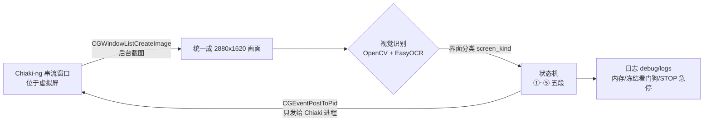

> 一句话概括：PS5 用 Chiaki-ng 串流到 Mac，Python 只“看”串流窗口的画面（OpenCV + EasyOCR），再把按键直接发给 Chiaki 进程，让《影之刃零》在铃铛旁**自动重置能力修行 → 重学两个节点 → 把饰品重新装回去**。每轮约 40 秒，每轮让饰品效果多叠一层；v10 起可以按一张清单，把多件饰品按顺序、按比例轮流叠。全程后台运行，Chiaki 放在一块 BetterDisplay 虚拟屏上，真实屏幕照常办公。

> 🎮 测试环境：PS5 Pro，《影之刃零》游戏版本 1.302.289。叠加 BUG 可能在后续版本中被修复，请以你手上的版本为准。

这是系列第二篇。第一篇做的是《龙之信条2》异界石自动送礼，底层的“后台截图 + 后台发键 + 看门狗”这次**原样复用**，所以这个项目从看录屏到第一版能跑只用了一个晚上。本文重点写**这次新遇到的问题**；Chiaki、BetterDisplay 的基础配置会写全，方便没看过上一篇的读者。

**本文结构**

1. 效果与整体架构（含叠加上限：封顶的是 100 倍——每层 +10% 时 990 层，每层 +20% 时 495 层）
2. 软件与库的准备（附官网下载地址）
3. PS5 网络：只断外网、保留局域网（防止游戏自动更新）
4. Chiaki-ng 配置与按键映射
5. BetterDisplay 虚拟屏：挂机和办公互不打扰
6. 自动化整体思路：菜单状态机
7. 视觉判断是怎么做的（界面分类、菜单高亮、格子光标、尘埃读数）
8. 踩坑全记录（v1 → v11，每版对应哪次日志；含“⌘O 事件”和一个还没完全查清的问题）
9. 完整代码 v11（先看“需要自己修改的地方”）
10. 人机协作：这次怎么让 AI 自己看录屏写代码
11. 经验总结

> ⚠️ 声明：本文只用于单机内容的学习与研究。叠加利用的是游戏的一个 BUG，随时可能被官方修复；串流和自动化操作请自行评估风险，长时间挂机注意主机散热。

---

## 1. 效果与整体架构

### 1.1 叠加原理（玩家实测）

在铃铛的【能力修行】里**重置所有修行**，会把【海纳百川·一式】多出来的那个饰品槽连同里面的饰品**强制卸下**（弹窗“饰品槽被重置，以上饰品已卸下”）。重学节点、再把**同一件饰品**装回去，这件饰品的效果就多叠一层。界面上不显示叠了几层。

这个方法是在 B 站看到的：[《影之刃零 无限叠加饰品属性 刷尘埃》](https://www.bilibili.com/video/BV1E3xm6hEFt/)，感谢 UP 主分享。不过实测下来它**并不是无限的**，有 100 倍的上限，换章节地图还会清零，详见 1.4 节。

后来想明白了这个 BUG 的本质：**重置把饰品卸下来了，但这件饰品的效果没有跟着撤掉**；重新学会节点、再装上，效果又加一次。所以**任何饰品都能这么叠**，不只是聚宝盆。

我最开始叠的是【聚宝盆】（意识尘埃掉落量 +10%），后来升级成【聚宝盆+1】（+20%）。v10 起，要叠哪些饰品、各叠多少层、谁先谁后，都写在一个清单文件里（见 6.3 节）。

### 1.2 一轮完整流程

| 段 | 操作 | 怎么确认成功 |
|---|---|---|
| ① 进修行 | 铃铛旁按 ○ → 铃铛菜单 → 光标移到【能力修行】→ ✕ | 出现宣纸背景、右下角“□重置 ○返回” |
| ② 重置 | □ 重置 →“将重置所有修行…”✕确定 →“饰品槽被重置，以上饰品已卸下”✕确定 | 尘埃 +10000 |
| ③ 重学 | → 移到【收放自如】按住 ✕（消耗 0）→ → 移到【海纳百川·一式】按住 ✕（消耗 10000） | 按钮条变“已修行”，尘埃 −10000 |
| ④ 退出 | ○ 回铃铛菜单 → ○ 回野外 | 菜单消失 |
| ⑤ 装回 | OPTIONS →【角色 → 装备】→ 饰品行第一个空格（标题“装备饰品”）→ ✕ → 列表里找到目标饰品 → ✕ → ○ | 那一格的标题就是目标饰品 |

一轮下来尘埃净变化为 0（重置返还 10000，重学再花 10000），饰品效果 +1 层。

### 1.3 实测效果

第一次整夜挂机（v2，11/05 23:55 ~ 11/06 04:57）：**471 轮，成功叠加 429 层**，每轮约 41 秒，内存一直稳定在 0.6~1.0 GB。失败的几十轮全是同一个原因（菜单淡入时按早了，见第 8 节），v3 修掉了。

之后的版本：v5 一次连续成功 **121 轮**，v6 一次连续成功 **110 轮**，中间没有一次失败。v10 在 11/08 一次连续跑了 7 小时 47 分钟：**695 轮全部成功、0 次失败**，平均每轮 **40.2 秒**（先叠完 10 件小饰品，再把聚宝盆+1 叠到 768 层）。11/05 晚到 11/06 晚，日志里一共成功叠了 **1,426 层**——后来才发现，其中大约 436 层是白跑的（见 1.4 节）。之后出去刷了一阵，日志里的意识尘埃读数从 86,650 涨到了 294,220，后来又到了 623,738。

### 1.4 叠加上限：封顶的是 100 倍，不是层数

视频标题说“无限叠加”，但我挂了一天之后发现，**效果最多到 100 倍就不再增加了**。

按每层 +10% 线性叠加来算（聚宝盆是“意识尘埃掉落量 +10%”）：

```text
倍数 = 1 + 0.1 × 层数
```

| 层数 | 按公式算 | 说明 |
|---|---|---|
| 100 | 11 倍 | |
| 500 | 51 倍 | |
| **990** | **100 倍** | 到顶 |
| 1,426（我实际叠的） | 143.6 倍 | 实测还是 100 倍 |

也就是说叠到 **990 层**（1 + 0.1 × 990 = 100）就封顶了，我多跑的约 436 层，按每轮 44 秒算，相当于白挂了 5 个多小时。

**叠满要多久？** 我把 11/05 ~ 11/07 的全部日志（21 份）统计了一遍：

| 统计口径 | 结果 |
|---|---|
| 成功的一轮 | 平均 **45 秒**（中位数 45 秒，最快 37 秒、最慢 85 秒，共 1,786 轮） |
| v7 及以前 | 每轮约 41 ~ 45 秒 |
| v8 / v9 | 每轮约 50 秒（多了断线检测、层数记录等检查）；v9 改成从列表末尾找饰品后约 41 秒 |
| v10 | 每轮约 **40 秒**（按位置矩阵走最短路径找饰品） |
| 算上失败轮和 □ 失灵时的等待 | 全部日志平均每层 **47 秒**；11/07 用 v9 跑的几次平均每层约 **55 秒** |

从 0 叠到 990 层（100 倍）：

| 按什么速度算 | 需要多久 |
|---|---|
| 理想情况：每轮 45 秒、一次不失败 | 990 × 45 秒 ≈ **12.4 小时** |
| 全部日志的实际平均：每层 47 秒 | ≈ **13 小时** |
| v9 的实际速度：每层 55 秒 | ≈ **15 小时** |
| v10 的实际速度（11/08，695 轮 0 失败）：每层 40.3 秒 | ≈ **11 小时**；聚宝盆+1 只要 495 层 ≈ **5.5 小时** |

所以一次叠满大约要挂**一整晚加半个白天**。如果中途换了章节地图被清零，就得重来一遍。

> 这里有个前提：每层是在原来基础上**加** 10%。如果是每层**乘** 1.1，叠到 49 层左右就已经 100 倍了；我是叠了很多层之后才发现封顶的，所以按“加 10%”计算更符合实测。

**封顶的是倍数还是层数？** 每层 +10% 时，990 层正好也是 100 倍，所以第一次分不出来。后来把聚宝盆升级成【聚宝盆+1】（每层 +20%），正好可以测：如果封顶的是 100 倍，`1 + 0.2 × 层数 = 100` → **495 层**就到顶；如果封顶的是层数（约 990 层），就能叠到约 200 倍。

11/08 把聚宝盆+1 叠到 **768 层**（按公式应该是 1 + 0.2 × 768 ≈ **155 倍**），打同样的敌人实测：

| 敌人 | 没叠时掉落 | 768 层时掉落 | 实际倍数 |
|---|---|---|---|
| 1 | 253 | 25,000 | **98.8** |
| 2 | 241 | 24,500 | **101.7** |

两个都是约 100 倍，离 155 倍差得很远。而且两个敌人原本掉得不一样、却各自正好放大了 100 倍——说明封顶的是**倍数**，不是尘埃数量，也不是层数。所以：

```text
每件饰品的层数上限 ≈ (100 - 1) ÷ 每层加成
```

| 每层加成 | 叠到 100 倍需要 |
|---|---|
| +5% | 1,980 层 |
| +10%（聚宝盆、筋力绑带+1） | 990 层 |
| +20%（聚宝盆+1） | **495 层** |

这次又多叠了约 270 层（495 → 768），按每轮 40 秒算约 3 小时——好在是专门为了测上限。其它饰品的效果大多不在界面上显示，测不出来，只能按这个公式估一个上限写进清单。

**其他注意事项**（会让叠好的效果消失的操作）：

- **不能跨章节地图传送**，否则叠加效果清零；同一章节的地图内一般可以随意传送。
- **例外：庞镇其实分成东西两个区。** 以后街牌坊为界，牌坊及以西是一个区，东侧的其他传送点是另一个区。看起来同属一章，但在东西两区之间传送，同样会丢失叠层（11/12 发现）。
- **不能重新加载 / 读档**；角色死亡不影响叠加状态。
- **叠过的饰品不要再动。** 11/08 解锁新技能后多了一个饰品位，我把之前叠过的饰品挪到了这个新位置，结果它叠的效果就没了。多出来的饰品位留空就行。

所以脚本加了“叠加上限”（v8 起，v10 改成每件饰品单独设）：

- 每件饰品的上限写在清单 `stack_plan.txt` 里（聚宝盆+1 写 495），到了就跳过这件，清单里全部到上限才停止；
- 累计层数按饰品名记在 `stack_count.json` 里，**跨多次运行累加**，停了再开接着算；
- 换章节地图后，双击 `reset_stack_count.command` 把所有饰品的计数清零。

### 1.5 整体架构



和上一篇一样，关键只有两点：**截图只截 Chiaki 窗口**（被遮挡也能截），**按键只发给 Chiaki 进程**（不经过前台）。脚本跑起来以后 Mac 照常用，键盘鼠标完全不受影响。

这次比龙信2简单得多：全程都在**固定位置的 2D 菜单**里，不用在 3D 场景里找人、寻路、转镜头。所以脚本里没有模板图片、没有标定，**全部判断都靠 OCR 读固定位置的文字，再加几个亮度特征**。

---

## 2. 软件与库的准备

### 2.1 软件清单

| 软件 | 用途 | 官网 / 下载 |
|---|---|---|
| macOS（Apple Silicon 推荐） | 运行一切；EasyOCR 可用 MPS(GPU) 加速 | — |
| PS5 +《影之刃零》 | 被控端，开启“远程游玩” | PS5：设置 → 系统 → 远程游玩 |
| **Chiaki-ng** | 开源 PS 远程游玩客户端，键盘可映射手柄 | GitHub：https://github.com/streetpea/chiaki-ng ，文档：https://streetpea.github.io/chiaki-ng/ |
| **BetterDisplay** | 创建虚拟显示器，Chiaki 放上去挂机 | https://github.com/waydabber/BetterDisplay |
| Python 3.10~3.12 | 运行脚本 | https://www.python.org/downloads/macos/ |
| PyCharm（可选） | 编辑调试 | https://www.jetbrains.com/pycharm/ |

### 2.2 Python 库

| 库 | 用途 | 官网 |
|---|---|---|
| opencv-python | 裁图、灰度、亮度统计、按列切分字符 | https://pypi.org/project/opencv-python/ |
| numpy | 图像数组运算 | https://numpy.org |
| easyocr | 中英文 OCR（菜单文字、节点名、饰品名、尘埃数） | https://github.com/JaidedAI/EasyOCR |
| torch | EasyOCR 的推理后端（Mac 上走 MPS） | https://pytorch.org/get-started/locally/ |
| pyobjc-framework-Quartz / Cocoa | 后台截图 + 给指定进程发按键 | https://pyobjc.readthedocs.io/ |

建议用虚拟环境（我的是 `~/venv`）：

```bash
python3 -m venv ~/venv
~/venv/bin/pip install opencv-python numpy easyocr torch pyobjc-framework-Quartz pyobjc-framework-Cocoa
```

**EasyOCR 模型**：第一次运行会自动下载到 `~/.EasyOCR`。网络不好可以手动下载 `craft_mlt_25k.pth`（文字检测）和 `zh_sim_g2.pth`（简体中文识别），放到项目的 `assets/easyocr/` 里，脚本会优先从这里读，并且不再联网下载（如果你和我一样有上一篇的 `DragonsDogma2/assets/easyocr/`，脚本也会自动去那里找）。模型下载页：https://www.jaided.ai/easyocr/modelhub/

### 2.3 macOS 权限（必做，否则截图全黑或按键无效）

系统设置 → 隐私与安全性：

- **屏幕录制**：勾选运行脚本的程序（“终端”或 PyCharm）。没有这个权限，截到的是黑图或只有桌面背景。
- **辅助功能**：同样勾选“终端”/PyCharm。给其他进程发按键（`CGEventPostToPid`）需要它。

改完权限要**重启终端 / PyCharm** 才生效。

### 2.4 项目目录

```text
PhantomBladeZero/
├── pbz_accessory_bot_v11.py     # 主脚本（最新版）
├── run_v11.command              # 双击：自动循环（清单全部叠完或手动停止）
├── run_v11_menu.command         # 双击：菜单选模式（单步测试 / 读列表 / 诊断）
├── run_v11_diagnose.command     # 双击：截一帧打印所有检测结果
├── stop_bot.command             # 双击：安全停止
├── test_imessage.command        # 双击：发一条测试 iMessage 到手机（见 6.4）
├── reset_stack_count.command    # 双击：所有饰品的累计层数和轮换进度清零（换章节地图后用）
├── stack_plan.txt               # ★ 叠加清单：叠哪些饰品、各叠多少层、比例（自己改）
├── stack_count.json             # 各饰品累计层数（脚本自动维护）
├── stack_state.json             # 第二阶段轮换到第几步（脚本自动维护）
├── stack_status.txt             # 每轮刷新的进度表（挂机时想看进度就打开它）
├── accessory_matrix.json / .txt # 饰品位置矩阵：列表里每格是什么、有没有红标（脚本自动维护）
├── reference/                   # 从录屏抽出的关键帧 00~15 + README（给 AI 看的“说明书”，见第 10 节）
├── debug/logs/                  # 每次运行的完整日志（自动保留最近 30 份）
├── history/                     # 前两个历史版本
└── assets/easyocr/              # （可选）OCR 模型
```

---

## 3. PS5 网络：只断外网、保留局域网

**为什么要断网**：游戏一旦检测到新版本，就**必须先更新才能启动**。这类 BUG 很可能在某个补丁里被修掉，所以我希望 PS5 停在当前版本；但 Chiaki 串流又需要 PS5 联网。

**思路**：让 PS5 **还连着路由器（局域网通）**，但**查不到任何网址（外网不通）**。Chiaki 在同一个局域网里直连 PS5，不需要外网。

> ⚠️ 不要直接在 PS5 上“断开网络”，那样局域网也断了，Chiaki 就连不上了。

### 3.1 准备（联网状态下先做好）

1. 设置 → 保存数据和游戏/应用程序 → 自动更新：关闭“自动下载”“自动安装”。
2. 设置 → 用户和账户 → 其他 → **主机共享和离线游玩：启用**（数字版离线验证授权要靠它）。
3. 设置 → 系统 → 远程游玩：启用；节能 → 待机模式中可用的功能：打开“保持连接网络”“从网络启用 PS5”。
4. **先在联网状态下用 Chiaki 完成注册并成功连一次**，再断外网。

### 3.2 手动 IP，DNS 填 0.0.0.0

先在 Mac 上看一下局域网信息（系统设置 → 网络 → 详细信息）：我的 Mac 是 `192.168.1.100`，子网掩码 `255.255.255.0`，路由器 `192.168.1.1`（我用的是网易 UU 加速盒，后台不支持按设备禁止上网，所以只能在 PS5 上做）。

PS5：设置 → 网络 → 设置 → 设置互联网连接 → 选中当前连接 → 高级设定：

| 项目 | 我的值 | 说明 |
|---|---|---|
| IP地址设定 | 手动 | |
| IPv4地址 | 192.168.1.200 | 同网段里没人用的地址（别和 Mac 撞） |
| 子网掩码 | 255.255.255.0 | 照抄 Mac 的；**千万别填成 IP 地址** |
| 默认网关 | 192.168.1.1 | 真网关 |
| 首选DNS / 备用DNS | **0.0.0.0** / 0.0.0.0 | 关键：查号台是空号，PS5 连索尼服务器的地址都查不到 |

测试网络连接：能获取 IP 地址、互联网连接失败，就对了。Chiaki 搜不到的话手动添加主机，填 PS5 的 IP。

> 也可以把默认网关填成一个不存在的地址（比如 `.254`）来断外网，效果一样。我最后用的是“真网关 + 空 DNS”，因为临时联网时只改一项就行。

### 3.3 临时恢复联网

把**首选 DNS** 改成 `192.168.1.1`（路由器）或 `223.5.5.5`，点 OK 即可；改回 `0.0.0.0` 就又断了。**联网期间不要启动游戏**，下载队列里如果出现了游戏更新，直接删掉。

---

## 4. Chiaki-ng 配置与按键映射

Chiaki-ng 的安装、PS5 注册（PSN 登录拿账号 ID、主机注册 PIN）、串流画质等基础配置，我在之前的文章里写过：

👉 [基础篇：Chiaki-ng 串流、虚拟屏与视觉识别通用配置](/2026/11/04/ps5-chiaki-mac-automation-basics.html)

本项目只用到下面几个键（Chiaki-ng → Settings → Keys），和上一篇龙信2是同一套映射：

| 手柄 | 键盘 | 脚本里的用途 |
|---|---|---|
| ✕ | `K` | 确认；**按住**完成修行 |
| ○ | `L` | 铃铛交互、返回 |
| □ | `J` | 重置修行 |
| 十字键 上/左/下/右 | `T` / `F` / `G` / `H` | 菜单、修行树、饰品格子移动 |
| R1 | `E` | 暂停菜单切页签（不在【角色】页时） |
| OPTIONS | `P` | 打开暂停菜单 |

> **11/09 起全部改成字母键。** 之前 □ 映射在分号 `;` 上，偶尔会在 Chiaki 里“卡住”：脚本按、我手动按都没反应，手柄直连 PS5 却正常；在 Chiaki 设置里把 Box 改成别的键再改回来就好了。回头看日志，出过问题的 □（`;`）和 ○（`'`）都是符号键，字母键从没出过问题，所以干脆把手柄按键全换成了字母。

你的映射不一样，就改脚本顶部的 `K_CROSS / K_CIRCLE / K_SQUARE / ...`。

**小心 Chiaki-ng 自己的串流菜单。** 按 **⌘O**（Windows/Linux 是 Ctrl+O）或手柄 **L1+R1+L3+R3** 会在画面底部弹出一条菜单：音量、Mic、Zoom、Stretch、画质预设（Default / High Quality / Custom）、Display，右下角是码率、连接的 PS5 地址和丢帧数（[官方文档](https://chiaki-ng.github.io/chiaki-ng/setup/controlling/)）。它开着的时候，**键盘输入全部被菜单接走，游戏收不到任何按键**；再按一次 ⌘O 关掉。脚本是怎么“不小心”按出它的，见第 8.1 节。

**窗口不能最小化。** macOS 对被最小化、被**完全**盖住、在别的桌面（Space）或显示器睡眠时的窗口**停止重绘**，截图会拿到一张“冻结”的旧画面。解决方法见下一节。

---

## 5. BetterDisplay 虚拟屏：挂机和办公互不打扰

### 5.1 为什么需要虚拟屏

Chiaki 放在主屏上，办公时窗口总会被盖住 → 画面冻结 → 脚本以为卡住了。虚拟屏就是一块“看不见的显示器”，Chiaki 单独待在上面，系统认为它“可见”，会一直绘制；你在真实屏幕上怎么盖窗口、切桌面都不影响。

### 5.2 创建虚拟屏

BetterDisplay 菜单栏图标 → **Create New Virtual Screen**：

| 设置 | 取值 | 原因 |
|---|---|---|
| 宽高比 | **16:9** | 和 PS5 输出一致，没有黑边 |
| 分辨率 | 我这次用的是 **2560×1440（HiDPI，实际 5120×2880 像素）** | 脚本会把截图统一缩放成 2880×1620 再识别，所有区域都用**比例坐标**，所以分辨率不用和我一致；但太小（视频宽 < 1600）文字识别会变差 |
| HDR | **关** | HDR 会改变亮度，亮度阈值会失效 |

### 5.3 把 Chiaki 放到虚拟屏上

1. 系统设置 → 桌面与程序坞 → 打开 **“显示器具有单独的空间”**。
2. 虚拟屏看不见，先把窗口挪过去：在 BetterDisplay 里临时把虚拟屏设为**镜像**，把 Chiaki 拖过去再取消镜像；或者开虚拟屏的**画中画**预览确认。
3. 在虚拟屏上让 Chiaki **全屏**。
4. 系统设置 → 显示器 → 排列：把虚拟屏拖到主屏的**斜对角**，两块屏幕只碰一个角。这样平时鼠标往右、往上推都会被屏幕边缘挡住，不会不小心滑到虚拟屏的 Chiaki 窗口上。
5. 脚本启动时会打印 `Chiaki 窗口所在屏幕：名字 / 是否虚拟屏 / 分辨率`，确认一下即可。我的日志：

```text
🖥️ [后台模式] Chiaki PID=20346 窗口ID=2213 | 截图 5120x2880px | 视频区域 x=0 y=0 5120x2880
🖥️ [后台模式] Chiaki 窗口所在屏幕: Virtual 16:9 #5 外接/虚拟屏 2560x1440pt / 5120x2880px
✅ [启动检查] Chiaki 画面正在刷新
```

### 5.4 防止睡眠

启动脚本用 `caffeinate -dims` 包住 Python：挂机期间显示器、磁盘、系统都不睡眠。另外建议 PS5 上隐藏“远程游玩连接”之类的通知，弹窗会挡住菜单文字。

---

## 6. 自动化整体思路：菜单状态机

### 6.1 四条原则（从龙信2继承）

1. **看到结果再走下一步**，不用固定 sleep。每个动作后都有一个“完成判据”，轮询 + 超时。
2. **判断界面只看固定位置的 UI**：顶部页签、右下角按键提示、按钮条、标题。这些位置和背景都是固定的，OCR 又快又稳。
3. **看不清就不按 ✕。** 识别函数要能返回“看不清”，看不清就等一下再看，绝不按推断按确认。
4. **每种界面都有回家的路**：任何一步失败，就 `escape_to_world()`（重置确认框按 ○ 取消、饰品槽框按 ✕、菜单按 ○，还在铃铛菜单就选【离开】），退回野外，这一轮作废重来。

### 6.2 自动停止条件

用户的要求是“手动停止，但异常要自动停”，所以：

| 情况 | 处理 |
|---|---|
| 某一步失败 | 退回野外，本轮作废；**连续 3 轮失败 → 停止** |
| 按 ○ 三次都打不开铃铛菜单 | 不在铃铛旁 → 停止 |
| 清单里某件饰品在列表里找不到 / 带红标（装在别的格子） | v10：**只跳过这一件**并在日志里写原因，其它饰品照常叠 |
| 尘埃少于 10000（学不起海纳百川） | 复读 5 次确认后停止 |
| 脚本内存 > 12 GB | 内存保险丝，停止 |
| 清单里每件都到了各自的上限 | 正常结束，自动停止 |
| Chiaki 串流断开（画面全黑 20 秒，或回到了主机列表） | 立刻停止，不再发任何键（主机列表里乱按可能误点 Delete / Wake Up） |
| 画面底部出现 Chiaki-ng 串流菜单 | 不算失败：脚本自己发 ⌘O 关掉（最多 3 次），关不掉就等，10 分钟还在才停止 |
| 某个键连按几次都没反应（目前只见过 □） | 先看是不是修行树“重置了但没学完”（这时按 □ 本来就没反应，直接重学）；真没反应才算失灵，不算普通失败：退回野外，依次停 60/120/240/480 秒再试，15 分钟都不行才停止 |
| 双击 `stop_bot.command` | 下一步检测到 STOP 文件，松开所有键、打印进度表后退出 |
| 在 PyCharm 里点 Terminate / 关掉终端窗口 | v10：收到 SIGHUP / SIGTERM 也按手动中断处理（松开按键再退出）；但如果紧接着被强制杀掉就来不及，所以平时还是用 `stop_bot.command` |

不管因为什么停止，脚本都会弹一条带提示音的 macOS 通知，写明停止原因，人不在电脑前也能在通知中心看到。

### 6.3 叠哪些饰品：一张清单（v10 起；v11 加了“预热”）

v9 以前脚本里只有一个 `TARGET_ACCESSORY`。明白了“什么饰品都能叠”之后，v10 改成读一个清单文件 `stack_plan.txt`，一行一件：

```text
# 名字  上限  [权重]  [先叠N]   （名字和游戏里显示的一样，升级过的带 +1；# 后面是注释）
# ---- 资源类 ----
聚宝盆+1      495  1000
# ---- 攻击类 ----
舞扇+1        333  3  先叠5
碧血云天+2    167  2  先叠5
筋力绑带+1    111  1  先叠5
追杀令+1      111  1  先叠5
妙手千钧+1    55   1  先叠5
破盾符+1      15
斩骑符+1      5
# ---- 辅助类 ----
弦音护符+1    25
珍玩妖织+1    12
...
```

规则分三步：

- **第一阶段**：上限 < 50 的小件（v11 起门槛从 100 改成 50），按上限从小到大，一件叠满再叠下一件，很快就过去了；
- **预热（v11）**：写了“先叠N”的，在第二阶段之前先轮流各叠到 N 层（每次挑层数最少的那件）。我给攻击类的大件都写了“先叠5”，这样叠聚宝盆的几个小时里中途去玩，攻击类也不至于太弱。预热的层数算进总数，上限不变；
- **第二阶段**：其余的按权重轮流。脚本把每件按权重重复几次排成一圈（比如 3/2/1/1 = 舞扇×3、碧血×2、筋力×1、追杀×1），`stack_state.json` 里记着走到了第几步，**每成功一轮才往前走一步**，失败不走，所以比例不会被失败打乱。聚宝盆写权重 1000，等于“先只叠它”，它叠满后其余按各自的权重轮流；
- **哪件到上限就跳过哪件**，其它照常；全部到上限自动停止；
- 清单**每轮开始前重新读一遍**，改完保存就生效，不用重启脚本。

日志每轮只打一行（目标、它的层数、第几阶段）；完整进度表只在启动和停止时打印，另外每轮写进 `stack_status.txt`，挂机时随时打开看：

```text
✅ 弦音护符  10/10  阶段1 本次+9
👉 聚宝盆+1  768/990  阶段2 ×1000 本次+686
   筋力绑带+1  0/990  阶段2 ×5
还剩 2544 层，按每层 40s 估算约 28.3 小时
```

名字用模糊匹配：OCR 把“+”读成“十”、错一个字（比如“浑源经脉仪”读成“浑源经豚仪”）都能认出来。饰品升级后会改名（聚宝盆 → 聚宝盆+1），旧名字的层数会自动转到新名字上。

### 6.4 停止时发 iMessage 到手机（v11）

挂机一跑就是十几个小时，人不可能一直守在电脑前。Mac 自带的通知只能在 Mac 上看到，所以我又让脚本在**停止时发一条 iMessage 到手机**：叠完了、出了异常、被手动停了，手机上都能马上看到。

**不用装任何东西。** 原理是让 Mac 自带的“信息”App 替你发消息：

```text
Python 脚本
  └─ subprocess（标准库，相当于在终端里敲命令）
       └─ osascript（macOS 自带的 AppleScript 执行器；OSA = Open Scripting Architecture）
            └─ AppleScript：tell application "Messages" to send ...
                 └─ “信息”App 用你登录的 Apple ID，经苹果的 iMessage 服务器发出 → iPhone 收到
```

准备工作：

1. Mac 的“信息”App 登录 Apple ID（Messages → Settings → iMessage）。
2. 脚本顶部 `IMESSAGE_TO` 填接收消息的**手机号**（`+86...`）或 **Apple ID 邮箱**，留空就不发。
3. 第一次发送时，macOS 会问“是否允许 终端 / PyCharm 控制‘信息’”，点允许。点错了就到“系统设置 → 隐私与安全性 → 自动化”里打开。

核心代码（号码和内容作为参数传给 AppleScript，消息里有引号、换行也不会出错；新旧版 macOS 的写法都兼容）：

```python
IMESSAGE_TO = ""   # 手机号（+86...）或 Apple ID 邮箱；留空 = 不发

IMESSAGE_SCRIPT = '''on run argv
    set toWho to item 1 of argv
    set msg to item 2 of argv
    tell application "Messages"
        try
            set svc to 1st account whose service type = iMessage
            send msg to participant toWho of svc
        on error
            set svc to 1st service whose service type = iMessage
            send msg to buddy toWho of svc
        end try
    end tell
end run'''


def notify_phone(msg):
    if not IMESSAGE_TO:
        return False
    import subprocess
    r = subprocess.run(["osascript", "-", IMESSAGE_TO, msg], input=IMESSAGE_SCRIPT,
                       text=True, capture_output=True, timeout=20)
    return r.returncode == 0
```

在主程序的 `try ... except ... finally` 里，每种退出方式都记一个原因，`finally` 里统一发出去：

```text
Phantom Blade Zero bot stopped
✅ Finished: every item in the plan reached its cap
This run: 1457 layers. Remaining: 0 layers (~0.0 h)
11-12 12:03
```

会发消息的情况：正常叠完、安全停止（按键失灵太久、串流断开、连续失败、内存保险丝）、双击 `stop_bot.command`、在 PyCharm 里点停止按钮（收到 SIGHUP / SIGTERM 也按手动中断处理）、程序崩溃（附错误类型）。只有 Mac 断电、死机时发不出来。另外加了一个 `test_imessage.command`，双击就发一条测试消息。

**踩过的坑：“Not Delivered”。** 11/13 突然所有消息都显示“未送达”，Mac 上连手动发的都失败，但 Mac 明明能上网、iPhone 上发消息也正常。排查下来是 **iPhone 上手机号的 iMessage 注册掉了**：

- iPhone“设置 → App → 信息 → 发送与接收”里，手机号一个勾不上、一个一直转圈（等激活），只有 Apple ID 邮箱是勾选的；
- 所以 Mac 的 iMessage 设置里也只剩邮箱（Mac 只显示已注册成功的地址），退出重新登录也没用；
- 发往这个手机号的 iMessage 自然送不出去（收件人名字变红）。

解决：`IMESSAGE_TO` 改成 **Apple ID 邮箱**，马上就能收到。手机号要重新激活：iPhone 上关掉 iMessage 等一会儿再打开，激活时 iPhone 会给苹果发一条国际短信，国内的卡可能要开通国际短信、等几个小时。

两点体会：一是**“能上网”不等于“iMessage 通”**，iMessage 走的是苹果自己的推送通道；二是 **osascript 返回成功只说明“交给信息 App 了”，不代表送达**，所以日志里写“已发送”，手机却可能没收到。真担心漏消息，可以再加一条备用通道（微信的 Server酱 / PushPlus，或 iPhone 的 Bark）。

---

## 7. 视觉判断是怎么做的

所有区域都是**视频画面的比例坐标**（按 1920×1080 录屏实测），运行时截图先统一成 2880×1620，再按比例裁。

### 7.1 界面分类 `screen_kind`

| 界面 | 判据 |
|---|---|
| 暂停菜单 | 顶部页签 OCR 出“地图/任务/角色/道具/读物/系统”里至少 2 个；左侧小标题“装备”= 装备页，“全部”= 饰品列表 |
| 能力修行 | 左侧宣纸亮（左侧中位亮度 ≥ 85，野外/暂停菜单只有 41~53）**并且** 右下角 OCR 出“返回” |
| 确认框 | 正文 OCR：“重置所有修行 / 是否继续” → 重置确认；“饰品槽被重置 / 已卸下” → 饰品槽框 |
| 铃铛菜单 | 菜单区域 OCR 出 ≥ 3 个已知行名（穿行/装备升级/买卖货物/能力修行/保存记忆/离开） |
| 野外 | 以上都不是 |

宣纸亮度是个很便宜的预筛：只有亮了才去做确认框和右下角的 OCR，省时间。

### 7.2 铃铛菜单：光标在哪一行？（v2、v3 两次改进）

这是这个项目最难的一步。最初的判据是“高亮行背后有一条深黑色墨迹”，录屏里墨迹亮度 26~38、其它行 60~100，很好分。

**但实际挂机的铃铛在暗室里**，每一行背后都很暗：高亮行 2、其它行 11~52，差值不够，v1 连续 3 轮“看不清高亮”停了。

v2 加了第二个判据：**高亮行文字左边有一个白色 ✕ 圆圈**。每行取文字左侧一个小框，算 97% 分位亮度：

| 场景 | 高亮行 | 其它行 |
|---|---|---|
| 暗室（实拍） | **253** | ≤ 74 |
| 亮场景（录屏） | **151** | ≤ 116 |

最亮比第二亮高 ≥ 30 就是它，和场景明暗无关。墨迹判据也放宽成“差 ≥ 15，或最暗一行 ≤ 第二暗的 60%”。两个判据都给出答案但不一致，才算看不清。

```python
hi = sorted(icon, key=icon.get, reverse=True)
by_icon = hi[0] if icon[hi[0]] - icon[hi[1]] >= 30 else None
lo = sorted(band, key=band.get)
b0, b1 = band[lo[0]], band[lo[1]]
by_band = lo[0] if (b1 - b0 >= 15 or (b0 <= 0.6 * b1 and b1 - b0 >= 5)) else None
if by_icon and by_band and by_icon != by_band:
    return None, vals                 # 两个判据矛盾 → 看不清
return (by_icon or by_band), vals
```

v3 又发现：**菜单是从下往上淡入的**，刚出现时 OCR 只认得出下面三四行。v2 把认出的第一行“买卖货物”当成光标所在行，又在高亮看不清时“按推断”按了 ✕，结果进了【装备升级】。v3 的做法：等 6 行都认出来（最多 3 秒，超时按行距 0.046 补齐漏掉的行），**只有亲眼看到高亮在目标行、隔 0.15 秒再确认一次才按 ✕**。

### 7.3 装备页和饰品列表：格子光标

选中的格子是**白底**，中位亮度 123~142，其它格子 ≤ 92。在已知的格子中心（比例坐标）算中位亮度，最亮的比第二亮高 ≥ 30 就是光标位置：

```python
EQ_XS = [0.107, 0.182, 0.258]          # 装备页三列
EQ_YS = [0.375, 0.497, 0.683, 0.805]   # 武器两行 + 饰品两行
LIST_XS = [0.120, 0.183, 0.247]        # 饰品列表
LIST_YS = [0.300, 0.415, 0.530, 0.645, 0.760, 0.875]
```

有了光标位置，`move_cursor()` 就是一个小的“视觉伺服”：看光标在哪 → 往目标方向按一下 → 再看。**连续 3 次按键光标都没动**才认为那个格子不存在（列表到底了）。

**找饰品：从“逐格找”到“位置矩阵 + 最短路径”。** 最早是从左上角逐格往后找，聚宝盆排在最后时每轮要多花 10 多秒。v9 改成先按 ↑ 绕到列表末尾再往前找（每轮从约 50 秒降到约 41 秒），但聚宝盆升级成 +1 后排到了前面，饰品也多到了 18 件、6 行，这招就不灵了。

v10 的做法：

1. **每次启动后第一次打开列表，完整读一遍**：每行按 → 读名字，读到绕回行首（或按两次都不动）这一行就完了；回到行首按 ↓ 换行，回到第一行（或不动）就读完了。每格的名字和左上角红标（= 装在别的格子）存成 `accessory_matrix.json`，再写一份 `.txt` 给人看，非目标饰品也都记下来，以后加新目标直接从这里抄名字。19 件、7 行读一遍约 33 秒。
2. **之后每轮按矩阵算最短按键**：换行先回到第 1 列（每行都有第 1 列），上下可以绕圈（第一行按 ↑ 到最后一行），最后往右。走到后 OCR 核对名字。
3. **走错了先分清原因**：读到的名字在矩阵里，而且是“这串按键里有几下没生效”能停到的格子 → 按键被吃了，从这里接着走；不是 → 列表变了（拿到新饰品、升级），重新读一遍。

整个过程**只认名字、不认格子坐标**，所以列表多到要往下滚动也一样能用（11/08 已经是 7 行，11/12 已经是 12 行、36 件）。11/08 跑的 695 轮里，只有 2 次“走到半路”需要接着走，没有一次找错。

v11 又补了几处细节，都是实际跑出来的问题：

- **名字晚一拍**：按 → 之后，右上角的名字有时要过一会儿才变。读列表时被当成“光标没动”又按了一下，就漏掉了一件（漏的是影动猎杀仪+1）。现在读到和上一件同名，先多等两次 0.5 秒再判断；读完再检查一遍：除了最后一行，每行都应该满 3 件，不满就重读。
- **重读前回不到左上角**：列表会滚动后，按格子坐标走回左上角会失败。现在先按名字在矩阵里定位、走最短路回去；还不行就按 ○ 关掉列表，在空格上再按 ✕ 重新打开（刚打开时光标一定在左上角）。
- **红标误判**：舞扇+1 的图标本身是一把红扇子，左上角也有红色，被当成“装在别的格子”跳过了。现在红标要和装备页饰品格里实际装着的饰品核对，饰品格里没有它就当误判；红色像素门槛也从 0.03 提到 0.06。

### 7.4 修行树：节点名 + 按钮条

修行树的节点不用认图标，光标停在哪个节点，右侧就显示它的名字。所以只要从【黑石】开始一直按 →，每按一下 OCR 一次标题，读到“收放自如”/“海纳百川”就停。学没学会看右下按钮条：没学是“按住✕消耗✦10000 完成修行”，学了是“已修行”。

### 7.5 尘埃读数：右对齐的数字会“往左长”（v4）

右上角尘埃数是右对齐的，右边缘固定在 x≈0.949。数字从 5 位变成 6 位时会往左长，固定的读数框就切掉了开头：**“304,220” 被读成 “4220”**，脚本以为尘埃不够、停止了。

v4 改成按列找字符：在 0.84~0.975 这一条里，和背景差 > 45 的列算“有字”，切成一个个字符块；**从最右边往左合并，字间距 ≤ 12px 就是同一个数字，遇到 ✦ 图标前约 26px 的大空隙就停**。再加两道保险：每次读 3 遍取多数；重置后尘埃比重置前还少 = 读错，不据此判断。

### 7.6 OCR 常见误读

| 原文 | OCR 读成 | 对策 |
|---|---|---|
| ✕（按钮条图标） | 囚 / & | 只用“按住/消耗/已修行”这些字判断 |
| ✦（尘埃图标） | 4 / # / + | 尘埃读数框排除图标；只取数字 |
| 海纳百川·一式 | 海纳百川'一式 / 海纳百川.一式 | 用片段匹配“海纳/纳百/百川” |
| 已修行 | **己修行** | `[已己巳]修行`，或含“修行”但没有“按住/消耗/收集/完成” |

---

## 8. 踩坑全记录

| 版本 | 日志现象 | 根因 | 改法 |
|---|---|---|---|
| v1 | 连续 3 轮“铃铛菜单高亮看不清”，没敢按 ✕ → 停止 | 挂机的铃铛在暗室，各行墨迹都很暗（高亮 2，其它 11~52），v1 要求差 ≥ 15 | 加 ✕ 图标判据（253 vs ≤ 70）；墨迹判据放宽 |
| v2 | 整夜 471 轮，**62 轮**“按了【能力修行】但没进修行页”，截图里进的是【装备升级】 | 菜单从下往上淡入，只认出 4 行就开始操作；把第一个认出的行当光标所在行；看不清时按推断按了 ✕ | 等 6 行都认出（超时按行距补齐）；只在看到高亮且二次确认后才按 ✕ |
| v2 | 1 轮：海纳百川其实学会了，按了 3 次后整轮作废 | OCR 把“已修行”读成“己修行” | `learned_text()` 兼容 |
| v2 | 2 次：“饰品区没有空格”“列表里找不到聚宝盆”（后者直接停了程序） | 暂停菜单刚打开时按键被吃掉，光标没动，2 次没动就放弃了 | 3 次没动才放弃、逐次多等 0.3 秒；进装备页先等 0.6 秒；找不到饰品连续 2 轮才停 |
| v3 | 尘埃 294,220 → 读成 4,220 → “尘埃不够”停止 | 尘埃涨到 6 位数，往左长，被固定读数框切掉开头 | 读数框按字符位置自动找；读 3 次取多数；不合理的读数不据此停止 |
| v4 | 脚本按 OPTIONS 之后，所有按键都没反应 → “不在铃铛旁”停止；截图底部多了一条 Mic/Zoom/Stretch 菜单 | 发出的按键带上了我当时按着的 ⌘：`o` 变成了 ⌘O，打开了 Chiaki 串流菜单（见 8.1） | 发键时把修饰键清零；识别 Chiaki 菜单，看到就自己发 ⌘O 关掉 |
| v5 | 跑一阵后某一个键彻底失灵（○ 或 □），其它键正常；重启脚本就好 | 当时判断是“松开”事件丢了，Chiaki 以为键一直按着 | 每次按下前补发一次松开；重试前松开所有键（v6） |
| v6 | 连续 110 轮后，□ 又失灵；松开所有键 6 次都没用 | **还没查清**：不是 Mac 这边卡键（见 8.2） | 不停机、能自愈：退回野外等 1~8 分钟再试，并在日志里记录等多久恢复（v7） |
| v7 | 一晚上叠了 1,426 层，实测效果早就停在 100 倍 | 叠加有上限，脚本只会一直跑 | 按 1 + 0.1 × 层数 算出 990 层上限，跨运行累计层数，到了自动停（v8，见 1.4） |
| v8 | 第 4 轮画面突然全黑，接着 Chiaki 回到主机列表；脚本以为“找不到聚宝盆”“打不开铃铛”，还在主机列表上按了几次 ○ | Chiaki 串流断开（PS5 那边连不上） | 识别断线（主机列表按钮 / 全黑 20 秒）→ 立刻停止、不再发键；停止时弹 macOS 通知（v9） |
| v9 | 重开后饰品列表变成 10 件，聚宝盆排在第 4 行第 1 格；脚本在第 3 行最后一格按 ↓ 光标不动，以为列表到底了，连续 2 轮“找不到聚宝盆”后停止 | 最后一行没排满时，从行末按 ↓ 下面没有格子，光标原地不动 | 换行前先回到本行第 1 格再往下走（v9 小修） |
| v9 | 按 ↑ 跳到列表末尾后，在最后一行两件饰品之间来回切换，一直不按 ✕ | 行末按 → 会绕回本行第 1 格，往右走到头的循环没有判断“绕回”，也没有步数上限 | 光标没往右走就停，最多走 3 步；往前找时每格都先确认光标位置 |
| v9 | 聚宝盆升级成 +1 后排到了第 2 行第 1 格，列表也变成 18 件、6 行，“从末尾找”不灵了 | 列表顺序不是“刚卸下的排最后”这么简单，升级后位置会变 | 先去上一轮找到它的那一格，对不上再从头找（v9 小修）；v10 改成位置矩阵 + 最短路径（见 7.3） |
| v10 | 想按清单叠多件、按比例轮流 | v9 只支持一件 | `stack_plan.txt` 两阶段 + 权重轮换；每件单独计数、单独上限；找不到 / 带红标的只跳过那一件 |
| v10 | 在 PyCharm 里点 Terminate 停脚本，日志停在“按 □”那一行，没有结尾 | 进程被直接杀掉，来不及松开按键、打印进度 | 收到 SIGHUP / SIGTERM 按手动中断处理；平时用 `stop_bot.command` 停 |
| v10 | 第 70 轮重置后找【收放自如】走过了头，之后每轮按 □ 都“没反应”，被当成 □ 失灵，白等 15 分钟 | 按 → 后节点名晚一拍才变，多按了一下；修行树停在“重置完、没学完”，没东西可重置，□ 本来就没反应 | 标题没变就再等 0.4 秒读；走过头往左找回；按 □ 没反应先看海纳百川学没学，没学就直接重学 |
| v10 | □ 真的没反应：脚本按、手动在 Chiaki 里按分号都不行，手柄直连 PS5 正常 | Chiaki 里符号键（`;`）的按键状态卡住，重新映射一下才好 | 手柄按键全部改成字母键（见第 4 节） |
| v10 | 聚宝盆+1 叠到 768 层，实测掉落只有约 100 倍（按公式该是 155 倍） | 封顶的是 100 倍，不是层数；每层 +20% 时 495 层就到顶 | 清单里聚宝盆+1 的上限改成 495（见 1.4） |
| v11 | 想在叠聚宝盆的几个小时里中途去玩，攻击类太弱 | 第二阶段一开始只叠聚宝盆 | 清单加“先叠N”：第二阶段前先给攻击类大件各叠 5 层（预热） |
| v11 | 妙手两件改成 55 层后，被当成小件插队先叠 | 第一阶段门槛是“上限 < 100” | 门槛改成 50；第二阶段一直按写的权重轮流 |
| v11 | 读列表漏了一件（影动猎杀仪+1），被当成“列表里没有”跳过 | 按 → 后名字晚一拍才变，被当成“没动”又按了一下 | 同名先多等两次 0.5 秒再判断；中间的行不满 3 件就重读 |
| v11 | 两次“读饰品列表：光标回不到左上角”，本轮作废 | 列表 9 行以上会滚动，按格子坐标走不回去 | 按名字走回去；不行就关掉列表重新打开 |
| v11 | 舞扇+1 被当成“装在别的格子”跳过 | 图标是红扇子，左上角的红色被当成红标 | 红标和装备页饰品格核对；红色门槛 0.03 → 0.06 |
| v11 | 停止时发到手机的 iMessage 全部“Not Delivered”，Mac 能上网、iPhone 发消息也正常 | iPhone 上手机号的 iMessage 注册掉了（发送与接收里勾不上 / 一直转圈），只剩 Apple ID 邮箱可用 | `IMESSAGE_TO` 改成 Apple ID 邮箱（见 6.4） |

还有一个和代码无关的坑：**跑错版本**。有一次的日志开头写着“v2”，是双击了旧的 `run_v2.command`。所以现在目录里只留最新版的启动脚本，前两个版本放进 `history/`，更早的放进 `_to_delete/`。

### 8.1 脚本发的 `o` 变成了 ⌘O

两次“所有按键都没反应”，都发生在脚本**刚好发了 `o`（OPTIONS）**的那一刻，之后画面底部多了一条 Chiaki-ng 的串流菜单。查了 Chiaki-ng 的文档才知道，这个菜单的快捷键是 ⌘O。

原因在发键的代码：用 `kCGEventSourceStateHIDSystemState` 创建的键盘事件，会带上**你当时在 Mac 上实际按着的修饰键**。脚本在后台挂机，我在前台正常用电脑，只要那一瞬间我按着 ⌘（⌘C、⌘Tab……），脚本发的 `o` 就成了 ⌘O。如果发的是 `q`，就是 ⌘Q——直接把 Chiaki 退出了。

修法就一行：发出前把修饰键清零。

```python
src = Quartz.CGEventSourceCreate(Quartz.kCGEventSourceStateHIDSystemState)
ev = Quartz.CGEventCreateKeyboardEvent(src, code, bool(down))
Quartz.CGEventSetFlags(ev, 0)          # 清掉 ⌘/⌥/⌃/⇧，脚本发的永远是“裸键”
Quartz.CGEventPostToPid(self.pid, ev)
```

另外加了一道保险：每轮开头和每次失败时，读画面底部有没有 Mic / Zoom / Stretch / Mbps / dropped frames 这些字（命中 3 个以上就是 Chiaki 菜单），看到了就自己发一次 ⌘O 关掉。⌘O 是开关键，**只在亲眼看到菜单时才发**，否则反而会把它打开。

> 中间还走了一段弯路：第一次修的时候把事件源换成了 `kCGEventSourceStatePrivate`，之后就开始出现“某个键彻底失灵、重启脚本才好”的情况。v6 把事件源换了回来，只保留“清零修饰键”。

### 8.2 还没解决的问题：□ 间歇性失灵

v6 连续跑了 110 轮之后，在修行页按 □ 又弹不出重置确认框了。同一轮里 ○、✕、OPTIONS、方向键全都正常，截图里也没有 Chiaki 菜单；把所有键松开再按，试了 6 次也没用。之前两次重启脚本、中间隔了 3 分钟左右，□ 就恢复了。

所以这不是 Mac 这边“键卡住了”，更可能是 PS5 / 串流那一侧 □ 的状态卡住，或者游戏本身有什么限制。根因没查清之前，v7 先做到两件事：

1. **不停机、能自愈**：□ 失灵时退回野外，依次停 60 / 120 / 240 / 480 秒不发任何键再试，15 分钟都不行才停止。
2. **收集证据**：哪次恢复了，日志里会写“✅ 失灵的键已恢复（共等了多少秒）”。

后来的日志给了答案：一次 □ 失灵时，等 60 秒还没好，再等 120 秒就自己恢复了（共 180 秒）。所以它确实是“等几分钟就好”，不是脚本发键的问题，v7 的退避等待能自动扛过去。具体是 PS5 / 串流那边还是游戏本身的原因，目前还不知道。

**11/09 找到了规律。** 这次 □ 又失灵时，我手动在 Chiaki 里按分号也没反应，但分号在 Mac 其他程序里正常，手柄直连 PS5 按 □ 也正常——问题出在 Chiaki 里分号这个键本身。在 Chiaki 设置里把 Box 改成 `U` 立刻就好了，再改回分号也好了：重新映射会让 Chiaki 重建按键状态。翻日志发现，出过问题的 □（`;`）和 ○（`'`）都是符号键，字母键一次都没出过，所以把手柄按键全改成了字母（见第 4 节）。具体 Chiaki 内部是怎么卡住的还不清楚，但换键之后可以继续观察。

另外，有几次“□ 失灵”其实是误判：上一轮重置后、重学节点时失败了，修行树停在“重置完、没学完”的状态，这时没有可返还的尘埃，按 □ 本来就不会弹确认框。v10 会先检查【海纳百川】学没学，没学就跳过 □ 直接重学。

> 写自动化脚本经常会遇到一时查不清的问题。这时别急着猜一个原因去改，先让程序**不停机、能自己恢复**，并且**把能区分几种猜测的证据记进日志**。

> 和龙信2一样，大部分问题说到底都是“**判断条件不够**”：v1 只看墨迹，v2 只看“认出了几行”，v3 只看“框里的数字”。每次都是日志里一个具体的现象，让我们给判断再加一个只有这个状态才有的特征。

---

## 9. 完整代码

### 9.1 使用前必须自己修改的地方

| 位置 | 改什么 |
|---|---|
| `stack_plan.txt` | 要叠哪些饰品、各自的上限和权重（格式见 6.3）；名字和游戏里显示的一致 |
| `RELEARN_NODES` | 重置后要重学的节点。我的号只学了“收放自如 → 海纳百川·一式”；你还学了别的节点，按顺序加进来（每个节点都是从左往右按 → 找），或者跑完自己重新加点 |
| `SLOT_COST` | 海纳百川·一式的尘埃消耗（10000） |
| `SMALL_CAP_LIMIT` | 上限小于它的算第一阶段（默认 50） |
| `IMESSAGE_TO` | 停止时把原因发到手机：填手机号（+86...）或 Apple ID 邮箱，留空 = 不发（见 6.4） |
| 每件饰品的上限 | 写在 `stack_plan.txt` 里，按“(100 - 1) ÷ 每层加成”估算（见 1.4） |
| `KEY_DEAD_WAITS` | 某个键失灵时依次等多少秒再试（默认 60/120/240/480） |
| `CHIAKI_MENU_WAIT_SEC` | Chiaki 串流菜单关不掉时最多等多久（默认 600 秒） |
| 按键 `K_CROSS / K_CIRCLE / ...` | 和你 Chiaki 的 Keys 设置一致 |
| `run_v11.command` 等里的 `PY=` | 改成你自己的 Python 路径 |
| `ROI_* / EQ_* / LIST_* / RED_BADGE_BOX` | 都是比例坐标，16:9 画面一般不用改；如果识别不到，先跑诊断模式看 `debug/debug_rois.jpg` 里框的位置 |
| 中文界面 | 所有 OCR 关键词都是**简体中文界面**的文字，其他语言要全部替换 |

### 9.2 运行方式

1. 角色站在铃铛旁边（能看到白色交互提示），不要打开任何菜单。
2. 首次：双击 `run_v11_diagnose.command`，分别在铃铛菜单、修行页、装备页各跑一次，看日志里的界面判断和 `debug/debug_rois.jpg`。
3. 写好 `stack_plan.txt`；不知道列表里都有什么，先跑 `run_v11_menu.command` → 6（跑 1 轮并读一遍饰品列表），再打开 `accessory_matrix.txt` 抄名字。
4. 单步测试：`run_v11_menu.command` → 1（进修行）→ 2（重置+重学）→ 3（退回野外）→ 4（装饰品）→ 5（跑 1 轮）。
5. 挂机：双击 `run_v11.command`；停止：双击 `stop_bot.command`。清单全部叠完会自己停。想停止时收到手机提醒，填好 `IMESSAGE_TO` 后先双击 `test_imessage.command` 试一下。
6. 换章节地图：双击 `reset_stack_count.command`，所有饰品的计数和轮换进度清零。单独改某一件：`~/venv/bin/python pbz_accessory_bot_v11.py --set-count 层数 --name 饰品名`。
7. 日志在 `debug/logs/`，出问题时把对应时间段的日志和 `debug/` 里的截图一起看。

启动脚本 `run_v11.command`：

```bash
#!/bin/bash
# 双击：影之刃零 饰品叠加 v11 —— 自动循环（一直跑，双击 stop_bot.command 停止）
cd "$(dirname "$0")" || exit 1
PY=/Users/你的用户名/venv/bin/python          # ← 改成你的 Python
"$PY" -c "import Quartz, AppKit" 2>/dev/null || "$PY" -m pip install -q pyobjc-framework-Quartz pyobjc-framework-Cocoa
caffeinate -dims "$PY" -u pbz_accessory_bot_v11.py --mode 0   # caffeinate：挂机期间显示器不睡眠
```

清零脚本 `reset_stack_count.command`：

```bash
#!/bin/bash
# 双击：把所有饰品的累计层数清零（stack_count.json），轮换进度也清零。
# 什么时候用：过了不同章节的地图、叠加效果被清掉之后。只想改某一件：
#   ~/venv/bin/python pbz_accessory_bot_v11.py --set-count 层数 --name 饰品名
cd "$(dirname "$0")" || exit 1
PY=/Users/你的用户名/venv/bin/python          # ← 改成你的 Python
"$PY" pbz_accessory_bot_v11.py --reset-all
sleep 3
```

`run_v11_menu.command` 和 `run_v11_diagnose.command` 只是最后一行不同：前者去掉 `--mode 0`（启动后选模式），后者是 `--mode 9`（诊断）。

停止脚本 `stop_bot.command`：

```bash
#!/bin/bash
# 双击：让正在运行的脚本安全停止（新建 STOP 文件，脚本下一步检测到就松开所有按键并退出）
cd "$(dirname "$0")" && touch STOP && echo "已发出停止信号，脚本会在几秒内安全退出。" && sleep 2
```

新建的 `.command` 文件要先 `chmod +x *.command` 才能双击运行。

### 9.3 主脚本 pbz_accessory_bot_v11.py

文件开头的注释里按版本写了每次改动对应哪次日志，可以和第 8 节对照着看。

完整代码约 2600 行，为了让博客加载和构建更快，单独放成了文件：

- 👉 [在 GitHub 上查看 pbz_accessory_bot_v11.py（带语法高亮、行号）](https://github.com/Geoffry-Librom/Geoffry-Librom.github.io/blob/main/code/pbz_accessory_bot_v11.py)
- 👉 [下载原始文件](/code/pbz_accessory_bot_v11.py)

---

## 10. 人机协作：这次怎么让 AI 自己看录屏写代码

上一篇总结过：和 AI 写自动化，最有效的输入是“**按流程编号的截图 + 每张写清四件事**”。这次往前走了一步：**我没有截图，只录了一段 49 秒的视频**，用 PS5 的录屏功能完整手动操作一轮，然后把视频交给 AI。

AI 做的事：

1. 用 ffmpeg 每秒抽一帧拼成九宫格，先看懂整体流程；关键几秒再每 0.25 秒抽一帧，确认每一步按了什么键、光标怎么移动。
2. 把 17 个关键帧按流程编号存进 `reference/`，每张在 README 里写清“**看到什么 → 怎么确认就是它 → 按什么 → 按完怎么确认成功**”。
3. 在这些帧上直接量出所有区域的比例坐标和亮度阈值，并用这些帧回放测试：界面分类、格子光标、菜单高亮在 17 张帧上全部判对之后，才交给我跑。
4. 只剩**画面里看不出来的东西**再问我：叠加机制对不对、要跑多少轮、退出铃铛是按 ○ 还是选【离开】、打开菜单用哪个键、按住 ✕ 要多久、键位是不是和上次一样。一共 7 个问题，我一次回答完。

之后的迭代和龙信2一样：**我挂机，AI 读日志和失败截图，每版只改有证据的问题**。这次 AI 能直接读我 Mac 上的 `debug/logs/` 和截图，我只需要说一句“看下日志”。

> 录屏比截图好的地方：**时序信息都在里面**。比如“菜单打开时光标默认在第一行”“修行树光标从【黑石】开始，按 → 就到收放自如”“按住 ✕ 大约 1 秒完成修行”，这些在静态截图里都看不出来。

当然录屏也有局限：录屏用的是亮场景的铃铛，实际挂机用的是暗室的铃铛，v1 的阈值就是在这里翻车的。**录屏时尽量就在挂机的那个位置录**，能省掉一个版本。

---

## 11. 经验总结

1. **底层一次写好，换游戏直接搬。** 后台截图、后台发键、冻结看门狗、内存保险丝、STOP 急停、日志存档，这次一行没改，新项目只写状态机。
2. **菜单类自动化优先用“固定位置的文字”当传感器。** 不用模板、不用标定，OCR 读标题和按钮条就能把状态机撑起来。
3. **亮度判据要有“和场景无关”的那一个。** 墨迹深浅会被场景明暗影响，白色 ✕ 图标不会；两个判据互相印证，比调一个阈值稳得多。
4. **淡入、动画是隐藏的时序坑。** 菜单刚出现时只显示一部分、按键会被吃掉。“看到完整的界面再操作”“按完确认它真的动了”，比加 sleep 可靠。
5. **不确定就别按确认，这条值得反复强调。** v2 唯一的系统性失败，就是一次“按推断按 ✕”。
6. **数字读数要考虑“会变”。** 位数变多、对齐方式、相邻图标都会让固定框失效；加合理性检查（重置只会让尘埃变多）能把读错的情况拦下来。
7. **录屏 + 让 AI 自己抽帧分析，是目前最省事的需求描述方式。** 再配上日志和失败截图，人只需要回答“画面里看不出来的问题”。
8. **后台发键要清掉修饰键。** 脚本在后台跑、人在前台用电脑，两边的按键会“串”在一起；`CGEventSetFlags(ev, 0)` 一行就能避免脚本按出 ⌘O、⌘Q。
9. **先确认“值不值得继续跑”。** 视频说“无限叠加”，我也就一直挂着，结果多跑了 400 多层。叠到几百层时花两分钟实测一下效果还涨不涨，能省下好几个小时；能算出上限的，就让脚本到了自己停。
10. **上限要搞清楚“封顶的是什么”。** 第一次只知道“990 层到顶”，分不清是层数还是倍数；饰品升级后每层加成翻倍，打两个敌人一算就清楚了：封顶的是 100 倍。能换一个变量再测一次的，就别只靠一组数据下结论。
11. **东西多了就“先建地图、再走最短路”。** 饰品从 1 件变成 19 件、要轮流叠，逐格找就太慢了。读一遍列表建位置矩阵，之后按矩阵走、按名字核对、对不上再重建——和游戏里先建导航网格、再寻路是一个思路。
12. **串流按键尽量用字母键。** 符号键在 Chiaki 里出过两次“卡住”，字母键从没出过；按键常量集中写在脚本顶部，换键位只改一处。
13. **查不清的问题，先让程序能自愈、再收集证据。** □ 失灵的根因还没找到，但脚本已经能自己等它恢复，日志也会告诉我们等了多久。

如果你也在做 PS5 / 其他串流游戏的自动化，欢迎在评论区交流 🙌
